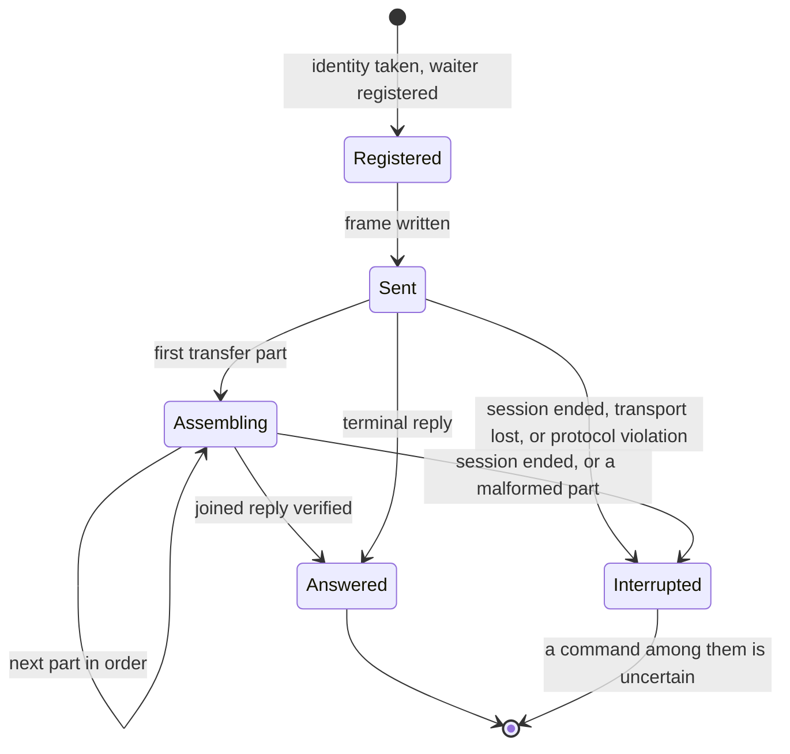
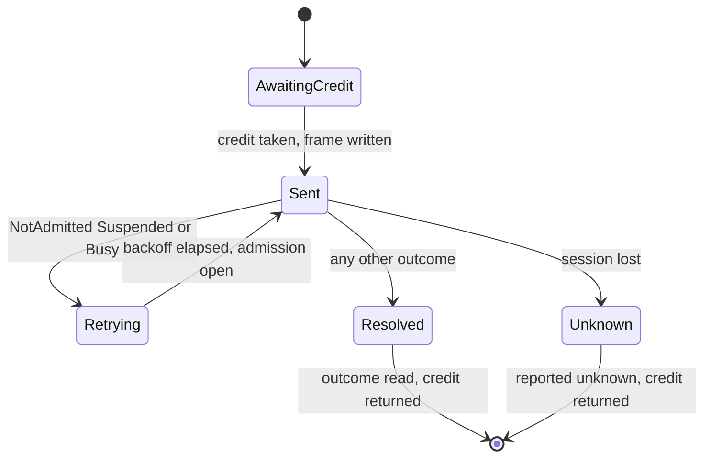

# Client Implementation Manual

*Plexus, the Nervix graph definition language.*

This manual is the normative contract for a program that speaks the Nervix client session protocol.
It states what an implementation must do to frame and verify messages, correlate requests, recover
commands exactly, follow the leader, hold a transaction, read subscriptions without misreading a
value, publish batches through producers, upload resources, and download backups. [Client Session Protocol](./client-session-protocol.md) explains why
the system behaves this way. This manual does not repeat those reasons, and the chapter does not
repeat these rules.

The Rust client, `nervix-client-core`, is the reference implementation. The shared host runtime
exposes it through the C ABI of `nervix-client-ffi` to C and C++ hosts, the native Ruby gem
`nervix-client` to Ruby hosts, the Python package `nervix_client` to CPython hosts, and the JNI
library `nervix-client-jvm` to JVM hosts. A host
that uses a binding inherits every rule below from it except its host-specific rules in
[Using The C ABI](#using-the-c-abi), [Using The Python Package](#using-the-python-package),
[Using The Ruby Gem](#using-the-ruby-gem), and [Using The JVM Library](#using-the-jvm-library).
An implementation that speaks the protocol itself, as the Go and TypeScript conformance clients
do, follows all of it.

The Rust reference implementation's execution modes and native/browser capability boundaries are
specified in [Execution Primitives](./execution-primitives.md). Those repository build and
verification contracts apply to the Rust implementation; independent clients continue to implement
the protocol rules in this manual using their own runtime.

## Conformance Language

The key words **MUST**, **MUST NOT**, **SHOULD**, and **MAY** are used as RFC 2119 defines them.
Each rule has an identifier, such as `F-3`, which [Conformance Evidence](#conformance-evidence) ties
to the executable tests that exercise it. An implementation conforms when it follows every **MUST**
and **MUST NOT** rule for the parts of the protocol it uses. It MAY implement a subset, for example
commands without subscriptions, and MUST NOT send a request whose replies it does not handle.

The protocol has one current form: no version negotiation, no compatibility mode, and no fallback
encoding. An implementation MUST be generated from, or checked against, the
`crates/client-wire/schema/session.fbs` of the server release it talks to.

## Messages At A Glance

Every request is a `ClientMessage` carrying a request identity and one `ClientRequest`. The server
answers each request with one terminal `Reply`, possibly delivered as transfer parts:

| Request | Served on | Served by | Terminal reply body |
| --- | --- | --- | --- |
| `CommandRequest` | Ordered lane | The leader, except for the reads the chapter lists | `CommandOutcome` |
| `AttachTransactionRequest` | Ordered lane | The leader | `AttachOutcome` |
| `SubscribeRequest` | Ordered lane | Any node | `SubscribeOutcome` |
| `UnsubscribeRequest` | Ordered lane | The session's node | `UnsubscribeOutcome` |
| `AttachDomainClockRequest` | Ordered lane | Any node | `DomainClockAttachOutcome` |
| `DetachDomainClockRequest` | Ordered lane | The session's node | `DomainClockDetachOutcome` |
| `OpenIngestorRequest` | Ordered lane | Any node | `OpenIngestorOutcome` |
| `SubmitBatchRequest` | The producer's task | The session's node | `SubmissionOutcome` |
| `CloseIngestorRequest` | The producer's task | The session's node | `CloseIngestorOutcome` |
| `OpenEmitterRequest` | Ordered lane | Any node | `OpenEmitterOutcome` |
| `ReadEmitterBatchRequest` | Concurrently | The session's node | `ReadEmitterBatchOutcome` |
| `SettleEmitterBatchRequest` | Concurrently | The session's node | `SettleEmitterBatchOutcome` |
| `CloseEmitterRequest` | Concurrently | The session's node | `CloseEmitterOutcome` |
| `SuggestRequest` | Concurrently | Any node | `SuggestOutcome` |
| `ChoiceLookupRequest` | Concurrently | Any node | `ChoiceOutcome` |
| `ListDomainsRequest` | Concurrently | Any node | `DomainList` |
| `SelectDomainRequest` | Concurrently | Any node | `DomainSelectionOutcome` |
| `InspectTransactionRequest` | Concurrently | The leader | `InspectionOutcome` |
| `CancelRequest` | On arrival | Any node | `CancelOutcome` |

Any request may instead end with `RequestRejected`, or with `RequestCancelled` when a cancellation
targeted it. A command sent to a follower is served there only when it is one of the reads the
chapter lists in [Which Requests Need The
Leader](./client-session-protocol.md#which-requests-need-the-leader); every other command is
answered with a `LeaderRedirect` disposition.

Unsolicited `ServerMessage` bodies carry no request identity:

| Body | Meaning |
| --- | --- |
| `LeadershipObserved` | Which node leads, first on every session and again on every change |
| `DomainsObserved` | The domain list, second on every session and again on every change |
| `DomainSnapshotObserved`, `ClusterObserved` | The selected domain's live graph and entities, and the cluster summary, after `SelectDomainRequest` |
| `ServerNotice` | Text for display at `Info`, `Warning`, or `Error`, of one kind: `Membership`, `Leadership`, `ClusterParameters`, `Runtime`, or `ControlPlane` |
| `SubscriptionRows`, `SubscriptionDeliveryLost`, `SubscriptionRowsSkipped`, `SubscriptionEnded` | Frames of one subscription generation |
| `DomainClockObserved`, `DomainClockTicked`, `DomainClockAttachmentEnded` | State, accepted tick progress, and end frames of one domain clock attachment |
| `ProducerAdmissionChanged`, `ProducerEnded` | The admission state and the end of one producer |
| `SessionEnding` | The last frame of a session the server ends |

A client that presents notices MUST route each by its `kind`, as [What A Session Is
Told](./client-session-protocol.md#what-a-session-is-told) defines the kinds, and MUST NOT derive
meaning from a notice's text, which is for display only.

A `Membership` notice describes the serving node's observation of a join, leave or incarnation
change. A command's application progress is internal node-to-node traffic; its client-visible
completion is the correlated command outcome under
[Commands And Execution Identity](#commands-and-execution-identity). Notice delivery has its own
bounded, gap-reporting stream and supplies no command outcome.

An upload is a separate call with its own frames; see [Resource Uploads](#resource-uploads). So is
the download of a backup's archive; see [Backup Downloads](#backup-downloads), and a restore with its
archive; see [Restore Streams](#restore-streams).

## Frames

- **F-1.** An implementation MUST read and write every frame with code generated from `session.fbs`
  by `flatc`, or with code checked against it. It MUST NOT renumber, reorder, or omit schema
  members.
- **F-2.** It MUST send exactly one finished frame per transport message, that is one gRPC message
  or one WebSocket binary message, finished with its root's file identifier, `NXCM` for a
  `ClientMessage` and `NXUM` for an `UploadMessage`, and without a size prefix. It MUST NOT split a
  frame across messages, join frames in one message, or send a WebSocket text message.
- **F-3.** Before it reads any field of a received frame, it MUST check that the frame is at most
  the frame limit of 4 MiB, at least 8 bytes long, and carries the expected identifier, `NXSM` on a
  session and `NXUR` for an upload reply. Where its FlatBuffers runtime has a verifier, it MUST
  verify the frame with a nesting limit of 64, a table limit of the frame length divided by 4, and
  an apparent-size limit of 8 times the frame length. Where its runtime has none, as for Go and
  TypeScript, it MUST check every union discriminant, required field, and required value it reads,
  and MUST treat a read that its runtime fails, such as an offset outside the frame, as a protocol
  violation.
- **F-4.** It MUST treat as a protocol violation a `NONE` or undeclared union discriminant, an
  undeclared enum value, a missing required field, an absent optional scalar that a schema comment
  requires, a zero that a schema comment forbids, and an empty collection that a schema comment
  forbids. It MUST NOT skip such a value, default it, or map it to another one.
- **F-5.** It MUST keep an absent optional scalar, declared `= null`, distinct from a present zero,
  both when it reads one and when it writes one. For example, it omits
  `expected_transaction_position` when it expects no position and writes `0` when it expects
  position zero.
- **F-6.** It MUST NOT send a frame above 4 MiB, a string above 64 MiB, a vector above 262,144
  entries, or tables nested deeper than 64.
- **F-7.** It MUST reassemble `TransferPart` replies into one reply per request identity. It MUST
  refuse a part that names another request identity or another total, a first total above the
  transfer limit of 64 MiB, a part whose offset is not the number of bytes received so far, and an
  empty chunk. It MUST verify the joined bytes as a `ServerMessage` frame under the transfer limit
  that holds a `Reply` to the same request whose body is not itself a transfer part. It MUST accept
  other frames between the parts of one reply, and MUST NOT deliver a partial reply.
- **F-8.** On a protocol violation it MUST stop reading the session, end every request still waiting
  on it as interrupted, and treat every command among them as uncertain under [Commands And
  Execution Identity](#commands-and-execution-identity). It MAY open a new session.
- **F-9.** A value read in place borrows the frame it was read from. An implementation MUST keep the
  frame alive and unchanged while any such value is in use, and MUST copy what must outlive it. It
  SHOULD copy a small frame out of a large receive buffer before retaining it, as the Rust gRPC
  codec does below 64 KiB, so a retained frame does not pin the whole buffer.

## Transports And Authentication

- **T-1.** A native client MUST open a session as the bidirectional gRPC stream
  `/nervix.session.Session/Exchange` over HTTP/2, and an upload as the client stream
  `/nervix.session.Session/UploadResource`. Each message MUST be one raw frame, not a protocol
  buffer, and uncompressed. It SHOULD set its gRPC message size limits to the frame limit.
- **T-2.** A server address MUST be an `http` or `https` origin whose path is `/` and that has no
  query, fragment, or user information, as an advertised `grpc_uri` is. A client that started over
  `https` MUST NOT follow a redirect or a seed to `http`.
  A native client that resolves a hostname to one or more addresses MUST retain the original URI
  authority and verify the TLS certificate against that hostname on every connection, including
  redirects and reconnects. DNS and address attempts MUST fit within the client's connection
  deadline.
- **T-2a.** Native client-core, the CLI and native bindings use the cryptography boundary's explicit
  `fips` cipher/group set by default. A cluster's outward policy governs its listeners and shared
  connector TLS, not a client's offers; an embedding host's process provider does not replace that
  native default. Trust roots, certificate identity, hostname verification, ALPN and deadlines
  retain their independent contracts. Read [Algorithm Policy](cryptography.md#algorithm-policy)
  for membership and the boundary between algorithm selection and a validated deployment.
- **T-3.** A WebSocket client MUST connect to `/console/ws` on the leader's console endpoint, using
  `ws` for an `http` endpoint and `wss` for an `https` one, and MUST send binary messages only. It
  MUST treat a close with code `1003`, `1007`, `1008`, or `1009` as a defect in what it sent.
- **T-3a.** A WebSocket client MUST carry each backup download on its own connection to
  `/console/backups/download`, and each restore attempt on its own connection to
  `/console/backups/restore`, with exactly the frames of the `DownloadBackup` and `RestoreBackup`
  calls. A download connection carries one request. A restore connection MUST stay open after its
  last chunk, whose bytes complete the size its start declares, until the reply arrives: closing
  it would end the attempt in transport. A client MUST treat a close with code `1001` on either
  connection as a transport failure, after which A-6 and W-5 apply, and a close with code `1011`,
  which the server sends when it cannot put an answer into one frame, as a failure of the server.
- **T-4.** A native client MUST send `authorization: Basic <base64(user:password)>` metadata on
  every call, including every upload. A WebSocket client MUST present the same credentials in an
  `Authorization: Basic` header or in the `auth` query parameter, percent-encoded, because the
  server decodes the query as a form and would read a raw `+` as a space.
- **T-5.** On `UNAUTHENTICATED`, or `401` for the WebSocket, a client MUST NOT retry with the same
  credentials automatically. The server paces a presented name's attempts after a failure even
  when that name identifies no user; a delay does not identify an existing user. `UNAVAILABLE`, or
  `503` for the WebSocket, means the node could not verify the credentials now and judged nothing,
  so a client MAY retry with the same credentials after backing off, as it does after any other
  transport failure.
- **T-6.** A client MUST NOT resend a frame that ended its call with `OUT_OF_RANGE` or `INTERNAL`,
  because the server found the frame oversized or malformed.
- **T-7.** A WebSocket client MUST expect its session to end with a `SessionEnding` whose reason is
  a `LeaderRedirect` whenever its node does not lead. It then reconnects to the named leader's
  `web_console_uri` with the path `/console/ws`, or backs off and retries when the redirect names no
  endpoint.
- **T-8.** A client MUST NOT rely on keepalives or an idle timeout, since neither side sends
  keepalives, and MUST bound every wait with a deadline of its own.
- **T-9.** A client MUST treat an upload, restore or download call that ends with `UNAVAILABLE`
  before its reply or its last frame as a call that failed in transport. A node that stops ends
  every such call it has not answered that way, and the call's outcome is then uncertain as U-5,
  W-5 and A-6 describe.

## Requests, Replies, And Cancellation

- **C-1.** A request identity MUST be non-zero and unique within its session, and MUST NOT be reused
  after its request's terminal reply. A counter that starts at 1 on every new session satisfies
  this. A client that exhausts the 64-bit range MUST open a new session.
- **C-2.** A client MUST register the waiter for a request before it sends the request's frame.
- **C-3.** A client MUST route every `Reply` by its request identity alone. An unsolicited body
  never completes a request. A reply whose identity no request is waiting for, because its caller
  stopped waiting, MUST be discarded and MUST NOT complete any other request.
- **C-4.** A client MUST expect exactly one terminal reply per request. After a `SessionEnding` or
  the end of the transport, no reply follows for any request still in flight.
- **C-5.** A client MUST NOT send a request identity that is in flight. The server answers such a
  duplicate with `DuplicateRequestId` under that same identity, and the original request's own reply
  still follows, so the two cannot be told apart.
- **C-6.** A client SHOULD NOT have more than 64 requests in flight on one session. A request
  refused with `TooManyRequestsInFlight` was not admitted and MAY be sent again once an earlier
  request has its terminal reply. Completion, choice lookup, domain selection and transaction
  attachment consume places in the same window as commands. Superseding or abandoning a sent
  request's result does not free its place; account for it until its terminal reply or the end of
  the session, without retaining unwanted reply payloads.
- **C-7.** A client MUST read and route replies whatever the application does with unsolicited
  frames. Every queue of unsolicited frames MUST be bounded, and a full queue MUST drop events and
  report the loss rather than stop the reader.
- **C-8.** A client MUST act on `RequestRejected` by its reason:
  - `InvalidRequest`, `UnsupportedRequest`, `UnsupportedValue`, and `DuplicateRequestId` report a
    defect in the request. The client MUST NOT send it again unchanged.
  - `TooManyRequestsInFlight` is covered by C-6.
  - `ReplyTooLarge` says the complete reply cannot be carried. Repeating an unchanged read returns
    the same result; a command's outcome is recovered by its execution reference like any lost
    reply.
  - `ServerBusy` answers a read, which a client MAY repeat later.
- **C-9.** A client MAY cancel a request with a `CancelRequest` that has an identity of its own. It
  MUST expect `CancelOutcome` under the cancellation's identity and, when that outcome is
  `Requested`, the target's own terminal reply as well, in either order. That reply is
  `RequestCancelled` or the target's ordinary reply. `BeforeAdmission` means the target has no
  effect. `AfterAdmission` means its effect continues and is recovered by its execution reference,
  except that a domain clock attach answered so attaches nothing (K-1). A client MUST NOT present a
  cancellation as undoing anything.
- **C-10.** A client that stops waiting without sending `CancelRequest` MUST treat the request
  exactly as a cancellation after admission: the effect may happen, and a command's outcome is
  recovered by its execution reference.
- **C-11.** A reply that names a request still waiting for its reply MUST be of a kind that answers
  that request: its own outcome, `RequestRejected`, or `RequestCancelled` for any request but
  `CancelRequest` and `SubmitBatchRequest`, as
  [Which Replies Answer A Request](./client-session-protocol.md#which-replies-answer-a-request)
  lists. A client MUST check the kind before it applies anything the reply carries, and MUST treat
  a reply of any other kind as a protocol violation under F-8. It MUST NOT adopt the subscription,
  clock attachment, producer, transaction or redirect such a reply carries. A reply whose request
  no longer waits is routed under C-3, whatever its kind.

## Structured Choice Lookups

- **Q-1.** A client that sends `ChoiceLookupRequest` MUST use the target's typed dependencies:
  domain for internal schema, branch, relay, codec, VHOST, signaling protocol, JSON/CBOR/AVRO wire
  schema, or resource choices;
  domain followed by a relay `Model` reference for relay fields; domain followed by a codec
  `Model` reference for the fields of its output schema; and domain followed by a
  `Resource` reference for completed resource versions. It MUST use the distinct wire-schema
  targets when a form requires an exact format. An ingestor-reference target MUST carry a
  domain and MUST match the selected connector and entity; the `HTTP ENDPOINT` and
  `WEBSOCKETS ENDPOINT` targets return endpoints of that `TYPE`, and the others return clients of
  the pair's connector. The ingestor codec target carries a
  domain and returns only decoding codecs. Its unbranched relay target carries a domain, while its
  branched relay target carries a domain followed by a branch `Model` reference. Ingestor error
  relays use the unbranched target. A branch-field lookup carries a domain followed by a branch
  `Model` reference. Decoded and relay output fields
  use the codec-field and relay-field targets above. Processor compatible-input, input-branch
  output, and materialized-relay targets each carry a domain followed by the first input relay's
  `Model` reference. The first requires the same named schema and branch, the second the same
  branch, and the third a relay with materialized state in that branch. A junction's first input
  uses the ingestor relay target for its selected branch; a reingestor's first input uses the
  ordinary relay target. Reingestor routes that construct a different branch use the ingestor
  relay and branch-field targets. An emitter-reference target carries a domain and offers only
  the client connectors its entity declares; a client consumer instead uses the schema target.
  The Iceberg catalog target uses its declared catalog-client option. An emitter encoding-codec
  target carries a domain and selects encoding-capable codecs; its schema may differ from the
  inputs because construction builds the output. A compatible-input target carries a domain
  followed by the first input relay and requires its exact named schema while allowing different
  input branches. Emitter materialized-state
  and error-relay targets carry a domain followed by every selected input relay, in input order;
  candidates must match every input's exact branch declaration, and materialized candidates must
  declare materialized state. Schema-field targets carry a domain followed by the output schema.
- **Q-2.** A client MUST use the returned `ChoiceValue`, rather than its presentation label, for
  selection. For completed resource versions it MUST handle `ResourceVersionNumber` and
  `LatestResourceVersion` as distinct values. It MUST NOT offer a version absent from the result as
  a completed upload. It MUST treat `MissingContext`, `StaleContext`, and `LookupFailed` as distinct
  outcomes, and MUST restart a paged lookup after `StaleContext` rather than reuse its cursor.

## Routing Statements

A client that accepts Plexus text sends some statements as requests of their own rather than as
commands. Sent as a command, each of these is refused with `RequestFailed` naming the request to
use.

| Statement | Sent as |
| --- | --- |
| `USE <domain>` | Nothing: it sets the domain the client puts in later requests. A client MAY send `SelectDomainRequest` to receive that domain's observations and to learn whether it exists. |
| `LIST DOMAINS` | `ListDomainsRequest` |
| `CREATE SUBSCRIPTION ...` | `SubscribeRequest` carrying exactly that statement |
| `DELETE SUBSCRIPTION <name>` | `UnsubscribeRequest` |
| `ATTACH DOMAIN CLOCK` | `AttachDomainClockRequest` for the selected domain |
| `DETACH DOMAIN CLOCK` | `DetachDomainClockRequest` for the selected domain |
| `UPLOAD RESOURCE ...` | An `UploadResource` call |
| `BACKUP ...` | `CommandRequest`, then a `DownloadBackup` call for the archive its outcome summarizes; a browser makes the call over a console WebSocket of its own |
| `RESTORE ...` | A `RestoreBackup` call that carries the statement and the archive it names; a browser makes the call over a console WebSocket of its own. Sent as a command, it is refused. |
| `DESCRIBE BACKUP ...` | Nothing: the client reads the archive file itself. Sent as a command, it is refused. |
| Every other statement | `CommandRequest` |

- **L-1.** A client MUST put the selected domain in every `CommandRequest`, or leave `domain` absent
  when none is selected. The server keeps no selected domain for commands.
- **L-2.** A client MUST send a statement from the table above on its own. It MUST NOT send several
  statements in one `CommandRequest` outside a transaction, and MUST NOT combine
  `DESCRIBE TRANSACTION` or `SHOW TRANSACTIONS` with any other statement.
- **L-3.** While it holds a transaction, a client MUST NOT send `SubscribeRequest`,
  `UnsubscribeRequest`, `AttachDomainClockRequest`, or `DetachDomainClockRequest`, which the server
  refuses then, and MUST NOT change its selected domain, which every request of the transaction must
  name.

## Commands And Execution Identity

An instance placement identity carries an unsigned 64-bit index in the `PlacementUnit` union;
partition indices remain unsigned 32-bit values. Client encoders and decoders preserve the full
instance index when reporting transaction impact and execution placement.

Named placement creation, alteration and removal are model mutations, including a rule with
domain-wide coverage. Exact `PARTITION` and `INSTANCE` relocation selectors retain their unit
identity in previews and execution reports. A failed policy or selector validation is an ordinary
failed command; the client preserves its diagnostic and does not retry invalid input.

Structured WASM inspection carries a `units` collection. Clients preserve each unit identity and
its own generation, reset, recovery and checkpoint details; a processor's partitions can have
different generations. Checkpoint and recovery detail limits apply to the complete response.

Treat client CONFIG validation refusals as ordinary failed commands under the rules below.
Show their client/key diagnostic without retrying invalid input automatically. A refused queued
statement leaves its transaction usable. `SHOW CREATE CLIENT` and structured-choice previews mask
confidential configuration with `********`; do not use those inspection strings as a lossless
configuration export. The backup contract carries complete configuration.

- **E-1.** A client MUST create one execution reference per logical command before it first sends
  that command. The reference MUST be 1 to 128 bytes of ASCII letters, digits, `-`, `_`, and `.`.
  For every command that can be persistent or part of a transaction, which is every command except
  the reads [Exact Recovery](./client-session-protocol.md#what-is-recorded) lists, it MUST be a
  UUIDv7 whose timestamp is the client's current time; a reference that is not one is refused before
  any effect. A client SHOULD use a UUIDv7 for every command.
- **E-2.** A client MUST keep the reference together with the exact query text, the domain, the
  expected transaction position, and the expected preview until the command's outcome is known.
  Every repetition MUST send all of them unchanged, under a new request identity. Explicit backup
  recovery MAY change the client-local archive destination as A-8 specifies; its server capture
  inputs and selected domain MUST remain unchanged.
- **E-3.** A client MUST NOT create a new reference for a command whose outcome is uncertain. It
  MUST repeat the command under the same reference until it receives a terminal disposition, or give
  up and report the outcome as unknown, naming the reference.
  An applying execution retains the finished transactions its recovery needs even beyond their
  configured tombstone age; transaction retention does not require a new execution reference.
- **E-4.** A client SHOULD stop repeating a reference well before the retry validity, 15 minutes by
  default, has passed since the reference was created, and its clock SHOULD stay within five minutes
  of the cluster's. A repetition after the record was reclaimed is refused with
  `ExecutionReferenceExpired`. A client MUST NOT present that refusal as the outcome of the
  original command, and MUST decide from the disposition rather than the message text.
- **E-5.** A client MUST check that the `execution_reference` of a `CommandOutcome` equals its
  request's reference, and MUST treat a mismatch as a protocol violation.
- **E-6.** A client MUST act on each disposition as this table requires:

| Disposition | Required action |
| --- | --- |
| `CommandCompleted` | Report success. `already_existed` means nothing changed. |
| `RequestFailed` | Report the failure with its message and diagnostics. |
| `LeaderRedirect` | Nothing was admitted. Follow [Leader Redirect And Reconnect](#leader-redirect-and-reconnect), then repeat under the same reference. |
| `TransactionDetached` | Attach the named transaction again, then repeat under the same reference. |
| `TransactionTakenOver` | Report it. The client MUST NOT attach the transaction back automatically. |
| `OutcomeUnknown` | Back off and repeat under the same reference until another disposition arrives. The client MUST NOT report success or failure from it. |
| `ExecutionReferenceConflict` | Report a defect in the client's use of references. The client MUST NOT repeat the request. |
| `ExecutionReferenceExpired` | Report the original command's outcome as unknown. |
| `PreviewStale` | Nothing was applied, and the transaction stays open. The client MUST NOT commit again against the current preview without the user's decision. |

- **E-7.** A client MUST report a request of several statements from its `statements`, one outcome
  per statement in written order. The command's own disposition is that of the statement that ended
  it.
- **E-8.** A client MUST treat `origin` as information only. A `Recovered` outcome is the outcome of
  the command, with the message and diagnostics recorded when it happened.

An unknown outcome from an interrupted finalization is subject to E-3 and E-6. Its message can
describe effects that already applied; the typed disposition still requires recovery under the
retained reference, query and transaction expectations.

An `OutcomeUnknown` reply alone does not require a new connection, including when its cause is
`LeadershipLost`: the serving node may still lead with an unconfirmed lease. Keep the open session
and its attachments while backing off and repeating the command in issue order. Follow a later
leader redirect or session ending, and recover the session when its transport ends. The Rust client
uses this distinction, and the console uses its existing 250-millisecond to five-second reconnect
delay range independently for each uncertain command; unrelated replies and events continue to be
processed during that wait.

This includes a WASM state reset interrupted while publishing its generation. Recovery uses the
same reference and can finish the existing reset; creating a fresh reference would request another
reset. A genuine reset failure arrives as `RequestFailed` and follows the failure rule above.

## Leader Redirect And Reconnect

- **D-1.** On a `LeaderRedirect` that names the leader with an endpoint, a client MUST open a
  session at `grpc_uri` for a native client, or at `web_console_uri` for a WebSocket client. Before
  it repeats a request that belongs to a transaction, it MUST attach that transaction on the new
  session.
- **D-2.** On a `LeaderRedirect` that names no leader, or a leader without the endpoint the client
  needs, a client MUST back off and try again. It MUST NOT construct an address the redirect did not
  name.
- **D-3.** A client SHOULD remember a bounded set of endpoints it learned from redirects and
  `LeadershipObserved`, and try them, and its configured seeds, when its session is lost.
- **D-4.** A client MUST bound every call with a deadline of its own. When a deadline passes before
  a command's outcome is known, the client MUST report the command as uncertain, naming its
  reference, and never as failed or completed. The Rust client keeps the last nonterminal answer's
  typed disposition and message in the report chain when one arrived before the deadline; that
  answer remains diagnostic evidence rather than a completed outcome.
- **D-5.** After it loses a session, a client that restores session state MUST, in this order: open
  a new session; attach the domain clocks it follows; open the subscriptions it keeps again, each as
  a new generation, reporting the gap; attach its transaction; and only then repeat outstanding
  commands under their original references. It MUST have sent every clock attach and subscription
  of the new session before it sends the transaction attach, because a session that holds a
  transaction refuses both.
- **D-6.** A client MUST treat `SessionEnding`, the end of the transport, and a protocol violation
  alike: every request in flight ends without a reply, and every command among them is uncertain.

## Transactions

- **X-1.** A client MUST send `BEGIN` with the selected domain, which must already exist, and MUST
  keep the transaction identity from the outcome's `transaction` status as the transaction's handle.
- **X-2.** Every request that appends to the transaction the session holds MUST carry
  `expected_transaction_position` set to the `accepted_operations` of the newest status the client
  received for that transaction; that is `0` right after an empty `BEGIN`. A request of several
  statements carries the position of its first append. The client MUST advance the position only
  from an outcome that reports it.
- **X-3.** A client MUST report an append as accepted only from its own outcome: `CommandCompleted`
  under its own reference, carrying a `transaction_admission`. It MUST report a commit only from the
  outcome recorded under the commit's own reference. It MUST NOT infer either from the transaction's
  state or counts, including `COMMITTED`.
- **X-4.** A client SHOULD send `COMMIT` with `expected_preview` set to the preview identity the
  user reviewed: the one from the last append's admission, or from an inspection of the attached
  transaction at its current position. An inspection runs on the concurrent lane, so its report can
  already include an append whose outcome has not arrived; the client MUST keep that preview under
  the position the report names and use it once the append's outcome reports that position, rather
  than discard it. It MUST NOT refresh that preview from a `PreviewStale` reply, from an inspection
  of another transaction, or from an inspection at an older position. The planning basis includes
  the committed cluster-parameter record and revision, so a publication can invalidate a reviewed
  preview even when its queued Models still fit the limits. A client MUST NOT replace that
  reviewed identity from an informational parameter-change notice.
- **X-5.** While a commit is `COMMITTING`, a client MUST keep waiting for the commit's own outcome,
  repeating the commit under its reference after any interruption, including an
  `OutcomeUnknown(StillApplying)` reply from a failed execution attempt. A later `COMMITTED` or
  `FAILED` transaction status does not stand in for the outcome under that reference.
- **X-6.** On `TransactionDetached`, a client MUST send `AttachTransactionRequest` for the
  transaction, adopt the domain of the attached transaction, and repeat the command under the same
  reference and position. `TransactionAlreadyFinished` reports the final status and aggregate
  outcome of a transaction that ended; the client MUST NOT treat it as the outcome of an outstanding
  append or commit. After a finished or failed attach, the client MUST repeat each outstanding
  command under its own reference and original position to obtain its recorded outcome or a
  definitive failure for a command that was never admitted. If the session still held a transaction
  whose tombstone has been removed, a COMMIT, REVERT, or attach reporting that transaction unknown
  releases the server binding. The client MAY then begin a new transaction in that session. It MUST
  keep recovering an earlier uncertain command under that command's original reference; an unknown
  result for a new request is not proof of the earlier command's outcome.
- **X-7.** Ending a session cleanly, by half-closing the gRPC request stream or sending a WebSocket
  close with no request in flight, reverts the open transaction the session holds. A client MUST end
  a session that way only when it intends that revert. An append or commit whose `OutcomeUnknown`
  the client has not yet repeated to a definitive outcome may never have been admitted, so ending
  the session cleanly then discards the transaction with it. Any other ending leaves the transaction
  open for a later attach. The server reports that revert to no one, and a revert it cannot record
  leaves the transaction open until it expires; a client that must know the transaction ended sends
  `REVERT` and ends the session after its outcome.
- **X-8.** A client MUST expect an open transaction to expire after its idle timeout, 15 minutes by
  default, whether or not a session is bound to it. Only attaching, appending, and commit admission
  renew it.
- **X-9.** A client MUST NOT assume a read is linearizable. A read served by any node reflects that
  node's applied state. Once a command completes, its effect is visible through each node in the
  leader's completion participant set. A node the leader has retired can serve an older state until
  it catches up.

## Subscriptions

- **S-1.** A client MUST open a subscription with `SubscribeRequest` naming the domain, carrying
  exactly one `CREATE SUBSCRIPTION` statement, and setting `subscription_type` to `Row` explicitly.
  It MUST handle both dispositions of the reply: `SubscriptionOpened`, and `SubscriptionRefused`
  with its typed refusal, which opened nothing.
- **S-2.** A client MUST record the handle and schema of `SubscriptionOpened` in the frame reader
  itself, before it routes any later frame, because the subscription's rows can follow the reply
  immediately.
- **S-3.** A client MUST route every subscription frame by its complete handle, the name together
  with the generation. It MUST ignore a frame for a handle it does not hold, MUST NOT apply a frame
  of one generation to another, and MUST expect the `SubscriptionEnded` of an earlier generation to
  arrive after the opening reply of a later generation with the same name.
- **S-4.** A client MUST treat `SubscriptionEnded` as the last frame of its generation. After
  `RelayChanged`, it MUST NOT read later rows against the ended generation's schema, and subscribes
  again to read the relay under its current definition. A client that keeps subscriptions across
  sessions MUST NOT open an ended generation again on a later session; only a new subscribe under
  the same name opens it, as a new generation. It MAY complete the deletion of an ended subscription
  without sending `UnsubscribeRequest`, because the server keeps an ended name only until it is
  reused or its session ends.
- **S-5.** A client MUST surface `SubscriptionDeliveryLost` and `SubscriptionRowsSkipped` as gaps
  with their counts, and MUST NOT present the rows around a gap as continuous.
- **S-6.** After `UnsubscribeOutcome` reports `SubscriptionDeleted`, nothing about that generation
  follows, and the client MAY reuse the name at once.
- **S-7.** A client that keeps a subscription across sessions MUST open it again as a new generation
  on the next session, unless the server ended it (S-4), and report the time between as a gap. Its
  reopening MUST carry, as `expected_schema`, the schema the generation it replaces announced. If
  its user deletes a subscription while an opening or reopening is in flight, a late successful
  reply MUST be followed by an unsubscribe before the name is used again. When the new session
  refuses the reopening as `RelayNotFound` or `DomainNotFound`, the client MUST end the subscription
  as `SubscriptionEnded` with `RelayRemoved` would, and when it refuses it as `RelayChanged`, as
  `RelayChanged` would; S-4 then holds for it. When the session refuses the reopening for any other
  reason, the client MUST report the refusal with its typed cause and SHOULD send it again on that
  session after a wait that grows with each refusal, rather than at a fixed rate. A reopening left
  unanswered past the request timeout ends that session. Its reader MUST be woken even when the
  transport remains connected, and MUST open the next session to restore the desired subscription;
  the unanswered request is not a server refusal to retry on the ended session. A client MUST
  complete the deletion of a subscription no open session holds, because the session that held it
  ended or the current session refused to open it again, without sending
  `UnsubscribeRequest`, and MUST release its name; a deletion whose session ends before it is
  answered is complete too.
- **S-8.** A client MUST bound what it retains for subscriptions, per subscription and in total, and
  SHOULD let one subscription retain at least one frame of the frame limit.
- **S-9.** A client that stops reading a `BLOCKING` subscription holds back the relay it reads. A
  client that cannot keep up SHOULD use `DROPPING` delivery.

## Reading Rows

The reply that opens a subscription carries a `RowSchema`: the relay's fields in declared order,
each with its name, type, nullability, and sensitivity, and, exactly when the relay is branched, the
declared branch with its key fields. Every later batch is positional against that schema.

- **R-1.** A client MUST read a `RowBatch` only against the schema of the generation its frame
  names.
- **R-2.** Before it exposes any value of a batch, a client MUST check the batch against that
  schema, and MUST treat a batch that does not conform as a protocol violation:
  - a batch of a branched relay carries a `branch_key`, and a batch of an unbranched relay carries
    none;
  - a row holds exactly one cell per schema field, and a branch key exactly one cell per key field,
    in declared order;
  - a sensitive field holds `RedactedCell` in every row, and no other field does;
  - only a nullable field holds `NullCell`;
  - every other cell holds exactly the cell type of its field's declared type, and a fixed-length
    list holds exactly its declared number of elements;
  - a list element is never `NullCell` or `RedactedCell`.
- **R-3.** A client MUST NOT convert a value to another type while reading it. An integer keeps its
  width and signedness, a `DATETIME` is signed nanoseconds since the Unix epoch in UTC, a `STRING`
  is UTF-8 that may contain NUL, and a `BYTES` value is raw octets that may be empty or not UTF-8.
- **R-4.** A client MUST keep a null value, a withheld value, and a present value distinct in its
  data model. A presentation MAY render a withheld value as a placeholder such as `"<masked>"`.
- **R-5.** A client MUST keep the exact bits of `F32` and `F64` values, including the sign of a
  negative zero and the payload of a NaN, wherever its data model can hold them.

| Declared type | Cell | Value |
| --- | --- | --- |
| `U8`, `U16`, `U32`, `U64` | `U8Cell`, `U16Cell`, `U32Cell`, `U64Cell` | Unsigned integer of that width |
| `I8`, `I16`, `I32`, `I64` | `I8Cell`, `I16Cell`, `I32Cell`, `I64Cell` | Signed integer of that width |
| `F32`, `F64` | `F32Cell`, `F64Cell` | An optional scalar that is always present, so a negative zero keeps its sign |
| `BOOL` | `BoolCell` | Boolean |
| `STRING` | `StringCell` | UTF-8 text |
| `BYTES` | `BytesCell` | Raw octets |
| `DATETIME` | `DatetimeCell` | Signed Unix nanoseconds in UTC |
| Fixed-length list | `ListCell` | Exactly the declared number of elements, each a cell of the element type |
| Variable-length list | `ListCell` | Any number of elements, each a cell of the element type |

### Language Pitfalls

The conformance report carries values chosen to break careless readers: every integer width at both
extremes, 64-bit values on both sides of JavaScript's safe-integer boundary, an absent and a
present-zero optional value, text with multi-byte characters and an embedded NUL, bytes that are not
UTF-8, empty text and bytes, `-0.0`, the smallest subnormal and the largest finite floats by their
bits, the extreme `DATETIME` nanoseconds, and a redacted field. The corpus adds lists, a NaN with a
payload, infinity, and nullable and sensitive branch key fields.

| Runtime | Pitfall | Required handling |
| --- | --- | --- |
| JavaScript and TypeScript | A `Number` holds 53 bits of integer precision. | Read `U64`, `I64`, `DATETIME`, request identities, generations, and counts as `BigInt`. |
| JavaScript and TypeScript | JavaScriptCore, which Bun runs on, canonicalizes a NaN it materializes as a `Number`; V8 keeps the payload. | Read a float's bits from the buffer as an unsigned integer when the bits matter, instead of calling the generated `value()` accessor. |
| JavaScript and TypeScript | `Date` has millisecond precision and a narrower range than the protocol's nanoseconds. | Keep a `DATETIME` as a `BigInt` of nanoseconds. |
| Java and other JVM languages | There are no unsigned primitive types. | JNI preserves a `U64` in a `long`; compare and print it with the unsigned `Long` operations. Generations, identities, unsigned offsets and durations use the same bit-preserving rule. Values read from the binding's column copies are raw bytes of the declared width, so widen a `U8`, `U16`, or `U32` without sign extension. |
| C and C++ | Strings may contain NUL, and the binding never terminates them. | Use the length every accessor returns; never treat a value as a C string. |
| Python | A `memoryview` borrows memory it does not own. | Keep the object that owns the buffer alive for as long as the view is used. |
| Every runtime | A borrowed value reads the frame it was verified in. | Keep the frame alive, and unchanged, while any borrowed value is used, and copy what must outlive it. |

## Domain Clock Attachment

- **K-1.** A client MUST attach with `AttachDomainClockRequest` and detach with
  `DetachDomainClockRequest`, each naming the domain. It follows each domain at most once. It MUST
  handle every disposition: `DomainClockAttached` with the clock, `DomainClockAlreadyAttached`,
  `DomainNotFound`, and `DomainClockAttachRefused` with its typed refusal for an attach;
  `DomainClockDetached`,
  `DomainClockNotAttached`, and `RequestFailed` for a detach. `DomainClockNotAttached` means the
  session does not follow that clock, and the client MUST stop following it as it does after
  `DomainClockDetached`. An attach answered `RequestCancelled` attaches nothing, so the client MUST
  NOT follow the clock on its account; a detach answered `RequestCancelled` with `AfterAdmission`
  has detached. A client that attaches clocks again on its own, as K-5 requires, MUST NOT decide to
  send such an attach while a detach of the same domain is unanswered, and MUST send an attach it
  decided on before that detach ahead of it, so that the detach reaches the attach's session behind
  it or finds that session ended. Once the detach is answered, no session then holds the clock on
  the client's behalf.
- **K-2.** A client MUST apply the clock in the attach reply before any state or tick frame for
  that domain. The attach reply's state, or a later `DomainClockObserved` for a changed generation,
  MUST be applied before a `DomainClockTicked` of that generation. It MUST ignore frames about a
  domain it does not follow and MUST treat
  `DomainClockAttachmentEnded` as the last frame about that attachment.
- **K-3.** A client MUST treat each `DomainClockObserved` as the newest installed clock and clear
  an older generation's tick or any tick when the clock is not paced. It MUST retain only the newest
  accepted `DomainClockTicked` per domain and generation, ignoring a tick id that does not advance.
  State changes and tick ids can be coalesced, so it MUST NOT expect every intermediate state or
  tick. It MUST discard unread ticks when it detaches or loses the session.
- **K-4.** A client MUST read the tick generation and id as nonzero unsigned 64-bit integers; its
  logical boundary, authority UTC observation, and serving-node logical reading are signed 64-bit
  Unix nanoseconds. A clock's generation is an unsigned 64-bit integer that is zero before the
  domain's first `START`. Period and skew are unsigned 64-bit nanoseconds, the period is nonzero,
  and the time rate is a required positive finite double. `DomainClockAttachmentEnded` always
  carries its reason. The serving-node reading anchors the tick when the client's UTC differs from
  the cluster's. [Domains And Time](./domains-and-time.md#following-a-domain-clock) defines the
  projection a client computes from a paced clock.
- **K-5.** After it loses a session, a client that follows clocks MUST attach them again, and MUST
  NOT assume it saw the changes or ticks made in between. It MUST clear the old tick frontier until
  the new attachment reports accepted progress. It MUST treat `DomainClockAlreadyAttached` as the
  session holding the attachment, keep the clock it last received without a tick, and read the clock
  from that session's later frames. A node that is still starting answers such an attach only once
  it has installed the committed domains, so `DomainNotFound` in reply means the domain no longer
  exists, and the client MUST end the attachment as `DomainClockAttachmentEnded` would. When the
  session refuses the attach for any other reason, as `DomainClockAttachRefused` or by rejecting the
  request, the client MUST keep the attachment interrupted rather than drop the domain, MUST report
  the refusal with its typed cause, and SHOULD send the attach again on that session after a growing
  wait. An attach the session leaves unanswered past the client's request timeout ends that session,
  as any request that outlives the timeout does, and the client attaches the clock again on its next
  session; a client waiting for clock events MUST then open that session rather than wait for the
  ended session's transport to fail. When a new session answers the attach while the previous
  session still holds the attachment, as after a leader redirect, the client MUST move the
  attachment without a gap: it keeps the newest tick of a clock that stays paced in the same
  generation, and ignores a tick of the new session that does not advance it.

The Rust-backed CLI applies these lifecycle rules to its dedicated observers. Its `subscribe`
process finishes after the terminal subscription event, including one discovered while restoring.
Its `domain-clock` process keeps reading after a recoverable session-opening failure; one expired
retry budget does not end the attachment. Ctrl-C closes an interrupted observer without reopening
a session solely to detach. [CLI streaming](client-tools-cli.md#streaming-a-relay) owns their exit
statuses and operator-facing output.

## Producers

- **P-1.** A client MUST open a producer with `OpenIngestorRequest`, naming the domain, the
  ingestor, the exact fields it expects, including each field's optionality and sensitivity, and
  positive credit no larger than 1,024 batches and the committed producer session-byte cap
  (32 MiB by default). It MUST handle both dispositions:
  `Opened` with the producer's description, and `Refused` with a `ClientProducerRefusal`. It MUST
  NOT open a producer while its session holds a transaction.
- **P-2.** The producer's identity is the request identity of its open. A client MUST start
  following that producer before the open's waiter completes, so the admission changes and end that
  the server sends after the reply find it, and it MUST ignore frames about a producer it does not
  follow.
- **P-3.** A batch MUST be one canonical Arrow IPC stream: the schema message, exactly one record
  batch, and the end-of-stream marker, uncompressed, without dictionary or extension encodings, and
  with exactly the fields of the producer's description in Nervix's Arrow representation and
  without field metadata. It MUST carry at most `max_batch_rows` rows and `max_batch_bytes` bytes of
  the grant.
- **P-4.** A client MUST track the credit its batches hold: each takes one of the granted batches and
  its size of the granted bytes from the moment it is sent until its outcome is read. It MUST NOT
  send a batch that does not fit; the server refuses it as `CreditExceeded` and ends the producer
  as `ProtocolViolated`.
- **P-5.** A client MUST expect exactly one `SubmissionOutcome` per batch and MUST NOT report
  completion before `Completed` arrives; transport receipt is not an outcome. It MAY send a batch
  again only when its outcome is `NotAdmitted` with `Suspended` or `Busy`, only while admission is
  open, and only after the ingestor's declared backoff, which starts at `retry_backoff` and doubles
  up to `retry_max_backoff`. It MUST NOT send again, by itself, a batch whose outcome is
  `ProcessingFailed` or `OutcomeUnknown`, or one refused for any other reason. A batch sent again
  follows every batch sent since, so a client that needs submission order MUST NOT have more than
  one batch outstanding.
- **P-6.** A client MUST stop sending new batches while the newest `ProducerAdmissionChanged` says
  `Suspended`. Admission changes are coalesced, so it MUST NOT expect every intermediate state. It
  MUST treat `ProducerEnded` as the last frame about the producer, every batch of which has already
  received its outcome.
  It MUST continue reading outcomes for admitted batches during an alteration's suspension,
  including buffered partial batches. It MUST retain their credit until their outcomes arrive;
  suspension and a failed alteration do not authorize replay or a replacement producer.
- **P-7.** A client MUST NOT send `CancelRequest` for a submitted batch; the server refuses it with
  `InvalidRequest`, and the batch's outcome still follows. A caller that stops waiting MUST leave the
  outcome retrievable, so it is never lost.
- **P-8.** A client MUST close a producer with `CloseIngestorRequest`, and MUST expect every batch's
  outcome before the close's reply. When its session is lost, it MUST report every batch sent without
  an outcome as of unknown outcome and MUST NOT resend any such batch. A client retaining a desired
  producer MAY open a new attachment on a new exchange only after its `START` generation, endpoint
  contract, fields, policy and grant match the original description. The new open uses a fresh
  request identity. A changed contract or generation, a removed or stopped endpoint, or a schema
  mismatch requires an explicit new producer. A temporary capacity or owner refusal MAY be retried
  with bounded physical backoff. `EndpointUnavailable` while the serving node establishes its
  process-start catch-up proof, or while the node executing the ingestor has not installed it again
  after a restart, is such a temporary refusal. Close and drop MUST win over an in-flight
  restoration.

## Emitter Consumers

- **E-1.** A client MUST open a `TO CLIENT` emitter with `OpenEmitterRequest`, naming its domain,
  emitter and exact ordered output fields, including optionality and sensitivity. It MUST supply
  nonzero batch and byte limits; the requested byte limit MUST hold one maximum-sized IPC batch.
  An open inside a transaction is refused. The open's `request_id` becomes its `ConsumerId`.
- **E-2.** A client MUST continue reading transport frames while an application waits for
  consumer credit or processes an output batch. A pending `ReadEmitterBatchRequest` does not
  acknowledge delivery and MUST NOT block command replies, producer outcomes, domain clock
  frames, or `SettleEmitterBatchRequest` replies. A client whose caller stops waiting for a read
  SHOULD keep the read and hand its reply to the next read of the same attachment: the server may
  already have assigned an attempt to it, and a reply nobody reads leaves that attempt unsettled
  until the emitter's ACK timeout.
- **E-3.** A `Batch` outcome is one Arrow IPC stream with exactly the opened schema and one batch.
  The client MUST check its row count against `members`, and treat the source relay and optional
  32-byte branch fingerprint as metadata, never as extra fields. The fingerprint does not carry
  raw branch key values. A read may instead return `Ended` when its attachment is gone. Since an
  end does not say whether the endpoint moved or changed, a client retaining the desired consumer
  MUST report the interruption and check a fresh open against its pinned contract.
- **E-4.** A client MUST settle only the current attempt reference with `Ack`, `Retry`, or
  `Reject`. The rejection reason is nonempty, at most 1024 UTF-8 bytes, and MUST NOT contain
  sensitive values. It MUST await `Confirmed` before treating an ACK as confirmed. A stale
  reference cannot settle a replacement; repeating a confirmed ACK is idempotent only while the
  server retains that bounded result.
- **E-5.** A retry or timeout can deliver the same stable identity and IPC bytes with a new
  reference, possibly to a different worker. The client MUST design its application side effects
  for this duplicate window. There is no durable consumer cursor. An owner or session loss ends
  the attachment. A client retaining a desired consumer MAY reopen it on the current or a new
  exchange only after the `START` generation, endpoint contract, fields, window, timeouts, grant
  and batch limits
  match its original open. It MUST surface the interruption before delivering a batch from the new
  attachment. It MAY retry `EndpointUnavailable` while the serving node catches up, with bounded
  physical backoff. Removed or changed endpoints require a new consumer open by the application.
- **E-6.** `CloseEmitterRequest` releases the attachment. Closing, losing the session, or losing
  the forwarding stream revokes its unresolved references. A delivery reference MUST be settled
  only through the exchange and consumer identity that delivered it; a lost settlement answer MUST
  be reported as uncertain, and a revoked reference MUST NOT be sent to a replacement attachment.
  Closing or dropping a desired consumer MUST fence a late restoration. Producers and consumers
  may share one session; an application may read and ACK output while a submitted producer batch
  waits for its graph outcome.

## Resource Uploads

- **U-1.** A client MUST upload one archive per `UploadResource` call. The first frame is an
  `UploadStart` with a non-zero `request_id`, the domain, the declared resource, the upload
  identity, and a non-zero `total_bytes`. The archive follows as `UploadChunk` frames in order, each
  non-empty and within one frame, adding up to exactly `total_bytes`, and then the client
  half-closes the stream. The Rust client sends 64 KiB chunks.
  [Resources](./resources.md#upload-format) defines the archive format.
  A client that prepares a local archive MUST finish and flush it before using it as an upload
  body. A preparation failure or cancellation MUST abandon the partial archive while preserving
  the original failure or cancellation outcome. Local preparation has not admitted an upload.
- **U-2.** A client MUST create one upload identity per logical upload, 1 to 128 bytes of ASCII
  letters, digits, `-`, `_`, and `.`, and SHOULD make it a UUIDv7. It MUST keep the identity and the
  exact archive bytes until the upload's outcome is known, and every attempt MUST send both
  unchanged.
- **U-3.** A client MUST check that the reply's `request_id` equals the start's, and that a
  `ResourceInstalled` names the upload identity it sent.
- **U-4.** A client MUST act on the reply:
  - `ResourceInstalled` reports the installed version.
  - `UploadFailed` with `InvalidStream`, `ResourceNotDeclared`, `SizeMismatch`, or `QuotaExceeded`
    admitted nothing, and the client MUST NOT send the same stream again unchanged.
  - `UploadFailed` with `IdentityConflict` reports that the identity already names another archive
    and carries the version assigned to that identity. The client MUST NOT retry that identity
    with the conflicting archive. A separate logical upload MUST use a fresh identity.
  - `UploadFailed` with `InstallationFailed` reports that the upload failed or that its completion
    could not be confirmed, and carries the assigned version when there is one. Repeating the same
    identity with the same archive returns the outcome recorded for it.
  - `LeaderRedirect` means the client streams the archive again, with the same identity, to the
    leader, or backs off when no leader endpoint is named.
- **U-5.** When a call fails in transport, or its deadline passes, before a reply arrives, the
  upload's outcome is uncertain. A client MUST send the whole archive again under the same identity
  to learn it, and MUST NOT create a new identity for it.
- **U-6.** A call repeated under U-4 or U-5 reports `Recovered` when an earlier call of the same
  upload already installed the version. That origin describes the call that answered, and the
  version is still the upload's own. A client that reports one outcome for every call of an upload
  SHOULD also report how many calls it made, so that its caller can tell such an installation from
  one that an earlier upload under the same identity made.

## Backup Downloads

- **A-1.** A client MUST send `BACKUP` as a `CommandRequest` on its own, under an execution reference
  that follows E-1 to E-4, and MUST download the archive only after a `CommandCompleted` outcome
  that carries a `backup` summary. It MUST keep the reference and the summary until the archive is
  downloaded or its retention ends. Each domain summary includes the capture cut kind and, for a
  quiesced cut, its engagement and release times and quiesce counters.
- **A-2.** A client MUST download one archive per `DownloadBackup` call, sending exactly one
  `BackupDownloadRequest` that names the backup's execution reference. The answer is one
  `BackupDownloadFailed`, `BackupArchiveHolder` or `LeaderRedirect` frame, or a
  `BackupArchiveStart`, the archive as `BackupArchiveChunk` frames in order, and a
  `BackupArchiveComplete`. After the start, a
  `BackupDownloadFailed` may also take the place of the remaining chunks and the completion, when
  the node cannot read the archive it retains. Any other order is a protocol violation.
- **A-3.** A client MUST check that the start's size and digest equal the summary's, MUST refuse an
  archive that grows past that size, and MUST accept the archive only after `BackupArchiveComplete`
  arrived and the bytes it received have exactly the summary's size and BLAKE3 digest.
- **A-4.** A client MUST NOT expose a partial or unverified archive under the name the user asked
  for, and SHOULD write the archive so that only its owner can read it: an archive holds password
  hashes and secrets.
- **A-5.** A client MUST act on the answer:
  - `BackupArchiveHolder` means the client downloads again from the node it names, which retains
    the archive. The client SHOULD do so without moving its session there. When the node names no
    endpoint the client can use, the client backs off and asks the node it started from again. A
    download that then fails at the named node starts again at the node the client started from,
    which names the holder again or answers why it cannot.
  - `LeaderRedirect` means the client downloads again from the leader, or backs off when no leader
    endpoint is named.
  - `BackupDownloadFailed` with `Expired`, `NotOwner`, `NotRetained`, or `InvalidRequest` is final
    for this archive, and the client MUST NOT present it as a failure of the backup itself, which
    completed.
  - `BackupDownloadFailed` with `ReadFailed` leaves the archive retained, and the client MAY download
    it again.
- **A-6.** When a call fails in transport, stalls, or ends before `BackupArchiveComplete`, a client
  MAY download the archive again, always from its first byte. It MUST NOT bound a download by the
  command's request deadline, and SHOULD bound the wait for each frame instead. A client that lost
  the outcome of `BACKUP` itself repeats the command under the same reference, as E-3 requires, to
  recover the summary.
- **A-7.** A client MUST distinguish each domain's quiesce timeout from the overall backup command
  wait. It SHOULD provide a bounded configurable wait without requiring the operator to predict
  the number of domains. All redirects and reconnects in one wait MUST share one deadline and
  execution reference. If that wait ends without a terminal outcome, the client MUST report the
  reference as uncertain and MUST NOT imply that admitted work was cancelled. The native client
  defaults to a ten-minute command wait; its duration is between one millisecond and 24 hours.
- **A-8.** Recovery MUST retain the original selected domain, scope, resource inclusion and
  capture options. The local archive destination MAY change; it is excluded from the semantic
  request binding. A client MUST respect an execution-reference conflict or expiry and MUST NOT
  silently issue a fresh reference. An explicit renewed wait does not renew archive retention or
  server retry validity, and the archive may already be unavailable when its outcome is recovered.

## Restore Streams

- **W-1.** A client MUST send `RESTORE` on its own, never in a `CommandRequest` and never while it
  holds a transaction. Each attempt is one `RestoreBackup` call: a `RestoreStart` with a non-zero
  `request_id`, the restore's execution reference, the statement as canonical Plexus, and the exact
  size and BLAKE3 digest of the archive; then the archive as `RestoreChunk` frames in order, each
  non-empty and within one frame, adding up to exactly the declared size; then the client
  half-closes the stream, or on a console WebSocket keeps the connection open for the reply (T-3a).
  The Rust client and the web console send 256 KiB chunks.
- **W-2.** A client MUST create one execution reference per logical restore, following E-1 to E-4,
  and MUST keep the reference, the statement, and the archive's bytes until the restore's outcome is
  known. Every attempt MUST send all three unchanged, and the digest MUST be computed over exactly
  the bytes the client streams.
- **W-3.** A client MUST check that the reply's `request_id`, when present, equals the start's, and
  that a `CommandOutcome` names the execution reference it sent. A reply that fails frame
  verification, exceeds the transport's receive bound, cannot be decoded or fails either identity
  check is a protocol violation under F-8 and D-6. Only the session selected for that attempt ends;
  a session installed while the reply was outstanding MUST remain usable. The client MUST retain
  the rejection's typed cause beneath uncertainty under its own execution reference or recover
  the original execution under E-3. A client MAY stop the call and report that uncertainty; the
  reply cannot establish that the restore was refused, and the client MUST NOT apply another
  execution's outcome to this restore.
- **W-4.** A client MUST act on the reply:
  - `RestoreUploadFailed` with `InvalidStream`, `InvalidStatement`, `SizeMismatch`, or
    `DigestMismatch` changed nothing on that stream (W-5 says what it settles after an earlier
    attempt), and the client MUST NOT send the same stream again unchanged.
  - `RestoreUploadFailed` with `QuotaExceeded` or `StagingFailed` changed nothing on that stream,
    and the client MAY send the same stream again later.
  - A `CommandOutcome` is the restore's outcome, decided from its disposition as E-6 to E-8 decide
    a command's: `LeaderRedirect` means the client streams the restore again, under the same
    reference, to the leader; `OutcomeUnknown` means it streams it again after a backoff; and
    `CommandCompleted` and `RequestFailed` are terminal subject to W-5. A `RequestFailed` whose
    restore report names a failed step leaves the steps before it applied. Clients MUST decode each
    restored domain's required `status` and `start_version`, including in a dry run. With `RESUME`, a
    completed outcome reports `Running` at the archived generation after all state is published;
    the default reports `Stopped`. Clients MUST also decode the required `start_version` in each
    `DomainInfo` from domain lists and domain-change events, and MUST reject missing required
    generation or status fields rather than supply a default.
- **W-5.** When a call fails in transport, or a frame or the reply does not arrive in time, the
  restore's outcome is uncertain. The same holds when the reply fails W-3 validation; an invalid
  reply cannot establish that the restore changed nothing. A client MUST stream the whole archive
  again, from its first byte, under the same reference to learn it, and MUST NOT create a new
  reference for it. It MUST NOT bound a call by the command's request deadline, and SHOULD bound
  each frame, and the wait for the reply once the last frame was sent, instead. Once an attempt has
  sent the whole archive without learning the outcome, or a reply has answered `OutcomeUnknown`,
  only a `CommandOutcome` that gives the restore's outcome under its reference settles it. A later
  attempt the client cannot complete, such as one whose archive it can no longer read, a reply it
  cannot accept, a `RestoreUploadFailed` of a later stream, `ExecutionReferenceExpired`, and a later
  `RequestFailed` with `Executed` origin and no restore report settle nothing: a client that stops
  then MUST report the outcome as uncertain under the reference, never
  that the restore changed nothing. A leader refuses some streams before it looks the restore up,
  and stages the archive again for a restore it finds admitted without it, so a refusal of a later
  stream says nothing about an earlier one. A matching request and execution reference do not make
  an unrecorded request failure authoritative for an earlier attempt. A client MUST preserve that
  later failure's typed cause beneath uncertainty. An initial valid refusal remains definitive; a
  failed outcome with `Recovered` origin or a restore report remains definitive, with every partial
  step retained.

## Using The C ABI

A host of the C ABI, `nervix-client-ffi`, follows the contract in
`crates/client-ffi/include/nervix_client.h` and these C/C++ ownership rules.
[Client Host Bindings](client-host-bindings.md) owns the shared runtime, call cancellation,
failure projection, Arrow exchange and native host lifetimes. Python, Ruby and JVM applications
use their own bindings, whose requirements follow below; they do not declare the C surface or
manage C handles. The
[C and C++ Client Library](client-library-c.md) explains them with anchored application-suite
examples, including explicit C cleanup and C++ custom-deleter ownership:

- **B-1.** A host MUST prepare each durable logical command once with `nx_session_prepare`, and
  MUST execute the same `nx_execution` again after `NX_ERROR_UNCERTAIN`, `NX_ERROR_CANCELLED`, or
  `NX_ERROR_DEADLINE` to recover its outcome. It MUST NOT prepare a new execution for a durable
  command whose outcome is uncertain. CREATE SUBSCRIPTION, DELETE SUBSCRIPTION and ATTACH or
  DETACH DOMAIN CLOCK are session-local requests without durable outcome identity. Repeating a
  CREATE, DELETE or ATTACH MAY be refused after the first took effect; a repeated DELETE fails when
  the subscription is already absent. The host MUST inspect its current session state or events
  rather than interpret the repeat as outcome recovery.
- **B-2.** A host MUST release every object it receives exactly once, with that object's release
  function, and MUST NOT use a borrowed pointer after the object it was read from is released.
- **B-3.** A host MUST hold a reference to an event, taken with `nx_event_retain`, for as long as it
  uses any frame or value borrowed from that event, and MUST release every reference exactly once.
  It MAY release a reference on any thread.
- **B-4.** A host MUST read every string as a pointer and a length. Strings are never terminated and
  may contain NUL. It MUST build an `nx_connect_options` handle for each connection policy, and
  MAY release it after `nx_session_connect` returns because the binding copies its values. The
  host MUST keep the handle unmodified while that call runs. The client validates its URL and
  deadline bounds, and a session begun over HTTPS MUST NOT fall back to an HTTP seed or redirect.
- **B-5.** A host MUST NOT call the binding from a thread that is driving a Tokio runtime.
- **B-6.** A host SHOULD read a batch one column at a time with the column accessors. For a string
  or bytes column it first passes a null data buffer to learn the size it needs.
- **B-7.** A host MUST treat `NX_EVENT_INTERRUPTED` as a gap in every subscription it names,
  `NX_EVENT_RESTORATION_FAILED` as a refused attempt to open that subscription again, which the
  session repeats after the wait read with `nx_event_restoration_retry_after`; it reads the cause
  with `nx_event_restoration_cause` and the failure message with `nx_event_restoration_message`.
  It MUST treat `NX_EVENT_CONSUMER_OVERFLOW` as the end of that subscription's delivery on this
  session, and `NX_EVENT_ENDED` as the last event of that subscription's generation, which the
  session never opens again. `nx_event_end_reason` reads why it ended: `NX_END_RELAY_REMOVED` when
  the relay or its domain no longer exists, and `NX_END_RELAY_CHANGED` when the relay was
  redefined, whether the server ended the generation or refused to open it again on a new session.
  A lost bounded event queue returns `NX_ERROR_OVERFLOW` from `nx_session_next_event`, distinct
  from the consumer event. With no acknowledged subscription, `nx_session_next_event` waits for
  another session's events; `NX_ERROR_CLOSED` means no known server can open that session.
- **B-8.** A host that runs `BACKUP` through `nx_session_execute` receives the archive in the file
  the statement names, and reads its size and digest with `nx_outcome_backup`. After an error that
  names the backup's execution reference, the host MAY execute the same `nx_execution` again, which
  recovers the backup's outcome and downloads its archive while the server retains it.
- **B-9.** A host MUST release every `nx_clock_event` that `nx_session_next_clock_event` or
  `nx_clock_event_retain` returns exactly once, and MAY release it on any thread. It MUST treat
  `NX_CLOCK_EVENT_INTERRUPTED` as a gap in that domain's clock: the changes and ticks in between are
  not reported, and the clock the restored attachment found arrives as the next state event, or,
  when the new session already held the attachment, with that session's later events. It MUST treat
  `NX_CLOCK_EVENT_RESTORATION_FAILED` as a refused attempt to attach that domain's clock again,
  which the session repeats after `nx_clock_event_restoration_retry_after`; that event carries its
  kind, its domain, the cause `nx_clock_event_restoration_cause` reads and the message
  `nx_clock_event_restoration_message` reads. The restoration accessors return `NX_ERROR_TYPE` for
  any other event kind and `NX_ERROR_INVALID_ARGUMENT` for a missing output.
  [C and C++ Client
  Library](./client-library-c.md#follow-a-domain-clock) lists the accessors of each event kind.
- **B-10.** A host that runs `RESTORE` through `nx_session_execute` streams the archive the
  statement names, and reads what the restore's report says with `nx_outcome_restore`. After an
  error that names the restore's execution reference, the host MUST execute the same `nx_execution`
  again, which streams the archive again and joins the restore or recovers its outcome.
- **B-11.** A host that paces on a domain clock MUST read it with `nx_session_domain_clock` once
  `ATTACH DOMAIN CLOCK;` completes, before it uses a tick, and MUST hold every later tick to the
  clock of the tick's generation as the latest `NX_CLOCK_EVENT_STATE` event, or a read taken after
  it, reports that clock. After `NX_CLOCK_EVENT_INTERRUPTED` it MUST NOT assume that the clock it
  read before the gap still holds. After `NX_ERROR_CANCELLED` or `NX_ERROR_DEADLINE` from an
  attach, it MUST execute the same `nx_execution` again, as B-1 requires, and read
  `nx_session_domain_clock` to learn whether the session follows the clock, since that attempt is
  refused as already attached when the first one took effect. It MUST release every
  `nx_domain_clock` exactly once, and MAY release it on any thread. It SHOULD project logical time,
  waits, and admission with the `nx_domain_clock` projections rather than reimplement the mapping's
  rounding.
- **B-12.** A host MUST describe an endpoint's fields exactly with `nx_fields`: every field in
  order, every level of a list type, and each field's nullability and sensitivity. It MUST read why
  an open was refused with `nx_error_open_refusal`, and MUST NOT open a producer or a consumer while
  its session holds a transaction.
- **B-13.** A host building a batch MUST give every column the levels its type has: states for a
  nullable column when a row is null, offsets for every `LIST` level, and the innermost values in
  their type's exact width or as UTF-8 text. It MAY reuse or free its buffers as soon as each
  builder call returns. A host submitting its own Arrow IPC MUST write one canonical stream of the
  producer's schema, P-3's, and MAY reuse the buffer once `nx_producer_submit_ipc` returns.
- **B-14.** A host MUST take every submission's outcome with `nx_producer_rejoin`, or let it go
  with `nx_producer_release`, since a submission holds its credit until then. A
  `nx_producer_submit` that ends with `NX_ERROR_CANCELLED` or `NX_ERROR_DEADLINE` submitted
  nothing, and the host MAY submit the batch again. A `nx_producer_rejoin` that ends either way
  leaves the submission with the producer, and the host MUST NOT submit its batch again. It MUST
  NOT treat `NX_SUBMISSION_PROCESSING_FAILED` or `NX_SUBMISSION_OUTCOME_UNKNOWN` as proof that the
  batch had no effect, and replays such a batch only when its effects are idempotent.
- **B-15.** A host MUST settle a delivery with `nx_delivery_ack`, `nx_delivery_retry`, or
  `nx_delivery_reject`; releasing a delivery never acknowledges it. It MUST key its effects by the
  delivery's identity, since a retried, timed-out, or revoked attempt comes again with a new
  reference, and after `NX_ERROR_UNCERTAIN` from a settlement it MUST treat the delivery as possibly
  settled. It MUST release every `nx_delivery` and `nx_batch` reference exactly once, MAY release
  one on any thread, and MUST NOT use a borrowed stream or value after the reference it was read
  from is released.
- **B-16.** A host MUST treat `NX_ERROR_INTERRUPTED` from `nx_consumer_next` as a gap: no delivery
  read before it can be settled, and what they carried is delivered again. It MUST treat
  `NX_ERROR_REOPEN_REQUIRED` as the end of the handle, read why with the handle's reopen reason,
  and open a new one only after checking the endpoint it now expects.

The binding never raises SIGPIPE. A write to a connection whose peer has gone fails with the
transport error that the waiting call reports or that the client recovers from, so a host MAY keep
SIGPIPE's default action and needs no handler for the binding's sake.

## Using The Ruby Gem

A Ruby 3.3+ host loads `nervix-client` with `require 'nervix_client'` and uses `Nervix::Client`.
The gem is built against the loading interpreter's ABI. B-1, B-7, B-8, B-10, B-12 and B-14 to
B-16 apply through its classes and enum constants. Ruby owns object lifetimes:

- **R-1.** Keep ordinary Ruby references to objects in use. The collector releases their native
  ownership once, without waiting. `Session#close` releases that session reference; already
  admitted calls, producers, consumers and deliveries retain the runtime they require. Dropping
  a delivery MUST NOT be interpreted as acknowledgement.
- **R-2.** Blocking calls MUST release the GVL and retain native input snapshots before waiting.
  Another Ruby thread MAY trigger their `Cancel`. A Ruby thread interrupt ends only that call;
  it MUST NOT cancel sibling calls through the same token. A caller MAY edit a `Fields` draft
  after an open took its snapshot without changing the open's complete field descriptions.
- **R-3.** Frame and IPC `IO::Buffer` views MUST remain read-only and retain their native owner,
  including through derived slices after session closure and collection. A caller MAY use
  `get_string` for a binary copy. Builders copy their inputs. Read columns as typed arrays or
  bulk values; preserve unsigned widths, signed nanosecond timestamps and float bits.
- **R-4.** Branch on the typed `ClientError` subclass or `kind`, never message text. Recover a
  durable command with the same `Execution`; inspect `execution_reference` after an uncertain,
  cancelled or expired call and `open_refusal` after an endpoint refusal. A command disposition
  remains an `Outcome`. Completion spans count UTF-8 bytes. Read event and clock attributes only
  for the variant that carries them, including restoration cause, message and retry wait.
- **R-5.** `Producer#close` and `Consumer#close` wait for the server-side close under their token
  and deadline. The gem MUST NOT implement another retry, routing or acknowledgement policy,
  and library workers MUST NOT call Ruby.

The `Session.connect`, `Session#open_ingestor` and `Session#subscribe_emitter` block forms return
the block's value and close on return or exception. Endpoint block cleanup uses the open's token
and deadline. An application that needs an independent cleanup deadline uses explicit `ensure`
and `close(cancel: ...)`. Grants and policies are immutable value objects: equality and hashing
compare their fields and `inspect` names those fields. The [Ruby Client Library](client-library-ruby.md)
includes runnable examples of these rules.

## Using The JVM Library

A Java 21 host uses `io.nervix.client.Nervix`, built on JNI in `crates/client-jvm` and the same
`nervix-client-host` runtime. B-1, B-7, B-8, B-10, B-12 and B-14 to B-16 apply through its typed
classes and enums. The C retain/release and borrowed-pointer rules become these Java ownership rules:

- **J-1.** Close each `AutoCloseable` handle promptly. Cleaner releases unreachable handles once; its action
  holds no reference to its Java referent. Java references share the same object; closing that object
  ends new access through every reference immediately. An admitted short call keeps its native allocation
  alive through JNI marshalling even if class loading reenters `close()` on the same thread; the
  allocation is released as that call returns. Nested access to the same handle is refused.
  Producers, consumers and deliveries retain the session
  runtime they require. Releasing a delivery never settles it.
- **J-2.** A blocking call takes independent leases on its inputs before waiting, with no Java monitor held.
  Another thread may trigger the same `Cancel`, close the original handle, or use independent
  references. Draft `Fields` and `BatchBuilder` calls are serialized by their own short-call monitor;
  an endpoint open takes a complete field-description snapshot before waiting.
- **J-3.** A read-only direct frame or IPC buffer retains its native owner, including every derived slice or
  duplicate, after the handle closes. Bulk arrays and builder inputs are copies. Use Arrow IPC for
  Arrow Java interchange. Preserve float bits and unsigned widths as the host table requires.
  `Batch.fromIpc` validates the exact Arrow schema, one batch and the declared row count locally;
  malformed application input raises `InvalidArgumentException`. A malformed batch received in
  a delivery raises `ProtocolException`, with the decoder's complete cause chain in its message.
- **J-4.** Branch on `ClientException.kind()` or its typed subclass. Read `executionReference()` for exact
  command recovery and `openRefusal()` for endpoint refusal; never decide from message text. A
  command disposition is an `Outcome`, separate from a failed host operation. Completion ranges
  count UTF-8 bytes. Read clock/event variant-specific fields only for the kind that carries them:
  `Event.endReason()` only for `ENDED`, and `RestorationFailure.cause()` with its message and wait
  only for `RESTORATION_FAILED`.
- **J-5.** Use endpoint `end(Cancel)` to wait for server closure and `close()` to release ownership. The
  library implements no Java retry, correlation, acknowledgement or restoration state machine.

The [JVM Client Library](client-library-jvm.md) shows these rules with examples from the library's
JUnit suite.

## Using The Python Package

A CPython host imports `nervix_client`, the package `crates/client-python` builds on pyo3. It
drives the same host session runtime as the C ABI, so B-1, B-7, B-8, B-10, B-12, B-14, B-15 and
B-16 hold for it with the package's names: a prepared `Execution` for `nx_execution`,
`Session.execute` for `nx_session_execute`, an exception class for each `NX_ERROR_*` kind, and the
same enumeration members without their prefix. The rules that exist only because a C host owns
retain and release, B-2 to B-4, B-6 and the release clauses of B-9, B-11 and B-15, do not apply to
it. A CPython host follows these rules instead:

- **N-1.** A host MUST let Python own every object the package returns. An object releases its
  share of the session when Python collects it or, for a session, a producer, a consumer and a
  delivery, when its `with` block ends, after which every call on it raises `ClosedError`. A
  producer, consumer or delivery keeps its session running until it is released, and a
  `memoryview` of an event's frame, a batch's stream or a delivery's stream keeps that object
  alive, and its bytes valid, for as long as the view exists. A host MUST NOT expect releasing or
  collecting a delivery to settle it.
- **N-2.** A host MAY call the package from any Python thread, and MAY use one object from several
  threads at once, except a `Fields` list or a `BatchBuilder`, which one thread builds at a time.
  Every call that waits releases the GIL until it returns, and the package never calls Python from
  a thread of its own, so a host MAY cancel a waiting call by triggering its `Cancel` from another
  thread.
- **N-3.** A host MUST branch on a failure by its exception class or its `kind`, never by its
  message, which is the report's whole chain. It MUST read the execution reference of an uncertain,
  cancelled or timed-out command from the exception's `execution_reference`, and an open's refusal
  from its `open_refusal`, and MUST then follow B-1 and B-12.
- **N-4.** A host MUST read a field or a cause that an object's kind does not carry only after it
  checked that kind: a clock event's `generation`, `state`, `paced`, `tick` and `end_reason`, an
  event's `schema`, `frame` and columns, and a submission outcome's `refusal`, `defect`, `failure`
  and `uncertainty` raise `TypeMismatchError` otherwise.
- **N-5.** A host that exchanges Arrow data through the PyCapsule interface MUST give a submission
  the producer's field names in order, exactly its types, `timestamp[ns, tz=+00:00]` for a
  `DATETIME`, and no null in a required field or in any list element. The package refuses anything
  else with `InvalidArgumentError` before it sends a batch. A rows event's Arrow export marks every
  sensitive field nullable and reads a withheld value as a null; a host MUST read `states` to tell a
  withheld value from a null.

The [Python Client Library](client-library-python.md) shows these rules with examples from the
package's pytest suite.

## Required State Machines

An implementation that supports a feature MUST behave as the corresponding state machine describes.
The state names are not normative.

**A request.** It is registered before it is sent and ends exactly once:



**A session and a command.** The chapter's [Reconnecting A
Session](./client-session-protocol.md#reconnecting-a-session) shows both: a session moves between
connecting, open, redirecting, awaiting a leader, lost, and restoring, and a command keeps one
execution reference from preparation to its terminal disposition.

**A transaction binding.** The client tracks which transaction its session holds:

```mermaid
stateDiagram-v2
    [*] --> Unbound
    Unbound --> Bound: BEGIN completed, or TransactionAttached
    Bound --> Bound: append accepted; position advanced from its outcome
    Bound --> Detached: TransactionDetached, session lost, or leader changed
    Detached --> Bound: TransactionAttached
    Detached --> Finished: TransactionAlreadyFinished
    Bound --> TakenOver: TransactionTakenOver
    Bound --> Finished: COMMIT or REVERT outcome recorded, or the transaction expired
    TakenOver --> [*]
    Finished --> [*]
```



**A subscription.** The chapter's [Restoration And Bounded
Consumers](./client-session-protocol.md#restoration-and-bounded-consumers) shows the lifecycle a
client keeps for each subscription across sessions.

**A producer and its batches.** A producer handle retains its desired endpoint across sessions;
each wire attachment lives on one session, and each batch holds its credit until its outcome is read:

```mermaid
stateDiagram-v2
    [*] --> Opening: OpenIngestorRequest sent
    Opening --> Refused: Refused
    Opening --> Open: Opened, followed before the waiter completes
    Open --> Suspended: ProducerAdmissionChanged Suspended
    Suspended --> Open: ProducerAdmissionChanged Open
    Open --> Closing: CloseIngestorRequest sent
    Suspended --> Closing: CloseIngestorRequest sent
    Closing --> Closed: every outcome, then the close reply
    Open --> Ended: every outcome, then ProducerEnded
    Suspended --> Ended: every outcome, then ProducerEnded
    Open --> Interrupted: session lost; sent batches unknown
    Suspended --> Interrupted: session lost; sent batches unknown
    Interrupted --> Restoring: new exchange, fresh open
    Restoring --> Open: generation and contract match
    Restoring --> Interrupted: exchange lost again
    Restoring --> ReopenRequired: generation or contract changed
    Refused --> [*]
    Closed --> [*]
    Ended --> [*]
    ReopenRequired --> [*]
```





## Conformance Evidence

The rules above are exercised by these tests. The Cucumber scenarios run through
`just test-scenarios --input <feature>`, the unit tests through `just test-package-lib <package>`,
the wire and corpus tests through `just test-client-wire`, and the cross-language probes through
`just test-client-conformance`. Beside its probe, each host binding's language-level suite under
`tests/client_conformance/<host>/suite` holds the host rules in that host's own test framework:
pytest for N-1 to N-5, JUnit 5 for J-1 to J-5, minitest for the Ruby gem's R-1 to R-5, and C11
and C++17 programs with named B-1 through B-16 tests, whose boundary tiers also run under
AddressSanitizer and UndefinedBehaviorSanitizer. `tests/client-suites-inventory.toml` registers
every suite test, `just validate-client-suites` holds each suite to its binding's whole public
surface, and every host guide includes its suite's checked source. [Host Suites And
Guides](client-host-bindings.md#host-suites-and-guides) states their tiers and what they prove
beside the probes and the representation properties.

| Rules | Executable evidence |
| --- | --- |
| F-1 to F-7 | `the_checked_in_corpus_is_what_the_encoder_writes_and_reads`, the frame and transfer tests of `nervix-client-wire` such as `a_union_discriminant_without_its_member_is_refused`, `parts_must_belong_to_the_transfer_and_arrive_in_order`, and `corrupting_a_row_batch_never_panics`; the scenario `A <runtime> client reads every frame of the conformance corpus the Rust encoder wrote` for Go, Node.js, and Bun |
| F-8, D-6 | `a_frame_the_contract_does_not_describe_ends_the_exchange` and `a_session_ending_frame_closes_the_waiters_of_its_exchange` and `a_foreign_command_reply_interrupts_every_waiter_and_leaves_its_own_reference_uncertain` and `a_command_answered_by_a_reply_of_another_kind_interrupts_every_waiter_and_leaves_its_own_reference_uncertain` in `nervix-client-core`; `A native session is told its node is shutting down before its call ends` in `session_protocol.feature` |
| F-3, F-4, F-7, F-8, D-6, E-3 (console) | `an_unreadable_reply_preserves_the_whole_command_and_issue_order`, `an_unreadable_split_reply_preserves_the_whole_command_and_issue_order`, `an_unreadable_joined_reply_keeps_its_command`, `an_unreadable_visual_create_keeps_waiting_for_its_own_outcome` and `an_unreadable_split_visual_create_keeps_waiting_for_its_own_outcome` in `nervix-web-console`; `An unreadable REPL reply interrupts the session and recovers its command once` and `An unreadable visual Create reply interrupts the session and recovers its command once` in `unreadable_replies.feature`, each for decoder refusal and split-transfer failure on one and three nodes |
| T-1 to T-6 | `Authentication, framing and protocol failures end a native session with their status` and `The console WebSocket closes a connection that sends something other than a session frame` in `session_protocol.feature`; `Repeated refused credentials are paced for <username> on <cluster_size> nodes` in `client_traffic.feature`; `non_frame_messages_end_the_connection_with_a_close_code` |
| T-3a | Every scenario of `backup_restore.feature` in the web console suite; `a_console_download_answers_its_request_and_closes_normally`, `a_console_restore_is_answered_once_its_declared_bytes_arrived`, `a_console_restore_whose_client_leaves_early_is_not_answered`, `a_second_request_on_a_console_download_breaks_the_call`, `a_console_download_stops_at_its_client_close_while_frames_remain`, and the shutdown cases in `nervix-server`; `each_console_websocket_refuses_the_frames_of_another_call` in `nervix-client-wire` |
| T-7 | `Web console opened on a follower connects to the leader` and `Web console reconnects after leader switchover` in `connection_status.feature` |
| T-9 | `Graceful shutdown cancels an accepted resource upload <progress>` in `shutdown_deadline.feature`; `a_call_its_stopping_node_ended_is_sent_again_under_its_identity` in `nervix-client-core` |
| C-1 to C-7 | `request_identities_start_at_one_and_are_never_reused`, `response_reordering_cannot_take_another_requests_waiter`, `a_reply_no_request_waits_for_is_dropped`, `saturated_event_consumer_cannot_block_a_command_reply`, and `replies_reach_their_requests_in_whatever_order_they_arrive` in `nervix-client-core`; `untracked_domain_push_cannot_discard_a_pending_websocket_request`, `every_control_waits_for_a_place_in_the_session_request_window`, `superseding_a_lookup_does_not_release_its_server_request_place`, `a_waiting_transaction_attach_precedes_held_commands_and_releases_them`, and `ordered_requests_beyond_the_in_flight_limit_wait_in_order_for_earlier_replies` in the console; `Web console refuses a command past its outstanding requests and recovers once they complete` and `Web console completes its latest input after a full command request window drains` in `plexus_repl.feature` |
| C-8 | `A malformed request is refused with a typed rejection and the session keeps serving` in `session_protocol.feature`; `a_rejected_request_surfaces_as_a_typed_error` |
| C-9, C-10 | `A long command leaves the session responsive and a waiter cancelled before admission admits nothing` and `Cancelling a durably admitted command ends only the wait for it` in `session_protocol.feature`; `Ctrl-C cancels a CLI command the leader has not admitted`, `A CLI command cancelled after admission is uncertain until its execution reference recovers it` and `The CLI REPL survives a cancelled and an uncertain command, and running the uncertain one again recovers it` in `cli_session.feature`; `cancelling_a_command_releases_its_pending_reply`, `a_command_cancelled_before_admission_fails_as_cancelled_with_no_effect`, `a_command_cancelled_after_admission_is_uncertain_under_its_reference`, `a_command_that_finished_before_its_cancellation_returns_its_outcome`, `a_call_cancelled_between_attempts_sends_nothing_more` and `a_cancellation_the_ended_session_cannot_send_leaves_the_command_uncertain` in `nervix-client-core` |
| C-11 | `a_request_is_answered_by_its_outcome_a_rejection_or_a_cancellation_that_can_reach_it` in `nervix-client-wire`; `a_command_answered_by_a_reply_of_another_kind_interrupts_every_waiter_and_leaves_its_own_reference_uncertain`, `a_read_answered_by_a_command_outcome_is_interrupted_without_adopting_it`, `a_reply_of_another_kind_ends_the_exchange_before_the_reader_follows_it`, `a_reply_no_request_waits_for_is_still_followed_whatever_its_kind` and `a_rejection_answers_any_request_and_a_cancellation_only_one_it_can_reach` in `nervix-client-core`; `a_reply_answers_a_console_request_only_when_the_contract_says_its_kind_does`, `a_reply_of_another_kind_preserves_the_whole_command_and_issue_order`, `a_visual_create_answered_with_a_reply_of_another_kind_keeps_waiting_for_its_own_outcome` and `a_reply_of_another_kind_to_a_superseded_lookup_is_discarded_without_ending_the_session` in `nervix-web-console`; `A native command recovers its own execution after a reply of another kind on <cluster_size> nodes` in `client_wire_failures.feature`, `The CLI recovers its own execution after a reply of another kind on <cluster_size> nodes` in `cli_session.feature`, and `A REPL command answered with a reply of another kind recovers its own execution on <cluster_size> nodes` and `A visual Create answered with a reply of another kind recovers its own execution on <cluster_size> nodes` in the web console's `reply_kind.feature` |
| Q-1, Q-2 | `configured_choices` unit tests for exact wire-schema, resource, version, VHOST, signaling, and dependency choices; `typed_choices_and_lookup_states_round_trip` in `nervix-client-wire`; `A resource-backed codec selects a completed version and file explicitly` and `A codec can choose a wire schema staged earlier in its transaction` in `visual_create_codec.feature`; `WebSocket client and endpoint select an existing signaling protocol` in `visual_create_client_endpoint.feature`; Go and Node.js corpus probes in `client_conformance.feature` |
| L-1 to L-3 | `use_domain_is_served_by_the_client`, `list_domains_is_served_from_a_domain_list_request`, `execute_rejects_mixed_client_local_multi_statement_request`, `execute_rejects_client_local_command_during_transaction`, and `a_create_subscription_statement_is_sent_as_a_subscribe_request`; `Implicit multi-command requests are rejected` in `plexus_transactions.feature` |
| E-1 to E-5 | In `client_wire_failures.feature`: `A command lost after durable admission is recovered by its request identity`, `A reclaimed command identity stays expired after a durable restart`, `A race across leaders recovers a typed execution reference conflict`, `A command identity outside its retry window starts no effect`, `A full command history refuses new identities and keeps every retained result`, `Concurrent exact BEGIN retries join one durable execution`, and `Reusing a durable transaction identity with different content fails semantically`; `A native command recovers its own execution after a foreign command reply on <cluster_size> nodes` in `client_wire_failures.feature` and `The CLI recovers its own execution after a foreign command reply on <cluster_size> nodes` in `cli_session.feature`; `Web console refuses a command outcome that names another execution and recovers its own` in `plexus_repl.feature`; `a_foreign_command_reply_interrupts_every_waiter_and_leaves_its_own_reference_uncertain` in `nervix-client-core`; `a_repl_command_answered_with_another_execution_is_repeated_under_its_own_reference` and `a_visual_create_answered_with_another_execution_keeps_waiting_for_its_own_outcome` in the console |
| E-6 to E-8, D-4 | `Leadership lost after durable admission leaves an unknown outcome that a retry recovers` and `A leader that cannot confirm its lease during <phase> reports that, not a move` in `session_protocol.feature`; `Web console recovers an uncertain command on its existing session` in `plexus_repl.feature`; `an_unknown_outcome_is_recovered_with_the_same_execution_reference`, `replies_ask_for_the_routing_their_disposition_needs`, `an_unknown_command_waits_before_repeating_on_its_open_connection` and `an_uncertain_command_deadline_names_its_last_server_answer` in `nervix-client-core` |
| D-1 to D-5 | `A redirect names no endpoint for a leader that discovery cannot reach` in `session_protocol.feature`; `The Rust client reconnects through its original seed after the leader stops` in `client_wire_failures.feature`; `a_command_redirect_keeps_its_execution_reference`, `a_command_waits_for_an_election_and_is_sent_again_with_its_reference`, `a_closed_session_recovers_through_a_configured_seed`, and `a_reconnected_session_restores_subscriptions_before_it_attaches_its_transaction` |
| X-1 to X-3 | In `client_wire_failures.feature`: `A command missing from a committed transaction cannot report aggregate success`, `Replaying a BEGIN whose response was lost returns the original transaction`, `Replaying an accepted <append_kind> append does not preflight or append it again`, and the three exact transaction batch retries, including `A committed transaction batch keeps its one outcome when leadership moves while each attempt records it`; `lost_begin_append_and_commit_replies_retry_the_exact_request` and `concurrent_commands_capture_transaction_position_in_send_order` |
| X-4, X-5 | `A commit fenced to a preview the transaction outgrew is refused and stays open` in `plexus_transactions.feature`; `An obsolete failed COMMIT attempt reports the commit another coordinator finished` in `explicit_commit_recovery.feature`; `a_commit_fences_against_the_basis_its_own_transaction_reported`, `a_refused_commit_does_not_adopt_an_unreviewed_basis`, and `an_older_inspection_cannot_replace_a_newer_queue_preview` |
| X-6 | `A session whose leader lost its binding re-attaches instead of failing`, `Attaching from a second session takes over an open transaction`, `A resumed commit that reaches the leader after its transaction finished reports the commit`, `A session that re-attaches a transaction which finished meanwhile begins a new one`, and `A session begins another transaction after the one it held loses its tombstone` in `plexus_transactions.feature`; `Web console recovers a reverted command's own outcome after its reply is lost` and `Web console resolves a Create command held when its transaction finishes during reconnect` in `plexus_repl.feature`; `a_detached_transaction_is_attached_again_before_the_command_is_retried` and `a_session_releases_a_transaction_after_its_finished_record_is_reclaimed` |
| X-7, X-8 | `A clean session close reverts its open transaction` and `An orphaned transaction expires and retains its outcome` in `plexus_transactions.feature`; `A stalled commit cannot block expiry, another domain, or tombstone cleanup` in `client_wire_failures.feature`; `Physical inactivity while every node is stopped expires an open transaction` in `client_wire_process_restart.feature` |
| S-1 to S-6 | Every scenario of `session_subscription_lifecycle.feature` and `session_subscription_options.feature`; `Published interest starts, reopens, and stops remote subscription fan-out` in `subscription_interest.feature`; `A native client does not restore a subscription the server ended and opens its name again on request` in `client_wire_failures.feature`; `Web console ends a relay tab the server ended and resubscribes it on request` in `plexus_repl.feature`; `a_subscription_type_must_be_selected_and_supported`, `a_subscription_the_server_ended_is_not_opened_again_on_a_new_session`, `an_end_its_session_lost_before_it_was_read_is_still_reported`, and, in the console, `a_generation_the_server_ended_ends_its_tab_which_keeps_its_rows_and_is_not_restored` |
| S-7, S-8 | In `client_wire_failures.feature`: `A reconnected native client restores acknowledged subscriptions`, `A native client deletes a subscription its lost session held and opens the name again`, `A native client ends the restoration of a subscription whose relay was <change> while it was disconnected`, `A native client opens again a subscription whose restoration the server refused for now`, and `A native client keeps a subscription active while it receives a row that fills most of a frame`; `Subscription restoration and typed transaction inspection survive the same leader loss` in `client_wire_qualification.feature`; `The CLI reports the end of a subscription whose relay was dropped while it reconnected` in `cli_session.feature`; `Web console restores a relay tab after its transaction finished while it reconnected`, `Web console restores a relay tab before it attaches its open transaction again`, and `Web console bounds a busy relay tab and keeps its REPL responsive` in `plexus_repl.feature`; `deleting_while_creation_is_in_flight_drains_its_late_success_before_name_reuse`, `cancelling_an_in_flight_restore_cleans_up_its_late_success`, `a_refused_restoration_is_repeated_after_a_growing_delay`, `deleting_a_subscription_whose_restoration_was_refused_needs_no_server`, `a_restoration_expects_the_schema_its_replaced_generation_announced`, `a_restoration_refused_because_its_relay_is_gone_ends_the_subscription_as_removed`, `a_restoration_refused_because_its_relay_changed_ends_the_subscription_as_changed`, `a_restore_attempt_requests_the_schema_its_replaced_generation_announced`, `a_restoration_refused_for_good_ends_the_subscription_once_after_its_gap`, `a_restoration_its_caller_deleted_ends_nothing`, the Shuttle check `shuttle_a_restoration_ended_for_good_racing_a_deletion_releases_the_name`, `a_subscription_requested_on_a_closed_session_opens_on_a_new_session`, `one_subscription_overflow_preserves_other_subscription_events`, `each_subscription_retains_a_frame_of_the_frame_limit_and_overflows_alone_past_it`, `a_subscription_past_the_exchange_allowance_overflows_without_evicting_full_subscriptions`, and `a_row_frame_filled_to_the_frame_limit_reaches_an_active_subscription`; `a_subscription_is_refused_by_what_the_committed_state_lacks_once_its_node_caught_up` and `a_restoration_expecting_another_schema_than_its_relay_announces_is_refused_as_changed` in the session service; the `client_subscribe_restoring.nxcm` and `server_subscription_refused.nxsm` conformance frames |
| R-1 to R-5 | `A <runtime> client round-trips an operation, typed rows, an error and a closure` in `client_conformance.feature` for every runtime; `a_batch_round_trips_every_cell_kind_at_its_bounds`, `cells_must_follow_their_fields`, `branch_identity_must_match_the_schema`, and `lists_must_follow_their_element_type_and_length`; `a_batch_that_does_not_conform_to_its_schema_is_a_protocol_failure` in the binding |
| K-1 to K-5 | `A domain clock attachment reply precedes its frames, a detach reply follows them, and a transaction refuses both` in `session_protocol.feature`; the state, tick, and client pacing outlines in `domain_clock_attachment.feature`; the owner-loss case in `domain_clock_contract.feature`; `The CLI follows a domain clock across a cluster restart` in `cli_session.feature`; `A <runtime> client reads the running domain clock it attached to before its ticks and keeps its generations apart` in `client_conformance.feature` for every binding host; `an_attach_answers_once_its_node_has_installed_the_committed_domains`, `an_ended_exchange_interrupts_its_attachments_until_a_new_exchange_attaches_them`, `an_attached_clock_is_attached_again_on_a_new_session_and_reports_its_clock`, `a_refused_clock_restoration_is_repeated_on_the_same_session`, `a_clock_restoration_answered_already_attached_follows_the_new_session`, `a_clock_restoration_that_reaches_no_server_is_tried_again_by_the_next_read`, `an_attachment_moved_before_its_old_session_ends_keeps_the_tick_it_reported`, `a_detach_sent_while_a_refused_restoration_waits_releases_the_clock_for_good`, `a_detach_the_old_session_answers_during_a_reconnect_stays_released_on_the_new_session`, `a_restoration_left_unanswered_past_the_request_timeout_wakes_the_waiting_reader`, `a_detach_refused_during_a_reconnect_leaves_the_clock_restored_on_the_new_session`, `a_clock_attached_while_a_reconnect_opens_its_exchange_is_attached_again_on_it`, `an_attachment_moved_while_its_exchange_holds_it_keeps_the_tick_of_an_unchanged_clock`, `a_detach_waits_for_the_attaches_decided_before_it_and_holds_off_later_ones`, `ticks_coalesce_per_domain_and_follow_their_generations_state`, the Shuttle check `shuttle_a_detach_racing_a_restoration_leaves_no_attachment_of_its_clock`, and the `server_domain_clock_ticked.nxsm` and `server_domain_clock_attach_refused.nxsm` conformance frames |
| P-1 to P-8 | Every scenario of `client_ingestors.feature` and of `client_ingestor_process_faults.feature`, including the socket loss, full restart, relocation, and forwarding node death cases retaining one producer; `a_lost_exchange_leaves_sent_batches_unknown_and_restores_the_producer`, `a_batch_waiting_for_admission_when_the_session_ends_is_definitely_unsent`, `a_new_domain_generation_requires_a_new_producer_open`, and `closing_a_producer_during_restoration_releases_its_late_open` in `nervix-client-core`; `every_open_refusal_round_trips`, `every_submission_outcome_round_trips`, `producer_events_round_trip_and_name_no_request`, and `the_largest_submitted_batch_fits_a_frame_and_one_byte_more_does_not` in `nervix-client-wire`; the `client_open_ingestor.nxcm`, `client_submit_batch.nxcm`, `server_ingestor_opened.nxsm`, `server_submission_*.nxsm`, and `server_producer_*.nxsm` conformance frames |
| E-1 to E-6 (emitter consumers) | The saturated producer and concurrent consumer and clock restart, generation change, and emitter relocation cases in `client_emitters.feature`; `a_consumer_reports_a_gap_then_reads_through_a_fresh_attachment`, `an_ended_consumer_attachment_reopens_when_its_contract_is_unchanged`, `a_changed_consumer_contract_or_generation_requires_a_new_open`, `temporary_consumer_capacity_refusal_retries_the_same_desired_contract`, `a_delivery_from_a_lost_exchange_cannot_ack_a_replacement`, `a_settlement_sent_before_the_session_lost_its_answer_is_unknown`, `a_read_whose_caller_stopped_waiting_is_taken_over_by_the_next_read`, `a_close_whose_caller_stopped_waiting_still_releases_the_attachment`, and `closing_during_restoration_releases_the_late_attachment` in `nervix-client-core`; `consumer_replies_round_trip_with_retained_arrow_body` and the `server_emitter_opened.nxsm` conformance frame in `nervix-client-wire` |
| U-1 to U-6 | `An upload stream the protocol does not allow is refused with a typed failure and admits nothing` in `session_protocol.feature`; in `resource_describe.feature`, `An incomplete upload does not admit content or consume its identity`, `Upload retry reports one assigned version`, `An upload whose installing call loses its reply reports its one assigned version`, `Upload retry after leader change reports the assigned version`, `A leader resumes an upload whose publication it refused from its own installed copy`, and `An uncertain upload completes once across installation and leader change`; `A <runtime> client distinguishes an upload identity conflict from its completed retry` in `client_conformance.feature` and the `upload_*.nxum` and `upload_*.nxur` corpus frames; the host suites' cluster-tier upload tests, Python's `test_an_upload_completes_again_under_its_identity_and_refuses_another_archive`, the JVM suite's `anUploadCompletesAgainUnderItsIdentityAndRefusesAnotherArchive`, Ruby's `test_upload_identity_conflicts_are_typed_outcome_fields` and the C11 and C++17 suites' `test_b1_an_upload_completes_again_under_its_identity_and_refuses_another_archive`, each on one and three nodes; in `cli_session.feature`, `An uncertain CLI upload is recovered by repeating it under its upload identity` and `The CLI REPL refuses an upload inside a transaction and recovers an uncertain upload by running it again`; `a_lost_upload_reply_retries_with_the_same_identity_and_archive`, `an_upload_redirect_keeps_its_identity_and_archive`, `malformed_upload_replies_are_rejected_by_their_correlations`, `a_handle_sends_the_identities_an_earlier_run_reported`, `a_cancelled_upload_the_server_received_is_uncertain_under_its_identity` and `an_upload_is_refused_while_the_session_holds_a_transaction` |
| A-1 to A-6 | Every scenario of `backup.feature`, including `A client that loses its download fetches the archive again until a download collects it`, `An archive is refused once its execution reference's retry validity ends`, and `Downloads of another user's backup, or under a reference without an archive, are refused`; the console's `A console backup downloads a verified archive whose manifest lists the backed-up domains`, `A console backup download interrupted by a page reload resumes after the reload`, `A console backup download interrupted by a page reload resumes after leadership moved under the backup`, `The REPL's backup keeps one console session and its leader redirect when the session's connection is lost`, `The REPL and the backup controls keep one console session when leadership moves after the redirect` and `The REPL's backup keeps one console session when leadership moved after the redirect and the session's connection is lost` in `backup_restore.feature`; `every_download_frame_round_trips` and `a_download_request_with_an_invalid_reference_is_refused` in `nervix-client-wire`; the `backup_download_*` conformance frames |
| A-7, A-8 | Every scenario of `backup_wait.feature`, including `A bounded native wait recovers the original multi-domain backup`, `A bounded CLI wait recovers the same multi-domain backup to another file`, `A backup execution can be recovered to another local destination`, `An expired reference refuses CLI recovery without starting another backup`, and `A leader change between domain cuts preserves multi-domain backup recovery`; `A native backup waits through an outage longer than its retry budget` in `client_wire_failures.feature`; `backup_waits_beyond_ordinary_request_and_retry_deadlines`, `backup_reconnects_with_the_same_reference_within_its_wait_budget`, `backup_redirected_to_an_unreachable_leader_recovers_within_its_wait_budget`, and `backup_wait_expiry_preserves_the_reference_for_explicit_recovery` in `nervix-client-core` |
| B-1 to B-7 | The binding tests of `nervix-client-ffi`, such as `retained_references_keep_the_frame_until_the_last_one_is_released`, `string_and_bytes_columns_are_copied_with_offsets_and_borrowed_per_cell`, `every_event_kind_reports_its_subscription_and_count`, `every_end_reason_and_restoration_cause_has_its_header_value`, and `a_host_creates_triggers_and_frees_tokens_through_the_c_abi`; `a_token_bounds_a_call_by_cancellation_and_by_deadline` in `nervix-client-host`; the C, C++, Java, and Ruby cases of `client_conformance.feature`; the C11 and C++17 application suites' named `test_b*` cases for these rules, with both programs' public header references checked by Clang |
| B-8 | `a_backup_outcome_reports_its_archive` and `client_errors_are_classified_and_keep_their_causes` in `nervix-client-ffi`; the C11 and C++17 application suites' named `test_b*` cases for these rules, with both programs' public header references checked by Clang |
| B-9 | `a_retained_clock_event_outlives_a_reference_released_on_another_thread`, `a_session_reads_every_clock_event_kind_and_bounds_its_wait`, and `a_restoration_failure_names_its_domain_and_carries_no_clock` in `nervix-client-ffi`; the clock cases of `client_conformance.feature` for C, C++, Java, and Ruby; the C11 and C++17 application suites' named `test_b*` cases for these rules, with both programs' public header references checked by Clang |
| B-11 | `a_clock_attached_after_start_is_read_before_its_first_tick`, `every_state_reports_only_the_fields_and_projections_it_carries`, `a_refused_attach_leaves_the_session_following_what_it_followed`, `an_attach_cancelled_after_it_was_sent_is_resolved_by_executing_it_again`, `several_domains_are_read_apart_until_a_detach_or_an_end_withdraws_one`, `an_interrupted_attachment_reads_its_last_clock_without_a_tick_until_it_is_restored`, and `a_domain_clock_outlives_references_released_on_another_thread_and_its_session` in `nervix-client-ffi`; the clock cases of `client_conformance.feature` for the C ABI in process, C, C++, Java, and Ruby; the C11 and C++17 application suites' named `test_b*` cases for these rules, with both programs' public header references checked by Clang |
| B-12 to B-16 | `A <runtime> client publishes typed batches through a client ingestor and acknowledges their output through a client emitter` in `client_conformance.feature` for the C ABI in process, C, C++, Java, and Ruby; `a_producer_reports_its_description_and_takes_every_outcome_class`, `a_refused_open_names_its_refusal_and_a_host_argument_is_checked_first`, `a_consumer_reads_and_settles_a_delivery_and_a_lost_confirmation_is_uncertain`, `a_reconnect_interrupts_a_consumer_expires_its_deliveries_and_restores_only_open_handles`, `every_kind_of_column_reads_back_from_the_batch_and_from_its_stream`, `a_builder_refuses_what_a_column_cannot_hold`, and `bolero_host_columns_round_trip_through_builder_and_stream` in `nervix-client-ffi`; the C11 and C++17 application suites' named `test_b*` cases for these rules, with both programs' public header references checked by Clang |
| N-1 to N-5 | The three outlines of `client_conformance.feature` for CPython over the Python package, on one and three nodes, whose probe also checks a retained frame view, a wait cancelled from another thread and Arrow data pyarrow builds and reads; the package's pytest suite, `tests/client_conformance/python/suite`, whose boundary tier `just test-client-python-api` runs and whose cluster tier is `A <runtime> client's suite passes its cluster tests over <transport> on <cluster_size> nodes` in `client_suites.feature`, with `with` blocks, collection-driven lifetimes, threads, typed exceptions and Arrow exchange with pyarrow and polars; `a_wait_releases_the_gil_and_another_python_thread_cancels_it`, `every_failure_kind_raises_its_exception`, `a_frame_view_keeps_its_event_alive`, `an_ended_restoration_and_a_refused_one_say_why`, `a_producer_outlives_its_session`, `a_with_block_releases_its_object_and_a_view_outlives_the_release` and `a_pycapsule_round_trip_keeps_every_column_kind_at_its_bounds` in `nervix-client-python`; `bolero_host_columns_round_trip_through_the_arrow_c_data_interface` and `bolero_typed_field_descriptions_round_trip` in `nervix-client-host` |
| J-1 to J-5 | The inventoried JUnit 5 suite in `tests/client_conformance/java/suite` and the [JVM guide](client-library-jvm.md), with the `@client_suite_java` one-/three-node outlines; Java 21's three conformance probe outlines; `BoundaryTests` checks columns, Cleaner release and cancellation from another Java thread; `nervix-client-jvm` embeds the JVM to check every host failure kind, restoration messages/waits, and registered complete JNI field/column properties. The Java row probe checks native Cleaner release and derived-buffer retention after its session closes. |
| R-1 to R-5 (Ruby gem) | The inventoried minitest suite in `tests/client_conformance/ruby/suite` and the [Ruby guide](client-library-ruby.md), with the `@client_suite_ruby` TLS/plaintext one-/three-node outlines; `just test-client-ruby-api` checks the prepared gem without a cluster. The suite covers retained String/IO::Buffer data and slices, collection, GVL release and cancellation, native metadata, typed failures and endpoint recovery. The existing embedded Ruby tests retain the sibling-token interrupt, field-snapshot and native representation evidence; the Ruby conformance probe remains independent. |
| W-1 to W-5, B-10 | `A <client> recovers a completed restore after <reply> on <cluster_size> nodes` in `client_restore_reply_validation.feature` (native client and CLI, both invalid replies, one and three nodes), the `restore_reply` owner tests in `nervix-client-core` (typed uncertainty, exact-session interruption, replacement preservation, local failures and known refusals); every scenario of `restore.feature`, including `An interrupted restore upload is sent again under its execution reference`, `A restore repeated under its execution reference joins it or returns its recorded outcome`, and `A leader change while a restore applies resumes it on the new leader`; the console's restore scenarios in `backup_restore.feature`, including `A console restore whose reply was lost after it applied stays unknown when a later attempt cannot read the archive`; the console's restore driver tests in `nervix-web-console`, including `a_restore_whose_reply_was_lost_stays_unknown_when_the_next_attempt_cannot_read_the_archive` and `a_restore_whose_reply_was_lost_stays_unknown_when_the_leader_refuses_a_later_stream`; `Ctrl-C during a CLI RESTORE leaves it to recover under its execution reference` in `cli_session.feature`; `a_restore_start_round_trips`, `every_restore_chunk_round_trips_and_an_empty_one_is_refused`, and `every_restore_reply_round_trips` in `nervix-client-wire`; `a_foreign_restore_reply_ends_its_session_and_reports_its_own_reference_uncertain` in `nervix-client-core`; the `restore_*` conformance frames; `a_restore_outcome_reports_its_steps` in `nervix-client-ffi`; `test_b10_restore_streams_the_archive_and_reports_its_steps` in both native application suites and the [C and C++ guide](client-library-c.md#back-up-and-restore) |
| W-3, W-5 (console) | `an_unreadable_restore_reply_naming_another_execution_leaves_its_own_outcome_unknown`, `an_unreadable_restore_reply_leaves_its_outcome_unknown`, and `an_unreadable_restore_reply_answering_another_request_leaves_its_outcome_unknown` in `nervix-web-console`; `A restore reply naming another execution leaves the restore outcome unknown` in `unreadable_replies.feature`, on one and three nodes |
| W-4, W-5 (console attempt history) | `an_unrecorded_request_failure_cannot_settle_an_earlier_possibly_admitted_restore`, `an_initial_unrecorded_request_failure_is_definitive`, and `a_recorded_or_report_bearing_failure_settles_an_earlier_possibly_admitted_restore` in `nervix-web-console`; `A console restore whose completed reply was lost stays unknown after an unrecorded request failure` in `backup_restore.feature`, on one and three nodes, followed by complete recorded-outcome recovery with the original start and archive |
| F-8, D-6, E-3, W-3, W-5: unreadable native restore replies | The structural/size rejection and typed-cause owner tests, replacement, refusal, archive and retry controls in `crates/client-core/src/tests/session/restore_codec.rs`; all eight native/CLI one-/three-node examples in `client_restore_codec_rejection.feature`, whose peer waits for a real completed restore before replacing its reply and whose recovery repeats the original execution. The native cases also read the shared failure kind and original reference through the C ABI. |
| W-5: uncertainty across restore attempts | The scripted real-gRPC owner cases in `restore_codec/restore_uncertainty.rs` cover later archive-open/read failures, stream and request refusals and expired references after transport loss or `OutcomeUnknown`, with definitive and recovered-outcome controls. `A later archive failure keeps the <client> restore uncertain on <cluster_size> nodes` in `client_restore_uncertainty.feature` checks the native client, C ABI classification and CLI status 3 after a real completed restore loses its answer and its archive, then recovers that execution. |

The [client representation properties](https://github.com/nervix-io/nervix/blob/main/tests/client-representation-coverage.md)
add complete generated-value evidence for F-1 to F-7, R-1 to R-5 and B-1 to B-7. They preserve
integer widths, float bits, nanosecond timestamps, schema metadata, cell validity, nested lists,
branch and subscription identities, and retained bytes. Opaque JSON and connector payloads are
compared as exact text or bytes. The malformed-request scenario also checks both completion page
bounds and then sends a valid completion and command on the same session.

### Executable Examples

The conformance probes are complete, runnable clients, and each prints the same report as every
other probe. They are qualification clients rather than supported SDKs. A host binding's
language-level suite is the other instrument: it holds one package to the behaviour its guide
documents, in that host's own test framework, and every code block of the guide is one of its
tests. A host suite can ask its scenario for the declared subscription-opening refusal through
the request/confirmation exchange in [Client Suites](integration-test-lifecycle.md#client-suites).
Python's `test_a_refused_subscription_restoration_reports_its_cause_and_recovers`, the JVM suite's
`aRefusedSubscriptionRestorationReportsItsCauseAndRecovers`, Ruby's
`test_refused_restoration_is_observable_and_the_subscription_recovers` and the C and C++ suites'
`test_b7_refused_subscription_restoration_reports_its_cause_and_recovers` observe the
interruption, unavailable restoration with its message and retry wait, and later row delivery
through the live cluster. The Python package's suite is `tests/client_conformance/python/suite`,
with the [Python Client Library](client-library-python.md) guide; the JVM suite is
`tests/client_conformance/java/suite`, with the [JVM Client Library](client-library-jvm.md) guide;
the Ruby minitest suite is `tests/client_conformance/ruby/suite`, with the
[Ruby Client Library](client-library-ruby.md) guide;
and the C11 and C++17 programs under `tests/client_conformance/{c,cpp}/suite` supply the
[C and C++ guide](client-library-c.md), including explicit cleanup and typed RAII ownership.
`tests/client-suites-inventory.toml` registers every suite test. Every host boundary tier runs in
ordinary CI, and the Python cluster tier runs in ordinary scenario shards. The `client-conformance` lane additionally runs
every host's cluster tier; its boundary and packaging checks pass before it starts the scenarios.
The Go and TypeScript probes
each keep one request in flight. They use a harness-supplied UUIDv7 reference for the leader-only
schema creation that proves redirect handling, and a separate reference for each later read or
deliberately malformed request.

Their three-node row scenarios start on a confirmed follower. The harness supplies the leader-only
command's reference and requires the redirect report's original request, repeated request and
terminal outcome to name that same reference. The native Go probe follows a command reply;
TypeScript follows the console's `SessionEnding{LeaderRedirect}` before opening its subscription on
the replacement session. The one-node examples are direct-connection controls.

| Probe | Shows |
| --- | --- |
| `tests/client_conformance/go/probe.go` | A native gRPC client: a pass-through frame codec, Basic authentication metadata, correlation by request identity, following a redirect's `grpc_uri` with the same execution reference, and failing on `OutcomeUnknown` |
| `tests/client_conformance/node/probe.ts` | A WebSocket client for Node.js and Bun: one binary message per frame, `BigInt` for every 64-bit value, float bits read from the buffer, and following a redirect's `web_console_uri` |
| `tests/client_conformance/go/corpus.go`, `probe.ts corpus <dir>` | Reading every corpus frame without a FlatBuffers verifier, checking identifiers, discriminants, and required values |
| `tests/client_conformance/c/probe.c`, `cpp/probe.cpp` | The binding from C and from C++ with `std::unique_ptr` ownership |
| `tests/client_conformance/python/probe.py` | The Python package `nervix_client`: a `memoryview` of a frame that keeps its event alive, waits cancelled from another thread, typed exceptions, and Arrow data pyarrow builds and reads through the PyCapsule interface |
| `tests/client_conformance/java/Probe.java` | Java 21 JNI classes with Cleaner-owned handles and owner-retaining direct frame buffers |
| `tests/client_conformance/ruby/probe.rb` | The magnus gem with collector-owned objects, immutable owner-retaining frame/IPC buffers and released-GVL waits |

Run with the `clock` argument, each binding probe follows a paced domain clock instead: it attaches
to a running clock, reads the clock the attach reported and its projections before it uses a tick,
follows a `STOP` and `START` into the next generation and the attachment the binding restores after
the scenario cuts its session, and detaches. Run with the
`io` argument, it opens a producer and a consumer, builds typed batches column by column, reads
their output one level at a time, and retries, rejects, and acknowledges it across a session the
scenario cuts.

The [Paced Simulation Drivers](paced-simulation-drivers.md) are runnable applications rather than
qualification clients. `examples/paced-simulation/python/paced_simulation.py` follows B-11 through
the native Python package: it reads `Session.domain_clock` before submitting, waits with
`DomainClock.wall_duration_until`, and checks timestamps with `DomainClock.admission_window` and
`DomainClock.admits`. It pauses from `ClockEventKind.INTERRUPTED` until the next
`ClockEventKind.STATE`, and runs its consumers beside its producer on one session, as emitter
consumer rule E-6 allows. The Rust driver
beside it does the same with the Rust client.
Both drivers explicitly reopen changed contracts within the current START generation, retaining
the original producer object for outstanding producer outcomes. Only `domain_stopped` and
`generation_changed` wait for a later generation. Removed endpoints, incompatible fields, and
unusable consumer credit produce configuration errors; no unknown submission is resent.

`just test-client-conformance` builds every probe and runs it against one- and three-node clusters;
[`tests/client-conformance-ledger.md`](https://github.com/nervix-io/nervix/blob/main/tests/client-conformance-ledger.md)
records the runtimes, the build commands, and what each probe checks. The core of the TypeScript
client's exchange shows C-1 to C-3 in a few lines:

```typescript
async request(kind: wire.ClientRequest, build: Build): Promise<wire.Reply> {
  this.nextId += 1n;
  const id = this.nextId;
  const builder = new flatbuffers.Builder(256);
  const body = build(builder);
  wire.ClientMessage.startClientMessage(builder);
  wire.ClientMessage.addRequestId(builder, id);
  wire.ClientMessage.addRequestType(builder, kind);
  wire.ClientMessage.addRequest(builder, body);
  builder.finish(wire.ClientMessage.endClientMessage(builder), 'NXCM');
  this.socket.send(builder.asUint8Array());
  for (;;) {
    const message = await this.receive();
    if (message.bodyType() !== wire.ServerBody.Reply) {
      this.pending.push(message);
      continue;
    }
    const reply = member(message.body(new wire.Reply()) as wire.Reply | null);
    if (reply.requestId() !== id) {
      throw new Error(`a reply names request ${reply.requestId()} while ${id} is in flight`);
    }
    return reply;
  }
}
```

Because the probe keeps one request in flight and its replies are small, it treats a reply for any
other identity, and any transfer part, as an error. A client with several requests in flight routes
such a reply to the waiter its identity names, as C-3 requires, and reassembles transfer parts as
F-7 requires.

## What A Client Must Not Promise

A client built on this protocol MUST NOT tell its users that:

- a subscription delivers every row, delivers a row exactly once, or can be resumed from a position;
- a failed transaction, a cancelled command, or a lost session rolled anything back;
- a cancelled or timed-out command did nothing, unless the server reported it cancelled before
  admission;
- an uncertain command failed, or succeeded, before its own outcome was recovered;
- a subscription's rows arrive in Arrow, or in any encoding other than typed Row frames, or that a
  columnar form of them exists;
- releasing, reading, or decoding a delivery acknowledged it, or that an acknowledgement whose
  answer was lost was not applied;
- a session, its subscriptions, its clock attachments, or its producers survive the loss of its
  connection;
- a submitted batch was delivered exactly once, or that a batch whose outcome is unknown or failed
  had no effect;
- a backup's archive can be downloaded more than once, or survives a restart of the node that
  assembled it;
- a restore whose outcome is unknown changed nothing, or that a restore which failed at a step
  undid the steps before it.

## Subscription Clock Lifetime

A filtered subscription reads the currently installed domain clock through its retained lifecycle,
so opening before START does not prevent later filtering. Clients continue
to handle domain-time-unavailable skipped-row notices and generation termination using the existing
subscription protocol. Internal clock and metric handle retention introduces no additional client
request, capability negotiation or recovery step.

## Cluster Policy and Attachment Grants

Treat producer and consumer byte defaults as request preferences. Validate an opened producer's
grant against the corresponding request, including its batch and byte limits, and use the row
limit returned in that grant. Do not reject a grant solely because it exceeds a compiled default.
A parameter change governs new admission; an existing attachment retains its grant until it ends.
`ALTER CLUSTER SET` uses the same durable command recovery and completion contract as other
administrative commands. Its informational notice is not a replacement for a command outcome.

During node initialization, cluster status and description are available before policy-dependent
work. A durable command sent then can return `OutcomeUnknown(NotYetAuthoritative)`, including an
exact retry of an execution that completed before restart. Keep the same execution reference and
continue recovery; this response establishes neither success nor failure of that execution.

### Password Credential Work

Password authentication continues to use the existing Basic credentials and session identity.
The server verifies bounded PBKDF2-HMAC-SHA-512 credentials through its isolated credentials
worker. A successful Exchange or WebSocket establishes the user once for that session; commands
and events reuse that identity. HTTP authentication probes deliberately verify the credentials
they present. An unjudged attempt remains retryable through UNAVAILABLE or HTTP 503; a wrong
password remains refused. Clients never receive a stored credential, salt or digest.

## Reading Typed Materialized State

Clients MUST retain `CommandOutcome.state` independently of the command message and preserve its
Page-or-Rejected distinction, complete counts, unit identities, owners/replicas, captured origins,
section schemas, watermark positions, row frames and continuation. A refused inspection has an
unsuccessful command disposition while retaining its typed reason. Clients MUST NOT derive success
from the presence of `state` or parse text to reconstruct rows.

Clients MUST preserve the inspection entity's typed scope. `DomainNodeInspectionEntity` contains
a domain and node reference; `ClusterLicenseInspectionEntity` contains neither. Native host
domain/name accessors return absent values for a cluster-license observation, and its entity kind
is `LICENSE`. The page and Row-section contract is shared by both scopes.

Embedded `NXRB` frames use the existing verified Row/Cell representation and the session transfer
bound. A retained frame MUST keep its backing bytes alive after its containing outcome is released.
Clients MUST preserve full integer widths, float bits, datetime values, bytes, nested lists, null
and redaction. Watermark column identities are their declared positions, never guessed names.

Resume the opaque continuation with the same domain, relay and selector. On `StaleContinuation`,
start a new read; do not combine it with rows from the abandoned sequence. Complete counts describe
the whole selected cut. An empty page has no row sections or continuation. See
[Materialized State Inspection Envelope](./client-session-protocol.md#materialized-state-inspection-envelope).

The native Python, Ruby and JVM bindings expose this envelope through
`Outcome.state_inspection` (Python property and Ruby method) and `Outcome.stateInspection()`
(JVM). Their inspection, unit and section views retain the shared host `Inspection`; each frame
retains only its verified Row bytes and schema. A Python memoryview, Ruby `IO::Buffer`, or JVM
direct `ByteBuffer` and its derived slices MUST keep that frame alive independently of every
parent object or closed handle. The JSON view is the existing envelope's lossless serializer,
never a reconstruction from display text. Native enums preserve the distinct refusal, stage and
unit-kind values. The host guides' `Inspect Materialized State` sections are executable examples.
