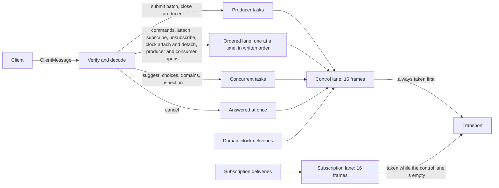
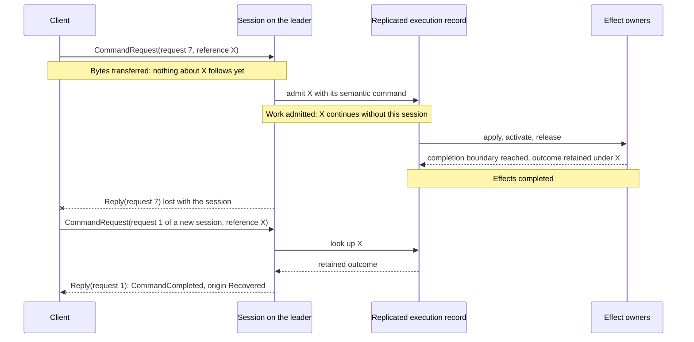
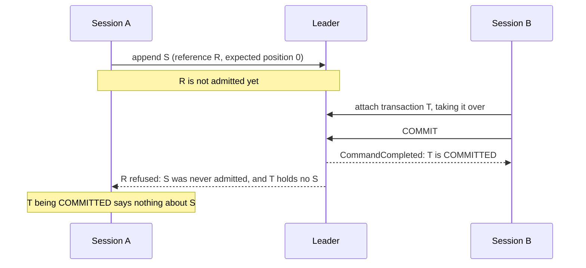
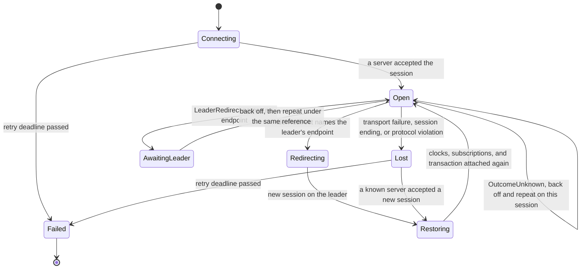
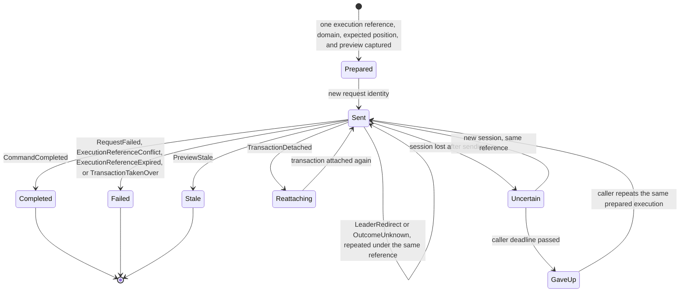
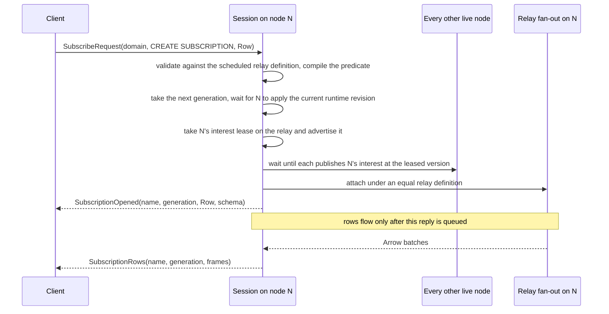

# Client Session Protocol

*Plexus, the Nervix graph definition language.*

The client session protocol is the public boundary between a client and a Nervix node. It carries
Plexus commands and their outcomes, transaction attachment and inspection, completion and choice
lookups, domain selection and the observations that follow it, Row subscriptions, domain clock
attachments, producers that submit batches to client ingestors, resource uploads, backup downloads, and restore streams. The CLI, the web console, the Rust client, every host of the
shared Rust binding, and independent implementations in other languages all speak it.

The protocol owns framing, verification, the session limits, request correlation, cancellation,
typed dispositions, the redirect to the leader, the lifecycle of a session, and delivery of the
unsolicited frames a session receives. The operation behind a request still owns what that request
means: the control plane decides what a command does and when it is complete, the transaction
planner decides what a transaction affects, the resource catalog decides when a version exists, and
the runtime decides what a relay delivers and when a submitted batch completes. A reply is therefore
never more than the statement it makes. Four facts stay distinct at this boundary, and a client that confuses them either repeats an
effect or reports one that did not happen:

- **Bytes transferred.** A frame reached the other side. Nothing about a request follows from it.
- **Work admitted.** The cluster durably recorded a command under its execution identity. The work
  continues whatever happens to the session that sent it.
- **Effects completed.** The command reached its completion boundary, and its terminal outcome is
  retained under that identity.
- **Waiter cancelled.** A client stopped waiting. Before admission nothing began; after admission
  the effect continues and can be recovered by its identity.

This chapter explains why the protocol behaves as it does. The [Client Implementation
Manual](./client-implementation-manual.md) states, as rules, what a client implementation must do.
Each links to the other instead of repeating it. [Command Completion](./command-completion.md) owns
the completion boundary and the retention of execution identities, [Control
Plane](./control-plane.md#replicated-plexus-transactions) owns the transaction lifecycle, [Transaction
Quiescence And Impact Inspection](./transaction-quiescence.md) owns the impact report, [Resource
Versions And Bindings](./resource-versions.md) owns the version lifecycle behind an upload, [Backup
And Restore](./backup-and-restore.md) owns what a backup archive holds, [Domain
Clock](./domain-clock.md) owns the clock a session can follow, [Errors And
Diagnostics](./errors-and-diagnostics.md) owns how typed failures become diagnostics, and [Shutdown
And Recovery](./shutdown.md) owns the phases of a node stop.

## A Boundary Separate From The Interconnect

Clients never speak the [Cluster Interconnect](./interconnect.md), and nodes never use the session
protocol to talk to each other. The two boundaries answer different questions and are built
differently:

| | Client session protocol | Cluster interconnect |
| --- | --- | --- |
| Peers | Untrusted clients acting for a registry user | Cluster nodes holding certificates from the cluster CA |
| Authentication | Basic credentials of a registry user on every call or upgrade | Mutual TLS 1.3 with one node identity URI per certificate |
| Listeners | The session gRPC listener and the console listener of every node | One interconnect listener per node |
| Encoding | FlatBuffers frames verified against one public schema | Bounded `rkyv` control archives and Arrow IPC relay bodies |
| Payload of a relay | Typed Row cells, positional against an announced schema | Arrow record batches |
| Identity of work | A request identity per session and a durable execution reference per command | Coordination identities, process epochs, and delivery identities |
| Evolution | One current schema; no version field, negotiation, or fallback | One current wire contract, fenced by a fingerprint at connection setup |

A follower does not forward a client's leader operation over the interconnect on the client's
behalf. It answers with a redirect that names the leader, and the client reconnects there, so every
leader operation arrives at the leader on a session the client itself holds. Subscriptions are the
one path that crosses both boundaries: the relay owner fans a batch out to the subscriber's node
over the interconnect, and that node encodes Row frames for its own sessions.

## Ownership By Layer

| Layer | Owner | What it owns |
| --- | --- | --- |
| Vocabulary | `nervix-models` | Execution references, domain, relay, subscription and user names, timestamps, the transaction status, preview identity and impact report, the resource description, and the observed domain clock. |
| Edges | The wire crate, `nervix-client-wire` | The FlatBuffers schema, frame verification and ownership, the session limits, the typed requests, replies, events, transfers and rows the schema describes, the display text of a row, and how frames travel in gRPC and WebSocket messages. It knows no registry, runtime, consensus, parser, Arrow, or client dispatch. |
| Edges | The session service in `nervix-server` | Authenticating a call, one session per transport connection, correlation, the ordered and concurrent lanes, cancellation against admission, typed rejections, reply encoding and transfer, the control and subscription lanes a session's frames wait in, unsolicited events, domain clock attachments, the upload stream, the backup download stream, the restore stream, and carrying a download or a restore over a console WebSocket of its own. |
| Edges | The client traffic record in `nervix-server` | The traffic series of each client listener, resolved once when the service starts, and the operator's record of a call whose credentials did not authenticate it. |
| Edges | The public listeners in `nervix-server` | Taking each connection a public listener accepts, and reporting an accept that failed while the listener keeps accepting. |
| Edges | The Row encoder in `nervix-server` | Binding one subscription generation to the row schema it announces and writing selected Arrow rows into bounded frames. |
| Edges | The session command and transaction adapters in `nervix-server` | Command admission and retained outcomes, and a session's transaction lifecycle, its binding, statement preflight and the replicated commit with the quiescence it recovers from. |
| Edges | Session subscriptions | Creation and deletion, the per-session subscription set, the generation each subscription opens with, its lifecycle, and its filter and sampling. |
| Control plane | The command pipeline and transaction use cases | Durable execution identity, exact recovery, domain mutation ownership, plan fencing, transaction application, impact and inspection, and the completion barrier. |
| Control plane | Backup execution and retained archives | Assembling a backup's archive from one applied revision, retaining it under the backup's execution reference until a download collects it or its retry validity ends, and the bounded stream that sends it. |
| Control plane | Subscription delivery | The delivery of one subscription generation to its session, and the interest lease it holds on its relay. |
| Data plane | Relay subscription fan-out | The subscribers of one relay, the definition they were attached under, and ending every subscriber before a batch of another definition can reach it. |
| Edges | The Rust client, `nervix-client-core` | Connecting, TLS selection, the dispatcher that pairs replies with requests, execution identity across retries, redirect and reconnect, transaction binding and previews, desired subscriptions and their restoration, followed domain clocks, uploads, and backup downloads verified against their summary. |
| Edges | The host session runtime, `nervix-client-host` | What every binding shares: the session runtime a host's thread blocks on, cancellation and deadlines, the classification of every client failure by its report's context, subscription events with bulk column access to their verified frames, domain clock events and the clock of each followed domain with its projections, field descriptions, and the Rust client's producers and consumers with their typed outcomes, settlements and Arrow batches built and read one column level at a time. |
| Edges | The C ABI, `nervix-client-ffi` | The C ABI through which C and C++ hosts drive the host session runtime: the handles a host holds, retains and releases, borrowed frame access, and bulk column copies into memory the host passes. |
| Edges | The Ruby gem, `nervix-client-ruby` | Ruby 3.3+ classes on magnus and rb-sys over the host session runtime: collector-owned objects, released-GVL waits, typed exceptions, immutable owner-retaining `IO::Buffer` views, typed columns and Arrow IPC. |
| Edges | The JVM library, `nervix-client-jvm` | Java 21 classes on JNI: Cleaner-owned handles, independent blocking leases, typed exceptions, owner-retaining read-only direct buffers, bulk column arrays and Arrow IPC. |
| Edges | The Python package, `nervix-client-python` | `nervix_client`, through which CPython hosts drive the host session runtime on pyo3: objects whose lifetimes are Python's, waits that release the GIL, typed exceptions, connection options, columns read as Python values, and Arrow batches exchanged through the Arrow PyCapsule interface. |
| Edges | The web console and the CLI | Consumers of the same protocol with bounded buffers of their own. The console speaks it over its WebSockets: the session, and one per backup download or restore stream, whose archive it verifies or measures itself; the CLI uses the Rust client. |

The server is the composition root: it is the only crate that names the wire crate, the command
pipeline, and the runtime together. The wire crate names neither Arrow nor the parser, so an
implementation in another language needs only the schema. The Rust client additionally names the
language edge, which it uses to split a request into statements and to recognize the statements it
serves itself, such as `USE`; everything it knows about the cluster arrives over the protocol.

The Rust client and CLI declare their edge ownership in gated compiler source contracts. Their
session maps remain client-owned synchronization outside the server record-path acquisition rule.
Server relay subscription fan-out remains recurring data-plane execution under its own source
contracts and holds no repair expectation. The annotations change no session framing,
recovery or delivery guarantee. [Data-Plane Concurrency](./data-plane-concurrency.md#source-contracts)
owns this compiler boundary. [Execution Primitives](./execution-primitives.md) owns the shared
backend selection, portable reference types and declared unmodeled exceptions used by the Rust
client, binding and browser; those build choices change no wire contract.

## Wire Format

An instance placement identity carries an unsigned 64-bit index in the `PlacementUnit` union;
partition indices remain unsigned 32-bit values. Client encoders and decoders preserve the full
instance index when reporting transaction impact and execution placement.

### One Schema, Eight Frame Roots

`crates/client-wire/schema/session.fbs` declares every shape of the public boundary, once. Eight
root files name the table a frame is rooted at and the four-byte file identifier it carries:

| Root | Identifier | Direction | Carried by |
| --- | --- | --- | --- |
| `ClientMessage` | `NXCM` | Client to server | The gRPC `Exchange` stream and the console WebSocket |
| `ServerMessage` | `NXSM` | Server to client | The gRPC `Exchange` stream and the console WebSocket |
| `UploadMessage` | `NXUM` | Client to server | The gRPC `UploadResource` stream |
| `UploadReply` | `NXUR` | Server to client | The gRPC `UploadResource` stream, exactly once |
| `BackupDownloadRequest` | `NXBQ` | Client to server | The gRPC `DownloadBackup` call, exactly once |
| `BackupDownloadMessage` | `NXBD` | Server to client | The gRPC `DownloadBackup` stream |
| `RestoreMessage` | `NXRM` | Client to server | The gRPC `RestoreBackup` stream |
| `RestoreReply` | `NXRR` | Server to client | The gRPC `RestoreBackup` stream, exactly once |

A frame is one finished FlatBuffer that carries its root's identifier and no size prefix. The
transport delimits frames, so a frame never has to describe its own length and a receiver never
parses a length that a peer chose.

A `ClientMessage` holds one request and the request identity that correlates its replies. A
`ServerMessage` holds either a `Reply` to one request or one unsolicited body: a server notice,
leadership, the domain list, the selected domain's snapshot and cluster summary, subscription rows
and the notices about them, a domain clock frame, a producer's admission change or end, or the
ending of the session. An unsolicited body
carries no request identity and never completes a request.

### Verification Before Reading

A receiver verifies a frame once, when it takes ownership of the bytes and before it reads any
field. The frame must fit the session frame limit, hold at least a root offset and identifier, carry
the expected identifier, and pass FlatBuffers verification. Verification bounds every offset and
length, requires every `(required)` field, validates every string as UTF-8 with its terminator, and
limits nesting depth, the number of tables, and the apparent size of the traversal. The table and
traversal budgets scale with the frame being verified rather than with the limit: a frame of `n`
bytes may hold at most `n / 4` tables and may expand to at most eight times its own size, so a small
frame whose offsets alias one another cannot make a receiver walk far more than it sent.

The transaction-operation and impact-reason unions declare their current numeric tags explicitly
in the shared schema. Only declared alternatives are accepted.

Reading then applies the rules the verifier does not know. Every union is required, so the `NONE`
discriminant is never valid. A union discriminant or enum value the schema does not declare is
rejected, and so is an absent optional scalar that a comment requires, a zero where a comment
requires a non-zero value, an empty collection that must not be empty, a vector or string longer
than the session limits, a set that is not in canonical order, and a value the receiver's platform
cannot represent. A receiver never substitutes a default for a rejected value.

Scalars declared `= null` are optional: absent means not provided, and a present zero is a value.
The distinction carries meaning in several places. An append that expects position zero is not an
append that expects nothing, and a float cell holds its value as an optional scalar because a
defaulted field would lose the sign of a negative zero. Other scalars read as their declared
default, zero or false, when absent.

Verified bytes are immutable, and every value the wire crate hands out borrows from them, so no view
reads unverified bytes and no read verifies again. A verified frame pins the buffer it was received
in for as long as it, or any value that keeps it, is alive. The gRPC codec therefore copies a frame
smaller than 64 KiB out of the transport's read buffer, which grows to the largest message the
connection has carried, and takes a larger frame without a copy.

### Session Limits

One set of limits governs a session. The transports configure their message limits from it, so an
oversized message is refused before it is buffered, and every encoder checks each string and vector
against it before the FlatBuffers builder grows, so no Nervix encoder produces a frame that a
receiver holding the same limits rejects.

| Limit | Default | What it bounds |
| --- | ---: | --- |
| Frame | 4 MiB | One gRPC message or one WebSocket binary message. It matches the receive limit gRPC applies by default. |
| Transfer | 64 MiB | One reply reassembled from transfer parts. |
| Nesting depth | 64 | Nested tables in a frame, counting the root as the first level. The deepest structure of the schema that does not recurse, a node coverage in an execution step's affected topology inside an inspection reply, nests 13 tables; the rest is for nested list values and list field types. |
| Collection entries | 262,144 | Entries in one vector. |
| String | 64 MiB | Bytes in one string. |

Every Nervix server and client uses these defaults. The wire crate refuses a configuration whose
frame limit is outside 1 KiB to 256 MiB, whose transfer limit is below the frame limit, whose
nesting limit is outside 16 to 128, or whose string limit exceeds the transfer limit. The upper
bounds keep the verifier's budgets representable in the 32-bit address space of the browser build,
and the nesting bound caps the stack a hostile frame can make the verifier and the decoders use.

### Replies Larger Than One Frame

A reply may be larger than one frame; a rendered transaction report is the usual case. The server
encodes the complete reply once, from one read of its state, and cuts that single frame into
`TransferPart` replies. The parts of one reply share its request identity and its total size, arrive
in order with contiguous offsets starting at zero, and each carries a non-empty chunk. The client
joins them and verifies the result as a frame of its own, under the transfer limit, which must hold
a `Reply` to the same request whose body is not itself a transfer part.

A transferred reply is therefore exactly as trusted as one that fit a frame. It is never delivered
truncated, and it can never mix two reads of the server's state. Parts of one reply stay in order,
but other replies and unsolicited frames may arrive between them, which is why a client keeps one
reassembly per request identity. A reply above the transfer limit is not sent at all: the request
receives the typed rejection `ReplyTooLarge` instead. A reply that carries an impact report is
encoded on the bulk workers under the bulk memory class; when neither memory nor a worker is
available for it, the request receives `ServerBusy`, which is safe to repeat because such a reply
belongs to a request that changes nothing.

### One Current Form

The protocol has exactly one current form. Frames carry no version, a session negotiates nothing,
and neither side keeps a compatibility reader for an earlier schema. A changed shape is a
coordinated change of the server, the Rust client, the binding, the console, the conformance
clients, and the corpus in one commit. A peer built against another schema meets the ordinary
verification and reading rules: an undeclared request kind is rejected as `UnsupportedRequest`, an
undeclared enum value as `UnsupportedValue`, and a client rejects a server discriminant it does not
know rather than skipping it.

The conformance corpus in `crates/client-wire/conformance` pins the bytes the Rust encoder writes
for a set of requests, replies, and events chosen to reach what live traffic does not, such as
extreme values, nested lists, and every refusal of a domain clock attachment, together with
`corpus.report`, the reading of those bytes that every other reader must reproduce.
`just test-client-wire` checks that the checked-in bytes are exactly what the encoder writes, and
`just update-client-wire-corpus` regenerates them for review.

A WASM description's typed `wasm_state` contains its shared resource binding and a `units`
collection. Each unit carries its identity, guest generations, reset readiness, recovery attempts
and checkpoint observations. Checkpoint and recovery detail each retain a whole-processor limit
of 128 entries; every unit reports complete counts and omitted totals. Text and JSON descriptions
render those same facts.

The registered client representation properties also compare complete generated current values
through the production codecs. Separate targets verify malformed bytes under fixed limits; Arrow
properties compare selected logical values and validity with decoded Row cells, using float bits
and explicit redaction, while binding properties check column copies and retained frame lifetime.
The [client representation coverage map](https://github.com/nervix-io/nervix/blob/main/tests/client-representation-coverage.md)
records their schema coverage and ownership boundaries. Both ordinary corpus replay and
sanitizer-backed fuzzing run the same assertions through the
[property target inventory](./property-testing-and-fuzzing.md#target-and-representation-register).

## Transports, Endpoints, And Authentication

Every live node runs both client listeners. Neither depends on leadership or placement, and both
close only when the node begins to stop. An accept that fails closes neither: the listener reports
the failure and accepts the next connection, as
[Stop Requests](./shutdown.md#stop-requests) describes for every public listener.

Configured `HTTP ENDPOINT` and `WEBSOCKETS ENDPOINT` ingestors use the server's VHOST listeners on
every live node. Their codec payloads and configured WebSocket signaling follow the
[endpoint ingestion contract](ingestors.md#http-endpoint-and-websockets-endpoint), independently of
the session framing and attachment recovery described here. Endpoint `MODE ACK` reuses the client
submission outcome labels in an HTTP JSON response or a signaling frame; it has its own per-node
response window and absolute ACK deadline. `MODE NO ACK` confirms HTTP admission with 202 and sends
no per-frame graph acknowledgement on WebSockets.

### Native gRPC

Native clients reach the gRPC service `nervix.session.Session`, which serves four methods and
answers every other path with `UNIMPLEMENTED`:

| Method | Shape | Frames |
| --- | --- | --- |
| `/nervix.session.Session/Exchange` | Bidirectional stream | `ClientMessage` frames answered by `ServerMessage` frames. One call is one session. |
| `/nervix.session.Session/UploadResource` | Client stream | `UploadMessage` frames answered by exactly one `UploadReply` frame. One call is one upload. |
| `/nervix.session.Session/DownloadBackup` | Server stream | One `BackupDownloadRequest` frame answered by `BackupDownloadMessage` frames. One call is one download. |
| `/nervix.session.Session/RestoreBackup` | Client stream | `RestoreMessage` frames answered by exactly one `RestoreReply` frame. One call is one attempt of a restore. |

Each gRPC message holds exactly one frame, delimited by gRPC's own length prefix. The messages are
not protocol buffers, and no generated gRPC service code is involved: the codec hands the frame
bytes to the transport unchanged and verifies what it receives. The server speaks HTTP/2 only,
accepts no message compression, and sets gRPC's message limits to the frame limit, so a message
above it is refused before it is buffered.

The listener serves plaintext HTTP/2 on `--addr` (`NERVIX_ADDR`, default `127.0.0.1:47391`) and
advertises `--grpc-advertise-addr` (`NERVIX_GRPC_ADVERTISE_ADDR`), or the listen address when that
is unset. `--grpc-mode https` (`NERVIX_GRPC_MODE`) serves the listener over TLS on
`--grpc-https-listen-addr` instead and advertises `--grpc-https-advertise-addr`. HTTPS requires
`--grpc-tls-cert` (`NERVIX_GRPC_TLS_CERT`) and `--grpc-tls-key` (`NERVIX_GRPC_TLS_KEY`), naming the
operator's PEM certificate chain and private key. The first certificate is the server's leaf and
must cover the advertised hostname or IP address. Every node needs its own reachable advertised
address and provisioned identity. The Kubernetes deployment runs the listener in plaintext mode.

The node validates the complete identity at startup, before opening its stores or listeners.
Missing material, unreadable files, unusable PEM and mismatched keys fail startup with a typed
cause; TLS files supplied in HTTP mode are refused. Certificates are loaded once, so rotation
requires restarting the node. A running listener retains the loaded identity. Client trust remains
explicit: the native client uses the supplied CA, while the browser uses its own trust store.

Native listeners, console TLS and HTTPS VHOSTs capture the committed outward cipher/group policy
for each new handshake. Changes apply without restarting them; established sessions retain their
negotiation and loaded identity. `DESCRIBE CLUSTER` exposes resolved committed and running lists.
Native client-core, the CLI and native bindings use `nervix-crypto`'s explicit `fips` provider by
default, independently of an embedding host's process provider. They are clients rather than members
of the cluster's policy authority. Browser TLS remains the browser's choice. The interconnect has
its independent fixed provider, unaffected by outward algorithm changes.
[Cryptography](cryptography.md#algorithm-policy) owns exact names, aliases, defaults and governed
connector paths; certificate trust and provisioning remain as above.

### Console WebSocket

The web console reaches the same session engine over a WebSocket, `GET /console/ws` on the console
listener: `--web-console-listen-addr` (`NERVIX_WEB_CONSOLE_LISTEN_ADDR`, default `0.0.0.0:47420`),
and optionally a TLS listener, `--web-console-https-listen-addr` with `--web-console-tls-cert` and
`--web-console-tls-key`. Each binary message holds exactly one frame in either direction and nothing
else: no size prefix, never two frames, never part of one. Ping, pong, and close messages belong to
the WebSocket connection and never carry a frame.

`--web-console-advertise-addr` names the externally reachable host and port. Its advertised scheme
is HTTPS when the HTTPS console listener is configured and HTTP otherwise. Without an explicit
address, the HTTPS listener's address is preferred. The certificate and key are loaded once at
startup; rotation requires a restart. Console HTTPS configuration is independent of native gRPC
TLS configuration.

The console session is served only by the leader. A console session on any other node is ended at
once with a `SessionEnding` whose reason is a `LeaderRedirect` naming the leader, and the console
reconnects to the leader's advertised console endpoint. A console session also ends this way when
its node stops leading, which the node checks every 250 milliseconds.

The console listener serves three WebSockets, each carrying one kind of call with exactly the
frames its gRPC method carries:

| Path | Call | Frames |
| --- | --- | --- |
| `GET /console/ws` | The `Exchange` session | `ClientMessage` frames answered by `ServerMessage` frames. One connection is one session. |
| `GET /console/backups/download` | One `DownloadBackup` call | One `BackupDownloadRequest` frame answered by `BackupDownloadMessage` frames, then a normal close. |
| `GET /console/backups/restore` | One `RestoreBackup` attempt | `RestoreMessage` frames answered by exactly one `RestoreReply` frame, then a normal close. |

A frame of another call's root fails verification and closes the connection with `1007`. A download
connection takes exactly one request: another data message after it closes the connection with
`1008`, and a close or a failed connection stops the download before it sends another frame, which
releases only its own hold on the archive. Any node serves a download and a restore, and each
answers from its own role exactly as its gRPC method does: a node that does not retain the archive
and is not the leader answers a download with a redirect, and a restore sent to a follower is
answered with a redirect outcome.

A WebSocket client cannot half-close a stream the way a gRPC client does: once it sends a close, it
reads nothing more. A restore over the console WebSocket therefore ends with the chunk that
completes the size its start declares, and the connection stays open for the reply. A close or a
failed connection before that chunk ends the attempt in transport, which changes nothing and
releases what the leader staged for it. A frame the restore cannot read, such as a chunk before the
start or a second start, ends the stream at that frame, and the restore refuses it without reading
further. The server closes with `1011` the rare answer it cannot fit into a frame.

The console has no upload stream: it uploads a resource through its own HTTP path,
`/console/resources/upload`, where the leader builds the archive from the files it receives, as
[Resource Versions And Bindings](./resource-versions.md#assignment) describes. How the console
sends an upload again is described with the [Resource Uploads](#resource-uploads) contract.

### Authentication

Both transports authenticate a registry user with Basic credentials before any frame is read. A gRPC
call presents `authorization: Basic <base64(user:password)>` metadata, on every call, and a call
that fails authentication ends with `UNAUTHENTICATED`. The console upgrade presents the same
credentials in an `Authorization: Basic` header or, because a browser cannot set headers on a
WebSocket, as the `auth` query parameter; a failure answers `401` with a `Basic` challenge and never
upgrades. `GET /console/auth` checks credentials without opening a session. Passwords are verified
against typed PBKDF2-HMAC-SHA-512 credentials held in consensus, on the node's credentials worker under a 64-byte verification-buffer charge. Stored iteration counts are validated before admission; the committed creation default is 210,000 and the accepted upper bound is 1,000,000. Its isolated CPU class serves only password
work, so saturated data, extension or bulk work never delays a login, and concurrent attempts wait
for it in turn. A node whose credentials class cannot take the verification now answers
`UNAVAILABLE`, or `503` without an upgrade on the console: the
credentials were not judged, so the attempt neither establishes failure pacing nor clears an
existing quota, and the same credentials may be presented again.

Every presented name shares one failure quota on its node across the client transports, whether
the name identifies a user or is unknown or invalid. Valid names use their canonical lower-case
identity; invalid spellings are compared without ASCII case distinctions as well. A judged
refusal establishes a ten-attempt bucket and consumes one slot. Slots replenish at ten per second.
Later attempts take a slot before credentials work; overlapping attempts that began before the
first refusal take their slot after their failed verification. A successful authentication clears
that name's pacing. A slot receipt belongs to the bucket it paid; if success or full recovery
replaces that bucket before verification finishes, a refused attempt pays the fresh quota.
One name's traffic never evicts another name's outstanding quota.

Every name costs the node the same work. Credentials whose name names no user, or cannot name one,
perform the same verification and padding workload as a known name, under the same charge, before they are refused. The immutable user publication carries the largest admitted cost, so changing the creation policy or restoring a credential cannot make an unknown name cheaper than an existing user. Neither the answer nor when it arrives tells an unknown
user from a wrong password, and a node whose credentials class cannot take that hash now answers
`UNAVAILABLE` or `503` for an unknown user as it does for a known one. Repeated refusals use the
same quota and ordering for both. Failure state retains one bucket per name, creates a bucket only
after a judged refusal, and reclaims fully replenished buckets as later attempts arrive. Its size
follows the largest burst-recovery working set and live attempts rather than all names ever
presented to the node.

Credentials a listener judged and refused are logged at `warn` as `client authentication failed`,
with the listener as `transport` and the address the call came from as `peer`. The record never
carries the user name or the password the call presented, because a name an operator did not
create can be a password typed into the wrong field. A call that presented no readable credentials
is logged at `debug`. Every attempt is counted on the node that judged it, in
`nervix_client_authentications_total` by outcome; see
[Client Traffic](./metrics-and-observability.md#client-traffic).

Authentication establishes who owns what a session does: its transaction binding, its execution
references, its subscriptions, and its uploads. It is the only access control. Every authenticated
user may run every command in every domain; ownership decides only who may attach and inspect a
transaction, and scopes execution references and upload identities to their user.

### Transport Failures

A failure of the framing ends the connection, because nothing after it can be trusted. Everything a
well-formed frame can get wrong is answered inside the session, as a typed reply to the request it
names.

| Failure | Native gRPC | Console WebSocket |
| --- | --- | --- |
| Credentials missing or wrong | `UNAUTHENTICATED` | `401`, no upgrade |
| Credentials the node could not verify now | `UNAVAILABLE` | `503`, no upgrade |
| Message above the frame limit | `OUT_OF_RANGE`, refused before buffering | Close `1009` |
| Message that is not a valid frame, or a frame of another call | `INTERNAL` | Close `1007` |
| Text message | — | Close `1003` |
| A second request on a download | — | Close `1008` |
| The node began to stop, during an upload | `UNAVAILABLE` | — |
| The node began to stop, during a download or a restore | `UNAVAILABLE` | Close `1001` |
| Frame without a valid request identity | `SessionEnding` with `ProtocolViolated`, then the end of the stream | The same `SessionEnding`, then a normal close |
| Session ended by the server | The end of the stream, with status `OK` | A normal close |

## Requests, Lanes, And Cancellation

### Request Identity Versus Execution Identity

Every `ClientMessage` carries a request identity: a non-zero 64-bit value the client chooses and
never reuses within the session. Every reply to that request is a `Reply` naming the same identity,
and a request receives exactly one terminal reply, delivered whole or as transfer parts. The
identity exists only to pair replies with the request waiting for them. It is scoped to one session,
which is one gRPC `Exchange` call or one WebSocket connection, and a new session starts over.

A command's execution reference is a different identity with a different purpose. It names the
command's effects durably, across retries, redirects, reconnects, leader changes, and full restarts,
and it outlives every session that carries it. A retry after a lost reply is a new request, with a
new request identity, that repeats the same execution reference. Confusing the two breaks both
guarantees: repeating a request identity cannot recover an effect, and minting a new execution
reference for a retry can apply an effect twice.

### Which Replies Answer A Request

A request is answered by its own outcome, by `RequestRejected`, which can refuse any request, or by
`RequestCancelled`, which ends a request a cancellation reached before its outcome. A
`CancelRequest` is answered at once, so nothing cancels it, and a submitted batch cannot be
withdrawn, so `RequestCancelled` never answers either of them.

| Request | Its outcome |
| --- | --- |
| `CommandRequest` | `CommandOutcome` |
| `SuggestRequest` | `SuggestOutcome` |
| `ChoiceLookupRequest` | `ChoiceOutcome` |
| `ListDomainsRequest` | `DomainList` |
| `SelectDomainRequest` | `DomainSelectionOutcome` |
| `AttachTransactionRequest` | `AttachOutcome` |
| `InspectTransactionRequest` | `InspectionOutcome` |
| `SubscribeRequest` | `SubscribeOutcome` |
| `UnsubscribeRequest` | `UnsubscribeOutcome` |
| `CancelRequest` | `CancelOutcome` |
| `AttachDomainClockRequest` | `DomainClockAttachOutcome` |
| `DetachDomainClockRequest` | `DomainClockDetachOutcome` |
| `OpenIngestorRequest` | `OpenIngestorOutcome` |
| `SubmitBatchRequest` | `SubmissionOutcome` |
| `CloseIngestorRequest` | `CloseIngestorOutcome` |
| `OpenEmitterRequest` | `OpenEmitterOutcome` |
| `ReadEmitterBatchRequest` | `ReadEmitterBatchOutcome` |
| `SettleEmitterBatchRequest` | `SettleEmitterBatchOutcome` |
| `CloseEmitterRequest` | `CloseEmitterOutcome` |

A matching request identity alone does not make a reply the answer to its request. A reply of any
other kind under the identity of a request that waits for its reply is a protocol violation. The
client checks the reply's kind before it applies anything the reply carries. On a violation it
stops reading that session, interrupts every request still waiting on it, and keeps each command
among them uncertain under its own reference. It adopts no subscription, clock attachment,
producer, transaction or redirect from the reply. The Rust client recovers each interrupted request
as after any other lost session: it repeats a command under its original reference on a restored
session, or reports `UncertainCommand` with that reference when recovery cannot finish. A reply
whose request no longer waits, because its caller stopped waiting, is not this violation: it
completes no request, and the reader still follows the subscription, clock or producer it opens,
as it does for every late reply.

### Two Lanes

A session serves each request on one of two lanes:

- **The ordered lane** serves the requests that change the session or may change the cluster:
  commands, transaction attach, subscribe and unsubscribe, domain clock attach and detach, and
  producer and consumer opens. They
  run one at a time in the order the client wrote them. A mutating command never overtakes the
  command written before it, and a subscription never opens before the command that created its
  relay has completed. Every command runs on this lane, including a `SHOW` or `DESCRIBE`, so within
  one session a read command waits behind a command that is waiting for its completion boundary.
- **The concurrent lane** serves the requests that only read the session: completion suggestions,
  choice lookups, listing and selecting domains, and transaction inspection. Each runs as its own
  task beside the ordered lane, from the view of the session that the ordered lane last published,
  so a long command never delays a completion, an inspection, or a domain request. Their replies can
  arrive in any order. Selecting a domain changes only which domain's observations the session
  receives.

A cancellation is on neither lane: it is answered as soon as it arrives. Neither is a submitted
batch or a producer close: the receive loop hands both to the producer's own task and reads the
next request at once; see [Producers](#producers). A session admits at most 64 requests in flight,
counting both lanes and producer closes but not submitted batches, which their producer's credit
bounds instead. A request beyond that is refused with
`TooManyRequestsInFlight` rather than queued, which also bounds the requests waiting for the ordered
lane; nothing about the refused request was admitted. The web console holds every kind of its
session requests while this window is full, including completions, choice lookups, domain selections
and transaction attachment. Ready work keeps its issue order, with setup and reattachment first;
[Restoration And Bounded Consumers](#restoration-and-bounded-consumers) describes lookup replacement
and connection lifetimes. A request identity that is already in flight
is refused with `DuplicateRequestId`, and that refusal necessarily names the same identity as the
request still in flight.

Completion resolves the semantic expectations of the composed Plexus grammar at the cursor.
Connector functions use the selected entity's scope in filters, HTTP request expressions and
`ALTER` constructions. Metadata candidates come from that ingestor's declaration; a timestamp
position offers its datetime metadata fields. Header reads belong to supported ingestor entities
and header writes to supported emitter `INVOKE` positions. Both transports return these candidates
as text edits; [CLI Completion](./client-tools-cli.md#completion) describes their application.

Semantic completion of placement members offers only placement-eligible runtime nodes. HTTP
endpoint, WebSocket endpoint and Syslog listener ingestors execute on every cluster node, so their
declared execution policy excludes them from these suggestions.

Choice lookups on the concurrent lane return typed values for structured client controls. A domain
dependency selects internal schemas, branches, relays, codecs, VHOSTs, signaling protocols,
JSON/CBOR/AVRO wire schemas, or resource catalogs; a domain and relay reference select relay
fields; a domain and codec reference select that codec's output schema fields; a domain and resource
reference select completed resource versions. Wire-schema targets have separate discriminants, so
a codec cannot mistake a JSON wire schema for a CBOR or AVRO schema with the same name. A
visual ingestor uses a distinct ingestor-reference target for each of the 14 connector and entity
pairs that read an external system; a client producer ingestor selects its schema through the
schema target instead. Each ingestor-reference target requires a domain and offers clients of its
pair's connector, except the HTTP endpoint and WebSocket endpoint targets, which offer endpoints of
that `TYPE`. Its decoding-codec target offers codecs that can decode. An unbranched-relay
target needs a domain; a branched-relay target also needs the selected branch and offers relays
with exactly that branch. Ingestor error relays use the unbranched target. A branch-field target
takes a domain and branch reference. Ingestor decoded and output fields use the existing
codec-field and relay-field targets. A junction, deduplicator, reorderer, or reingestor asks for
another input relay with a domain and the first relay reference; candidates have that relay's exact named schema and branch.
The same dependencies with the output-relay target select the input branch, and with the
materialized-relay target select only relays with materialized state in that branch. Route
construction of an unbranched or named branch uses the ingestor relay targets, while branch keys
and record fields use the branch-field and relay-field targets. These processor targets resolve
against the attached transaction prefix, and their page digests include the selected input
definition. The typed target and dependencies remain part of the cursor identity. A
completed-version value
is either an explicit number or `LATEST`, not a label to parse. Resource catalogs include resources
staged earlier in the attached transaction, while version choices include completed uploads only.
The cursor binds the selected candidate set and its definitions; a changed context returns
`StaleContext` instead of continuing an earlier page. [Sessions](./sessions.md#structured-choices)
owns the complete lookup contract and the server's transaction-aware resolution.

Emitter controls ask entity-specific reference questions using the clients their vocabulary
declarations admit; a client consumer selects its schema, and the Iceberg catalog question reads
the declared catalog-client option. Encoding-codec questions require a domain and offer codecs
that encode; their schema may differ from the input schema because construction builds the
output. Additional-input questions carry the first input relay and require its exact payload
schema. Unlike ordinary processor inputs, emitter
inputs may have different branches. Materialized-state and error-relay questions therefore carry
every selected input and require a candidate's branch to match all of them. Output schema fields
are selected with a domain and schema reference. These lookups retain the same transaction-prefix,
paging, definition-digest and stale-context guarantees as the existing structured controls.

### What A Session Sends First

A session queues its frames on two bounded outbound lanes. Replies, transfer parts, session events,
and domain clock frames wait on the control lane, which holds 16 frames. The session ending never
waits: the transport writes it after the control frames already queued, and nothing after it.
Subscription rows and the notices about them wait on the subscription lane, which holds 16 frames
shared by every subscription of the session. The transport always takes a queued control frame first
and takes subscription frames only while the control lane is empty. A reply, including the reply to
the unsubscribe that stops a subscription, therefore never waits behind rows the client has not
read. The lanes never reorder what the transport already took: a frame handed to the transport stays
ahead of every frame queued after it.
An attached clock's tick holds one replaceable control slot per domain. Its delivery task can
overwrite the slot while the lane is full or after queueing it, until the transport takes it; a
changed clock state withdraws a superseded tick still in that slot.

Because every frame is at most the frame limit, the two lanes bound what a session holds for a
client that reads slowly. Backpressure reaches the client's requests too: a rejection or a
cancellation outcome waits for room on the control lane before the session reads the next request,
so a client that reads nothing eventually stops being read. The server has no idle or slow-client
timeout; such a session ends only with its transport.

### Cancellation

`CancelRequest` names the request identity it targets. The server answers with `CancelOutcome`:
`Requested` when the target is in flight, or `NotInFlight` when it is not. The target still receives
its own terminal reply: `RequestCancelled`, or its ordinary reply if it finished before the
cancellation took hold. The two replies can arrive in either order.

Whether a cancellation stops an effect depends on one atomic decision per request. A request admits
itself immediately before its first effect, and a cancellation that arrives first decides the
request cancelled for good. `RequestCancelled` reports which came first:

- **`BeforeAdmission`.** The request was not admitted and never will be. It has no effect.
- **`AfterAdmission`.** The request was admitted. Cancelling ends only the wait for it. A command's
  effect continues and is recovered by its execution reference, exactly as after a lost reply; what
  an admitted cancellation leaves of the other ordered requests is described below.

A submitted batch cannot be cancelled: a `CancelRequest` naming it is refused with
`InvalidRequest`, and the batch still receives its outcome, because a batch the ingestor may already
have admitted cannot be withdrawn.

A command admits itself just before its durable admission or first effect. Transaction attach,
subscribe, unsubscribe, clock requests, and producer and consumer opens admit themselves when the
ordered lane starts serving them, and a concurrent request never admits itself, so cancelling one
always stops it. A command cancelled after admission keeps the ordered lane until its work finishes,
and an attach cancelled after admission still binds the transaction. A domain clock attach cancelled
after admission also keeps the ordered lane until it is served, but then attaches nothing, because
the server delivers only an attachment whose reply it queued; a domain clock detach cancelled after
admission has still detached, and sending it again reports the session's state. A cancellation never
rolls back admitted work: it is how a client stops waiting, not how it undoes a command, and undoing
is a new command.

### Rejections

A request that is not served receives `RequestRejected` with a typed reason, the offending field
when there is one, and a message for display. The session keeps serving after any rejection.

| Rejection | Meaning |
| --- | --- |
| `InvalidRequest` | A field is missing, malformed, or out of range, such as an execution reference that is not one or a completion cursor inside a character, or a cancellation names a submitted batch. |
| `UnsupportedRequest` | The request kind is not one the server's schema declares. |
| `UnsupportedValue` | An enum value the server does not declare, including a subscription type it does not implement. |
| `DuplicateRequestId` | The request identity is already in flight in this session. |
| `TooManyRequestsInFlight` | The session already has 64 requests in flight. Nothing was admitted. |
| `ReplyTooLarge` | The complete reply cannot be encoded within the session limits, above all because it exceeds the transfer limit. |
| `ServerBusy` | The server had no memory or worker left to prepare the reply of an inspection. |

The first five refuse a request before anything about it runs. `ReplyTooLarge` and `ServerBusy`
replace a reply that could not be prepared. For a read, repeating the request reads again. For a
command, the missing reply says nothing about the command's effect, which is recovered by its
execution reference like any other lost reply.

## Command Dispositions

Client CONFIG validation uses the ordinary failed-command outcome before configuration commits.
An invalid connector/entity mode, option, envelope, metadata read or header write that the registry
can judge from the declaration is likewise a failed command before graph publication. These
refusals add no command disposition: the client still decides from the typed disposition and
recovers an uncertain attempt under its original execution reference.
The registry checks declared keys and the composition root runs network-free driver checks for
standalone mutations and transaction preflight. Refusals name the client and key without rendering
driver values that may contain credentials. A refused transaction statement leaves the transaction
available for correction. `DESCRIBE CLIENT <name>` is an ordinary domain-scoped read on the command
lane. It returns connector identity and effective CONFIG, marking declared defaults supplied for
omitted keys; a missing client is a failed command. `SHOW CREATE CLIENT` preserves authored CONFIG.
Both client inspection commands and structured-choice previews are confidential
inspection projections: declared secrets, address credentials/query options and undeclared driver
properties appear as `********`. Complete canonical configuration remains in backup serialization;
inspection text is not a complete configuration export. See the
[Connector Contract](connector-contract.md) for the validation boundary and initialization limits.

Inspection preflight can refuse a request when local capacity is full. After a transaction or
restore has been accepted, its model application waits for client-inspection command memory and a
filesystem worker-queue place. Temporary pressure supplies no failed configuration verdict; the
existing execution identity, outcome recovery and node-shutdown rules continue to govern the command.

A command's reply is a `CommandOutcome`: the execution reference it answers, whether the outcome was
produced now or recovered from the durable record of an earlier attempt, one typed disposition, a
message for display, diagnostics with optional source spans, and, for a request of several
statements, the outcome of each statement in written order. It also carries the transaction this
session is bound to while the command was served, the operation admission when the command accepted
one operation into the transaction, the typed inspection, WASM state, or resource description a
describing statement produced, and the summary of a backup's archive or the report of a restore.

Before interpreting any outcome, the client checks that its execution reference equals the
request's. A matching transport request identity alone does not establish that the outcome belongs
to the command. A mismatch is a protocol violation: the client stops reading that session,
interrupts every request still waiting on it, and keeps each command uncertain under its own
reference. The Rust client uses its ordinary lost-session recovery to repeat the whole command on
a restored session, or reports `UncertainCommand` with that reference if recovery cannot finish.
No disposition, redirect or transaction carried by the foreign outcome is adopted.

The disposition is the one field a client decides from; the message is for a person. Each
disposition belongs to one phase of the command and makes one statement about its effect:

Consensus proposal failures reach the session with typed leadership, conflict, storage, and
transaction-mutation causes in local reports. The session selects its disposition from those
causes and the command's admission phase, while the display message retains the underlying Raft
or I/O reason. Report carriage does not change request correlation, the durable acknowledgement
boundary, or the stored transaction response. A leader whose lease lapsed, because no quorum
acknowledged it within the lease, refuses a proposal before appending it and names no leader. The
session answers that refusal as leadership loss, never as a failure of the command, even though the
same node may still lead when it answers. Its message says the leader could not confirm its lease in
its term and may still lead, while a refusal after leadership moved says that leadership moved and
names the new leader when the node knows it. The disposition and its cause are the same for both,
because a client recovers from both the same way.

| Disposition | Phase | What it establishes | What a client does |
| --- | --- | --- | --- |
| `CommandCompleted` | Finalization | The command reached its completion boundary. `already_existed` says a creating statement found its entity present and changed nothing. | Report success. |
| `RequestFailed` | Admission, execution, or finalization | The command failed definitively. Nothing further will happen under its reference. | Report the failure with its diagnostics. |
| `LeaderRedirect` | Before admission | The serving node is not the leader, and nothing was admitted there. The leader's endpoints are absent while no leader is known or discovery cannot reach it. | Reconnect to the leader, or wait for one, and repeat the command under the same reference. |
| `TransactionDetached` | Before admission | The leader holds no binding for the session's transaction, typically after a reconnect or leader change. | Attach the transaction again and repeat the command under the same reference. |
| `TransactionTakenOver` | Before admission | Another session attached this session's transaction, and nothing was admitted for this request. | Report it. Attaching the transaction again would take it back, which is the user's decision rather than a retry. |
| `OutcomeUnknown` | Admission, execution, or finalization | The command may have been admitted and its outcome is not known yet: leadership moved, or the leader could not confirm it still leads, while the command was admitted or applied (`LeadershipLost`), it is still applying (`StillApplying`), or the node is still establishing live policy or waiting for a finished outcome to become authoritative on every live node (`NotYetAuthoritative`). | Repeat the command under the same reference until the outcome is known. Never report success or failure from this disposition. |
| `ExecutionReferenceConflict` | Before admission | The reference already identifies a different command, which differs in its owner, domain, transaction position, or content. Nothing was admitted for this request. | Treat it as a defect in the client's use of references. |
| `ExecutionReferenceExpired` | Before admission | The reference aged out of execution history. Its outcome can no longer be recovered, and the command was not executed again. | Report that the outcome is unknown; issuing the work again is a new command. |
| `PreviewStale` | Commit admission | The commit named a preview that no longer describes the transaction. Nothing was applied, and the transaction stays open. The reply names both the expected and the current preview. | Inspect the transaction again and decide whether to commit against the current preview. |

`OutcomeOrigin` distinguishes an outcome produced by this request, `Executed`, from one read back
from the durable record of an earlier attempt with the same reference, `Recovered`. A recovered
failure is the same failure: its message and diagnostics are the ones retained when it happened.

Every `OutcomeUnknown` cause permits a repeat on the existing open session. `LeadershipLost` can
mean an unconfirmed lease on the node that still leads; it does not by itself identify another
endpoint. The Rust client and web console back off and repeat there under the same execution
reference. A subsequent redirect, a session-ending event, or a transport ending supplies the reason
to reconnect. The console starts its per-command wait at 250 milliseconds, doubles it up to five
seconds while the answer remains unknown, and keeps processing session messages during the wait.
Held commands retain their issue order, and the selected domain, clock and subscription tabs keep
their existing attachments. Only a terminal disposition is rendered as the command's outcome.

For a WASM state reset, loss of Raft leadership during generation publication leaves the durable
step applying under its original reference. The request can wait for recovery or answer
`OutcomeUnknown` if its coordinator no longer leads; it does not retain a failed outcome merely
because that publication lost authority. A genuine reset failure still returns `RequestFailed`,
including when the client repeats the same reference.

A request of several statements reports each statement's own disposition, which is one of
`CommandCompleted`, `RequestFailed`, or `LeaderRedirect`, in written order, and the command's
disposition is that of the statement that ended it. Several statements in one request always belong
to a transaction: the request begins one and appends to it, possibly committing it too, or appends
several statements to the transaction the session holds. Outside a transaction a request carries one
statement. `DESCRIBE TRANSACTION` and `SHOW TRANSACTIONS` read beside the transaction and are always
sent alone.

The leader's reference check and replicated admission return the same typed dispositions. A
reference the history no longer holds returns `ExecutionReferenceExpired`; a conflicting request
detected during replicated admission returns `ExecutionReferenceConflict` with the conflict kind.
Neither refusal admits the request. [Exact Recovery](#exact-recovery) explains the retry fence.

### Four Boundaries

The dispositions exist because a client can lose sight of a command at four different points, and
each point means something different:

A cancelled waiter is the fourth point: a `CancelRequest` that wins before admission leaves no
record of the reference at all, and one that arrives after admission ends only the wait. In every
case the same reference, sent again, finds the truth: nothing recorded admits the command now, an
applying record joins it, and a terminal record returns it.

## Exact Recovery

A client recovers a command it lost sight of by sending the same command again under the same
execution reference. The protocol makes that safe by keeping one durable record per reference and
answering every repetition from it. [Command
Completion](./command-completion.md#lifecycle-and-ownership) owns the record's lifecycle, its
retention, and the retry fence; this section describes what a client can rely on.

### What Is Recorded

Every persistent command is recorded under its reference before its first effect: model creation,
alteration, and removal (including corridor and domain-wide placement rules), `REBIND RESOURCE`,
`CREATE DOMAIN`, `CREATE USER`,
`CREATE RESOURCE`, `START`, `STOP`, `DROP NODE`, `CORDON NODE`, `UNCORDON NODE`, `DRAIN NODE`,
`RELOCATE`, `RESET WASM PROCESSOR ... STATE`, and `BACKUP`. So is every transaction request: a request that
begins, commits, or reverts a transaction, one sent while the session is bound to a transaction, and
one that carries an expected transaction position. An ordinary request carries at most one
persistent statement; several statements in one request always form a transaction request.

Reads record nothing. `SHOW`, `DESCRIBE`, `LOOKUP`, `DESCRIBE TRANSACTION`, and `SHOW TRANSACTIONS`
accept any well-formed reference, and repeating one reads again. Uploads have an identity of their
own and are covered in [Resource Uploads](#resource-uploads).

The record binds the reference to one semantic request: the authenticated owner, the request's
domain, the expected transaction position, and a digest of what the request asks for. For an
ordinary command the digest covers the parsed statement, so a retry that differs only in whitespace
or keyword case is the same request. For a transaction request it covers the exact request text. A
new reference is admitted only when it is a UUIDv7 whose creation time lies after the cluster's
retry fence and no more than five minutes ahead of the leader's clock; a reference that fails either
check is refused before any effect.

### How A Repetition Is Answered

The leader serializes the requests that carry one reference, then consults its record:

- **No record.** The request is admitted as new, subject to the checks above.
- **Applying.** The request joins the admitted execution and waits for it. After a leader change,
  the new leader resumes every applying record on its own in its next reconciliation pass, which
  runs every 250 milliseconds, so the work completes whether or not anyone repeats it.
- **Finished.** The request returns the retained outcome once that outcome is authoritative on each
  node in the leader's current completion participant set. The leader can retire an unreachable
  node from that set; the node must catch up before its local reads reflect the completed effect.
  If the wait fails, the reply is `OutcomeUnknown` with cause `NotYetAuthoritative`, and a later
  repetition returns the outcome.

The first reply is itself rebuilt from the durable record, so the reply to the original attempt and
the reply to a repetition are identical except for their origin. The record keeps the disposition,
message, diagnostics, per-statement outcomes, transaction status, operation admission, and the
archive summary of a completed backup. It does
not keep the typed inspection, WASM state, or resource description that a describing statement
returns, because those statements are reads and record nothing.

An execution whose attempt returns `OutcomeUnknown`, a leader redirect, or `TransactionDetached`
stays applying. The finalization boundary returns that disposition unchanged and leaves recovery
under the original reference to determine the terminal outcome. Reconciliation follows the same
rule when an attempt is interrupted after admission.

An ordinary model command applies through its own durable transaction. A failed commit attempt
does not decide the command's result when another coordinator has already finished that
transaction: the serving coordinator recovers its recorded outcome, including the command's
message, diagnostics and admission. A committed transaction answers success; a recorded terminal
failure keeps that failure. A transaction still committing answers `OutcomeUnknown` with cause
`StillApplying`, and a typed leadership loss retains the leader-recovery response. The original
execution reference and completion barrier govern all of these paths.

A transaction's configured tombstone age cannot shorten an applying execution's recovery lifetime.
An applying transaction request retains its finished target; an applying ordinary command retains
its internal transaction and every planning refresh attempt through their recorded mutation owner.
Their plans and reports remain available as well. Cleanup rechecks these relationships against the
replicated execution records when it applies. This remains true after a leaderless interval longer
than the configured retention.

The same rule covers every transaction control:

- **`BEGIN`.** The new transaction's identity is fixed when the request is admitted. Repeating a
  `BEGIN` whose reply was lost returns the same transaction and binds the repeating session to it,
  instead of opening a second one.
- **Appends.** Each statement of a request is recorded under an identity derived from the request's
  reference and the statement's position in it. Repeating an append with the same reference,
  position, and text returns the admission recorded for it, without preflighting it again or
  renewing the transaction's activity; the transaction is not appended to twice. This holds after
  the transaction has finished as well: a committed, failed, reverted, or expired transaction keeps
  the identity and admission of every statement it accepted for as long as its tombstone is
  retained, so a repetition that arrives after the transaction ended still receives the admission
  recorded for its append.
- **`COMMIT`.** Repeating a commit joins the committing execution or returns its recorded outcome.
- **`REVERT`.** Repeating a revert of a transaction its owner already reverted succeeds again.
- **Multi-statement requests.** A request of several statements is one execution with one outcome
  per statement, and a repetition after a leader change or a full restart returns those outcomes
  without repeating any effect. A request that begins, fills, and commits its own transaction can
  lose its outcome after its commit applied, when leadership moves before the outcome is recorded.
  The leader that resumes it finds the transaction finished and answers each statement from what the
  transaction recorded: the same transaction for `BEGIN`, each append's recorded admission, and the
  commit's recorded outcome. The outcome it records is therefore the one the interrupted attempt
  applied, however many times leadership moves while an attempt records it.

### Conflicting Reuse

A reference names one request forever. Repeating it with a different owner, domain, expected
position, or content, checked in that order, is refused as `ExecutionReferenceConflict` naming what
differed, and nothing about the new request is admitted. A session bound to a transaction other than
the one the reference was recorded against is refused as a position conflict. When two leaders race
and the replicated state machine detects the conflict after the leader's local check, the refusal
carries the same typed `ExecutionReferenceConflict` and kind.

### Bounded History And Expired Identities

The history is bounded by count, 65,536 records by default, counting applying records, finished
records, and tombstones together. When it is full a new reference is refused with an explicit
capacity failure, and admitted work is never evicted to make room. A finished record is retained for
the retry validity after the command finished, 15 minutes by default, and then reclaimed; an
applying record is never reclaimed. Reclamation advances a durable, monotonic retry fence first, so
a reclaimed reference, repeated at any later time, fails the admission check and never starts its
effect again. The refusal is `ExecutionReferenceExpired` whether the history still holds a
tombstone or only the retry fence. The outcome of the original attempt can no longer be recovered.

### Why Aggregate State Proves Nothing

A client that lost the reply to an append, or to a commit, might be tempted to look at the
transaction instead: if it is `COMMITTED` and its operation count moved, the append must have been
in it. That inference is false. Another session can attach the transaction, commit it without the
outstanding append, and leave the same counts. Finishing a transaction discards its queued
statements and keeps only the identity and admission of each statement it accepted, so an append
that was never admitted cannot match anything afterwards, and the only witness of what happened to
a particular request is the record of its own reference. A client therefore reports an
append or a commit only from the outcome recorded for that exact request.

## Domain Mutation Ownership And Plan Fencing

Exact recovery answers "did this command happen"; ownership and fencing answer "could anything else
have changed the domain under it". Both are control-plane contracts, and a client observes them only
through the outcomes they produce.

### One Owner Per Domain

A command that changes a domain acquires the domain's mutation lease when it is admitted, and a
transaction acquires it when its commit is admitted. The lease is replicated state. It names its
owner, a command's execution reference or a transaction's identity, and carries a recovery fence:
the log position of the entry that acquired it. Every write to the domain's replicated state, its
definition, schedule, and lifecycle, must present exactly the lease currently held. A write that
presents none while a lease is held, a different one, or one from a superseded acquisition is
refused, and so are automatic schedule changes and clock-authority updates while any lease is held.
The command or transaction releases the lease when it finishes, whatever its outcome.

A transaction that paused its domain for a model alteration completes that pause's release before
it publishes a terminal outcome. Losing leadership during release leaves the applying step and its
mutation lease available to recovery under the same execution identity. The successor completes
cleanup before another mutation can acquire the domain; a refused release alone does not turn an
otherwise applied alteration into a definitive failure. A leader whose lease lapsed refuses the
step's publication the same way while it still leads. The coordinator that resumes such a step
adopts the pause as the step's own: it drains it, checks the step's frozen inputs against the
domain as the pause left it, and releases it before the step records any outcome, a planning-input
refusal included. An ordinary command keeps its mutation lease while its internal transaction is
still committing. When its attempt ends on another failure, it answers `OutcomeUnknown` with the
`StillApplying` cause instead of a terminal result, so the lease that transaction needs to release
its pause is never given up first.

An admitted model command that encounters an orphaned model-alteration pause may recover it under
that exact lease after rechecking its internal transaction for progress. Consensus atomically
checks the lease, the restore activation gate and the absence of any same-domain `COMMITTING`
transaction. Only then may it resume the domain and let the command plan again. An active local
alteration prevents recovery. A proposal that cannot be confirmed leaves the command retryable
under its original execution reference and retains its mutation lease. Recovery changes no start
version, start mode, clock or schedule, and produces no extra client success result or notice.
Backup cuts and transaction-owned pause cleanup keep their respective ownership contracts.

Because the lease lives in replicated state rather than in a leader's memory, it survives leadership
changes and restarts. A new leader resumes the applying record, or the committing transaction, that
holds the lease and continues under it; a deposed leader can no longer propose, and a stale
acquisition fails on its fence. A second mutation of the same domain is therefore refused at once,
with a failure that names the owner, rather than queued behind the first, while mutations of other
domains proceed in parallel. A client that receives such a refusal decides whether to send the
command again once the owner has finished.

### Plans Apply Only To What They Planned

A command or commit is planned from one captured set of inputs: the domain's state, its resources
and completed versions, its schedule, and cluster membership, voters, and cordons. The replicated
state machine applies the plan only if those inputs are still equal to what was captured, and
refuses it otherwise, naming the input that changed. Eligibility that lives outside consensus,
liveness and incarnations, is checked again by the leader immediately before it publishes. A plan
can therefore never publish a candidate derived from one schedule over a newer one: a `RELOCATE`
planned before a schedule revision fails rather than overwrite that revision.

What happens after such a refusal depends on who owns the plan. An ordinary command applies through
a frozen internal attempt; when its captured inputs change before its effect is recorded, it keeps
the failed attempt and starts a new attempt derived from the current revision under the same
execution reference, so its caller sees one outcome. A refusal reached against an out-of-date view
of the attempt is not that outcome either. After leadership changes, the leader that admitted the
command can still hold an observation from before a successor opened, committed, or paused the
domain for the same attempt. That coordinator reads the attempt again before accepting a preflight,
queue, or commit-planning refusal. If the attempt moved, it recovers that progress under the same
reference, and only a refusal against the attempt as it still stands is recorded. An explicit transaction freezes its plan when
`COMMIT` is admitted: stale inputs at admission leave the transaction `OPEN`, and a step whose
inputs changed after admission fails the transaction with the applied prefix preserved, rather than
being replanned against state the client never reviewed. [Transaction Quiescence And Impact
Inspection](./transaction-quiescence.md#coherent-preview-and-guarded-commit) defines the frozen plan
and the preview it is checked against.

## Transactions Over The Protocol

A transaction is replicated control-plane state; its binding to a session is not. [Control
Plane](./control-plane.md#replicated-plexus-transactions) owns the lifecycle, the eligible statements,
and the limits, and [Transaction Quiescence And Impact Inspection](./transaction-quiescence.md) owns
planning, previews, and reports. This section describes how a transaction travels over the protocol.

**Opening.** `BEGIN` is an ordinary `CommandRequest` for the selected domain, which must already
exist, and every later request of the transaction names that domain. The outcome's
`TransactionStatus` carries the transaction's identity, domain, state, and accepted and applied
operation counts; the identity is the durable handle a client keeps. One request may also begin the
transaction, append to it, and commit it at once.

**Appending.** Each append carries the position it expects: the number of operations the transaction
had accepted, as the client last learned it. A statement accepted into the transaction returns
`TransactionOperationAdmission` with its one-based operation number and the whole-transaction
preview identity after it. An append that is refused leaves the transaction and its position
unchanged, so the client corrects it and appends again. Other sessions keep seeing committed
configuration until the commit.

**Binding, attach, and takeover.** The session that begins a transaction is bound to it. The binding
is soft state in the leader's memory: it routes commands, and it is gone after a leader change or
when the session ends. An open transaction that expires takes its binding with it. A transaction
that finishes otherwise, such as a commit that another request admitted before this session attached,
keeps the binding of the session that holds it. While the tombstone remains, that session's next
request for the transaction is answered from its recorded outcome and ends the binding. Once the
tombstone has been removed, a COMMIT or REVERT from that session reports the transaction unknown,
ends the binding, and lets the session begin another transaction. A session binds an existing
transaction with `AttachTransactionRequest`, which the leader grants only to the transaction's
owner; the reply is `TransactionAttached` with the current status, `TransactionAlreadyFinished`
with the final status and aggregate outcome while its
tombstone is retained, or a failure for an identity that is unknown or retained no longer. An attach
that reports an identity unknown also ends any binding that this same session still holds for that
identity. A leader that holds no binding for the session's transaction answers the session's next
transaction request with `TransactionDetached`, and the client attaches again and repeats the request under the same
reference. An attach that reports the transaction already finished binds nothing, and a session that
still named that transaction no longer holds it. A finished or failed attach does not resolve
commands whose replies were lost: the client repeats each under its own execution reference and
expected position. The leader returns a recorded outcome before planning a new request; a command
it never admitted receives a failure.
The unknown-transaction failure of a new request does not establish the outcome of an earlier
request whose reply was lost. Its execution reference still determines whether that earlier
outcome can be recovered; after the reference expires, its outcome remains unknown.
Attaching from a second session takes the binding over, and the displaced session's next
transaction request receives `TransactionTakenOver` before anything is admitted. While a session
holds a transaction, the server refuses the requests that belong to the session rather than the
transaction, subscribe and unsubscribe and domain clock attach and detach, and the Rust client and
the console refuse `USE` and `LIST DOMAINS` themselves.

**Committing.** `COMMIT` may name the preview identity the client reviewed: the transaction
identity, its accepted position, and the fingerprint of its planning basis, taken from the last
append's admission or from inspecting the attached transaction. An inspection runs on the concurrent
lane, so its report can already include an append whose own outcome has not arrived yet. The Rust
client and the web console therefore keep an inspected preview under the position its report names,
and use it once the append's outcome brings the client's status to that position. If the named
preview no longer describes the transaction, the commit is refused with `PreviewStale` naming the
expected and the current identity, nothing applies, and the transaction stays open and bound. A
preview fences only a commit of a transaction that the same request did not itself begin or append
to, because such a request has already moved the transaction past what the client reviewed. A commit
that is admitted runs its frozen plan step by step; each step is atomic, and a failed step leaves
the applied prefix in place rather than rolling back the transaction. A commit's outcome arrives
only when the final step is usable on every live node, and a client waits through `COMMITTING` for
the outcome recorded under the commit's own reference. If one commit execution attempt fails, the
server reads the transaction again before answering: a finished transaction supplies its recorded
outcome and diagnostics, including a recorded failure; a transaction still `COMMITTING` leaves the
command applying and answers `OutcomeUnknown(StillApplying)`. A leadership loss still follows the
leader recovery route while the outcome is unresolved. An attempt's error cannot replace a
terminal transaction outcome another coordinator recorded before the reply.

The planning basis includes the complete committed cluster-parameter record and its revision.
A publication through `ALTER CLUSTER SET` invalidates an earlier identified preview, including
when the queued Models still fit the new limits or later publications return the same values.
The client keeps the reviewed identity until another inspection supplies the user's next choice.

**Inactivity and retention.** An `OPEN` transaction expires once it has been inactive for its idle
timeout, 15 minutes by default, whether or not a session is bound to it. Attaching it, appending to
it, and a commit's admission or failure renew that deadline; an open connection, a bound session,
and reads of the transaction do not. The deadline is a durable UTC instant, so time the cluster
spends stopped counts toward it, and an overdue transaction expires once the cluster runs again. A
`COMMITTING` transaction never expires. A finished transaction remains as a tombstone for at least
the configured retention, 15 minutes by default, during which attach and inspection report its
outcome. An applying command that still needs it extends that lifetime as described in
[Exact Recovery](#exact-recovery). Once the age has passed and no applying execution needs it,
cleanup removes it and its identity is unknown; command finalization starts no additional window.

**Ending a session.** A session that ends uncleanly, through a transport failure, a node stop, or
the server ending it, only releases its binding; the transaction stays open for attach until it
expires. A session that the client closes cleanly, with no request in flight, reverts the open
transaction it is bound to on the leader, which is how an interactive client that exits discards its
unfinished work. That revert is the leader's last act for the session, and nothing reports it to the
client. The leader does not retry it: when the leader cannot record it, for example because it could
not confirm its lease or its consensus storage failed, it logs the failure with its cause at `warn`,
and the transaction stays open for attach until it expires, as after an unclean ending. A client
that must know the transaction ended sends `REVERT` and closes the session after its outcome.
Neither ending affects admitted work: an append already admitted stays admitted, and a
`COMMITTING` transaction continues without its client.

**Read consistency.** A read, such as `SHOW`, `DESCRIBE`, or `LOOKUP`, is served by the node the
session is on from its locally applied replicated state; it is not a linearizable read. Once a
command completes, its effect is applied on every node in the leader's completion participant set,
so a later read through one of those nodes observes it. A node the leader has retired can still
serve an older local state until it catches up. Completion for a session bound to a transaction
resolves against the committed configuration with the session's own queued statements applied,
while every other session sees committed configuration alone. Inspecting a transaction reads it
without changing its binding, domain, activity, or queue position.

Emitter inspection resolves its batching policy and effective payload container from one emitter
and codec view on the serving node. The existing command output carries that projection to every
client. Its owner-routed preparation counters distinguish encoded payloads from delivered source
records; [Emitter payload preparation](./metrics-and-observability.md#emitter-payload-preparation)
owns their units and retry counting.

## Leader Discovery, Redirect, And Reconnect

### What A Session Is Told

Every session receives `LeadershipObserved` first and `DomainsObserved` second, and each again
whenever it changes; the serving node checks leadership every 250 milliseconds. Leadership is one of
three states: the serving node leads, a remote node leads, with whichever of its endpoints discovery
has established, or no leader is known. Selecting a domain with `SelectDomainRequest` opts the
session into that domain's observations as well: a `ClusterObserved` summary and a
`DomainSnapshotObserved` carrying the domain's live graph as a JSON document and its declared
entities, at once and then every 500 milliseconds. A session that selects no domain receives
neither. A server notice is text for display with a level and a kind. The kind says what the notice
reports, so a client routes notices by kind and never by their text:

| Kind | What it reports | Level |
| --- | --- | --- |
| `Membership` | A change of the serving node's live set: a node joined, a node left, or a node restarted as a new incarnation; a join and a restart name the incarnation now live | `Info` |
| `Leadership` | The serving node's consensus: a Raft transition of that node, or a membership operation it proposes as leader | `Info` |
| `ClusterParameters` | A committed cluster-parameter revision the serving node installed | `Info` |
| `Runtime` | A failure the runtime of the serving node, or of another node, recovered from | `Error` |
| `ControlPlane` | A control-plane failure the serving node recovered from | `Error` |

A membership notice reports only a change of the live set. Model changes, subscriptions opening or
closing and domain starts change what members publish through gossip, not which members are live,
so none of them produces one. The serving node still refreshes routes, prerequisites and subscription
interest when those published values change. A notice carries no acknowledgement of a particular
command: [command completion](./command-completion.md#application-progress) follows that command's
terminal outcome. The [CLI](./client-tools-cli.md#asynchronous-output) labels all notice kinds; the
[console](./client-tools-web-console.md#following-cluster-events) routes membership and leadership
to its event panel and the other kinds to its transcript.

A session that falls behind the node's notice bus skips the notices it missed; the node logs how
many. The Rust client holds at most 128 notices and 1 MiB its caller has not read. A
notice that does not fit drops the ones held, and the caller's next read reports that gap before
the notices that follow it. Notices end with the session that delivered them, and the client's
notice stream continues with the next session it opens.

There is no separate discovery request. A client learns where the leader is from these observations
and from the redirects in its replies. Endpoints come from the cluster's discovery, which carries
each node's advertised gRPC and console URLs. A redirect never guesses: while no leader is known it
names none, and while discovery has not established a leader's endpoint the redirect names the
leader without it.

### Which Requests Need The Leader

The node a session is on serves completion and choice lookups, listing and selecting domains,
subscriptions, domain clock attachments, producers, and the reads its locally applied state can
answer: `SHOW CLUSTER STATUS`, `DESCRIBE CLUSTER`, `SHOW TRANSACTIONS`, `SHOW CREATE`, `SHOW UDFS`,
`SHOW INGESTORS`, `SHOW EMITTERS`, `SHOW PLACEMENTS`,
`SHOW RELAY MATERIALIZED STATE`, `SHOW REORDERER STATE`, `SHOW CORRELATOR STATE`,
`SHOW DEDUPLICATOR STATE`, `SHOW WINDOW PROCESSOR STATE`, `LOOKUP`, and
the `DESCRIBE` statements of domains, resources, endpoints, lookups, placements, UDFs, relocations,
relays, ingestors, junctions, deduplicators, reingestors, correlators, reorderers, window
processors, WASM processors, and emitters. Every other
statement needs the leader, and so do every transaction request, transaction attach and inspection,
and uploads. A follower answers them with `LeaderRedirect` before anything is admitted, and the
client reconnects to the leader and repeats the request. Because persistent commands and
transactions only ever run on the leader, a follower holds no execution state a client could lose.

The console session is the exception: the web console is served only by the leader. A console
session on any other node, and a console session whose node stops leading, is ended with a
`SessionEnding` that names the leader, and the console reconnects to the leader's console endpoint.

### Deadlines And Cancellation

The server imposes no deadline on a request's wait and no idle timeout on a session, and neither
transport sends keepalives; a connection is judged dead by its transport or by the client's own
deadline. A client deadline bounds only the client's wait. It never cancels admitted work, and
[Command Completion](./command-completion.md#disconnects-deadlines-and-recovery) owns what the work
does meanwhile. A client that gives up on an uncertain command keeps its execution reference and can
recover the outcome later, within the retry validity.

The Rust client bounds each connection attempt by `connect_timeout` (10 seconds by default), each
request by `request_timeout` (120 seconds), and each public call, including all of its retries and
redirects, by `retry_timeout` (120 seconds). A `BACKUP` takes `backup_wait_timeout` in place of
both: its replies and every redirect and reconnect it makes share that one deadline, so a backup
keeps reconnecting through an outage longer than `retry_timeout`. Without keepalives, a request
that outlives `request_timeout` is the client's only sign that its session may be dead, so it ends
every request still waiting on that session, and the next request opens a new one. While an
election converges it retries with a delay that starts at 100 milliseconds and doubles up to one
second. When a call's deadline passes before a command's outcome is known, and the command may have
been admitted, the call fails as uncertain and names the execution reference. When a nonterminal
server answer arrived before the deadline, the Rust client's report also retains the last such
answer's typed disposition and message beneath the uncertainty and above the deadline. That answer
does not establish the command's outcome. The console never
sends `CancelRequest`. The Rust client sends one only for a call made through
`execute_prepared_with_cancellation`, when its caller cancels the call while the command waits for
its reply, and it keeps waiting for the command's terminal reply: `RequestCancelled` before
admission fails the call as cancelled with no effect, and after admission as uncertain under the
execution reference. The CLI cancels that way when its operator presses Ctrl-C while a command runs;
see [Interrupting A Statement](./client-tools-cli.md#interrupting-a-statement). Any other caller that
stops waiting only drops its waiter, and the reply, when it comes, is discarded.

`nervix-cli backup --timeout` sets only each running domain's quiesce timeout; its request and
retry budgets stay at their defaults, and `--backup-wait-timeout` bounds the overall command wait.

For native Rust sessions, the client loads a Hickory resolver during setup or uses one its owner
provided. It resolves the hostname of each selected server, seed, and redirect on a new connection
attempt, preserving the advertised URI's authority and TLS name. Tonic's connection timeout spans
DNS, address attempts, and TLS. A lookup takes at most 30 seconds when no shorter connection
deadline cancels it. Failed resolution is a connection failure under the same bounded reconnect
policy. Server-internal sessions to a peer's session service reuse the node's loaded resolver.
Browser WebSocket and fetch resolution remains owned by the browser.
[Name Resolution](./name-resolution.md) describes the resolver, its bounds and its failures.

### Reconnecting A Session

A lost session takes everything session-scoped with it. As soon as its frames stop, the Rust client
reports an interruption for every subscription and clock it held, and it rebuilds the session in a
fixed order. Domain clock attachments and subscriptions come before the transaction, because a
session that holds a transaction refuses both, and the transaction comes before any command that
belongs to it:

1. It opens a new session against the servers it knows: its configured seeds, then at most 32
   endpoints it learned from redirects and leadership observations, oldest first, then the server it
   was using, with the same backoff as an election.
2. It attaches every domain clock it followed.
3. It publishes the new session to its callers and ends the old one. When the old session was still
   open, as after a leader redirect, ending it reports an interruption for every subscription and
   clock it still held. Its frames stop before the interruption, so nothing it delivers afterwards
   can make an attachment look held.
4. It attaches every clock the old session began to follow while the new one was opening, opens
   again every subscription the server had acknowledged, each as a new generation, and opens its
   native producers and consumers again.
5. It attaches its transaction before it repeats any command that belongs to it.

The requests of steps 2 and 4 are sent before step 5 begins, not merely started, so the transaction
can never overtake them on the ordered lane. Only then does the client repeat outstanding commands,
each under its original execution reference and, for an append, its original expected position.

The new session can still refuse a restoration, and the typed refusal says whether another attempt
could succeed. A refusal that says the subscription or clock can never be restored as it was ends it
instead: a subscription refused as `RelayNotFound` or `DomainNotFound` ends as `RelayRemoved`, one
refused as `RelayChanged` ends as `RelayChanged`, and a clock attach answered `DomainNotFound` ends
the attachment as `DomainRemoved`. The client reports that end exactly as it reports the same end
from the server, and never restores it again. Any other refusal leaves it interrupted: a relay the
serving node cannot open now, a session that already holds as many requests as it admits, or a
transaction a caller attached meanwhile, which makes the session refuse session-local requests. The
client then reports a restoration failure for that subscription or clock, carrying its typed cause,
the server's message and the wait before the next attempt, and sends the request again on the same
session. A restoration the session leaves unanswered past the request timeout ends that session
instead, as any request that outlives the timeout does, and the next session restores it again. The
wait starts at one second and doubles after each refusal up to thirty seconds. It keeps trying for
as long as the session stays open and the client still wants the subscription or follows the clock;
the next session starts again from one second. An attach answered `DomainClockAlreadyAttached` means
the session already holds the attachment, so the client follows the clock on that session and reads
its frames from then on.

Closing the native client's request registry also wakes its exchange reader, even while the
transport remains live and silent. The reader stops routing frames before it interrupts that
generation's attachments and event queues. A subscription or clock reader already waiting there
can therefore open the next session; it does not need another command, a later back-off timer, or
a transport failure to make progress. An unanswered reopening ends its session; the
`RestorationFailed` event reports attempts that failed while the session stays open, including
server refusals and local encoding failures.

The client's event streams outlive the session. A caller reading subscription events, clock events,
or notices keeps reading across the replacement: the interruptions mark the gap, and events of the
new session follow them. Reading subscription or clock events opens a new session
while one waits to be restored; reading notices never does, and waits for the session something
else opens. A failed attempt to open one is returned to the reader, and its next read tries again.

The web console follows the same order on every connection: it selects its domain, attaches the
selected domain's clock, opens again the subscription of every tab the server had acknowledged, and
attaches its transaction before any ordered request it holds goes out. A restoration belongs to the connection that sent it; when that
connection ends before the reply, the next connection restores the tab again. A transaction that
has finished, or can no longer be attached, ends only the commands issued in it: restorations,
subscription changes, and commands issued outside the transaction keep their place.

A command moves through its own states within that session state machine:

## Row Subscriptions

A subscription is a read-only view of one relay, owned by the session that opened it. Its rows
travel from the relay owner to the subscriber's node as Arrow batches, and from there to the client
as typed Row frames. [Sessions](./sessions.md#subscription-lifecycle) owns the Plexus form and what a
user sees; this section explains the protocol and data path behind it.

### Opening A Subscription

`SubscribeRequest` names the domain, carries exactly one `CREATE SUBSCRIPTION` statement, and
selects the subscription type. The statement carries the subscription's name, relay, `BLOCKING` or
`DROPPING` delivery, sample rate, and `WHERE` predicate; the server parses it once and compiles the
predicate Model directly. The type is required, and `Row`, the only type, must be named: a request
that omits it is refused rather than defaulted, and a value the server does not support is refused
as `UnsupportedValue` rather than replaced by another encoding. A subscription's type never changes.

A request that restores a subscription on a new session also carries `expected_schema`, the schema
the generation it replaces announced. The server opens it only when the relay's current definition
announces exactly that schema, and refuses it as `RelayChanged` otherwise, so a restored
subscription never delivers rows under a schema its client did not hold. A first subscribe carries
none and opens under the relay's current definition.

Opening runs on the session's ordered lane:

A refusal at any step releases everything taken before it, and the name stays free. The reply is
`SubscriptionRefused`, whose typed refusal says why, beside the server's message and diagnostics:

| Refusal | Meaning | Sending the request again |
| --- | --- | --- |
| `InTransaction` | The session holds a transaction, which refuses every session-local request. | Can open it once the transaction ends. |
| `InvalidStatement` | The request does not carry exactly one valid `CREATE SUBSCRIPTION` statement. | Is refused the same way. |
| `NameInUse` | The session already holds a subscription of that name. | Can open it once the name is free. |
| `DomainNotFound` | The committed state the serving node installed holds no such domain. | Is refused the same way while the domain is absent. |
| `RelayNotFound` | The committed state the serving node installed holds no such relay in the domain. | Is refused the same way while the relay is absent. |
| `RelayChanged` | The relay's current definition announces another schema than the request's `expected_schema`. | Is refused the same way; a subscribe without an expected schema opens it under the current definition. |
| `InvalidFilter` | The `WHERE` predicate does not compile against the relay's definition. | Is refused the same way while the definition and the domain's functions stay. |
| `Unavailable` | The serving node could not open it now: it has not yet proved it caught up with the committed state, it could not apply the current runtime revision, a live node did not confirm the interest, or the relay was redefined while it opened. | Can open it. |

`DomainNotFound`, `RelayNotFound` and `RelayChanged` describe the committed state the serving node
applied, and a client restoring the subscription ends it on any of them. A node that has not yet
proved, since it started, that it caught up with the committed state cannot tell what the cluster
lacks from what it has not applied, so it refuses such a request as `Unavailable` instead, as it
refuses a producer or consumer open as `EndpointUnavailable`; a subscription the node holds the
domain and relay for opens as usual meanwhile. The generation is a per-session counter that starts
at 1, so a handle, the name together with its generation, is unique within its session only; a
generation taken by a request that then failed is simply skipped.
The visibility wait is what makes the reply meaningful: by the time a client reads
`SubscriptionOpened`, every live node already routes the relay's batches to the subscriber's node,
and an advertisement left over from before an earlier withdrawal cannot satisfy it. When a live node
does not confirm the interest, the refusal names every such node and carries, beneath it, the first
one's own cause: the interconnect failure that ended the request to it, such as its deadline or the
node leaving the membership, or the node's own refusal. Like every failed command's message, it is
the whole chain of the report, as [Errors And Diagnostics](./errors-and-diagnostics.md#rendering)
describes.

The reply carries the schema and precedes every row. Delivery is held back until the reply is queued
on the control lane, which the transport always serves first. When the reply cannot be queued,
because the request was cancelled, the session ended, or the reply did not fit the session limits,
the generation is abandoned before it delivers anything, so a client never receives rows it has no
schema for. Batches the relay published during the opening are not delivered.

### Encoding From Arrow Columns

The subscriber's node encodes Row frames directly from the Arrow batch it received. It validates the
batch against the announced definition once, then writes each selected cell from its typed column
into the FlatBuffers builder; no JSON object, map of fields, or intermediate row is built. Every
Plexus type has exactly one cell type, `DATETIME` travels as signed nanoseconds, floats keep their
exact bits, and `BYTES` travels as raw octets. A sensitive field is written as `RedactedCell` in
every row, whether or not it held a value, so the frame reveals neither the value nor its nullness.
A null in a nullable field is `NullCell`; a list element is never null or redacted.

A frame holds rows of one concrete branch. Its branch key is written once per frame, with sensitive
key fields redacted, and is absent exactly when the relay is unbranched. The encoder groups the
selected rows of a relay batch into runs of adjacent rows with the same branch key, so interleaved
branches produce one frame per run.

A frame holds at most 256 rows and at most the frame limit in bytes. When a row does not fit the
frame being built, that frame is finished and the row starts the next one. A row that does not fit
an empty frame cannot be delivered at all; the encoder then reports every selected row of that relay
batch as skipped with cause `EncodingFailed`, and the subscription stays open. Each subscription
encodes its own frames, so two subscriptions to one relay never share a frame.

### Selection, Sampling, And Delivery

Each row passes the subscription's predicate, then its sampling, then its delivery mode:

The delivery owner supplies its node's bounded executor to predicate evaluation together with
the batch's domain-time snapshot. The selector borrows that executor for the call.

- **Predicate.** The `WHERE` expression is an ordinary `BOOL` expression over the relay record. A
  row is selected only where it is true, so a null result does not select it and is not reported.
  When a predicate is present, each relay batch takes one domain-time snapshot on the subscriber's
  node, so every row and every volatile function of the batch sees the same instant. Rows whose
  evaluation fails are counted and reported once per batch as skipped with cause `FilterFailed`, and
  a batch whose domain time cannot be read is skipped whole with cause `DomainTimeUnavailable`.
- **Sampling.** `BATCH SAMPLE RATE` is applied to each selected row after the predicate, with a
  pseudo-random draw shared by every subscription on the node. A rate of 1 passes every row and a
  rate of 0 passes none.
- **`BLOCKING`.** A frame waits for room on the session's subscription lane. While it waits, the
  subscription stops taking batches, and the relay's fan-out waits for it: on the relay owner that
  holds back the relay itself, including its runtime consumers, and on another node it holds back
  that node's ordered delivery from the owner, which waits within its relay admission bounds.
- **`DROPPING`.** A frame that finds the lane full is discarded, and its rows are counted. Before
  the subscription's next rows, the session sends `SubscriptionDeliveryLost` with the count, if that
  report itself finds room; otherwise the next rows are discarded too and counted with the rest.

The subscription lane holds 16 frames shared by every subscription of the session. One slow
`BLOCKING` subscription therefore also holds back the session's other `BLOCKING` subscriptions and
makes its `DROPPING` ones drop, while replies and session events keep flowing on the control lane.

### Fan-Out Across Nodes

The relay owner is the only fan-out source. It delivers each admitted batch to its local
subscriptions, to every node that advertises interest in the relay, and to its runtime consumers. It
encodes one Arrow body for the whole subscription fan-out and shares it across nodes; a node that
also hosts a runtime consumer of the relay receives the batch once, for that consumer, and its
subscriptions piggyback on that delivery. Each batch reaches a subscription at most once. Delivery
to a node is ordered per branch; batches of different branches may arrive in a different order than
the owner published them. The subscription copy carries no acknowledgements, so a subscriber never
holds back an ingestor's acknowledgement beyond the time its `BLOCKING` backpressure takes.

### Generations, Endings, And Cleanup

Every frame about a subscription carries its handle. A name reused after deletion, or after the
server ended its generation, opens a new generation, and the protocol never lets a frame about one
generation be taken for another. That fence matters: the `SubscriptionEnded` of an earlier
generation can still be queued when the same name is opened again, and because replies travel ahead
of queued subscription frames, it can reach the client after the new generation's opening reply.

The server ends a generation with `SubscriptionEnded`, its last frame, in two cases. `RelayChanged`
means the relay was redefined, so the schema the subscription announced no longer describes its
rows: a payload field's name, position, type, nullability, or sensitivity changed, the relay became
branched or unbranched, or its branch or branch key schema changed. `RelayRemoved` means the relay,
or its domain, no longer exists. The relay fan-out ends every subscriber before a batch of another
definition can reach it, so no row of a redefined relay is ever read against the earlier schema.
Stopping and starting the domain, a rebuild that keeps the definition, a capacity or
materialized-state change, and an ownership move keep the subscription delivering.

Deleting a subscription, or ending its session, withdraws it at once, even while its client reads
nothing: the frames it still has queued are discarded, it stops waiting on the lane, it releases its
relay receiver and its interest lease, and only then is the reply to the deletion queued. Nothing
about the deleted generation follows that reply. A node advertises interest in a relay exactly while
at least one of its subscriptions holds a lease on it, and every lease is released exactly once.

### Gaps

A subscription is a live view. It keeps no offsets, is not persisted, and replays nothing. The
protocol reports the losses the server knows of and states which ones it cannot report:

| Loss | Reported to the client |
| --- | --- |
| Rows a `DROPPING` subscription discarded | `SubscriptionDeliveryLost` before its next rows. A count still outstanding when the generation ends, or when no further rows follow, is not reported. |
| Rows whose predicate failed | `SubscriptionRowsSkipped` with `FilterFailed` |
| A batch without domain time | `SubscriptionRowsSkipped` with `DomainTimeUnavailable` |
| A batch with a row too large for a frame | `SubscriptionRowsSkipped` with `EncodingFailed` for every selected row of the batch |
| Batches published while the subscription was opening | Not reported; they precede the subscription |
| Batches lost in transit while relay ownership moves or a node-to-node delivery fails | Not reported; the nodes log them |
| The session itself | Not reported by the server, whose session is gone; the Rust client reports an interruption of each subscription the server had not ended |
| A restoration the new session refused | Not a server event; the Rust client reports each refused attempt with its typed cause, and the gap lasts until an attempt succeeds. A refusal that says the relay was removed or redefined ends the subscription instead, reported as the server's `SubscriptionEnded` would be |

### Restoration And Bounded Consumers

Nothing on the server restores a subscription. A client that wants one to outlive its session opens
it again on the next session, which is a new generation with a new schema announcement, and must
treat the time between as a gap. The Rust client does this for every subscription it holds that the
server acknowledged and did not end, and fences its restoration by generation: a late reply for an
attempt the caller has since cancelled is followed by a deletion before the name can be reused, and
rows of a generation the client no longer holds are ignored. Every restoration carries the schema
of the generation it replaces as its `expected_schema`. A restoration the new session refuses as
`RelayNotFound` or `DomainNotFound` ends the subscription as `RelayRemoved`, and one it refuses as
`RelayChanged` ends it as `RelayChanged`: the client reports `Ended` with that reason and the
server's message, exactly once, and the subscription reads `Ended` as if the server had ended its
generation. Any other refusal is reported as a restoration failure with its typed cause and sent
again on that session after a growing wait, as [Reconnecting A Session](#reconnecting-a-session)
describes. Each interruption, refused attempt and ended restoration reaches the caller's next read
as soon as the client records it, without waiting for another change to the subscriptions it holds.

A generation the server ended is never restored, because a new session would not change why it
ended: its relay was redefined, so the announced schema no longer describes its rows, or the relay
no longer exists. A restoration the server refused for one of those reasons ends the same way, so a
relay removed or redefined while the client had no session ends its subscriptions just as it ends
them while a session holds them. The Rust client applies `SubscriptionEnded` as the frame arrives,
before it queues the end for its caller, so the subscription reads `Ended` from then on, even to a
caller that has not read the end yet. It stays `Ended` across later sessions until its caller
subscribes again under the same name, which opens a new generation that announces the relay's
current definition, or deletes it. The end reaches the caller exactly once, after the generation's
other events: when the session ends before the caller reads it, the client discards that session's
unread events as it does for every subscription, reports no interruption, and reports the end
itself. The one exception is a subscription whose events overflowed the client's queue, for which
the consumer overflow stays the last event of its generation.

A deletion asks the server only while an open session may hold the subscription. A subscription
whose session ended, including one whose delivery had already failed, is deleted without a request,
and so is an interrupted subscription the current session refused to open again: no session holds
either, so the client simply stops wanting it and releases the name. A subscription the server ended
is deleted without a request too: the server keeps an ended name only until it is reused or its
session ends, and nothing of the ended generation remains to release. A deletion whose session ends
before it is answered is complete, because the subscription ended with that session. A deletion that
waited for an opening or a restoration still in flight asks the server only if that request opened
the subscription. Only a name the client never held is always asked about, on a new session if the
current one ended, and a refusal leaves that name free. Each subscription moves through `Creating`,
`Active`, `Interrupted`, `Restoring`, `DeliveryFailed`, `Ended`, `Closing`, and `DeletionFailed`:

```mermaid
stateDiagram-v2
    [*] --> Creating: subscribe
    Creating --> Active: opening reply
    Creating --> [*]: refused
    Creating --> Interrupted: session lost after the server opened it
    Active --> Interrupted: session lost
    Interrupted --> Restoring: next session
    Restoring --> Active: opening reply for a new generation
    Restoring --> Interrupted: refused for now; reported, then retried on the same session
    Restoring --> Ended: refused as removed or changed; reported as its end
    Restoring --> Interrupted: session lost; retried on the next session
    Active --> DeliveryFailed: the client's event queue overflowed
    Active --> Ended: SubscriptionEnded
    DeliveryFailed --> Ended: SubscriptionEnded
    Ended --> Creating: subscribe under the same name
    Active --> Closing: unsubscribe
    Creating --> Closing: unsubscribe
    Restoring --> Closing: unsubscribe
    DeliveryFailed --> Closing: unsubscribe while its session is open
    Interrupted --> [*]: unsubscribe, which no session is left to answer
    DeliveryFailed --> [*]: unsubscribe after its session ended
    Ended --> [*]: unsubscribe, which needs no request
    Closing --> [*]: deleted, the session ended, or the opening it waited for was refused
    Closing --> DeletionFailed: deletion refused
    DeletionFailed --> Closing: unsubscribe again
    DeletionFailed --> [*]: the session ended
```

A consumer must stay bounded however fast rows arrive, and must never let an unread event hold back
a reply. The Rust client charges each subscription event for the whole frame its rows keep alive and
for the event itself. By default one subscription holds at most 32 events and one frame of the
frame limit, 4 MiB, with the event that carries it; all subscriptions together hold four times as
much, 128 events and 16 MiB of frames with their events. The native client exposes these local
record, frame-retention and aggregate-multiplier capabilities through `ConnectOptions`; the
[CLI flags](client-tools-cli.md#connection-capabilities) project the same validated settings. An event that does not fit drops that subscription's
queued events, reports a consumer overflow, and marks the subscription `DeliveryFailed`; the reader
that routes replies never waits. An event stops counting once the application reads it, so a
subscription whose events are read before the next one arrives stays within its own allowance
however wide the server's frames are, and overflows only when other subscriptions have filled the
total. The gRPC receiver shares its receive buffer with a frame of 64 KiB or more rather than
copying it, so a retained frame costs about its own size: four subscriptions each holding one
4.17 MB frame kept 16.78 MB live for 16.69 MB of frames, and the receiver keeps the allocation of the
last large frame it read as its receive buffer after that frame is released. The CLI bounds its
terminal output to 128 lines and 1 MiB, cuts a line above 8 KiB, and reports how many lines it
omitted. It keeps reading every stream across reconnects, and when the client cannot reopen a
session to restore subscriptions or clocks it prints why while the client keeps trying. The web
console keeps at most 256 lines and 256 KiB per REPL and per subscription
tab, and marks where it omitted earlier lines. It keeps the latest 256 commands and 256 KiB of its
command history and the snapshot of the one domain it observes. It holds at most 64 requests of its
controls waiting for a connection, carrying at most 4 MiB of text. Connected controls can admit at
most 256 outstanding requests carrying at most 16 MiB. Setup also restores the retained tabs,
selected domain and clock, and transaction even with a full control backlog, so that backlog can
recover. Every request kind shares the 64-place in-flight window,
including lookups, domain selection, restoration and transaction attachment. Connection setup and
reattachment progress ahead of ordered work that waits for them; other waiting controls respect
ready work's issue order, so a stream of lookups cannot keep overtaking earlier commands. A waiting
completion or choice
lookup is replaced by the latest one for that input or control; a superseded sent lookup retains
only its request identity until its terminal reply, so it still occupies its server request place.
Its text and partial reply are released immediately, and later parts are discarded without
reassembly; the final part releases its place. Waiting connection-local requests end with that
connection, while ordered commands retain their issue order and execution references. A request
past either outstanding bound is not sent, and the control that issued it reports why.

A reply the console cannot decode or reassemble, or whose body does not answer its request kind,
ends that session as a protocol violation. The unanswered commands retain their complete requests,
issue order, execution references and uncertain-outcome retry delays. Recovery restores the
session before sending them again through the same bounded window; an unreadable reply never
settles a command as failed.

A tab whose generation the server ended with `SubscriptionEnded` turns ended in the web console. It
keeps its rows and the reason, and it is not restored on a later connection, which would not change
why the server ended it. The operator resubscribes it under the same name, which opens a new
generation announcing the relay's current schema, or closes it. Closing an ended tab sends no
deletion: the server keeps an ended name only until it is reused or the session ends, and nothing
of the ended generation remains to release.

## Domain Clock Attachment

A session can follow the clock of a domain. `ATTACH DOMAIN CLOCK;` and `DETACH DOMAIN CLOCK;` reach
the server as `AttachDomainClockRequest` and `DetachDomainClockRequest` naming the active domain,
and the reply to an attach carries the `START` generation and the clock as the serving node has it
installed. [Sessions](./sessions.md#domain-clock-attachment) owns the public contract and [Domain
Clock](./domain-clock.md#session-attachment) owns how an installation and accepted progress become
observations; this section places the attachment in the protocol.

An attachment is not a subscription, and the protocol keeps the two apart end to end. It reads no
relay, takes no interest lease, and has no name or generation of its own: it is keyed by its domain,
so a session follows each domain clock at most once, and every frame about it names the domain. Its
frames travel on the control lane rather than the subscription lane. Attach and detach run on the
ordered lane, in order with the session's commands. The attach reply is queued before delivery
starts, so its state precedes every frame. If the installation has not changed since the reply and
the node already holds a tick of that generation, its newest tick is the first frame after the
reply. Each changed installation arrives
as `DomainClockObserved` before any tick of its generation. A committed unassigned authority
produces uninstalled and then the same mapping on reassignment; a direct authority move retains the
mapping and produces no state frame.

`DomainClockTicked` carries the domain, generation, nonzero tick id, logical boundary, the
authority's UTC observation, and the serving node's logical reading from a clock snapshot taken
when the frame is built. The three timestamps use signed Unix nanoseconds. The serving reading lets
a client anchor itself even when its local UTC differs from the cluster's. The runtime publishes
only accepted progress, fenced by generation and authority; a late attachment reads the newest
accepted tick without waiting for another one. Tick ids can skip when the authority coalesces
missed periods or a slow client's pending tick is replaced.

A state frame waits for room on the control lane, and changes published meanwhile collapse into
the newest installation. A tick occupies one replaceable slot per attached domain, including while
the control lane is full, so a slow client never accumulates a tick backlog. Delivery withdraws a
pending tick when state changes and rechecks installation before selecting another. Detach stops
delivery before its reply is queued, so nothing about the domain follows that reply. When the
serving node no longer has the domain, `DomainClockAttachmentEnded` with reason `DomainRemoved` is
the last frame about the attachment.

Every node serves attachments from its own installation, which it derives from the same committed
revision as every other node, and from progress it already accepted, so an attachment adds no
interconnect traffic and survives nothing: it ends silently with its session. The Rust client
reports the gap as an interruption when the session ends, clears its previous tick, and attaches
every clock it followed again on its next session. An attach that session refuses as
`DomainClockAttachRefused`, or rejects without serving it, is reported as a restoration failure with
its typed cause and sent again on the same session after a growing wait; an attach it leaves
unanswered past the request timeout ends that session instead, and the next session attaches the
clock again, which a caller already waiting for clock events opens at once. A reply that the
session already follows the clock moves the attachment to that session: the caller keeps the clock
the previous session last reported, without a tick, until that session's later state or tick
frames arrive. When the new session's attach reply arrives before the old session ends, as after a
leader redirect, the attachment moves without an interruption: the client reports the clock only
if it changed, keeps the newest tick of a clock still paced in the same generation, and reports a
tick of the new session only when it is newer. A detach the client sends while a clock waits to be
restored reaches the current session: a closed session is opened again first, which attaches the
clock before the detach releases it, and an open session that has not restored it answers
`DomainClockNotAttached`, after which the client no longer follows the clock. The client sends no
restoration attach of a clock behind a detach of it: a detach waits until every restoration attach
already decided for the clock is sent, so each reaches its session first, and a restoration that
would attach the clock while the detach is in flight waits for the detach to end and attaches it
only if the client still follows it. After
`DomainClockAttachmentEnded`, a detach is answered `DomainClockNotAttached` and an attach is served
as a new attachment. The shared binding exposes this event stream through
`nx_session_next_clock_event` and a dedicated retained `nx_clock_event` handle, and the clock the
client holds for each followed domain, starting with the one the attach reply carried, through
`nx_session_domain_clock` and a retained `nx_domain_clock` handle. The web console
attaches the selected domain clock once per session, detaches it on selection changes, and restores
it on reconnect before it attaches its transaction again; its REPL sends the same typed requests for
explicit attach and detach statements.
These requests enter the console's bounded session hand-off; a local refusal is shown to the
operator and sends no request. Both requests are refused while the session holds a transaction,
like every other session-local request: an attach as `DomainClockAttachRefused` with the refusal
`InTransaction`, which a later attempt can overcome once the transaction ends, and a detach as
`RequestFailed`.

A node answers an attach only once it has installed the cluster's committed domains since it
started. Before that it holds no domain, so it cannot tell one the cluster lacks from one it has not
installed yet, and an attach that reaches a restarting node waits on the ordered lane rather than
hearing that a live domain was not found. The server bounds that wait only by the session, as it
bounds every wait, so a client that needs an answer sooner applies its own deadline. Ordered
requests the session sends after the attach wait behind it. `DomainNotFound` therefore always means
that the committed state the node installed holds no such domain, and the Rust client ends an
attachment it was restoring when a new session answers it so, as it does after
`DomainClockAttachmentEnded`.

The CLI's `domain-clock` subcommand uses the Rust client's typed attach reply and clock event
stream. It prints the reply and then the same state, tick, interruption, and end lines as its REPL,
including the fresh state after the client restores an attachment. A read that cannot restore a
session within one retry deadline prints the same continuation notice as the REPL and reads
again. A permanent attachment end exits with status `0`; a terminal `SessionClosed` exits with
status `1`. Ctrl-C detaches an attachment last reported held; while an interruption or failed
restoration is outstanding it exits without reconnecting solely to detach. An attach refusal
exits nonzero with its typed reason.

The dedicated `subscribe` subcommand observes the completion of its existing event reader, so it
does not compete with that reader for events. It prints the final end notice and exits with status
`0` when the server ends its subscription, including a permanent end discovered during
restoration. Other CLI modes keep observing unrelated subscriptions and server notices. Their
bounded terminal queue, line limits and dropped-line notices are unchanged.

## Producers

A session can open producers that submit typed batches to a
[client ingestor](./ingestors.md#client-ingestors). [Ingestors](./ingestors.md#client-ingestors)
owns what an ingestor admits and how an outcome is decided, and [Sessions](./sessions.md#producers)
owns the public contract of a producer; this section places producers in the protocol.

### Opening, Submitting, And Closing

`OpenIngestorRequest` names a domain explicitly, the ingestor, the fields the producer expects, and
the credit it asks for: how many batches and how many bytes it may have outstanding. The open runs
on the ordered lane. The serving node checks the session's transaction binding, the requested
limits, the committed domain state and schedule, and the ingestor's kind, reserves room in the
session's budget of 32 producers and its committed byte cap (32 MiB by default), and in
its own resolved producer node budget, and attaches the
producer through the node that executes the ingestor, which checks the expected fields against the
execution it runs. The reply is `ProducerOpened` or a typed `ClientProducerRefusal` with a message;
a refused open leaves nothing attached and reserves nothing. `ProducerOpened` carries the domain,
the ingestor, and a `ClientProducerDescription`: the attachment identity, the input schema, the
domain's `START` generation, the endpoint contract digest, the ingestor's window, ACK timeout and
retry backoff, the granted credit with the largest batch one submission may carry, and whether
admission is open.

The request identity of the open names the producer: every later request and frame about it carries
that identity as its `ProducerId`, so a client needs no second identity space. The producer accepts
batches from the moment its reply is queued. It belongs to the session: `USE` does not retarget it,
and it cannot be opened while the session holds a transaction.

`SubmitBatchRequest` carries the producer and one canonical Arrow IPC stream as opaque bytes. The
receive loop checks the batch against the producer's credit, takes its share, and hands it to the
producer's task without waiting for anything; the batch's reply, a `SubmissionOutcome`, follows
whenever its outcome is decided. The session never decodes a batch: the node that executes the
ingestor validates and admits it. A batch beyond the credit is answered at once as not admitted
with `CreditExceeded`, and the producer is closed and later ended as `ProtocolViolated`; the batches
it already submitted still receive their outcomes.

`CloseIngestorRequest` stops admission for the producer: its queued batches are refused, its
admitted batches are answered as they resolve, and the close is answered `Closed` once every batch
has its outcome, or `NotOpen` when the session holds no producer by that identity.

### Outcomes, Admission, And Ends

`SubmissionOutcome` carries one terminal `ClientSubmissionOutcome` and a bounded, non-sensitive
message. The four outcomes keep the boundary's four facts apart:

- **`NotAdmitted`.** No row entered the graph. The cause is an `InvalidBatch` defect, `Suspended`,
  `Busy`, `Draining`, `ProducerEnded`, or `CreditExceeded`. Only `Suspended` and `Busy` are
  temporary.
- **`Completed`.** The batch's ingestor acknowledgement root resolved successfully.
- **`ProcessingFailed`.** The batch was admitted and its acknowledgement failed, with `AckTimedOut`
  or `Rejected`. Some effects may have happened.
- **`OutcomeUnknown`.** The batch may have been admitted, and no terminal result can be established:
  `Interrupted` when the ingestor's execution stopped or the producer ended with the batch
  unresolved, `OwnerLost` when the node that executes it, or the connection to that node, was lost.

A transport receipt is never an outcome, and a reply is never sent before the outcome is decided.
The session never replays a batch: the client decides, and only a temporary refusal is safe to send
again unchanged.

`ProducerAdmissionChanged` tells the client that admission is `Suspended` or `Open` again. Changes
are coalesced, so a client that reads late receives the newest state. `ProducerEnded` carries a
`ClientProducerEndReason` and is the last frame about the producer; every batch it held has its
outcome before it: `EndpointChanged`, `EndpointRemoved`, `DomainStopped`, `Relocated`,
`ShuttingDown`, `OwnerLost`, or `ProtocolViolated`. [Ingestors](./ingestors.md#producers) says
which change causes each. A producer closed by its client ends with the close reply and no
`ProducerEnded`.

During an ingestor alteration, admitted buffered batches keep their original outcome and credit
while admission is suspended. The server drains them before publishing the replacement contract,
including partial branch batches that must first pass through a shared relay. An intake hold and
the full entity hold overlap, so no intermediate `Open` admits work between those phases. A failed
drain keeps the committed contract and producer attachments; it does not replay an unresolved
submission. A successful contract change delivers the admitted outcomes before `EndpointChanged`.

### Ordering And Backpressure

Each producer has one task on the serving node that is the only writer of its replies and frames, so
a batch's outcome, the producer's admission changes, and its end reach the client in the order the
ingestor produced them. Outcomes, admission changes, and ends travel on the control lane. A batch
keeps its share of the credit until its reply is queued, so a client that sends a batch only once an
earlier reply freed room never exceeds its credit, and a producer whose client stops reading
outcomes stops receiving room for new batches. The credit therefore bounds what a producer holds on
the serving node, whatever the graph does, while commands, subscriptions, and clock frames keep
moving beside it.

The ingestor admits a producer's batches in the order they reach it. A batch refused as `Busy` or
`Suspended` reaches it again only when the client sends it again after the backoff, behind every
batch the client sent in the meantime, so batches outstanding at the same time can be admitted,
and their output delivered, in another order than they were first sent. A client that needs
submission order keeps one batch outstanding.

### Forwarding To The Executing Node

A client may open a producer through any live node. When the serving node does not execute the
ingestor, it opens a producer link to the node that does over the interconnect, reserves the
producer's bytes in its own budget, and relays the batches, outcomes, admission changes, and end;
the executing node reserves the same bytes again for the batches it retains. [Cluster
Interconnect](./interconnect.md#client-producer-links) owns the link. The client sees the same
protocol either way. The executing node admits a forwarded batch only after the serving node cleared
it, so when the link is lost, whether the executing node crashed or stopped answering, the serving
node still knows which batches may have entered the graph. Every batch it never cleared is answered
`NotAdmitted` with `ProducerEnded`, which the client may submit again on a new producer without
duplicating its effects; every batch it cleared has an `OutcomeUnknown` with cause `OwnerLost`; and
the producer then ends as `OwnerLost`. When the serving node itself is lost, its sessions end with
it, as [When The Session Ends](#when-the-session-ends) describes.

### When The Session Ends

When the session ends, including because the node that serves it crashed, its producers detach:
the executing node stops accepting their batches, drops the ones it held queued or awaiting their
clearance without admitting them, answers nobody, and lets admitted batches finish in the graph.
No server attachment survives the session. The Rust client retains the application's desired
producer and its submission ledger. It reports every batch sent without an outcome as
`OutcomeUnknown(SessionLost)` and never resends it. On a new exchange it sends a fresh
`OpenIngestorRequest`, compares the returned `START` generation, endpoint contract, schema, policy
and grant with the first open, then publishes the new attachment to the same producer handle. A
different generation or contract, a removed or stopped endpoint, or an incompatible schema makes
the handle require an explicit new open. Temporary owner and capacity refusals are retried with
bounded physical backoff while the new exchange lives. Closing or dropping the handle fences a
late open and releases any attachment it created. The shared binding opens producers through these
same Rust client handles, so its hosts restore them the same way; the web console does not open
producers.

A serving node whose runtime has not yet passed its process-start linearizable catch-up barrier
refuses producer and consumer opens as `EndpointUnavailable`. Its local domain snapshot may still
show the state before a committed `START`, so it does not classify a missing or stopped endpoint as
terminal until that barrier passes. The client retries this temporary refusal with its bounded
restoration backoff.

The node that executes the endpoint answers only for the endpoint it runs. The serving node has
already checked the open against the committed domain and schedule, and the executing node's
installation trails them until it has installed its domains again after it started, or the
revision the serving node read. An open that finds no endpoint there is therefore
`EndpointUnavailable`, never `DomainNotFound`, `DomainStopped`, `IngestorNotFound` or
`NotClientIngestor`. A restored producer whose open reaches a restarted executing node before that
node installs its domain retries instead of requiring an explicit new open, and a removed or
stopped endpoint is still classified, by the serving node, on the next attempt.

A transient failure while reconstructing the executing node's graph does not require a client to
submit another configuration command. The node's background installation supervisor retries the
current admitted revision on the admission loop's half-second cadence, or sooner on a committed
schedule or domain update. Until installation completes, the endpoint's existing
temporary-unavailability behavior and the client's restoration backoff continue to apply.

Node byte capacities derive from memory or explicit local overrides;
[Execution Capabilities](node-settings.md#execution-capabilities) defines those admission ceilings.

## Emitter Consumers

`OpenEmitterRequest` names the domain and `TO CLIENT` emitter, an exact field list, and requested
outstanding batch and byte limits. The serving node validates the committed schedule and schema,
reserves the requested bytes against the session's committed cap (32 MiB by default) and the
node's separate resolved consumer
budget, and attaches to the executing node before sending `OpenEmitterOutcome.Opened`. It
refuses an open that cannot hold the emitter's maximum IPC batch. At most 32 consumer handles
belong to one session. The request identity of the open is its `ConsumerId`. The protocol and its
FlatBuffers shape are identical over native gRPC and the console WebSocket. An opened reply also
carries the domain `START` generation and the emitter endpoint contract fingerprint. The fingerprint
is BLAKE3 of canonical emitter Plexus with flush cadence normalized to immediate, a `0xff` separator,
and the ordered output fields serialized as JSON. A flush-only change therefore keeps the live
endpoint contract while changes to construction, publishing or ACK behavior do not.

`ReadEmitterBatchRequest` is a concurrent, potentially long read. It occupies one of the 64
ordinary in-flight request places but does not hold the ordered lane or receive loop. Its reply
is a `ReadEmitterBatchOutcome`: `Batch` carries one canonical Arrow IPC stream, a stable delivery
identity, a fresh attempt reference, source relay, opaque branch fingerprint, member count and
execution-time snapshot; `Ended` says the attachment is gone. It does not distinguish relocation
from removal or a changed contract. A client retaining the desired consumer reports the
interruption, then checks a fresh open on the current exchange against its pinned generation and
contract. A large reply uses the normal bounded transfer parts. Reading the reply never
acknowledges it. The Rust client decodes a batch only when its stream declares exactly the Arrow
schema of the fields the emitter declared at the open and holds one record batch of the member
count, and treats any other stream as an unexpected reply. The registered
`client-emitter-deliveries` property holds that decoder to the stream a client emitter's connector
writes: the declared schema, every delivered row in order, and every value and null.

`SettleEmitterBatchRequest` carries the consumer, attempt reference, and `Ack`, `Retry`, or
`Reject` with a bounded non-sensitive reason. It runs beside the ordered lane and answers with
`Confirmed`, `StaleReference`, `WrongConsumer`, `InvalidReason`, or `ConsumerEnded`. An ACK waits
for that confirmation. ACK is idempotent while its bounded result remains; a reference revoked by
retry, timeout, detach, or reassignment cannot settle a newer attempt. The emitter's physical
backoff controls retry. `CloseEmitterRequest` detaches and answers `Closed` or `NotOpen`.

A read the server answers with a batch assigns that attempt to its consumer, so a reply nobody
waits for would strand the attempt until its ACK timeout. A caller of the Rust client that stops
waiting for a read therefore leaves the read with its consumer, and the next read of the same
attachment receives its reply instead of sending a read of its own; a read of an attachment that
has since ended is dropped with it. Closing a consumer, like closing a producer, sends the close
from a task of its own, so a caller that stops waiting still releases the attachment, and a second
close, or a close while the handle waits to be restored, finds nothing attached and returns at once.
The close also ends every read left with the consumer, including one left while the close ran, so
no read outlives the close of its consumer.

Consumer and producer operations can share one session. A read awaiting output runs beside
commands, producer submissions and their outcomes, clock observations, and consumer settlement.
Each server attachment is bound to its session exchange. The Rust client keeps a desired consumer
across reconnects and emitter relocation, and reports one interruption before the next delivery for
each exchange it lost, whether the loss or a reply racing it is observed first. A read decides under
one lock whether it reports a gap or reads through its attachment, so a loss that arrives as a read
starts is reported by that read before the client recovers the session or restores the consumer; a
later read restores it. The client opens a new attachment only while the generation, contract,
schema and granted behavior still match its original open. Removed or changed endpoints require an explicit new consumer. A delivery
reference remains bound to the exchange that delivered it; the client never sends its ACK on the
replacement exchange, and
a settlement whose answer was lost is uncertain. The serving node forwards remote consumers on an
authenticated relay-class duplex stream and reserves their granted bytes on both the serving and
executing nodes. Loss of the stream or either endpoint revokes outstanding attempts. There is no
durable cursor or consumer result history across an owner loss; upstream replay may be needed.
[Emitters](./emitters.md#client-emitters)
owns the ingestor acknowledgement guarantee and [Cluster
Interconnect](./interconnect.md#client-consumer-streams) owns the forwarding form.

The executing node exports active consumer and forwarding credit gauges, retained IPC work
gauges, and retry, application ACK, and rejection counters. `DESCRIBE EMITTER` reads those values
from the scheduled owner, including when the command enters through another node.

## Resource Uploads

A terminal upload reason includes the rendered storage and archive-decoding cause chain. This is
the fixed textual outcome recorded for that upload identity; local storage failures remain typed
until it is constructed. Configured-choice failures keep their fixed status and report their cause
before projection. An emitter-target inspection failure returns endpoint-unavailable with its
diagnostic, while an absent target keeps the emitter-not-found disposition.
The producer's ingestor-target inspection follows the same distinction between endpoint
unavailability and an absent ingestor. Credential validity remains a deliberate generic
authentication rejection; operator-visible hash failures keep their separate diagnostic.

The Rust client's terminal subscription close keeps the queue-end report beneath `SessionClosed`.
The shared C binding declares its host-visible failure as a fixed ABI outcome; conversion from a
client report renders the whole chain into that outcome's message at the binding boundary.
Canonical Arrow batches use one shared decoder with typed failures. A malformed received delivery
is a protocol failure; malformed IPC passed to a local batch constructor is an invalid argument.
Both retain the decoder's complete cause chain, including an originating Arrow error.
Local archive readers and feeders report their actual failure before the stream produces its
fixed refusal; a client download's file-install worker retains its join error in the I/O cause.

A resource archive travels on its own gRPC call, `UploadResource`, beside the session rather than
inside it. The client streams one `UploadStart` frame, then the archive as `UploadChunk` frames in
order, and half-closes the stream; the server answers with exactly one `UploadReply`. The start
names the domain, the declared resource, the upload identity, and the exact size of the archive, and
each chunk is non-empty and fits one frame. There is no manifest, digest, or finish frame: the
leader hashes the archive as it stages it and verifies everything else when it installs it. The
console WebSocket carries no upload stream.

The console posts the selected files to its own HTTP path, `/console/resources/upload`, under an
upload identity it chooses once per upload. A node that cannot propose for the upload as the
leader, because another node leads, none is known, or it could not confirm its lease, answers
`409 Conflict`. That refusal decided nothing, so the console sends the same files under the same
upload identity again, to the leader it knows by then, after the wait it takes before reconnecting,
which doubles from 250 ms up to five seconds, for as long as its upload dialog stays open, as the
Rust client opens another call after a redirect or a reply without a leader. A success names the
installed version, and every other answer is final.

The Rust client builds one deterministic archive in a temporary file before opening an upload
call. Archive construction uses bounded 1 MiB read and write buffers. Only a successfully
terminated and flushed archive becomes an upload body. An I/O failure abandons the partial file
and returns `BuildUploadArchive` above its originating I/O error; cancellation abandons it without
finalizing in a destructor or spawning cleanup work. The command deadline may cancel construction
and retains its typed deadline outcome. Once construction succeeds, every transport attempt reads
the same complete archive and keeps the same upload identity.

The Rust client opens another call for the same upload when a call fails in transport or passes
its request deadline before a reply arrives, when a reply redirects it to the leader, and when a
reply says no leader is known. The upload's outcome carries the origin of the call that answered
and how many calls the upload opened. A repeated call finds recorded what an earlier call of the
same upload installed, so an upload that opened more than one call can report `Recovered` for its
own installation. An upload whose identity nothing used before, answered by the only call it
opened, reports `Executed`.

An upload is identified by its upload identity, not by an execution reference. The identity is
chosen by the client, at most 128 bytes of ASCII letters, digits, `-`, `_`, and `.`, and is durable
under the key of the authenticated user, the domain, and the resource. The first complete body
admitted under a key binds it to that archive's digest and takes the next version number of the
resource. Repeating the same identity with the same archive joins the installation or reports its
recorded outcome, with the same version, and the reply's origin says whether this call installed it
(`Executed`) or found it recorded (`Recovered`). The same identity with another archive fails as
`IdentityConflict`, carrying the version already assigned to that identity and a diagnostic naming
the digest conflict. The client must keep that identity bound to its original archive; another
logical upload takes a fresh identity. Upload identities never expire. Because the digest is
computed from the body, recovering an uncertain upload means sending the whole archive again; the
protocol has no request that asks for an upload's outcome without it.

Uploads are leader operations. A follower reads the start frame, answers `LeaderRedirect`, and reads
no chunk. The leader refuses what a stream gets wrong with a typed failure:

| Failure | Meaning |
| --- | --- |
| `InvalidStream` | The stream did not begin with exactly one valid start followed only by chunks. |
| `ResourceNotDeclared` | The domain declares no resource of that name. |
| `SizeMismatch` | The chunks add up to more or fewer bytes than the start declared. |
| `QuotaExceeded` | The declared or received size exceeds the archive quota. |
| `IdentityConflict` | The upload identity already names another archive. It carries that identity's assigned version; the conflicting call assigns no new version and changes no recorded outcome. |
| `InstallationFailed` | The archive could not be staged or installed, or the completed version's outcome could not be confirmed on every live node. It carries the assigned version when one was assigned, and repeating the same identity and archive returns the recorded outcome. |

A body that ends early or overruns its declaration admits nothing and leaves its identity unused, so
it can be sent again. Once the complete body is admitted, installation belongs to the cluster: it
continues when the uploading connection closes, a new leader resumes it, and `ResourceInstalled`
arrives only after every live node incarnation has verified and installed the same digest. If
one incarnation has no local copy and has not discovered a live source yet, its replica remains
pending and the admitted upload keeps waiting. A real installation failure retains its diagnostic
cause in the terminal outcome. If
leadership moves while the upload installs, the reply is a `LeaderRedirect`, and repeating the same
identity and archive on the new leader recovers the recorded outcome. A leader that cannot confirm
it still leads refuses the upload's writes the same way, with a redirect that names no leader. When
the refused write was the version's publication, the leader still holds the copy it installed and
its reconciliation publishes that copy, so repeating the upload joins the installation or recovers
its outcome rather than finding it failed. [Resource Versions And
Bindings](./resource-versions.md#version-lifecycle) owns what admission, installation, publication,
and completion mean, and [Command Completion](./command-completion.md#effect-specific-completion)
owns the completion boundary.

Authentication gives an upload its owner and nothing more: any authenticated user may upload a
version of any resource declared in a domain, and the user scopes only the identity, so two users
who choose the same identity string upload two versions.

## Backup Downloads

A backup is a persistent command that leaves an artifact behind: its archive, which can be far
larger than any reply. `BACKUP` therefore travels as an ordinary `CommandRequest` and is recorded
under its execution reference like every other persistent command, while its archive travels on a
call of its own, `DownloadBackup`, keyed by that reference. [Backup And
Restore](./backup-and-restore.md) owns what an archive holds and how it is laid out.

The leader runs the backup. Each domain is captured at its own applied revision and records whether
its cut was quiesced, live, stopped, or configuration-only. The leader assembles the archive in its
staging area, and only then completes the command. The `CommandCompleted` outcome carries the
archive's summary: its size and BLAKE3 digest, the capture time, the instant the node stops
retaining the archive, whether resource bytes are included, the number of users, and each domain's
revision, cut kind and quiesce counters, section count, and bytes. The summary is part of the recorded outcome, so repeating the
command under its reference returns the same summary and never assembles a second archive.

The BLAKE3 digest checks content consistency with that summary and binds a restore to the
operator-selected archive. It is not a signature or credential: matching it does not authenticate
an archive's provenance or authorize a command. Session authentication and configured transport
security retain those separate roles; the [cryptography register](cryptography.md#classification-register)
names the checksum owners.

A quiesced cut whose pause commits after its cut deadline is refused before the coordinator
starts installation, even if reconciliation already installed that pause. The command records
the timeout after resuming the domain and produces no archive. This is the cut's deadline;
client command-wait and download bounds retain their separate meanings.

A download call carries exactly one `BackupDownloadRequest`, which names the backup's execution
reference, and the node authenticates the call from its metadata before it reads the request. A
node that retains the archive answers with a `BackupArchiveStart` naming the archive's size and
digest, then the archive in order as non-empty `BackupArchiveChunk` frames of at most 256 KiB, then
a `BackupArchiveComplete`. Every other answer is one frame:

| Answer | Meaning |
| --- | --- |
| `BackupDownloadFailed` with `InvalidRequest` | The request did not decode. |
| `BackupDownloadFailed` with `Expired` | The retry validity of the reference has ended. |
| `BackupDownloadFailed` with `NotOwner` | Another user ran the backup. |
| `BackupArchiveHolder` | The backup's recorded outcome names another node as the one retaining the archive, and that node's process is live. It carries the node's endpoints. |
| `LeaderRedirect` | The node does not retain the archive, has not applied the backup's recorded outcome, and does not lead. |
| `BackupDownloadFailed` with `NotRetained` | No live node retains the archive: the backup is still assembling it, the command assembled no archive, a download already collected it, the node that assembled it restarted or left, or the reference names no backup. |
| `BackupDownloadFailed` with `ReadFailed` | The node could not read the archive it retains; the archive stays retained. |

An archive is retained on the node that assembled it until the first download whose completion
frame was queued collects it, or until the retry validity of the backup's reference ends. Any node
reads that end from the reference's UUIDv7 time, so an expired reference is refused the same way
before and after its execution record is reclaimed. The recorded outcome names the process
incarnation of the node that retains the archive, and a node streams an archive only when the
outcome it applied names it. Any other node that applied the outcome sends the client to the named
node with `BackupArchiveHolder` while that process is live, and refuses with `NotRetained` once it
restarted or left. The named node refuses with `NotRetained` itself once a download collected the
archive, so a download is never sent back and forth. A node that has not applied the outcome sends
the client to the leader, which answers from it. A command's outcome reaches a client only once
every live node applied it, so the node a client hears the outcome from can always answer.

If a backup's pause, resume or mutation lease release loses proposal authority, including a leader
whose lease could not be confirmed while it keeps its term, the client receives
`OutcomeUnknown` with cause `LeadershipLost`. The admitted execution remains applying, and the
client repeats its original execution reference. Its next attempt rejoins any mutation lease the
execution still holds and captures the domains again. A cut whose declared budget expired remains
a definitive failure, including a lease wait whose last refusal named an unconfirmed leader lease.

If leadership moves while a backup runs, the new leader resumes the applying command and assembles
an archive of its own, while the former leader's run may still finish. The run that records its
outcome first is the backup's outcome, wherever it assembled its archive. A run whose outcome the
cluster refuses to record releases the archive it assembled. A run that lost leadership while
recording keeps its archive, because its outcome may have been recorded after all; once another
outcome is recorded, its node releases that archive when a download asks for it. Neither archive is
ever offered.

Each running domain has its own quiesce timeout; the serial capture does not imply a total
command timeout. Native clients bound the overall backup command wait with
`ConnectOptions::backup_wait_timeout` (ten minutes by default, one millisecond through 24 hours),
including every reply, redirect and reconnect. An exhausted wait returns `UncertainCommand` with
the original reference and leaves admitted work recoverable. A new wait attempt retains that
reference and its original selected domain, scope, resource inclusion and capture options; the
client's local output path is excluded from the server's semantic request binding. A changed
capture request conflicts, and an expired reference cannot admit a replacement execution.
Waiting again does not extend server retry validity or the archive's retention. Downloading
begins only after the summary arrives and has separate per-frame stall bounds.

The node reads the archive only as fast as the client takes frames, at most four frames ahead of
it, so a slow client holds back reads instead of growing what the node buffers for it. The call is
not bounded by the request deadline, because a transfer can take far longer than a command; the
Rust client bounds the wait for each frame instead. A download that ends early releases only its own
hold on the archive, which stays retained for the client to download again. The protocol has no
resume offset: a client starts a failed download again from the first byte, and accepts the archive
only when the completion frame has arrived and every byte matches the summary's size and digest.
The Rust client follows a `BackupArchiveHolder` over a connection of its own to the named node, and
its session stays where it is. A download that fails there starts again at the node the session is
on, which names the holder again or answers why it cannot.

The web console sends `BACKUP` on its session and downloads the archive over a console WebSocket of
its own, starting at the console of the node whose session reported the backup and following a
`BackupArchiveHolder` to the console of the node it names. It verifies the archive
exactly as the Rust client does, and hands it to the browser as a download only once it is
complete and matches the summary. The browser tab records the backup's execution reference, query
and domain until the archive is downloaded, so a reloaded page repeats the command under the same
reference, recovers the summary, and downloads the archive again while it is retained.
`DESCRIBE BACKUP` never reaches a node at all: a client reads the archive file on its own machine,
and a node answers the statement sent as a command with `RequestFailed`.

## Restore Streams

A restore reads an archive that exists only on the client's machine, so the archive has to reach
the leader before the restore can even be planned. `RESTORE` therefore never travels as a
`CommandRequest`: the client sends the statement together with the archive on a call of its own,
`RestoreBackup`, and the call's one reply carries the restore's outcome. A node answers `RESTORE`
sent as a command with `RequestFailed`. [Backup And Restore](./backup-and-restore.md#restoring)
owns what a restore recreates and the order of its steps.

The client streams one `RestoreStart`, then the archive in order as non-empty `RestoreChunk`
frames, and half-closes the stream. The Rust client and the console send chunks of at most
256 KiB; the leader accepts any non-empty chunk that fits one frame. The start carries the request identity of the
reply, the restore's execution reference, the statement as canonical Plexus, and the archive's exact
size and BLAKE3 digest. The reference is a persistent command's execution reference, and the
request it is bound to is the statement together with the archive's size and digest: a restore is
admitted once under it, repeating the same statement and archive under it joins that restore, and
another statement or archive under it is answered `ExecutionReferenceConflict`, like any persistent
command.

The reply is a `RestoreReply` holding either a `CommandOutcome`, exactly as a command's reply would
hold it, or a `RestoreUploadFailed` that refuses the stream itself and leaves nothing changed:

| Failure | Meaning |
| --- | --- |
| `InvalidStream` | The stream did not begin with exactly one valid start followed only by chunks. |
| `InvalidStatement` | The start does not name exactly one `RESTORE` statement. |
| `SizeMismatch` | The chunks add up to more or fewer bytes than the start declared. |
| `DigestMismatch` | The archive's bytes do not have the digest the start declared. |
| `QuotaExceeded` | The archive is larger than one staged artifact may be, or the leader's staging area cannot hold it now. |
| `StagingFailed` | The leader could not write the archive to its staging area. |

A command outcome that names another execution reference is a protocol violation, even when the
reply has the correct request identity. It cannot establish that the restore was refused or
completed. The Rust client ends the session used for that attempt and reports `UncertainCommand`
under the restore's own reference, with the typed reference mismatch beneath it. Recovering the
restore streams the same statement and archive again under that reference.

A reply must decode, and its request identity, when present, must equal the start's. A verified
frame that fails semantic decoding or names another request is a protocol violation, not evidence
that the restore was refused: the node may already have applied it. The Rust client ends the exact
session used by that attempt, interrupts its pending requests, and returns `UncertainCommand`
under the restore's own execution reference with the typed validation cause beneath it. A session
installed while the restore was in flight remains usable. Keep the statement, archive bytes and
reference unchanged when repeating the restore to recover its outcome.

A refusal of the stream is not recorded; sending the stream again stages the archive again. A
refusal answers the one stream it ends, not the restore: a leader refuses a stream whose start or
statement it cannot read, or while its cluster parameters are unavailable, before it looks the
restore up, and stages the archive again for a restore it finds admitted without it, so a refusal
of a repeated stream says nothing about whether an earlier stream had the restore admitted. Every
other answer is a `CommandOutcome` under the start's execution reference:

- A follower reads the start, answers `LeaderRedirect`, and reads no chunk.
- A leader that finds the restore finished answers with its recorded outcome, whose origin is
  `Recovered`, and reads no chunk.
- A leader that holds the archive of the restore while it applies answers `OutcomeUnknown` with the
  `StillApplying` cause, and reads no chunk.
- Otherwise the leader stages the whole archive, verifies it, and plans the restore. A restore it
  refuses there is answered `RequestFailed` and is not admitted. A restore it admits, or finds
  admitted without its archive, runs to its outcome, which carries the typed `RestoreReport`: the
  mode, the archive's size and digest, the capture time, what the users step did, each restored
  domain with its counts, required lifecycle status and required archived start generation and,
  for a dry run, its model run's transaction impact report, and each
  step with its outcome.

A restore that failed at a step is `RequestFailed`, and its report names the step as `Failed`, the
steps before it as `Applied`, and those after it as `NotAttempted`. A dry run reports every step as
`Planned`, and is never admitted or recorded.

An executed `RequestFailed` without a `RestoreReport` can refuse verification or planning before
admission, or report that the attempt's task could not finish. It does not give an earlier
attempt's recorded outcome. After a whole upload lost its answer, or an `OutcomeUnknown` answer,
the web console keeps the restore unknown under its original reference when a later attempt
returns such a failure, retaining that complete typed outcome beneath the uncertainty. An initial
failure remains definitive. A failure with origin `Recovered`, or one carrying a restore report,
settles the restore, including the steps a failed restore already applied.

A domain whose restore has not published its complete runtime-state generation refuses `START`
with a definitive command failure naming the incomplete installation. Planning rejects it before
admitting a lifecycle step, and consensus checks the same gate at activation. Failure of the
restore, release of its mutation lease, and node restart do not release this gate. Only completion
of the whole installation does.
With `RESUME`, complete publication, gate release and the transition to `Running` at the archived
generation and clock mapping precede the successful outcome. A client can immediately inspect
that lifecycle or attach its clock. A dry run reports the planned lifecycle without activation.
`DomainInfo` in `DomainList` and `DomainsChanged` carries a required `start_version` beside its
status and pace. Wire verification rejects missing required lifecycle and generation fields;
the decoder never invents a default generation.

The call is not bounded by the request deadline, because an archive can take far longer to send
than a command takes to run; the Rust client bounds each frame by it, and then the wait for the
reply once the last frame was sent. Once the leader has received the whole archive, the restore is
no longer tied to the call: a client that goes away does not stop it, and repeating the stream
under the same reference returns its outcome. A call that ends before the whole archive arrived
changes nothing and releases what the leader staged for it.

A reply that fails frame verification or exceeds the native transport's receive limit cannot
establish a restore outcome. The native client ends the exact session whose channel carried that
attempt, leaving a replacement session intact, and reports the original restore reference as
uncertain. Repeating the same statement and archive under that reference recovers the outcome.
If no earlier attempt could have been admitted, authentication or other server refusals received
before a response, a declared `RestoreUploadFailed`, and local archive refusals keep their
definitive meaning. An unreadable reply is no evidence of refusal.

A restore's uncertainty belongs to its execution reference across attempts. If an earlier attempt
handed over the whole archive without learning its outcome, or received `OutcomeUnknown`, a
later local read error, stream refusal, or `ExecutionReferenceExpired` does not settle it. The
Rust client preserves the original reference as uncertain with the later typed cause beneath it;
only an outcome that establishes the restore's result settles the execution.

Only the leader the archive was streamed to holds it, until the restore finishes or the retry
validity of its reference ends. If leadership moves, or that leader restarts, while the restore
applies, the reply is a `LeaderRedirect` or the call fails, and repeating the stream on the new
leader hands it the archive, from which it resumes the restore at its first step not recorded. The
protocol has no resume offset: every repetition sends the archive from its first byte.

The web console streams a restore over a console WebSocket of its own, to the console of the
leader its session follows. It reads the archive file the operator chose once to measure and digest
it before the start, and again as it streams. The stream ends with the chunk that completes the
declared size instead of a half-close, and the console watches for a reply that arrives before
every chunk was sent. It repeats a redirected, interrupted, or still-applying restore under the
same reference, statement and archive, and reports the outcome as unknown, naming the reference,
when ten minutes of repetitions leave it unknown. It reports the outcome as unknown as well when
the restore ends without it after an attempt may have had the restore admitted, by sending the
whole archive without learning the outcome or by an `OutcomeUnknown` answer: when the file can no
longer be read, a reply cannot be accepted, the leader refuses a later stream, or the leader no
longer holds the reference. A later executed request failure without a restore report likewise
leaves an earlier possible admission unknown; the matching request and execution identities alone
do not make it the earlier restore's recorded result.

## Node Stop And Restart As A Client Observes Them

[Shutdown And Recovery](./shutdown.md) owns the phases of a node stop. This section describes what a
client sees at each ending and what it recovers.

**Graceful stop.** When a node begins to stop, it closes admission on its session gRPC and console
listeners and ends the sessions they carry. Every request a session had not yet admitted is decided
cancelled before admission and never begins an effect. Work that was admitted keeps running and no
reply follows for it: a transaction commit continues, and the node waits for it until its shutdown
deadline. Subscriptions and domain clock attachments stop with their session. Every session, native
or console, receives `SessionEnding` with reason `ServerShuttingDown` after the control frames it
had already queued; a native session's call then ends with status `OK`, and a console session's
WebSocket with a normal close. An upload, a restore or a download call on the native listener ends
at once with `UNAVAILABLE` and is not admitted, unless an upload's installation already began or a
restore already had its whole archive; either goes on without its call. A backup download or a
restore stream on a console WebSocket of its own ends at once with close code `1001`, and a restore
admitted with its whole archive goes on without its call. The node keeps a gRPC connection open
after admission closes only so that these endings reach the client: it takes no new call on it, and
it cuts a connection still open two seconds after admission closed, which a native client that
reads nothing sees as a transport loss. Either way the client reconnects to another node and
repeats each outstanding command under its execution reference, which joins the admitted work or
returns its retained outcome, and sends again each upload, restore or download whose call did not
answer.

The shutdown outlines in `session_protocol.feature` verify both client observations on one and
three nodes. Reading clients receive their ending and an `OK` end of call, including while an
admitted command still runs. The unread-client outline first establishes an actual wait for
response capacity, then measures the connection's ending from the stop request, requires the
grace-period cut log from that launch and checks that admission completed within the shutdown
deadline. [Integration Test Lifecycle](./integration-test-lifecycle.md#scenario-driven-stops)
owns the harness observations and their diagnostic scope.

**Forced ending.** A repeated signal, an expired shutdown deadline, `SIGKILL`, or a crash ends the
connection without warning. A command whose reply was not received may or may not have been
admitted, and the client cannot tell which from the connection. It repeats the command under the
same execution reference on whichever node now leads. If the command was admitted, the new leader
resumes it from its durable progress, and the repetition joins it or returns its retained outcome
with origin `Recovered`; if it was not, the repetition admits it for the first time.

**Leadership change.** A gRPC session on the former leader receives `LeadershipObserved` naming the
new leader, or no leader during an election, and its next leader operation is redirected. A command
that leadership moved under returns `OutcomeUnknown` with cause `LeadershipLost`, and repeating it
on the new leader recovers its outcome. A console session on the former leader ends with a
`SessionEnding` that names the new leader, and the console reconnects there.

**Full restart.** When every node stops and restarts from its own storage, the cluster reopens its
committed state, including every retained execution record, transaction, and upload record.
Repeating an execution reference admitted before the restart returns its retained outcome without
repeating its effect, a `COMMITTING` transaction resumes from its recorded step, and an open
transaction whose inactivity deadline passed while the cluster was down expires once it runs again.
Nothing a session held survives.

| Fact | Where it lives | After a failover or a full restart |
| --- | --- | --- |
| Execution record: admitted command, progress, terminal outcome, retry fence | Consensus | Retained; repeating the reference recovers it |
| Transaction: owner, domain, state, operations, previews, commit progress, inactivity deadline, tombstone | Consensus | Retained; attaching the identity recovers it |
| Domain mutation lease | Consensus | Retained by the command or transaction that holds it |
| Upload record: identity, digest, version, outcome | Consensus | Retained without expiry; repeating the identity recovers it |
| Session, request identities, admission decisions, queued frames | The serving process | Gone; a new session starts with new request identities |
| Transaction binding | The leader's memory | Gone; the client attaches the transaction again |
| Selected domain and its observations | The session | Gone; the client selects the domain again |
| Subscriptions, generations, interest leases, queued rows | The session and its node | Gone; rows in transit are lost, and a restored subscription is a new generation |
| Domain clock attachments | The session | Gone; the client attaches again and receives the clock as it is then |
| Producer and consumer attachments, their credit, and the replies they owe | The session and the executing node | Gone; unresolved producer batches are of unknown outcome, admitted ones finish in the graph, and matching client handles acquire fresh attachments |
| Waiters, transfer reassembly, previews, desired subscriptions, followed clocks, desired producers and consumers | The client | Kept by the Rust client across reconnects; lost if the client process ends |

A subscription therefore always has a gap across the loss of its session. The server cannot report
that gap, because the session that would carry the report is the one that was lost. The Rust client
reports it instead, as an interruption of every subscription and clock the lost session held, before
it restores them.

## Bindings For Other Hosts

C and C++, CPython, Ruby and JVM applications reuse the Rust client's state machine through
`nervix-client-host`. C and C++ reach it through the C ABI; Python uses pyo3, Ruby magnus and Java
JNI, each in its own Rust binding crate. [Client Host Bindings](client-host-bindings.md) owns
runtime and thread ownership, call cancellation, retained views, failure projection, Arrow
exchange, packaging and qualification. Application APIs belong in the [C and C++](client-library-c.md),
[Python](client-library-python.md), [Ruby](client-library-ruby.md) and
[JVM](client-library-jvm.md) guides.

The C ABI's public contract is `crates/client-ffi/include/nervix_client.h`.
[Manual B-1 through B-16](client-implementation-manual.md#using-the-c-abi) apply to its callers:

- Each owned handle has exactly one matching release function. Event, clock-event, domain-clock,
  delivery and batch references can be retained; borrowed frames, streams, strings and values
  require a live owning reference. Strings use pointer/length pairs and may contain NUL.
- `nx_connect_options` carries copied credentials, a TLS requirement, CA PEM, seed URLs and the
  Rust client's connection/request/retry/backup deadlines. Connect snapshots it; HTTPS remains
  required on every seed and redirect after an HTTPS start.
- A host prepares a durable command once and executes that same `nx_execution` after uncertainty,
  cancellation or timeout. Session-local subscription and clock requests have no durable outcome
  identity. Cancelling a waiter never rolls back admitted work.
- Blocking calls accept `nx_cancel`, may run concurrently on application threads, and cannot be
  entered from a thread driving a Tokio runtime. The shared host runtime owns worker threads and
  invokes no application callbacks. The binding does not raise SIGPIPE.
- Rows retain verified frames and expose bulk columns and borrowed scalar values. Endpoint batches
  use copied builder inputs or canonical Arrow IPC. Releasing a delivery settles nothing;
  producer outcome waits retain their submission identity after cancellation.
- Error kinds, dispositions, restoration causes and endpoint refusal/reopen reasons are typed.
  Restoration events expose cause, message and retry wait. A session-event queue overflow is a
  failed wait, distinct from a subscription consumer-overflow event.

The C ABI also exposes an independently retained typed state-inspection envelope through
`nx_outcome_inspection`: JSON, counts, section schemas and verified Row frames outlive the
originating outcome. Python, Ruby and JVM project that same shared owner through typed metadata,
JSON, section schemas and retained Row frames; [Typed Inspection](client-host-bindings.md#typed-inspection)
owns their lifetime contract. Typed
transaction status/inspection, choice lookups, server notices and leadership observation are
outside the shared binding surface. The architecture chapter's
[guarantees and limits](client-host-bindings.md#guarantees-and-limits) and the ledger distinguish
available host operations from the wider Rust client API.

Independent implementations exist as qualification clients rather than supported SDKs. The Go client
speaks native gRPC with `flatc --go` output and `google.golang.org/grpc`, and the TypeScript client
speaks the console WebSocket with `flatc --ts` output, unchanged under Node.js and Bun. They
correlate replies by request identity, follow a leader redirect with the same execution reference,
and fail rather than report success when an outcome is unknown. Their three-node row-conformance
examples start on a confirmed follower and create an otherwise unused schema to require the leader.
They compare the original, repeated and terminal-outcome references with the UUIDv7 reference
supplied by the harness. Go follows a command reply's redirect; TypeScript follows the console's `SessionEnding{LeaderRedirect}` and opens its subscription on the
replacement session. One-node examples provide direct-connection controls. Neither restores
subscriptions or domain clock attachments after reconnection; that recovery belongs to the Rust
client and, through it, to every binding host. The FlatBuffers runtimes for Go and TypeScript have no verifier, so those
clients check each frame's identifier and every union discriminant and required value they read, and
the Rust verifier remains the only full structural verification. [Conformance
Evidence](./client-implementation-manual.md#conformance-evidence) lists the probes, the runtimes
they cover, and how to run them.

## Measured Costs

[Client Wire 16](https://app.clickup.com/t/86bc1ahz3) retains the performance report, raw samples,
reproduction commands, tested revisions and regression alarms,
[Client Wire 18](https://app.clickup.com/t/86bc8cx3h) the command preparation and transport report
with its paired samples, and [Client Wire 61](https://app.clickup.com/t/86bcx1uz6) the reports from
before and after the server held its grammar. Measurements qualify their recorded workload, build
profile and host; they do not establish throughput guarantees for another revision.

The broad baseline instrument used by those reports is retired. Its archived commands reproduce
only the recorded revisions; current measurements use the focused instruments below. The original
measurements, budgets and conclusions remain on their ClickUp tasks.

Before it sends a command, a native client classifies the statements by parsing them with the
client statement grammar. Building that grammar constructs the parser of every Plexus statement
and allocates about 1.7 MB, which costs far more than parsing a command with it, and releasing it
costs about as much again. The Rust client therefore builds the grammar once on each thread that
prepares a command and keeps it for the life of the thread. The server reads every command,
subscription, restore and completion request with the same grammar, held the same way: each worker
thread of the node's runtime builds it for the first request it reads and keeps it between
requests, so a node holds at most one grammar on each of its runtime's worker threads. A completion
request reads both the grammar's expectations and the local path being written with that one
grammar. The execution identity and the request frame cost little beside the parse.
`just client-wire-command-cost` measures each of these stages, and a completion read with a held
grammar and with one built for it, and `just client-wire-tls-cost` compares the same command and
fresh connections over plaintext and TLS in alternating pairs against two release servers. A TLS
session pays most of what TLS costs in its handshake, when it connects; an established TLS session
adds a few percent to a command's round trip.

The cost model follows the protocol boundaries: the server writes Arrow column values directly
into FlatBuffers tables, verification runs once per frame, and later views borrow that frame.
Owning cells and rendering their display text allocate separately. The gRPC sender copies into its
output buffer, small received frames detach from the receive buffer, and WebSocket messages require
owned bytes. The row and frame-byte limits bound retained buffers. Binding hosts read columns in
bulk to avoid paying a host-language call for each cell.

## Guarantees And Non-Guarantees

The protocol guarantees:

- **Correlation.** A reply completes exactly the request whose identity it names, in whatever order
  replies arrive, and never a request of another session. A reply completes it only when its kind
  answers that request; a reply of another kind ends the session instead.
- **Bounded, verified frames.** Every frame fits the session limits and is verified before it is
  read. A reply larger than a frame arrives whole or not at all.
- **One outcome per identity.** Repeating a command under the execution reference that admitted it
  joins the admitted execution or returns its retained outcome. It never applies the effect a second
  time, and a reference whose record was reclaimed is refused rather than run again.
- **Exact proof.** The outcome of an append or a commit comes only from the record of that exact
  request, never from the state of the transaction as a whole.
- **Written order.** The requests that change a session run in the order the client wrote them.
- **Responsive control.** Replies and session events are never queued behind subscription rows, and
  a command waiting for its completion boundary delays no concurrent request.
- **Typed rows.** A Row frame carries every value with its declared type and nullability, withholds
  every sensitive value, and names its concrete branch. Its schema precedes it, and no row of a
  redefined relay reaches a subscription announced under the earlier definition.
- **Named losses.** A subscription reports the rows the server skipped, the rows a `DROPPING`
  subscription discarded before its next rows, and its end. The Rust client and its bindings also
  report the loss of the session a subscription lived on, and every attempt to restore it that a
  new session refused.
- **One outcome per batch.** Every submitted batch receives exactly one terminal outcome, never
  completed before its acknowledgement root resolved, and a producer's end follows every outcome it
  owed.
- **Verifiable archives.** A backup's archive arrives with the size and digest its recorded outcome
  names, and a download that ends early leaves it retained for another attempt.

It does not provide:

- **Exactly-once submission.** A batch whose outcome is unknown or failed may have had effects, and
  nothing replays or deduplicates it. The application keeps its source data and decides.
- **Exactly-once delivery.** A subscription is a live view with at-most-once delivery per admitted
  batch. Rows in transit can be lost without a report while relay ownership moves or a node-to-node
  delivery fails, and an ingestor may redeliver a record that the graph then passes again.
- **Automatic rollback.** A failed transaction keeps the applied prefix of its execution steps, and
  a cancelled waiter keeps its admitted effect. Undoing either is a new command.
- **Durable subscription replay.** Subscriptions keep no offsets and are not persisted. A restored
  subscription starts with the rows that arrive after it opens again.
- **Guaranteed restoration.** The Rust client opens a subscription or endpoint again, or attaches a
  clock again, only when the serving exchange accepts it. A subscription whose relay was removed or
  redefined ends instead, and its caller subscribes again to read the relay's current definition. A
  subscription refused for another reason, such as a filter that no longer compiles, stays
  interrupted and is tried again until its caller deletes it. A producer or consumer whose endpoint
  contract or domain generation changed requires a fresh application open. There is no durable
  consumer cursor.
- **A required Arrow client library.** Rows arrive as typed FlatBuffers cells; a client needs only
  code generated from the schema.
- **Columnar subscriptions.** `SubscriptionType` has one value, `Row`. A server refuses a type it
  does not declare as `UnsupportedValue` and never substitutes another encoding.
- **A durable session.** A session, its request identities, its selected domain, its subscriptions,
  its domain clock attachments, its producers, and its transaction binding end with the connection. Only execution
  records, transactions, and upload records outlive it.
- **Liveness detection.** Neither transport sends keepalives, and the server has no idle timeout. A
  client that needs to detect a half-open connection bounds its own waits.
- **A durable archive.** A backup's archive lives in the staging area of the node that assembled it
  and is lost when that node stops, or once its reference's retry validity ends; the recorded
  outcome outlives it. Only the first complete download receives it.
- **Authorization.** Every authenticated user may run every command in every domain.

## Observability

The protocol makes a client's view of its own work explicit rather than inferred:

- **Correlation.** Every reply names the request identity it answers, and every command outcome
  names its execution reference. A client that logs both can pair a reply with the request it sent
  and with every later attempt of the same command. The CLI prints the execution reference of a
  command whose outcome is unknown, and the upload identity of such an upload, and sends it again
  under that identity when the operator runs the same statement again at the prompt or passes it to
  `--execution-reference` or `--upload-identity`, so the later attempt recovers the outcome rather
  than starting another command. The serving node's ordered-request debug event names the request
  identity and, for a command, its execution reference and the disposition it queued. A command
  cancelled before admission or whose reply could not be queued has no answered disposition in that
  event.
- **Dispositions and origin.** A command outcome states its disposition, and whether it was executed
  now or recovered from the durable record. `OutcomeUnknown` names its cause, a conflict names what
  differed, and a stale preview names both identities.
- **Transactions.** `SHOW TRANSACTIONS` lists live transactions and retained tombstones with their
  owner, domain, state, pending count, progress, age, and idle time, from any node.
  `DESCRIBE TRANSACTION` reads one transaction's full impact report; see [Transaction Quiescence And
  Impact Inspection](./transaction-quiescence.md#observing-a-transaction).
- **Command history.** Every node's metrics endpoint exposes its applied execution counts by
  applying, finished and expired state and its durable retry-fence timestamp. Admission refusal
  counters distinguish expired, future-dated and timestamp-less references and exhausted history
  capacity on the process that handles the refusal; replicated application on followers does not
  multiply that count. See [Command Execution History](./metrics-and-observability.md#command-execution-history)
  for labels, node attribution and restart behavior.
- **Subscriptions.** A client learns of its own losses from `SubscriptionDeliveryLost`,
  `SubscriptionRowsSkipped`, and `SubscriptionEnded`, and the Rust client reports a lost session as
  an interruption of each clock and of each subscription the server had not ended, each refused
  attempt to restore one as a restoration failure with its typed cause and the server's message,
  and each restoration refused for good as the end the server would have sent.
  `Client::subscription_lifecycle` reads each subscription's state, including `Ended` for one the
  server ended. The web console shows each tab's state on the tab: pending, active, interrupted,
  restoring, ended, resubscribing, or closing. Console restoration carries the acknowledged
  schema and ends a tab on `DomainNotFound`, `RelayNotFound` or `RelayChanged`. Other failures
  report their typed cause, diagnostics and bounded retry wait only in that tab, leaving REPL
  history intact; see [Web Console](./client-tools-web-console.md). Each node exports `nervix_session_subscriptions`, the
  number of subscription leases it holds per relay, and
  `nervix_session_subscription_dropped_rows_total`, the rows its `DROPPING` subscriptions discarded,
  both labeled by `domain` and `relay`; see [Metrics And
  Observability](./metrics-and-observability.md#raw-metrics). Skipped rows are reported only to the
  client.
- **Leadership.** `LeadershipObserved` tells every session which node leads and where to reach it,
  and `SHOW CLUSTER STATUS` shows each node's availability.
- **Producers.** A client learns every batch's outcome and every admission change and end of its
  producers. `SHOW INGESTORS` and `DESCRIBE INGESTOR` show each client ingestor's attached and
  forwarded producers, its outstanding batches and bytes, and the batches holding its window, and
  the node that executes it exports them as metrics with the answered batches by outcome and cause;
  see [Metrics And Observability](./metrics-and-observability.md#client-ingestors).
- **Backups.** A completed backup's outcome carries its archive's summary. The node that assembled
  the archive logs its assembly and its collection by a complete download at `info`, naming the
  execution reference, and every other end of a download at `debug`.

The server keeps its own records at the levels the logging contract assigns. Listener startup is
logged at `info`, and so is a listener that accepts connections again after its accepts failed; the
first of those failures is logged at `warn` and the ones repeating it at `debug`. A reply replaced
by a rejection, a reply the session ended before it could queue,
a subscription notice or loss report that does not fit a frame, domain clock attach, detach, and
end, and producer opens, refusals, closes, and ends are logged at `debug`. A session that falls behind the notice bus, an event or snapshot that
does not fit a frame, a failed revert at a clean close, a failed remote subscription dispatch, and
credentials a listener judged and refused are logged at `warn`. A failed revert at a clean close names its transaction and renders the
revert's whole cause chain, so a lease the leader could not confirm, a lost leadership and a
storage failure read differently. Session opening and closing, individual requests, and rows are
not logged, and no log line carries a payload value. Each node exports the traffic its client
listeners carry: the sessions it serves and has served, the requests they decode by kind, the
rejections and cancellations that end requests, the transfer parts of large replies, and the
authentication attempts it judged by outcome, each by transport; see
[Client Traffic](./metrics-and-observability.md#client-traffic). They count traffic and carry no
session, request, execution or user identity, so a client that pairs its own replies with its
requests still logs their identities itself. Producer counts are exported by the node that
executes the client ingestor, not per session.

## Retained Subscription And Producer Dependencies

A subscription generation retains its domain lifecycle when delivery starts. Filtered batches read
the currently installed clock through that capability, including a domain started after the
subscription opened. Unavailable-clock skipped-row outcomes remain unchanged.
It also retains the node's executor and passes it to predicate evaluation for bounded execution.
Its dropped-row counter is resolved with the generation. A native ingestor endpoint resolves every
public batch-outcome metric child at startup and retains its execution's acknowledgement trackers.
These internal ownership rules change neither session framing nor client recovery behavior.

## Committed Cluster Policy

`ALTER CLUSTER SET` is an administrative command on the ordinary command and execution-reference
path. A `ClusterParameters` notice announces a committed parameter revision after local
installation; notices retain their ordinary best-effort delivery contract. No frame or correlation
shape changes. Cluster inspection reports committed and per-node installed values.

The public session listener starts while live cluster policy may still be unavailable. Authenticated
`SHOW CLUSTER STATUS` and `DESCRIBE CLUSTER` work during that wait; status names the node's
`initializing` or `ready` initialization state. Other command batches are refused before durable
admission until live policy is caught up and initialization completes. A durable command may be
resuming an earlier execution, so this wait answers `OutcomeUnknown(NotYetAuthoritative)` under
the same reference, preserving the client's recovery obligation. Read-only refusals are definitive
for that request. Producer and consumer
requests use their existing `EndpointUnavailable` outcome. Resource upload, restore upload and
backup download report the unavailable installation, staging or read through their existing typed
failure outcomes. No transfer starts before this admission check and no wire shape changes.

Producer and consumer session-byte admission uses the committed cluster limits. A producer's
existing grant carries its exact row bound, which the admission worker enforces for that
attachment. The compiled defaults are request preferences, not server admission ceilings.

Placement-policy choices use `ChoiceTarget::PlacementPolicy` with no dependencies. They offer
policies for named placement rules; the rule's scope and the candidate graph determine which
policies are applicable. Domain pace is a separate domain-creation choice.

## Materialized State Inspection Envelope

`CommandOutcome.state` carries `StateInspection`, independently of the display message. Its result
is exactly one `Page` or `Rejected` value. A page contains complete counts, unit count, ordered unit
entries and an optional continuation. Unit entries preserve execution identity, owner, replicas,
process-bound read origin, complete counts and named sections. A section carries the shared
`RowSchema`, bounded `NXRB` RowBatch frames, omitted-row count and optional positional watermark
indices. Watermarks are distinct, non-sensitive datetime columns. Frames conform to their section
schema, keep branch keys and redaction, and share the verified outer reply's backing bytes.

The entity is a typed choice between a domain node and the cluster license. A domain-node entity
carries its domain and node reference. A cluster-license entity has neither a domain nor a model
name. `DESCRIBE LICENSE` uses the same page, unit, origin and Row-section contract, capturing one
published policy revision and its committed usage. Its single unit belongs to the answering node.

Stateful processor reads use the same envelope. Deduplicators publish `keys`; windows publish
retained `rows` plus per-branch `header` and `accumulators` sections. Window metadata consumes
reply bytes and sections, while complete row counts, `LIMIT` and continuation offsets refer only
to retained inputs. Metadata can therefore be present when no input is retained. The
[processor inspection sections](./processors.md#inspect-retained-window-state) define their fields.

The shared host runtime keeps this envelope in `Inspection`. Python, Ruby and JVM applications
read its typed metadata and lossless JSON through their native binding, using the host guides'
`Inspect Materialized State` sections. Metadata views retain the inspection independently; each
frame view retains its exact verified bytes and schema. Host buffer lifetimes do not depend on
the outcome or session, and no binding parses the display message to recover inspection data.

Embedded frames use the session transfer bound; transport frames still obey the smaller frame
bound and the ordinary reply-transfer protocol. The service checks the complete typed outcome plus
its requested rendering against the actual session limits before publication. Bound overflow yields
an unsuccessful typed `ReplyTooLarge` inspection in the requested format. Cancellation and the
single-terminal reply gate still govern that outcome. Other typed reasons are `UnknownEntity`,
`NotMaterialized`, `InvalidSelection`, `InvalidLimit`, `StaleContinuation`, `OwnerUnavailable`,
`NotReady` and `Deadline`.

The JSON projection preserves cell types: integer values, float bits, datetime nanoseconds, base64
bytes, nested typed lists, null and redacted cells. Counts and origin fields remain structural
metadata. See [Inspect Materialized State](./relay.md#inspect-materialized-state) for token fencing
and query semantics. This operator page protocol does not change subscription batches or the
internal dependency/generator full-snapshot protocol.
