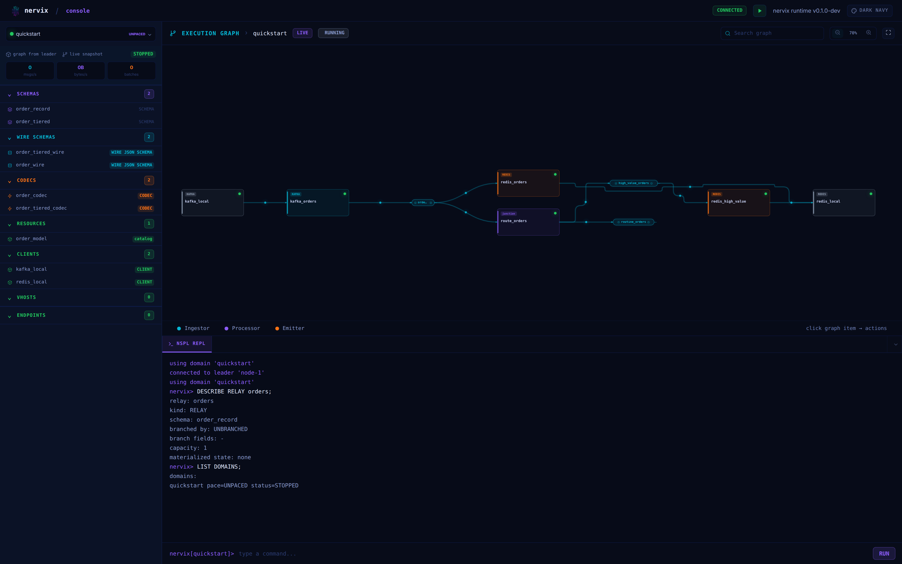
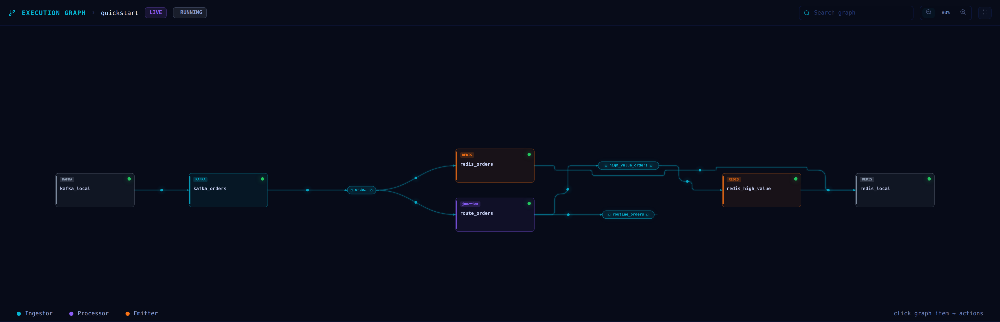
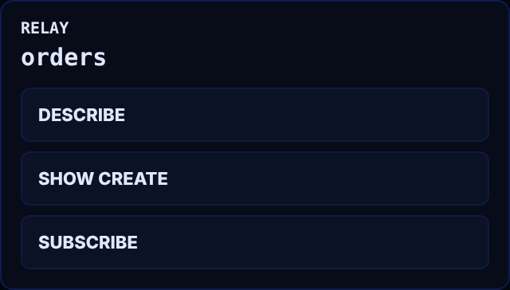
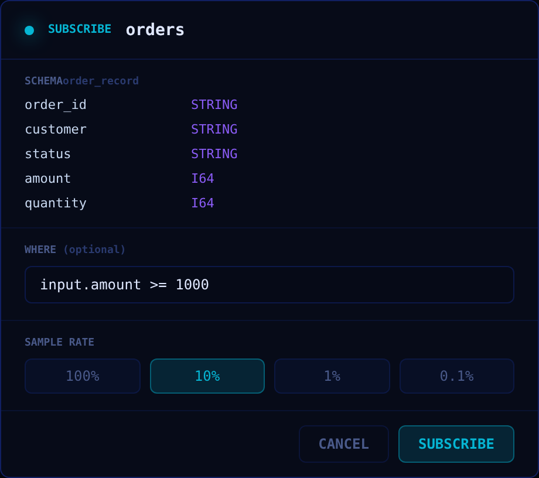
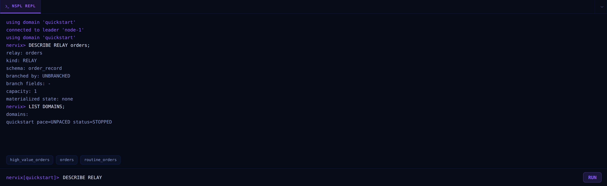
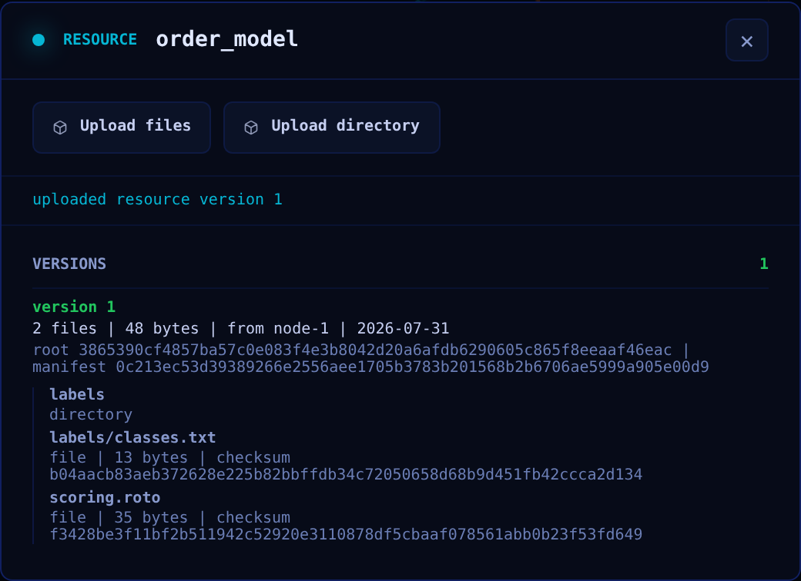

# Web Console

*Plexus, the Nervix graph definition language.*

Every Nervix node serves a browser console. It combines a live drawing of the running execution
graph with a Plexus command line, so the same session can be used to read a graph and to change it.



## Opening The Console

The console is served by the node itself; nothing extra is deployed. It listens on `0.0.0.0:47420`
by default and is served under `/console/`, with `/` and `/console` redirecting there:

```text
http://127.0.0.1:47420/console/
```

Change the address with `--web-console-listen-addr` or `NERVIX_WEB_CONSOLE_LISTEN_ADDR`. The
published ports differ by installation method: see [Docker](installation-docker.md) and
[Kubernetes Operator](installation-kubernetes.md).

To serve HTTPS, configure `--web-console-https-listen-addr`, `--web-console-tls-cert`, and
`--web-console-tls-key`. Set `--web-console-advertise-addr` to the client-reachable HTTPS host and
port on each node; leader redirects then advertise HTTPS and the console reconnects over `wss`.
Without an explicit advertise address, the HTTPS listen address is used. The certificate must be
trusted by the browser and cover that host. It is loaded at startup, so restart after rotation.
These options configure the console independently of the native session listener's TLS options.

Opening the console on a follower works when the leader advertises a browser-reachable console
URL. The console follows that redirect, reconnects there, and reports which node it reached:

```text
connected to leader 'node-2'
```

The console reports the leader each time its session connects, so the notice appears again when
the session reconnects: after a lost connection, after a reply that breaks the session contract, or
after a leader change. A reconnect keeps the session's place: the console connects again where the
redirect took it, selects its domain, attaches its clock, restores its subscription tabs and
attaches its transaction again, and then sends its pending commands under their execution
references.

The browser page stays at the URL you opened, while its session and upload requests follow the
leader's advertised console URL. Later reconnects keep using that destination until another
redirect changes it. If the redirect has no leader console URL, the console prints a topology
notice and retries its current destination. Configure each node's advertised console address so
the browser can reach it after a leadership change.

## Signing In

Without credentials in the URL the console shows a login form for a registry user. Automation and
bookmarks can supply `?auth=<base64(user:password)>`, with the token URL-encoded. The browser app
reads credentials from that query parameter or the login form. An `Authorization: Basic` header
authenticates the server's console requests, but supplying it when loading the page does not sign
the browser app in; the page still shows its login form.

The query parameter puts credentials into browser history and server access logs, so prefer the
login form for anything but a local cluster.

## Layout

The console is one screen with three regions:

- the **sidebar** on the left: the domain selector, live throughput for the selected domain, and
  the domain's entities grouped by kind — schemas, wire schemas, codecs, resources, clients,
  vhosts, and endpoints
- the **execution graph** in the upper right
- the **REPL** below it, which also hosts any relay subscriptions you open

The top bar carries the websocket connection state, the node panel, the global **Create** menu, the
**Backups** button, the domain lifecycle button, the selected clock state, and the theme picker. The
clock panel below the domain selector shows the selected domain's clock in detail.

### Following cluster events

The **Events** button beside the connection state counts the cluster events the console has
received, and opens the node panel that lists them, newest first. They are the membership and
leadership notices of the node the console is connected to: a node that joined, left or restarted
as a new incarnation, the node's Raft transitions, and the membership operations it proposes while
it leads. A membership event repeated within one session is shown once with its count, for example
`node 'node-3' left ×2`. The panel keeps the events of earlier sessions after a reconnect, up to its
newest 256 entries; the count on the button keeps every event received.

```text
node 'node-3' joined (incarnation 1793845627114630656)
node 'node-3' left
raft transition: state=Follower leader=node-2 term=3 last_log_index=41 last_applied=41
```

These events never enter the REPL transcript. Runtime and control-plane failures and committed
cluster-parameter revisions still appear there as notice lines, beside the command outcomes.

The server-supplied notice kind selects the panel or transcript; its message is display text.
Creating a model, starting a domain or changing subscription interest alone adds no membership
event. The command's own outcome reports its completion. The
[session protocol](./client-session-protocol.md#what-a-session-is-told) defines all five notice
kinds and the notice stream's bounds.

Sidebar entries are counted per kind and each group collapses. Selecting an endpoint runs its
`DESCRIBE` in the REPL; selecting a resource does the same and opens its version dialog.
The **Cluster** footer reports the number of running domains, non-relay graph nodes, and relays
across the cluster graph. Its counters start at zero and are refreshed alongside the selected
domain's snapshot, so the first cluster totals arrive only after a domain is selected. With no
domain selected, the footer receives no fresh totals; its values do not establish that the cluster
is empty.

### Following the selected domain clock

Selecting a domain attaches the console session to its clock once. The console selects the first
listed domain on its own when none is selected or the selected one disappears, and selecting another
domain, from the domain menu or with a typed `USE`, detaches the previous clock first. The console's
session is served by the leader, so after a connection interruption or a leader change it attaches
the selected clock again on the new session; the server releases the earlier attachment when its
session ends. A new connection attaches the clock before it attaches the console's transaction
again, because a session that holds a transaction refuses clock attachments and detachments, so a
console inside a transaction keeps following its clock across a reconnect. The panel shows the
attached clock's typed state and START generation. For a paced clock it also shows logical now,
rate, period, skew, the logical origin and UTC anchor, and the latest accepted tick id and logical
boundary. Logical now is projected from the committed mapping at the browser's UTC, refreshed four
times a second; a browser whose clock differs from the cluster's can show a different projection.
The tick is the serving node's accepted observation. Stopped, uninstalled, and unpaced states have
no projected logical time. A refused attachment shows its reason and is not retried until the
selection or connection changes.

The panel and the top bar's `CLOCK` state name the attachment's phase: `NO DOMAIN` without a
selection, `ATTACHING` until the attach reply, `STOPPED`, `UNINSTALLED`, `UNPACED` or `PACED` while
it follows the clock, `INTERRUPTED` while the connection is lost, which shows no projection,
`REFUSED` with the server's reason, `DETACHED` after a typed detach, and `ENDED` with its reason
once the server ends the attachment, which the console does not attach again until the selection
or connection changes.

The terminal's connected-to-leader message confirms the new session's serving node. The selected
clock remains `ATTACHING` until its own attach reply arrives, including when a new session restores
it after a leader change. Its `PACED` state and advancing ticks establish restored-clock readiness.

## Creating Entities From Forms

The top bar's **Create** menu opens keyboard-accessible forms for domains, placement rules, users,
resource catalogs, schemas, wire schemas, branches, relays, subscriptions, codecs, signaling
protocols, clients, VHOSTs, endpoints, hash maps, Roto UDFs, ingestors, emitters, junctions,
deduplicators, reorderers, window processors, correlators, reingestors, generators, inferencers,
and WASM processors: every current creation statement, as [Creation Coverage](#creation-coverage)
lists. Contextual actions open the same forms in the selected domain: the **＋** beside the
**Schemas**, **Wire Schemas**, **Codecs**, **Clients**, **Vhosts** and **Endpoints** sidebar
headings, whose wire-schema action asks for the JSON, CBOR or AVRO format; the resource group's
**Create resource in this domain**; and the execution graph's **PLACE** and **SUBSCRIBE** item
actions. A form keeps its unfinished draft when it closes, restores focus to the action that opened
it, reports validation and server failures inline, and shows the canonical Plexus statement before
submission.
An expression typed into a form, such as a filter, a `WHERE` predicate, an assigned value or an
invocation argument, reads exactly as it does in a typed statement: its [string literals](filter-map-functions.md#literals) are verbatim, so a
backslash is an ordinary character.
The domain form supports paced and unpaced clocks, period and skew for a paced clock, and
`IF NOT EXISTS`. User and resource forms support their corresponding names and the same creation
modifier.

Pace and placement policy are typed choices supplied by the session server. They are searchable and
paged independently, and neither depends on another selection. Loading and no matches have separate
neutral messages. A missing prerequisite, such as a captured
domain or a selected relay for its field list, shows a neutral hint naming what to choose. A stale
choice page shows a neutral message and **Retry**, which requests a fresh first page. Lookup and
session-channel failures remain alerts on the control. A reply the console cannot read ends the
session instead, which the REPL reports, and the control asks again once the console reconnects.
These states apply to every form's server-backed choices. An edit, dialog close, or replacement
session makes an older reply ineligible to change the form.

A placement form creates a named [placement rule](placement.md) in its captured domain. Its
coverage is **Entire domain**, which writes `DOMAIN WIDE`, or **Corridor**, which writes `FROM` and
`TO` members. Each side's members come from a searchable, paged list of the runtime nodes a rule may
name, decided by the same rule that validates a placement: ingestors that execute on every cluster
node, entities that are not runtime nodes, and names that more than one eligible entity shares are
not offered, and each candidate shows its kind. The list includes runtime nodes staged earlier in
the attached transaction. Members are kept in the order they were chosen, can be moved and removed,
and appear once per side; that order is the order the rule writes. All four policies are offered on
one page, and `RANK` is an optional positive whole number. A side without members, `RANK 0` or a
rank beyond 64 bits is refused inline before submission. A member selected before the draft moved
to another domain stays listed but must be selected again, and a member the server no longer has,
or a policy a covered hop does not permit, is reported inline from the server's refusal while the
draft stays editable. Switching a corridor to the entire domain keeps its members, so switching back
restores them. The graph's **PLACE** action on a runtime node or relay opens a new corridor draft
whose first `FROM` member is that item.

A resource draft captures the selected domain the first time it opens. If the console later
selects another domain, reopening the retained draft keeps its captured scope and offers **Use
current domain** as an explicit change. Domain and user creation are cluster scoped. Passwords are
sent in the canonical command but appear as eight asterisks in both the preview and REPL; the
cleartext value is never added to terminal history.

Submitting uses the same durable command path as the REPL. The form therefore keeps the command's
execution reference through redirects and reconnects, uses the attached transaction's expected
position, and reports **Editing**, **Submitting**, **Queued until reconnect**, **Queued in
transaction**, **Completed**, or **Failed** from the correlated outcome. While the command is
submitting or queued until reconnect, the form's fields and typed choices, their searches included,
are disabled along with **Create**, so the draft cannot change or be sent again and the form reports
that command's own outcome. A queued transaction operation is not presented as externally complete.
A successful standalone resource create opens the existing resource version dialog, where upload
identity and completion continue to be owned by the upload workflow.

The **Create** menu also opens forms for internal schemas, JSON/CBOR/AVRO wire schemas, and named
branches. Schema fields are added in declaration order and can be moved or removed. An internal
field selects its exact scalar type, then may wrap it in any sequence of variable vectors and
fixed arrays; each fixed array needs a positive length. Optional and sensitive flags are separate
controls. Wire fields select the types of their chosen format and an explicit `STRICT` or `LOOSE`
mode. JSON offers `string`, `number`, `integer`, `boolean`, and `array`; CBOR offers `integer`,
`float`, `boolean`, `text`, `bytes`, and `array`, with native byte strings for `bytes`. AVRO offers
the item types `boolean`, `int`, `long`, `float`, `double`, `string`, and `bytes`, and wraps the
picked item type in one array per added layer, building `array<item>` the way an internal field
builds vectors and fixed arrays; a layer can be removed again. Codec field encoding controls
select `RFC3339` or `BASE64` for explicit text interchange, as described in
[Schemas And Codecs](schemas-and-codecs.md#codecs).
A wire schema's format is part of its identity, so JSON, CBOR, and AVRO definitions may
share a name. The preview and submitted command come from the completed semantic Model's
canonical renderer, just as they do for the earlier forms.

A branch form selects an internal key schema from a server-backed, searchable, paged list, then
requires a TTL. Its partition count starts at 1 and accepts a whole number from 1 through 65535; the
preview omits `PARTITIONS 1` as `SHOW CREATE BRANCH` does. It may set a positive maximum instance
count with LRU eviction. The schema list
uses the draft's captured domain and the session's attached transaction prefix, so a schema staged
earlier in the same transaction is selectable. Changing the captured domain keeps a previous
selection visible but marks it invalid until it is selected again. An invalid branch key schema,
including one containing `BYTES`, is rejected by registry validation and shown inline with the
branch and field named. These domain-owned drafts keep their captured scope when reopened; **Use
current domain** changes it explicitly.

A relay form selects the relay's internal schema from the same kind of list, then states its
branching explicitly: **UNBRANCHED**, or **BRANCHED BY** with a branch chosen from a searchable,
paged list of the captured domain's branches. A new draft has chosen neither, and it cannot be
submitted until one is chosen, so a relay is never unbranched by omission. Capacity starts from the
default relay buffer and must be a positive count. Materialized state is **NONE** or `LAST BY
TIMESTAMP`. Both lists read the attached transaction prefix, so a schema or branch staged earlier in
the transaction is selectable, and a relay created while a transaction is attached is queued in it
like the other forms' creates. Changing the captured domain keeps the selected schema and branch
visible but invalid until each is selected again. The preview is the canonical `CREATE RELAY`
statement, which always states its capacity.

A codec form selects one current wire format: a declared JSON, CBOR, or AVRO wire schema; the
fixed SYSLOG format; a JAQ-native JSON, YAML, TOML, XML, or CBOR format; or Protobuf. The internal
schema is an exact typed selection. Declared wire-schema choices are limited to the selected
format, even when wire schemas of different formats share a name. JAQ-native and Protobuf codecs
choose ingestion (decode), emitting (encode), or both, and may add an emitting-batch program after
an emitting program. These are program editors: their contents remain jaq source in the current
codec Model, including quotes and whitespace. Field encoding rules select RFC3339 or BASE64 and
can be added in order where the format supports them. The preview renders the complete codec
Model as canonical Plexus.

The Protobuf controls select an existing resource and one of its completed versions, including
`LATEST`, then accept an optional `.proto` file and include root, additional compiler
configuration entries, message type, and optional batch message type. The resource list includes
catalogs staged earlier in the attached transaction; the version list offers completed uploads
only. `LATEST` stays unresolved in the draft and submitted command, and is pinned when the server
applies the statement. These controls never create a resource or upload a file as a side effect;
provision and upload it explicitly through the resource workflow. Changing the resource or captured
domain leaves an earlier version visible but requires selecting it again. A rejected program or
configuration reports failure inline and keeps the draft editable.

A signaling protocol form chooses JSON, YAML, TOML, XML, CBOR, RAW, or Protobuf. Protobuf uses the
same resource, version, file, include, and compiler configuration controls and requires separate
send and wait message types. The ordered handshake editor adds SEND and WAIT steps, moves or removes
steps, and keeps each step's jaq programs in written order. WAIT steps can have multiple matchers,
failure matchers, an optional capture when there is exactly one matcher, and ACCEPT DATA. The form
also offers connection-wide ACCEPT DATA, failure matchers, and the handshake timeout. Its canonical
preview and command preserve the order and raw program text. Both forms use the existing durable
command dispatcher and retain rejected drafts, transaction positions, and reconnect handling.

A client form offers every current transport as a typed selection. Connector `CONFIG` remains an
ordered key/value editor whose key hints come from the selected connector's declaration. Switching
connectors refreshes those hints. The server validates the declared key schema before admission;
the [Connector Capabilities](./connector-capabilities.md) tables describe required keys, types and
delegated namespaces. Accepted keys and values are passed to the connector unchanged; the form
does not provision external services, topics, buckets, tables, or other objects. Redis, Postgres,
MySQL, and MongoDB clients require explicit minimum and maximum pool sizes. A client may mount an
existing resource and a completed version. A WebSocket client may select a configured signaling
protocol. Switching transports clears transport-specific configuration and signaling choices;
changing the resource or captured domain invalidates its version selection. `LATEST` remains a
request until the server applies the statement, when the stored binding becomes an exact version.
Configuration rows can be marked secret, and common credential keys and URLs with passwords are
treated as secret automatically. Secret inputs use password controls. The preview and the command
line history mask those values, while the transmitted command keeps the actual values.

A VHOST form accepts ordered hostnames and may bind TLS to an existing resource and completed
version. A TLS VHOST installs its certificate in the HTTPS listener of every live node at command
completion, including nodes that do not lead or run the domain's graph. The certificate bundle
must already be uploaded; missing or invalid material follows the existing command failure path
and leaves the draft editable. An endpoint form selects an existing VHOST, requires a path, and
chooses HTTP or WEBSOCKETS. A WebSocket endpoint may also select a signaling protocol. VHOST and
signaling lists are typed, searchable, paged, and scoped to the captured domain, including the
attached transaction prefix. An upstream selection or domain change refreshes dependent choices;
stale selections must be chosen again before submission. A completed VHOST or endpoint is usable
immediately by later commands through the same session.

A hash map form selects a resource, a completed version or `LATEST`, a codec, and a key field from
that codec's output schema. It also requires the file path within the resource. Codec and key
choices read the captured domain and the attached transaction prefix; changing the codec makes an
earlier key selection invalid until selected again. A changed resource invalidates its version,
and changing the captured domain invalidates all references while leaving them visible for
correction. `LATEST` remains unresolved in the draft and canonical command; the server pins it
when the statement applies. The form shows **Completed** only after the resource file has decoded
and the lookup index is ready. A malformed file or unavailable version reports failure inline and
keeps the entered path and selections for inspection. A successful hash map can be queried with
`LOOKUP` or used by `LOOKUP_HASH_MAP` immediately.

A Roto UDF form keeps arguments in declaration order, with exact scalar, vector, and fixed-array
types and separate optional flags. The result has the same type controls. The current language is
`ROTO_0_13`, with an explicit volatility control. The source editor preserves its complete text,
including quotes, whitespace, the named function body, and Roto `test` blocks; canonical Plexus
chooses a safe dollar-quote delimiter around it. The server checks the declared signature exactly
and runs the Roto tests before **Completed** appears. Compilation, type, or test failure keeps the
signature and source editable. A completed function is available to `udf::` calls in later
commands under the same session and domain.

An ingestor form offers every connector and entity an ingestor reads through a transport:
`HTTP REQUEST`, `HTTP ENDPOINT`, `KAFKA TOPIC`, `PULSAR TOPIC`, `MQTT TOPIC`, `NATS SUBJECT`,
`NATS STREAM`, `RABBITMQ QUEUE`, `REDIS PUBSUB`, `PROMETHEUS QUERY`, `ZEROMQ PULL`, `SQS QUEUE`,
`WEBSOCKETS CONNECTION`, `WEBSOCKETS ENDPOINT`, and `SYSLOG LISTENER`. Its client or endpoint is a
typed choice limited to that pair: clients of its connector, or endpoints of the `TYPE` its head
names. The preview writes the statement under that pair's head. The entity declaration supplies
the locator, options, option choices, delivery modes and quiesce modes in declared order. Controls
use the declaration's keywords, and optional value placeholders
show declared defaults, including Prometheus `MAX BODY SIZE` (`16MiB`). HTTP and WebSocket endpoints
offer `NO ACK` and `ACK`; choosing `ACK` exposes its maximum and timeout and requires `REJECT`
on quiesce. Buttons whose declared option requirements are unmet stay disabled, including MQTT
ACK or SUSPEND without `SESSION PERSISTENT` at `QOS 1` or `QOS 2`. A required option, such as an
MQTT topic's `SESSION` and `QOS`, starts unchosen and has no default: the draft refuses to build
until each is chosen, and validates the declared requirements too.
Switching ingestors refreshes the option controls and quiesce choices from the selected entity.
A WebSocket connection edits literal upgrade headers as
ordered name/value rows. An `HTTP REQUEST` edits its request headers as ordered rows too: a row
holds a literal value, or, with **Client secret** checked, the client key it reads, and the preview
shows `CLIENT SECRET '<key>'`. A RabbitMQ queue offers its declared `NO ACK`, `ACK SEQUENTIAL` and
`ACK PARALLEL` modes; the parallel window, batch timeout and retry settings are retained in the
preview and submitted command. A topic,
queue, subject, channel, consumer group, queue group or subscription keeps its text exactly as
typed, case and spaces included, and the form refuses a name its entity's rule refuses. A
`PULSAR TOPIC` subscription also requires an explicit ownership choice, `OWNED BY INGESTOR START AT EARLIEST` or
`PROVISIONED`, and an explicit `TYPE`, neither of which the form defaults. The decoding codec list contains only codecs that
support decoding. Timestamp behavior must be chosen explicitly: source timestamp, `NOW`, or `AT` a
typed field from the codec's output schema.

Each ingestor route explicitly chooses an unbranched or named branch and a relay with that exact
branch declaration. Routes can be added, removed, and moved in order. They edit inheritance,
ordered output assignments and function invocations, an optional `WHERE` expression, branch key
assignments, an explicit flush policy, and a route-local message error policy. An ingestor error
route selects an unbranched relay and its own field assignments. The node-wide general error
policy is also required. The draft retains incomplete values and shows the canonical Plexus preview
only when every required choice and expression is valid. It submits through the usual durable
command path, including attached transactions and reconnect recovery.

A junction form chooses its exact unbranched or named branch before its input relays. A reingestor
chooses inputs first and gives each output route an independent branch action: preserve the input
branch, become unbranched, or construct a named branch from ordered key assignments. Additional
inputs are offered only when their declared schema and branch match the first input exactly.
Both forms keep input predicates, optional collection bounds, materialized dependencies, and
output routes in visible order. A materialized dependency resolves against the incoming branch and
requires `REQUIRED SKIP`, `REQUIRED WAIT`, or `DEFAULT` with ordered assignments. Each transforming
route has ordered inheritance, output assignments, and invocations, an optional predicate, an
explicit flush policy, and a route-local message error policy. Server-backed choices restrict
output and error relays to the required branch and offer only materialized relays for state. A
changed domain or dependent reference keeps the draft visible and requires the affected choice to
be selected again. The preview and durable submission use the completed semantic Model; registry
validation reports any remaining schema, branch, sensitivity, or graph error inline.

A deduplicator or reorderer form follows the junction form's contracts: it chooses its exact
unbranched or named branch before its input relays, offers additional inputs and its output, error
and state relays under the same schema and branch rules, and keeps input predicates, collection
bounds, materialized dependencies, and routes in visible order. It also edits its ordered
`DEDUPLICATE ON` or `BY` expressions and its `MAX TIME` duration. Expressions can be added, removed,
and moved, and their written order is the key or ordering order the preview and the stored Model
keep. The form requires at least one expression, reads each as a typed expression before the
preview appears, and requires a duration, which it keeps exactly as typed. The registry reports a
key or ordering expression that does not compile against the input schema, or a duration it cannot
read, inline while the draft stays editable. [Deduplicator](processors.md#deduplicator) and
[Reorderer](processors.md#reorderer) describe the keyspace, ordering, and holding-time semantics.

A window processor form follows the same branch, input, state, and relay rules. It edits its `WIDTH`
and `STEP`, each as a message count, a duration, or both, and an optional `MAX STATE SIZE` that caps
the state of each branch with a byte size such as `1MiB`. Its routes are set-only and emit on the
window's cadence, so the form offers no inheritance, invocation, or flush policy, and each route
requires at least one output assignment. Window input is read only inside an aggregate argument:
beside the output assignments, the operator names an aggregate such as `COUNT` and chooses one of
the input relay's fields, and the form appends `count(input.<field>)` to the last assignment. Typed
operators and constants combine aggregates into larger expressions. The form keeps bounds and
sizes as typed until it builds; the registry reports a step that does not fit its width, an
aggregate, scope, or function a route cannot read, a nested aggregate, or an unassigned required
output field inline while the draft stays editable.

A correlator form chooses its exact unbranched or named branch before its `LEFT FROM` and
`RIGHT FROM` relays. The first right relay may use another schema than the left side; each side
offers additional relays with its own first relay's schema and branch, and keeps its own input
predicates and collection bounds. The correlation section inserts the left and right relays'
fields as `left.<field>` and `right.<field>` into `CORRELATE WHERE`, and requires an explicit
`MATCH EARLIEST` or `MATCH LATEST`, a `MAX TIME` duration, and each side's timeout action: `DROP`,
or `SEND TO` a relay with that side's schema and branch. A correlator has no node-wide filter and
no default input scope. Its set-only routes insert left and right fields into their last output
assignment, require at least one assignment, and require an explicit flush policy. The registry
reports a scope a correlator does not expose, such as `input`, inline while the draft stays
editable. [Window processor](processors.md#window-processor) and [Correlator](processors.md#correlator)
describe the aggregate, cadence, matching, and timeout semantics.

A generator form reads no input relays, so it has no input list, acknowledgement mode, node filter,
or materialized dependencies. It chooses its exact unbranched or named branch, then its
materialized relay: the session offers only relays with materialized state on exactly that branch,
through the generator-materialized-relay choice, and a changed branch or domain requires the relay
again. `EACH` is a domain-clock period such as `100ms`, read as the language reads it; the first
occurrence is immediate and later ones keep that schedule. Its set-only routes are offered relays
with the materialized relay's branch, require at least one output assignment and an explicit
flush policy, and insert the materialized relay's fields as `relay_state.<relay>.<field>` and, for
a named branch, the key's fields as `branch.<field>` into the last assignment. No picker offers a
live input, which a generator does not have; the registry reports such a scope inline while the
draft stays editable.

An inferencer form follows the junction form's branch, input, filter, acknowledgement, state and
relay rules. It selects a resource and one of its completed versions or `LATEST`, which stays the
requested version until the statement is applied, and the model `FILE` inside that version. Its
tensor section edits the ordered `INPUTS`, the optional `STATE` and the ordered `OUTPUT SCHEMA`.
Each tensor names its model port and declares its dense `F32` shape axis by axis: a positive
fixed size, `DYNAMIC`, or `BATCH`. An `INPUTS` mapping holds an expression over the live input,
into which a picker inserts `input.<field>`; a `STATE` binding names its input and the output it
comes `FROM` and requires `INITIAL ZEROS` or an `INITIAL` constant. The form shows the execution
mode the shapes imply, per message or batched, and the refusal of shapes that mix the two or
give state a `BATCH` axis, by the inferencer Model's own rule; the registry applies it when the
statement is created. Routes are set-only with an explicit flush policy: they insert each output
tensor whose name is a field name as that generated field and, for a named branch, the key's
fields, and never offer the live input. The model file is read when the inferencer is created, so
a missing or unreadable file, like a mapping the model rejects, is reported inline while the
draft, its tensors included, stays editable.

A WASM processor form follows the same branch, input, filter, acknowledgement, state and relay
rules, and the same resource, version and `FILE` choices for its guest module. `MAX FUEL` is a
whole number of fuel units and `MAX MEMORY` a byte size such as `64MiB`; both are required and
positive. `ON REJECTED STATE` starts at `PRESERVE`, and the form states the consequence of each
choice: `PRESERVE` keeps a snapshot the recreated guest refused and reports the refusal until an
operator acts, while `RESET` replaces that branch's state lifetime once through the coordinated
reset, starting it from the guest's initial state. `ON GLOBAL ERROR` requires `LOG` or `IGNORE`.
The guest owns when its routes emit, so a route declares no flush policy; its set-only
construction inserts the guest's output fields, one aligned to each field of the route's relay,
and, for a named branch, the key's fields. The guest module is compiled when the processor is
created, so a missing or invalid module, or a route that reads the live input, is reported inline
while the draft stays editable. [Generator](processors.md#generator),
[Inferencer](processors.md#inferencer) and [WASM processor](processors.md#wasm-processor) describe
the cadence, tensor, state and guest semantics.

An emitter form starts with its connector and entity, then selects the configured client or the
schema a client consumer publishes. Its searchable input list preserves written order and offers
additional relays with the same payload schema; those relays may have different branch
declarations. Input predicates, optional collection bounds and attachment are explicit controls.
The form offers the publishing modes, envelope clauses, properties and batching choices declared
by that entity. Acknowledged broker and client modes require a sequential or bounded parallel
window and an acknowledgement timeout; every mode requires its retry policy. Database emitters
require their declared batching bounds, and Iceberg requires its catalog, location and commit
cadence. External names retain their spelling, and configured client keys remain with the client.

Payload controls choose a compatible encoding codec, direct ordered `VALUES` mappings, native
client output, or HTTP `WITHOUT BODY`, as the entity permits. HTTP method and path expressions
and supported header invocations remain editable independently of the body. Ordered construction,
materialized dependencies, flush and error policies use the same semantic Models as the REPL.
Materialized-state and error-relay choices must fit every input's branch declaration. Changing a
domain or prerequisite selection invalidates dependent references while retaining the draft.
The canonical preview and submission use the existing command path, including transaction
prefixes, final registry validation and reconnect recovery. See [Emitters](emitters.md) for the
entity-specific types, sensitivity rules, external provisioning and delivery guarantees.

### Creation Coverage

Every creation family has exactly one form, and the console's dispatch over families is keyed by
the vocabulary's own Model kinds beside the four statements outside it, so a kind the vocabulary
gains does not build until the console decides its form. No family uses a whole-command text box
as its form; where a contract is source text, the form embeds an editor for exactly that text.

| Statement | Form | Variants the form offers | Embedded text editors |
| --- | --- | --- | --- |
| `CREATE DOMAIN` | Domain | `UNPACED`, `PACED` with period and skew | — |
| `CREATE USER` | User | — | — |
| `CREATE RESOURCE` | Resource | — | — |
| `CREATE SUBSCRIPTION` | Subscription | a session subscription to one relay | filter expression |
| `CREATE PLACEMENT` | Placement | `DOMAIN WIDE`, corridor `FROM` / `TO`, all four policies | — |
| `CREATE SCHEMA` | Schema | every internal scalar type with vector and array layers | — |
| `CREATE WIRE JSON`, `CBOR`, `AVRO SCHEMA` | Wire schema, one per format | each format's wire types, `STRICT` and `LOOSE` | — |
| `CREATE BRANCH` | Branch | key schema, TTL, partitions, LRU eviction | — |
| `CREATE RELAY` | Relay | `UNBRANCHED`, `BRANCHED BY`, materialized state | — |
| `CREATE ... CODEC` | Codec | declared wire schemas, `SYSLOG`, every JAQ-native format, Protobuf | jaq programs |
| `CREATE SIGNALING PROTOCOL` | Signaling protocol | JSON, YAML, TOML, XML, CBOR, RAW, Protobuf | jaq programs |
| `CREATE ... CLIENT` | Client | every connector with a client declaration | `CONFIG` values, passed through |
| `CREATE VHOST` | VHOST | hostnames, optional TLS binding | — |
| `CREATE ... ENDPOINT` | Endpoint | `HTTP`, `WEBSOCKETS` with optional signaling | — |
| `CREATE HASH MAP` | Hash map | resource version, codec and key | — |
| `CREATE UDF` | Roto UDF | typed arguments and source tests | Roto source |
| `CREATE ... INGESTOR` | Ingestor | every declared ingestor connector and entity | expressions |
| `CREATE ... EMITTER` | Emitter | every declared emitter connector and entity | expressions |
| `CREATE JUNCTION`, `DEDUPLICATOR`, `REORDERER`, `WINDOW PROCESSOR`, `CORRELATOR`, `REINGESTOR`, `GENERATOR`, `INFERENCER`, `WASM PROCESSOR` | One form per processor family | each family's inputs, state, routes and policies | expressions |

The sections above give each form's optional clauses. A transaction can stage a whole graph through
these forms: each create is queued at its position in the attached transaction, later forms offer
what earlier ones staged, the transaction inspector supplies the commit basis, and the attached
transaction and its queued creates survive the console following a new leader.
[Visual Creation And Shared Completion](./visual-creation.md) explains how drafts, choices,
completion and submission are built and qualified.

## The Execution Graph



The graph is redrawn from snapshots the leader pushes twice a second. It shows external clients,
ingestors, processors, relays, and emitters, connected in the direction records flow.

Records always travel from left to right. Items sit in columns ordered by how far a record has
travelled, and every item appears to the right of everything that feeds it. Relays get columns of
their own between the processing columns, drawn as labelled capsules with a bar per buffer quantile
and the p50/p90/p99 depths on hover, so a relay reads as the port its producers converge on and its
consumers fan out from. A pipeline with no branching or fan-out is drawn as a single straight line.

Edges run horizontally and vertically with rounded corners, through gutters kept clear of the
items, so no edge ever passes under a node, a capsule, or a label. Each edge leaves and arrives at
its own attachment point, so a node with several outputs fans out visibly rather than from one
spot. Two relations between the same pair of items stay two edges: a node that both reads a
relay's records and looks up its materialized state draws one edge of each style, side by side.
Edge style carries meaning:

- **solid** — records flowing
- **dashed, error tint** — a route's `ON MESSAGE ERROR` destination
- **dashed, warning tint** — a correlator's `ON TIMEOUT` destination; a correlator's two inputs are
  labelled `LEFT` and `RIGHT`
- **dotted, hollow arrow** — a materialized-state dependency, including the relay a generator reads
  with `USING MATERIALIZED STATE`. State is looked up rather than delivered, so these edges carry
  no rate

A graph that feeds back on itself — a reingestor writing a relay that reaches it again — draws that
one edge as a marked return path above the items it spans, so backwards travel is never mistaken
for forward flow. Disconnected parts of a graph are stacked as separate bands.

When traffic is flowing, each edge carries its own rate, with the full messages, bytes, and batches
per second on hover, and a pulse travelling along the edge. Where a node declares several routes to
the same relay they are drawn as one edge, and hovering reports how many routes it stands for.

Branch groups are drawn as a tinted region with a stacked outline around the part of the graph that
runs per branch, containing exactly the items that run per branch and nothing else. Regions of
different branches never touch, even where they share a column. The region is
headed with the branch name, its key fields, and how many branch instances are currently live; the
outline thickens with that count. The count comes from the per-branch statistics of the graph
snapshot, which name each concrete branch by the lowercase hexadecimal fingerprint of its key, so a
snapshot never carries key values a branch schema may declare `SENSITIVE`. The ingestors and
reingestors that construct the branch, and the emitters and reingestors that collapse it, sit on
the region's border rather than inside it. Clicking the header opens the branch's key schema and
its live instances.

The toolbar controls framing. Search highlights matching items, dims the rest, and brings the
matches into view; the zoom buttons step in tens and `Ctrl`/`Cmd` with the scroll wheel is
continuous, both between 25% and 300%; **FIT** frames the whole graph, which is also the view you
start with; the fullscreen button expands the graph over the whole window. Dragging pans. The
graph moves only when the topology changes, and never because traffic changed.

The header carries the domain's lifecycle state — `RUNNING`, `PAUSED`, or `STOPPED` — and the state
of the feed: `LIVE` while snapshots arrive, `STALE` when they stop, and `OFFLINE` when the session
is disconnected. A stopped domain still draws its whole graph, with no rates and no pulses.

A domain with no installed graph shows `NO ACTIVE DATAFLOW GRAPH` instead.

### Item Actions



Clicking any node or relay opens its action menu. Each action types the corresponding statement
into the REPL and runs it, so the console never does anything you could not have typed:

- **DESCRIBE** — the runtime view of the item, where the item has a `DESCRIBE` form
- **SHOW CREATE** — the Plexus that declares it
- **SUBSCRIBE** — relays only; opens the subscription form described below for that relay, whose
  tab runs the same `CREATE SUBSCRIPTION` the REPL accepts
- **PLACE** — ingestors, processors, emitters and relays; opens a new corridor placement draft
  whose first `FROM` member is that item, described in
  [Creating Entities From Forms](#creating-entities-from-forms)

### Node Health

Nodes are drawn with their runtime status. A node whose external connection has failed is marked in
error, and an ingestor or emitter waiting to reconnect shows a countdown to its next attempt.
Hovering a node reveals the underlying reason. Metrics for alerting belong in the observability
endpoint rather than here — see
[Metrics And Observability](metrics-and-observability.md#observability-server).

## Subscribing To A Relay



The **Create** menu's subscription form opens a read-only session subscription as a tab beside the
REPL. A relay's **SUBSCRIBE** action opens the same form as a new draft for that relay in the
graph's domain, while the **Create** menu reopens the retained draft. A draft starts under a
generated name such as `web_console_subscription_2`, which can be edited; names are unique among the
console's tabs.

The relay is selected from a searchable, paged list of the captured domain's relays. The selected
relay's fields are listed in declaration order with their exact types, `OPTIONAL`, and `SENSITIVE`;
selecting one inserts a typed `input.<field>` reference into the filter. The filter is the `WHERE`
predicate over the relay's record. While it is edited, the form shows its canonical reading, and it
refuses to submit text that is not an expression. Checking the fields, scopes, and types the
predicate uses belongs to the server, which reports a failure such as a string compared with an
integer field when the subscription is created. Delivery is `BLOCKING` or `DROPPING`, and batch
sampling takes a rate from 0 through 1 that each selected row passes with that probability. The
preview is the canonical `CREATE SUBSCRIPTION` statement the tab sends.

Submitting opens the tab through the same subscription lifecycle as a `CREATE SUBSCRIPTION` typed in
the REPL. The tab waits until the session can serve it, opens and becomes active once the server
announces the schema of its rows, and streams records into it. The form reports **Completed** once
the tab is open. It reports **Failed** with the server's reason, such as a relay that no longer
exists, a filter the server cannot compile, or an open transaction, and then no tab remains and the
draft stays editable. A name an open tab already uses fails before anything is sent. After a
reconnect or leader change, the console restores each open tab once under its name; the form does
not submit it again.

The console restores its tabs before it attaches the session's transaction again, because a session
that holds a transaction refuses subscriptions, so an open transaction does not keep a tab from
coming back. A tab stays **restoring** until the server answers. Restoration includes the complete
schema the tab previously acknowledged. If the domain or relay no longer exists, or the relay's
schema changed, the refusal turns the tab **ended**, retaining its rows and the reason. The tab
offers the same **↻** resubscribe action as a subscription the server ended.

Other restoration failures leave the tab **interrupted**. Each attempt reports its typed refusal,
server diagnostics and next wait in that tab, preserving the REPL's history. Retry waits start at
one second and double to five seconds while the session holds no transaction. The shared retry
timer may add up to one second to that minimum wait. Closing the waiting tab stops its retries and
frees its name immediately. A replacement connection restores desired tabs immediately before
reattaching a transaction and starts a fresh retry sequence.

When a relay is redefined or removed, the server ends the subscriptions that read it. Such a tab
turns **ended**: it keeps the rows it showed together with the reason, receives nothing more, and
is not restored after a reconnect, which would not change why it ended. Its **↻** button
resubscribes it under the same name with the statement that first opened it. The tab shows
**resubscribing** until the server answers, then becomes active again with the relay's current
schema. A refusal, such as a relay that no longer exists, leaves the tab ended with the reason. An
ended tab keeps its name until it is closed, so resubscribe it or close it before opening another
subscription with that name.

Closing the tab ends the subscription; closing an ended tab only removes it, because the server
already ended its subscription. Subscriptions are read-only views: they cannot construct, inherit,
or produce side effects. See [Sessions](sessions.md).

## The Plexus REPL



The REPL accepts the same Plexus as the command line client, including the client-local statements
`USE`, `LIST DOMAINS`, `BEGIN`, `COMMIT`, `REVERT`, and the subscription statements. A typed
`CREATE SUBSCRIPTION` opens a tab in the selected domain exactly as the subscription form does, and
`DELETE SUBSCRIPTION <name>` closes the open tab of that name. The prompt shows the active domain,
and marks an open transaction the same way the terminal client does:

```text
nervix[quickstart]>
nervix[quickstart tx]>
nervix[quickstart committing]>
```

The console sends a statement whether or not a domain is selected, and the server decides whether
it needs one: `SHOW CLUSTER STATUS` or `CREATE DOMAIN` runs with no domain selected, while a
statement that acts on a domain fails with `no active domain selected`.

A typed `BACKUP` runs through the [Backups](#backing-up-and-restoring) dialog, which opens to show
its progress and downloads its archive. A typed `RESTORE` opens the dialog's restore form with the
statement's options, because the browser cannot read the path the statement names. `BACKUP`,
`RESTORE`, and `DESCRIBE BACKUP` must each be sent on their own, and `DESCRIBE BACKUP`, which reads
an archive file on the client's machine, runs only in `nervix-cli`.

The REPL renders attachment outcomes, domain-clock state and tick frames, and attachment ends.
Tick entries include the id, boundary, authority UTC observation, and serving node's logical
reading. Every tick adds a line, so a fast clock can push earlier output out of the REPL's latest
256 lines. `ATTACH DOMAIN CLOCK` and `DETACH DOMAIN CLOCK` typed into the REPL use the same
session-local requests as the automatic attachment, and the console refuses them itself while a
transaction is active. A typed second attach is refused as already attached. A typed detach
releases the clock and leaves the panel detached until a typed `ATTACH DOMAIN CLOCK`, another
domain selection, or a new connection restores following.

`BEGIN` requires a selected domain that already exists and binds the transaction to it. The
console follows the transaction's domain, so attaching switches the domain selector to it.
`DESCRIBE TRANSACTION` prints the open transaction's impact report between queued statements, and
with an id it reads another transaction of the same user while the prompt, domain selector, and
attached transaction stay as they were. See
[Plexus Overview](plexus-overview.md) for its forms and output.

Before typing `COMMIT`, inspect the attached transaction at its current position with
`DESCRIBE TRANSACTION;` or **Transaction · Inspect**. The console refuses to send the commit until
that inspection is complete; [Inspecting a transaction](#inspecting-a-transaction) explains when
to refresh it after another queued statement or a stale-preview refusal.

Every persistent command keeps one execution reference while the browser waits, reconnects, or
follows leadership. When its outcome is not known yet, the console repeats it on the open session
after a wait that starts at 250 milliseconds and doubles to at most five seconds. The command keeps
its position ahead of later held commands, while session messages continue to arrive. The selected
domain, clock and relay tabs keep their existing attachments. A redirect or an ended connection
triggers recovery; an uncertain reply alone leaves the connection open. A reply whose outcome names
another execution reference than its command's is a protocol violation: the console reports it with
both references, takes nothing from that reply, neither its result nor its redirect, transaction or
retry, and stops reading the connection. It reconnects as after a lost connection and sends the
command again in its place under its own reference, so the leader answers with the command's own
outcome; a Create form shows **Queued until reconnect** until then. The transaction id and
status are replicated. A reply that cannot be decoded or reassembled also violates the session
contract, and so does a readable reply of a kind that does not answer its request, such as a
domain listing under a command's request identity: a request is answered only by its own outcome,
a rejection or a cancellation. The console checks a reply's kind before it applies anything the
reply carries, so it takes no listing, selection, subscription, clock attachment, transaction or
redirect from a reply of another kind and never shows it as the command's failure. It reports why
the reply broke the contract and stops reading that connection. Every command still waiting keeps
its whole original request and its place in the issue order, including its reference, transaction
position, preview and uncertain-outcome retry history. The next connection restores the session before repeating those commands; a visual Create
waits for its own recovered outcome.

If the WebSocket closes
unexpectedly or leadership changes, the console reconnects and attaches that id before resuming a
pending command. Each append is matched by its reference and expected position, and an outstanding
commit remains pending through `COMMITTING` until its exact terminal result. A
finished or failed attach does not settle pending commands: the console sends each under its
original reference and position to recover its own outcome, or a failure if it was never admitted.
The Create form then leaves **Queued until reconnect** with a completed or failed result. A
second session can attach the same owner's transaction and take it over; the displaced console
then gets an explicit takeover error. A clean console session close reverts an open transaction,
while an accepted commit continues on the leader without the browser. See
[Replicated Plexus Transactions](control-plane.md#replicated-plexus-transactions) and
[Client Session Protocol](client-session-protocol.md).

Connector expression completion follows the same entity declarations as the
[CLI](./client-tools-cli.md#completion), including filters, HTTP request expressions, `ALTER`
constructions and typed metadata fields. Header functions are offered only in a supported scope.

`Tab` cycles through completions offered by the server for the current cursor position. `ArrowUp`
and `ArrowDown` walk the session's command history, `Ctrl`/`Cmd` with `Enter` submits, and `clear`
empties the scrollback.

Accepting a candidate replaces its exact source range, including the rest of a word after the
cursor, while preserving surrounding text. The list shows one bounded page at a time; use **MORE
SUGGESTIONS** to fetch the next page. The console shows a message when the selected domain or
transaction context is missing or stale, or when the candidate lookup fails. An empty list with
no message means there are no matches.

### Bounded Buffers

The console holds a bounded amount of everything it keeps, however long it runs or however fast
its session delivers, and says where it left something out:

- The REPL and every subscription tab each keep their latest 256 lines, up to 256 KiB of text, and
  a line longer than that is cut. The first line then says that earlier lines were omitted.
- The command history behind `ArrowUp` and `ArrowDown` keeps the latest 256 commands, up to
  256 KiB. Walking back to the oldest command kept says that earlier commands were omitted, and a
  command larger than the whole history says that it cannot be recalled.
- While the console connects or waits to reconnect, at most 64 requests of its controls wait for
  the session, carrying at most 4 MiB of statements, completion input, and search text. Once
  connected, controls can admit at most 256 outstanding requests carrying at most 16 MiB.
  Connection setup also restores the retained tabs, selected domain and clock, and transaction,
  so a full control backlog cannot prevent its own recovery.
  Every request shares the session's 64-place request window, including completion, choice lookup,
  domain selection, connection setup and transaction attachment. Requests wait for earlier terminal
  replies to free a place. Waiting controls respect the issue order of ready commands, subscription
  changes and inspections; setup and reattachment precede the commands waiting for them. A waiting
  completion is replaced
  by the latest input, and each choice control keeps its latest waiting lookup. Superseded requests
  already sent still count until their terminal replies, while their text and partial replies are
  released immediately. Waiting lookups, selections and attachments end with their connection;
  the replacement connection issues its own. A request past either bound is not sent, and the control
  that issued it shows why where its outcome would have appeared: the REPL, a form, a tab, the
  resource dialog, or the inspector. A completion request that is not sent reports a failed lookup
  rather than an empty list.
- The execution graph and sidebar keep only the latest snapshot of the selected domain. Selecting
  another domain replaces it with that domain's snapshot, which the server sends at once.
- A backup's download moves each 256 KiB chunk of the archive into the browser's own blob storage
  as it arrives, and the page holds one chunk at a time. A restore reads its archive file one slice
  at a time, at most 4 MiB while it digests the file and 256 KiB while it streams it, and keeps at
  most 1 MiB queued on its connection.

## Inspecting a transaction


Select **Transaction · Inspect** in the top bar while a transaction is active. The inspector reads
the typed impact report without attaching another transaction or changing the session domain.
Use **Discover transactions** to list retained transactions in the REPL, then enter a transaction
ID to inspect one. A `DESCRIBE TRANSACTION` command also opens its typed result in the inspector;
the REPL still prints the server's text or JSON rendering.

The outline groups accepted operations by their execution steps. Selecting an operation shows
its own planned contribution; selecting its step shows the effective pause and effects of the
atomic step. **Whole transaction** shows the union of the steps. Switch between **Before**,
**Changes**, and **After** without moving graph items, or between **Planned** and **Actual** to
review recorded progress. Search frames matching names and kinds; **FIT**, zoom, and drag control
the viewport. Select a node or relation for its before/after presence, roles, and contributing
operation numbers. The **Relations** list offers labeled buttons for keyboard selection of graph
edges, including parallel data and materialized-state paths. Role marks and the resource card
shape supplement the graph colors.

The summary names the transaction, domain, state, accepted and applied counts, completeness,
freshness, aggregate quiesce level, planning basis, relocations, rebuilds, and state resets. An
incomplete report shows its diagnostics. A stale preview must be refreshed before retrying `COMMIT`.
The console sends the inspected whole-transaction preview identity with `COMMIT`, even when an
operation is selected. Without a complete inspection of the attached transaction at the position it
commits, the console refuses `COMMIT` and asks for one first. A statement's outcome can arrive after
an inspection whose report already includes that statement; the report becomes the commit basis once
the outcome brings the transaction to its position. Inspecting another transaction leaves the
attached transaction's commit basis intact. Retained reports keep their own graph geometry when the
live execution graph changes.

The inspector receives the same complete typed report as the Rust client and CLI. It does not
silently omit nodes, edges, operations, or steps from a large retained report; search, focus, and
the outline change what is visible in the viewport without narrowing the result that was read.
The [Transaction Quiescence And Impact Inspection](./transaction-quiescence.md) chapter defines the
operation, step, and whole-transaction facts behind these views.

## Uploading Resources



The sidebar shows each resource's highest completed version, such as `v2`, or `catalog` while no
upload has completed. Selecting a resource opens its version list, read from the typed description
that `DESCRIBE RESOURCE` returns beside the text the REPL prints: every version with each file and
directory under its exact path, and under each version the models bound to it, listed by kind and
name, or `none`.

Files or a whole directory can be uploaded from the browser as a new version of that resource in
the selected domain. The successful upload result arrives after every current live node has
verified and installed the version. A refusal by a node that could not act as the leader, such as a
leader that could not confirm its lease, decided nothing: the dialog keeps uploading and sends the
same files again, waiting as the console waits before reconnecting, until the upload completes or
fails, or the dialog is closed. An upload moves no binding: models keep the version they pin
until [`REBIND RESOURCE`](resources.md#rebinding-existing-models) moves them. Version contents and
how nodes consume them are covered in [Resources](resources.md).

## Backing Up And Restoring

The top bar's **Backups** button opens a dialog with two forms, **Back up** and **Restore**. They
run the same `BACKUP` and `RESTORE` statements as `nervix-cli`, on the console's own session: they
follow its leader redirect, and a statement typed in the REPL runs through the same dialog. Each
form is bound to the statement's options and shows the canonical Plexus it sends before you submit
it. [Backup And Restore](backup-and-restore.md) describes what the statements capture and restore.

### Taking A Backup

The **Back up** form backs up the cluster or one domain, the selected domain by default, into the
archive file you name. It captures runtime state quiesced, optionally with a drain timeout, live
(`WITHOUT PAUSE`), or not at all (`WITHOUT STATE`), and can leave resource bytes out (`WITHOUT
RESOURCES`). **Back up and download** sends the `BACKUP` as a command. Once it completes, the
dialog lists the summary the backup reported: the archive's size and BLAKE3 digest, when it was
captured and until when it can be downloaded, the users, and each domain with its cut, revision,
and sections. The REPL prints the outcome as it prints any command's.

The console then downloads the archive from the leader that assembled it, and checks it as it
arrives. It accepts the archive only once every byte arrived and the size and BLAKE3 digest match
the summary, and only then hands it to the browser as a download, saved under the last component of
the file the statement names; the browser chooses the directory. A partial or altered archive never
reaches the browser's downloads. The first download whose last frame the leader queued releases
the archive on the leader.

A download that fails in transport, stalls, or ends early starts again from the first byte after a
one-second pause, for up to eight attempts and redirects in all, while the leader retains the
archive, and **Download again** retries one that stopped for such a reason.
A download the leader refuses, because the archive expired, a download already collected it, or the
node that assembled it restarted, ends with that reason; the backup itself completed, and running
it again assembles a new archive.

A backup whose answer a lost connection took is sent again under its execution reference once the
session reconnects, and the leader answers with the backup's recorded outcome instead of running it
again; the archive then downloads as it would have.

The console records each backup it sends in the browser tab's session storage until the archive is
downloaded. Reloading the page while the backup runs or downloads sends the same backup again under
its execution reference: the leader answers with the backup's recorded outcome instead of running
it twice, and the console downloads the archive again from its first byte. The node collects an
archive once it has queued the archive's last bytes for a download, so a reload that comes after
that moment finds the archive collected, and the backup must run again. Closing the tab or signing
in as another user forgets the record. So does a reload that finds a record the console cannot read
back as exactly what it wrote, such as one edited outside the console; the reload then resumes
nothing. An archive stays downloadable only while it is
retained, by default for 15 minutes from the moment the console sent the backup.

The browser saves the archive with the permissions of its downloads directory. An archive holds
password hashes, client secrets, and TLS private keys, so keep a downloaded archive where only its
owner can read it.

### Restoring An Archive

The **Restore** form restores one domain of an archive, under its archived name or a new one, or a
whole cluster archive with its policy for users the cluster already has. It can resume the restored
domains at their archived lifecycle, and leave out ingestor offsets or all runtime state.

Choose the archive file, set the options, and select **Dry run**. The console reads the file once to
measure its size and BLAKE3 digest, then streams it to the leader with the statement's `DRY RUN`
form, showing how many bytes it has read and sent. The dry run reports what the restore would
create: each domain under the name it would have, with its status, start version, models, and
resource versions, and every step it would apply. The planned model run of each domain is drawn
with the [transaction inspector's](#inspecting-a-transaction) view.

**Restore** streams the archive again and runs the same statement without `DRY RUN`. It stays
disabled until a dry run of the current options and file has planned the restore. The result lists
each step as applied, failed, or not attempted: a restore that fails at a step keeps the steps
before it, and the dialog names the step. A refusal shows the leader's reason, such as a domain
that already exists or an archive that is not a valid backup archive, and changes nothing.

A restore that skips archived state says so. The result lists the restore's warnings above its
report, as `nervix-cli` prints them: the state the restored schedule cannot take, such as a window
whose model changed, with the reason. The REPL prints the same warnings after the restore's
message.

A restore runs outside transactions, so the form refuses while the session holds one. Every attempt
sends the same execution reference, statement, and archive: a lost connection or an unknown outcome
streams the archive again, from its first byte, until the leader answers. After about ten minutes
of retry pauses without learning the outcome, the dialog reports it as unknown and names its
execution reference. An unreadable reply, or a reply naming another request or execution, stops
that restore call and likewise reports **unknown** under the restore's original reference. It
cannot establish that the restore was refused or that nothing changed; a foreign outcome is never
shown as this restore's result.

The leader may admit a restore once it holds the whole archive, so once an attempt has sent the
whole archive without an answer the console can read, or the leader has answered that the outcome
is not known yet, the restore may have run. If the restore then ends without its outcome, because
the browser can no longer read the file, a reply cannot be read, the leader refuses a later
stream, the leader no longer holds the execution reference, or a later request fails without a
recorded outcome or restore step report, the dialog reports the outcome as
unknown under that reference, with what stopped it, and never as a refusal: a refusal of a later
stream says nothing about the earlier one. A file the browser cannot read before any attempt has
sent the whole archive changes nothing, and the dialog reports the restore as refused.

A valid refusal on the first attempt remains definitive. A recovered failure, or a failure with
the restore's step report, gives the restore's result; the dialog retains the steps already applied.
An unrecorded failure of a later request cannot replace an earlier restore's unknown result, even
when it names the same execution reference. Keep the original reference, statement and archive
when recovering that result.

The console never renders what an archive holds beyond the summary a backup reports and the report
a restore returns.

## Domain Lifecycle

The sidebar's domain selector switches the console between domains; the top bar shows the selected
domain's state and runs `START;` or `STOP;` for it. Both statements appear in the REPL as if you
had typed them. See [Start And Stop](domains-and-time.md#start-and-stop).

## Themes

Four themes are available from the top bar: **Dark navy** (the default), **Pure dark**, **D0ZNPP**,
and **Light**.
