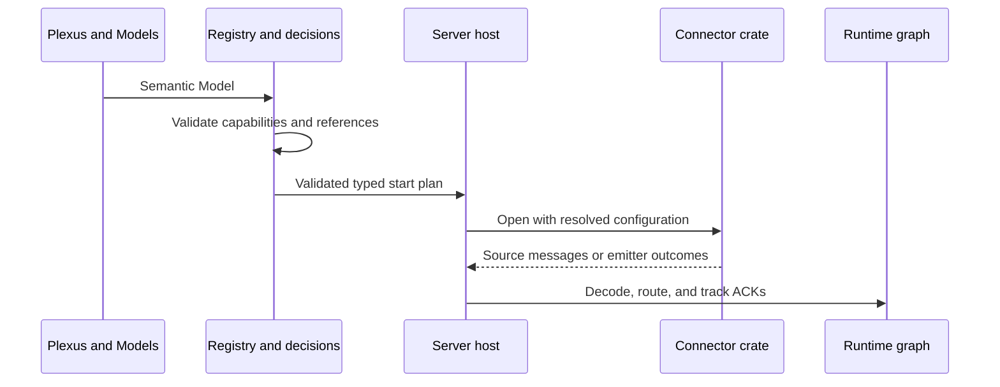
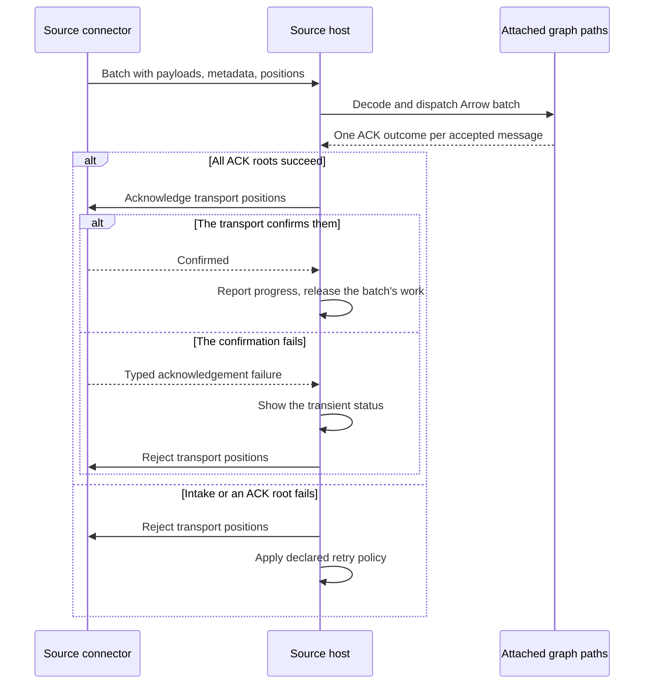
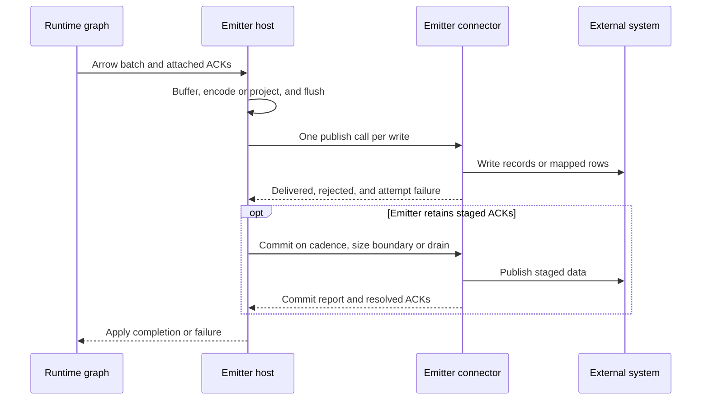

# Connector Crates And The Connector Contract

*Plexus, the Nervix graph definition language.*

An external integration meets Nervix at a data-plane boundary. The [ingestor](./ingestors.md)
and [emitter](./emitters.md) manuals define its Plexus surface and delivery options. This chapter
defines who owns the work after validation: the shared connector contract, each integration's
transport, and the host that drives it. [Data Plane](./data-plane.md) describes what happens to
the resulting Arrow batches inside the graph.

[Execution Plans](./execution-plans.md) describes how one committed revision supplies those typed
ingestor and emitter plans to the host.
[HTTP Emitter Architecture](./http-emitter-architecture.md) follows this boundary for one
outbound request, from Arrow preparation to response and recovery.

## Connector and entity kinds

The vocabulary owns two related identities. `ConnectorKind` names the integration or Nervix-served
boundary, such as Kafka, HTTP or application sessions. `IngestorEntityKind` and `EmitterEntityKind`
name a connector together with one entity it reads or writes. HTTP request and HTTP endpoint
ingestors therefore have distinct kinds, as do OTEL logs, traces and metrics emitters. A connector
that serves one entity still names that entity explicitly.

### Statement heads and references

Plexus selects these identities in the statement head:

| Statement family | Head examples |
| --- | --- |
| Client | `CREATE KAFKA CLIENT`, `CREATE HTTP CLIENT` |
| Ingestor | `CREATE KAFKA TOPIC INGESTOR`, `CREATE HTTP ENDPOINT INGESTOR`, `CREATE CLIENT PRODUCER INGESTOR` |
| Emitter | `CREATE KAFKA TOPIC EMITTER`, `CREATE OTEL METRICS EMITTER`, `CREATE CLIENT CONSUMER EMITTER` |
| Boundary alteration | `ALTER KAFKA TOPIC INGESTOR`, `ALTER OTEL METRICS EMITTER` |

Each connector/entity pair owns its grammar body. Shared combinators compose its keyword head and
the patterns its body shares with other entities; completion offers the composed head as one item.
The selected entity's declaration supplies the reference kind, locator, options, modes and
capabilities. A `TOPIC`, `TABLE` or other locator in the body names the external object; it does not
select another connector or entity. Nervix references remain typed identifiers, while external
locators preserve the text admitted by their entity's name rule.

An ingestor or emitter alteration repeats its stored connector and entity. `SET FROM` or `SET TO`
is parsed as that entity's complete replacement body, and applying the alteration validates the
stored kind before publishing any operation. Changing the connector/entity pair requires dropping
and creating the boundary node. Addressing uses the node's ordinary identity instead:
`DESCRIBE INGESTOR`, `DROP EMITTER`, `SHOW CREATE CLIENT`, and placement selections name the Model
kind and name without repeating a connector/entity head.

The referenced client need not have the same connector kind as the entity: the entity declaration
owns that relationship. An Iceberg table emitter names an object-store client and a catalog client;
an endpoint ingestor names an endpoint; native client producers and consumers name a schema and
use the session transport without a client Model. The registry validates these reference contracts
before a graph becomes active.

### Identity through Models and plans

The semantic shape carries the selected kind through each boundary:

| Stage | Owner and representation |
| --- | --- |
| Vocabulary | Each connector module declares its client Model, per-entity Models and modes, entity enums, external-name rules and capabilities. `IngestorEntity` and `EmitterEntity` nest connector then entity; the entity Model carries only that entity's fields. |
| Language | The chosen head selects that entity's body parser and produces its structured Model once. Alterations retain the selected pair and its typed replacement operations. |
| Decisions | Validation resolves the declared references and capabilities. `IngestorConnectorPlan` and `EmitterConnectorPlan` nest connector then entity, with a typed leaf for each implementation. |
| Data plane | A per-connector composition module consumes the leaf plan and opens the matching concrete entity implementation. The host executes the plan without reading a Model. |

The vocabulary's shared declaration macros derive kind accessors, metadata and conversions from
the per-connector entity declarations. Their outer unions list connectors, so a second entity
extends its connector's own enum. A kind is derived from the Model's variant rather than stored
beside it as another selector. [Entity declarations](#entity-declarations) owns the complete
capability contract, and [Typed States](./typed-states.md#validation-and-failure-boundaries) explains the
validation boundary.

### Implementation declarations and composition

Each connector crate exposes one concrete implementation and configuration per entity in an entity
module: for example `kafka::topic::KafkaTopicIngestor` and `KafkaTopicEmitter`, Redis `pubsub`,
Syslog `listener` and `collector`, and ZeroMQ `pull` and `push`. An implementation does not select
its entity with a mode flag. OTEL exposes `OtelLogsEmitter`, `OtelTracesEmitter` and
`OtelMetricsEmitter` with distinct configurations; only their private OTLP encoder shares
signal-dependent encoding and transport.

`IngestorConnector::KIND` is the concrete ingestor's compile-time vocabulary declaration.
`EmitterLifecycle::kind()` returns the emitter's declaration through the object-safe lifecycle
contract; concrete emitters expose the same declaration as `KIND`. The server's external-connector
composition arms contain constant assertions matching each concrete `KIND` to the entity its plan
arm constructs.
A mismatched declaration fails compilation. Exhaustive plan matches select the constructor; the
assertion checks its declared identity, while owner tests and public scenarios verify its behavior.

HTTP request and WebSockets connection ingestors live in their connector crates. Their endpoint
entities are concrete host-owned ingestors over a shared private intake binding mechanism. The
binding ends its exact intake lifetime before withdrawal, including when an ingestor drops. Native
client producer and consumer entities also remain host-owned. Shared implementation mechanisms
preserve these distinct entity types and declarations.

### Public names and adding an entity

Canonical Plexus, completion and console previews render the selected connector/entity head from
the vocabulary. `Model::connector_kind()` identifies a configured connector, and entity-kind
metadata supplies each boundary's composed name. Inspection, diagnostics, logs and metric labels
derive the connector or entity identity they report from those same declarations. A running task
resolves its label once outside batch publication. There is no separate server spelling or case
table.

Adding a second entity keeps this ownership: extend the connector's vocabulary declaration and
typed union, add its own grammar body, plan leaf, implementation and composition assertion, and
extend the entity-based generators, conformance tests and runtime capability inventory. Console
choices and previews consume the declared pair. Shared encoders stay private, and neither a body
selector nor an implementation mode substitutes for the new entity. The
[integration checklist](#adding-an-integration) applies to an additional entity as well as a new
connector crate.

## Ownership and dependency direction

| Layer | Responsibility |
| --- | --- |
| Vocabulary and registry | Define and validate source capabilities, schemas, delivery modes, header availability, branches, and references before activation. The vocabulary nests every ingestor and emitter Model by connector and entity, and each pair declares its capabilities once there. The registry names no connector crate. |
| Decision and composition | Convert a validated Model into a typed source or emitter start plan once. The registry decides every ingestor's source plan together with its codec and lowered routes, validating the source name, kind, client and route identities as one decision. The server is the composition root and the only crate that names every integration. It resolves client resource mounts before opening a connector. |
| `nervix-connector` | Define ingestor and emitter operations, typed boundary values, and opaque host services. It knows neither a driver nor graph execution state. |
| `nervix-connector-*` | Own one integration's driver, connection and configuration interpretation, transport headers, protocol acknowledgements, and per-record results. A crate implements the ingestor contract, the emitter contract, or both. |
| Host data plane | Own tasks, intake and Arrow decoding, branch routing, ACK trees, quiesce, buffering, retry and flush scheduling, metrics, events, and drain. It executes typed plans; it does not parse Plexus or read a Model during data-plane execution. |

The contract may name shared vocabulary types, Arrow, the async and error facilities needed by its
boundary, the node's bounded executor, and configuration helpers for TLS, HTTP clients, service
URLs, resource mounts, and physical time. It must not name the registry, runtime, relays, branches, schedules, or a driver.
An integration crate may depend on the contract, vocabulary, Arrow, and its own driver stack. It
must not depend on the server, another integration crate, or runtime collectors. Driver libraries
belong in that integration's manifest, with test-harness dependencies kept separately. A
connector receives resolved configuration and a typed plan, not graph routing authority. Two
sources have no external driver and live in the server. The node's own HTTP/HTTPS endpoint uses the
same ingestor lifecycle and host intake. A client source admits the batches applications submit
through their sessions; it has no connector crate, because the session protocol is its transport,
and its host is the client ingestor endpoint described under
[Integration-specific boundaries](#integration-specific-boundaries).

The contract and integration engines declare `nervix::input(plans, reason = "...")` alongside their
source-owned `nervix::layer(engine, ...)` contracts. Resolved configuration Model types, constructors
and matches are rejected in their interfaces and bodies even though other infrastructure engines
may own persisted Models. Module contracts travel with source moves. The compiler and independent
language import/dependency checks run through `just ratchet`; these classifications introduce no
runtime policy or connector lifecycle change.

The contract and every integration crate take their execution-sensitive primitives from
`nervix-primitives`: synchronization, tasks, the timers and monotonic instants their deadlines and
backoff are measured with, and every socket a connector opens itself. A modeled build therefore
selects them for the whole graph, as [Execution Primitives](./execution-primitives.md)
describes. The sockets and timers a driver library creates inside itself stay the driver's and are
outside that selection. A connector's own code never resolves a name through the operating system:
it resolves through the node's resolver, as the sections below describe, and a driver that resolves
inside itself is one of the residual paths [Residual
Resolution](./name-resolution.md#residual-resolution) lists.

### Host test fixtures

`nervix-connector-fake` is a test harness outside the product layer order and a server
dev-dependency. Product code never names it. It implements the broker and paced ingestor
boundaries and the record, mapped-row, row-request and HTTP-request emitter boundaries. Its
family kinds use the vocabulary's existing entity declarations; it introduces no connector
kind or Plexus statement.

Finite publish scripts fail on an unexpected extra call. Repeating answers are explicit.
Scripts distinguish accepted, rejected and unanswered members, infrastructure failures and
typed retry hints. Queued and channel input retain message positions, ordered headers and
typed metadata. Channel reads use the host's cancellation handle and detect a future dropped
before its read completed. Resume, settlement and lifecycle scripts preserve the same host
ordering assertions as the local fixtures they consolidate.

Observations retain the complete current contract values: record identities, admission times,
keys, groups, headers, payloads and HTTP request fields. Mapped-row observations share Arrow
columns and retain column names and selected row order. Payload preparation and row-request
preparation run through the real host adapters, as do staged writes and commits. A failed
commit retains its staged work and acknowledgements until a successful commit.

The fake's channels, synchronization and ownership come from `nervix-primitives`; the server's
Shuttle and Loom features propagate through its dev-dependency. Host unit tests check policy
and value retention. Its shared assertion logs serialize one synchronous observation update
per callback, with guards released before waiting. Recurring contract implementations declare
that bounded harness coordination beside their methods. The registered host Shuttle checks
explore the production owners
against scripted boundaries. These checks establish host behavior only. Driver confirmation,
external delivery and transport-specific cancellation still need the real integration's
owner tests and public scenarios. The fake adds no product synchronization protocol and does
not change the applicability of the lifecycle Deloxide lanes.

### Declaration validation

Each ingestor and emitter entity declares its accepted modes, quiesce forms, client kinds, payload
form, codec and header support, and batching legality in the vocabulary. Direct-value entities
also declare their mapped-value types there: destination columns accept the current Plexus scalar,
array and vector types, while OTEL protocol fields require their declared exact types. The OTEL
connector verifies its prepared input schema against that same type table as an internal plan
guarantee. An impossible mapped type is not a retryable connector initialization failure.

The registry checks these declarations against the candidate graph before accepting `CREATE` or
`ALTER`. It rejects duplicate `VALUES` keys, unsupported or wrongly typed mappings, and invalid
transport-ingestor delivery durations before any ingestor or emitter opens. Expression inference
precedes the mapped-type check. An expression that cannot infer a type, including a null-only
mapping, is refused with its declared section and destination key and retains the typed VM cause.
ACK timeouts and retry
durations must be positive; a zero batch timeout gathers without waiting. Every duration must fit
the shared schedulable deadline bound, and retry maximum must be at least its initial backoff.
OTEL `RESOURCE` mappings remain literal-only. Required batching is established by validation, so
planning consumes that guarantee rather than discovering a missing `BATCH` when an emitter starts.
OTEL field declarations also own literal severity, identifier and enum-name constraints. The
registry applies those constraints before storing CREATE or ALTER; values computed from records
retain their per-record checks. Client declarations can restrict an optional key to one URL
scheme. OTEL's TLS file keys require an HTTPS endpoint independently of the selected protocol,
before file inspection. Its declared header-pair decoder validates configuration and supplies
the decoded values to both OTLP transports; each export uses the same once-decoded values.
An invalid alteration leaves the accepted graph intact. Driver configuration checks and external
availability retain their own boundaries; these declaration checks perform no transport I/O.

### Connector hygiene standard

The following standard applies to each connector crate, its declarations, and the server paths
that compose and report it. It also applies when another feature adds or changes one of those
paths.

- **One source for names.** The vocabulary's `ConnectorKind` display supplies connector names;
  ingestor and emitter entity names come from their vocabulary declarations. Configuration errors,
  transport and HTTP-client labels, metrics, logs, dataflow identifiers and `DESCRIBE` output
  derive their names from those sources. A required namespace or prefix is derived once and
  reused, rather than introducing another spelling or case table. Protocol field names and
  external configuration passed through to a driver retain their external contract.
- **Typed causes until reporting.** A connector owns semantic error enums using `thiserror` and
  propagates context with `error-stack`. Preserve a driver's typed error beneath the connector's
  operation context instead of replacing it with its `Display` text. A cause that Nervix can
  classify is a typed variant, not a free-text `reason` or `Result<_, String>`. Text received as
  part of an external protocol remains external data; it does not replace an available typed
  cause. Render a report only at the boundary that presents it, retaining the cause for callers
  that must decide whether to retry, reject a record or fail a start. Sensitive payloads and
  credentials stay out of rendered diagnostics.
- **Annotations describe the actual outcome.** A `nervix::error_boundary(outcome|library, ...)`
  contract belongs on the exact error type or return contract it classifies, with a reason
  describing that path. An annotation may call a result a record rejection only when the
  implementation actually returns that record's rejection. A failed connection, refused start
  or failed request is not made record-specific by its annotation. [Errors And
  Diagnostics](./errors-and-diagnostics.md) owns these classifications and reporting boundaries.
- **Unit tests exercise the owning paths.** Cover each implemented publish path, window or batch
  algorithm, header and metadata mapping, and acknowledgement operation through its production
  owner. Include successful delivery and the supported rejection, transient and unanswered
  outcomes, partial confirmations, ordering and bounds where the path has those states. Exercise
  source polling, reads and close when the connector owns them, and an emitter's finish where its
  client can hold records once a publish returns. A path the connector does not
  implement needs no fictional test. Unit tests complement the public Cucumber scenarios and
  concurrency checks required by the behavior; they do not replace them.
- **Properties cover encodings and measures.** Each connector-owned encoding or encoded-size
  measure has a bounded Bolero property over valid current values, registered in
  `tests/bolero-targets.toml` for ordinary and fuzz execution with its source-adjacent corpus.
  Lossless conversions compare the complete original value; size properties compare the measure
  with the exact production encoding, including headers and framing that count toward the limit,
  and exercise the limit boundaries. Lossy or one-way mappings assert their declared contract.
  A crate using a shared encoding or measure exercises that shared owner rather than copying
  its implementation. [Property Testing And Fuzzing](./property-testing-and-fuzzing.md) owns
  registration, budgets, execution and retained failure evidence.

A connector change keeps this chapter and the relevant ingestor or emitter manual current, runs
`just validate` and the focused checks for its changed paths, and leaves the architecture ratchet
at or below its baseline. Documentation changes also run `just book`. Execution-mode evidence
follows the changed protocol or lifecycle, as [Data-Plane
Concurrency](./data-plane-concurrency.md) describes; changing labels or documentation alone does
not introduce a synchronization claim.

Before closing a connector epic, review changes landed from parallel work for additional name
sources, free-text causes, inaccurate boundary annotations, and publish, mapping, batch or
acknowledgement paths missing their unit or property coverage, and hold them to the
[delivery review](#delivery-review) below. Record the review, evidence and any compliance tasks on
the owning ClickUp epic and tasks. Implementation reports and temporary audit findings are not
repository documentation.

### Connector delivery standard

A connector loses, duplicates or stalls nothing beyond what its declarations state. The following
standard applies to each ingestor and emitter, its declarations, and the host paths that drive it,
including a path another feature adds or changes. Each rule names the section that owns its detail.

- **Declarations state what the transport gives.** Every source entity declares its position
  class, what its positions still mean once their connection is gone, and its acknowledgement
  confirmation, how far its transport has confirmed them once acknowledging returns. A source whose
  client returns before its transport answers declares that weaker confirmation rather than
  reporting one it did not get. The host handles each class once after a lost connection: it
  retries a `replayable` source's rejection before reading again, discards and counts the pending
  positions of a `broker_redelivered` source, and keeps nothing for a source of class `none`; see
  [Ingestor boundary](#ingestor-boundary).
- **Progress follows confirmation.** `acknowledge` returns once the transport has confirmed the
  positions as far as the entity declares, or with a typed acknowledgement failure. The host reports
  a batch's progress and releases its work only then, so a drain, an ownership handoff and a
  graceful stop wait for that confirmation within their deadlines; see
  [Confirmed acknowledgements](#confirmed-acknowledgements).
- **A codec's refusal is consumed once.** A payload its codec refuses leaves its batch as a decode
  rejection, which the ingestor's `ON GENERAL ERROR` policy reports, and in an acknowledged mode its
  position is acknowledged with the batch's other positions instead of being presented again. A
  refusal for room judged nothing and stays a retry; see
  [Decode Rejections](./errors-and-diagnostics.md#decode-rejections).
- **A cancelled read keeps what it took.** The host awaits every read it starts, and a read it
  cancels ends with every message it had already taken, which the host takes in; see
  [Interrupted reads](#interrupted-reads).
- **Every emitter finishes.** `finish` has no default. It sends what the emitter's client still holds by
  the deadline the host gives it, or reports what it could not send; see
  [Finishing an emitter](#finishing-an-emitter).
- **A brokered emitter never resends what its broker confirmed.** A record emitter that awaits its
  broker's answers in `MODE ACK` does so through the contract's `ConfirmationWindow`, which settles
  every answer already given before a failure ends the publish; see [Emitter boundary](#emitter-boundary).
  The RabbitMQ emitter, which settles what its broker confirmed itself when it loses a channel, is
  the one brokered emitter that does not use the window yet.
- **Every buffer and every wait is declared with its bound.** The deadline keys keep one meaning,
  no driver call parks an asynchronous worker, and each deadline key an entity's waits name has its
  stalled-peer scenario. A change adds no unbounded buffer and no wait that only a stop ends; one
  that already exists stays declared unbounded until its connector bounds it. See
  [Bounds and deadlines](#bounds-and-deadlines).
- **A delivery defect is reproduced before it is fixed.** A fix for a lost, duplicated or stalled
  delivery starts from a reproducer that fails because of the defect: a public scenario through the
  connector's real transport, and a Shuttle check over the production owner where the defect is an
  interleaving.

The generated tables of this chapter list each source entity's position class and acknowledgement
confirmation, the capability inventory names each entity's stalled-peer scenarios, and the Shuttle
checks of broker ingestor reconnect, confirmation, refused payload confirmation and read
interruption, and of the brokered emitter confirmation window, hold the host's protocols for these
rules; see [Protocols and their checks](./data-plane-concurrency.md#protocols-and-their-checks).

The wide-columnar NATS delivery scenario checks all 32,768 sequence values and repeated headers
through the real broker, on one node and across explicit source-to-relay and relay-to-emitter
remote hops on three nodes. Its observing client retains receipt counts and subject-labelled
driver-event diagnostics; a source sent counter alone does not confirm broker delivery. The
[broker observer contract](./integration-test-lifecycle.md#broker-observers) owns those diagnostics,
their bounds and the unchanged sequence deadline.

#### Delivery review

A change that adds or alters a source or emitter entity, or a host path that drives one, checks that:

- each source entity declares the position class and acknowledgement confirmation its transport
  actually gives;
- a read the host cancels returns every message it took;
- a payload its codec refuses becomes a decode rejection rather than failing its whole batch;
- each emitter answers `finish` for what its client can still hold once a publish returns, and a
  brokered emitter in `MODE ACK` awaits its broker through the `ConfirmationWindow`;
- the [bounds review checklist](#review-checklist) holds;
- a new host protocol on these paths has a Shuttle check over its production owner.

### DNS for HTTP and Iceberg

The node loads and validates one `nervix-dns` resolver at startup, and every integration below
connects through it. [Name Resolution](./name-resolution.md) owns that resolver: its
configuration, answer order, cache and TTL bounds, lookup budgets and failures, the dependency
features that select it, and the drivers that still resolve by themselves. These sections own how
each integration connects through it.

Composition passes the resolver's handle into the HTTP polling and Prometheus source plans and into
the HTTP request, Sentry, OTEL HTTP, and Iceberg emitter plans. The shared `HttpClientConfig` installs
it on the Reqwest 0.13 clients of HTTP polling, Prometheus, Sentry and OTEL HTTP. The HTTP request
emitter resolves each request's target host, or its client's declared proxy's host, itself, as its
[request transport](#emitter-boundary) describes. Iceberg REST uses a separate Reqwest 0.12 client with that same resolver. Iceberg object
storage uses OpenDAL 0.57 with a Reqwest 0.13 client that the connector builds with the node
resolver and installs through `HttpClientLayer`; the layer also supplies HTTP calls made by
OpenDAL's credential providers through its accessor info. The object-store client's optional
`timeout_ms`, read through `ConfiguredDeadline`, sets both the operation and I/O timeout of the
OpenDAL operator, including credential HTTP calls, name resolution, connection and TLS. Without
the key, metadata and delete operations allow 60 seconds and reads and writes allow 10 seconds.
Each of the two Iceberg HTTP clients receives the rustls configuration that the shared
`RustlsClientConfigProvider` builds from its own client's entries. It holds the bundled WebPKI roots and the
platform's native roots with the client's `tls_ca_file` added, and the identity of its
`tls_cert_file` and `tls_key_file`. The Reqwest 0.13 object-store client takes its configuration
from the S3, GCS or Azure Blob client, and it serves both OpenDAL's object requests and its
credential providers' HTTP calls. The Reqwest 0.12 catalog client takes its configuration from the
ICEBERG_REST client. The emitter builds both configurations when it opens, under the rustls
provider the host installed or AWS-LC when the host installed none. An unreadable or invalid file is
therefore an open-time configuration failure, with the client it belongs to and the provider's
typed TLS cause beneath it. The three Iceberg backends keep their
S3, GCS, and Azure property mappings and commit boundary. One operator is initialized from the
emitter's location and the initial table's effective storage properties. Table metadata refreshes
retain that table's `FileIO` and its initialized storage, so later object calls reuse the operator;
an object URL for a different storage root is refused. OpenDAL's credential providers keep their
own credential refresh. Storage calls make one attempt: the emitter host owns retry pacing, and
neither an OpenDAL retry layer nor the HTTP client's retry policy multiplies that attempt.
Azure locations select the Blob service with `wasb`/`wasbs` and the Data Lake service with
`abfs`/`abfss`; their account hosts identify the corresponding `blob` or `dfs` service. Both use
the same node resolver and storage-client operation deadline described here.
The standalone OpenDAL S3 `detect_region` helper constructs its own client, but
Nervix does not call it; S3 operator construction requires its configured region or the driver's
environment policy.

No client Nervix builds ever initializes Reqwest's default Hickory resolver: each replaces it with
the node resolver before its first request. That default could choose a public name server if
reading system DNS configuration failed. A bad node resolver configuration therefore fails node
startup, while a lookup failure reaches the existing source or emitter failure path. Request URLs, HTTP
authority, proxy behavior, TLS verification, custom trust and identity, and connection pools remain
with the HTTP client. A client's `timeout_ms` includes DNS resolution, connection setup, TLS and
response handling; the resolver's own 30 second ceiling only bounds clients without a shorter
request timeout, which includes the Iceberg REST client. DNS failures use the host's existing retry
policy and do not create application-level probes or acknowledgements.

### HTTP client transport

An `HTTP CLIENT` means the same transport whichever statement uses it, and three owners hold that
one contract:

- The shared `HttpClientConfig` in `nervix-connector` builds every Reqwest client an HTTP-speaking
  connector sends through: HTTP polling, Prometheus, Sentry and OTEL HTTP. Such a client resolves
  names through the node resolver, never reads `HTTP_PROXY`, `HTTPS_PROXY`, `ALL_PROXY`,
  `NO_PROXY` or their lowercase forms, follows no redirect by itself, bounds each request by the
  client's `timeout_ms` where the client sets it, and presents the client's TLS trust and identity.
  It also reads the one proxy a client declares with its `proxy` key, as a `DeclaredProxy`: a
  Reqwest client sends every request through it, and the HTTP request emitter's own transport reads
  the same declaration. Prometheus, Sentry and OTEL HTTP declare neither `proxy` nor
  `follow_redirects`, so their clients use no proxy and follow no redirect.
- The HTTP connector's redirect rule decides, for polling and emitting alike, whether a redirect
  answer repeats its request: only when the client declares `follow_redirects = true`; only for a
  `301`, `302`, `307` or `308`, or a `303` to a `GET` or `HEAD`, which asks for the retrieval such a
  request already is; only when the answer carries exactly one `Location`, which resolves against
  the answered request's URL to that request's origin, the same scheme, host and port, without user
  information; and at most 10 times for one request, the limit
  `CreateClientHttp::TRANSPORT` declares. The request is repeated unchanged: the same method,
  headers and body, at the `Location` without its fragment. Any other answer is the response, as it
  is for a client that does not opt in.
- The HTTP polling ingestor and the HTTP request emitter each send the repeated request
  themselves, so a request and the redirects it follows share its one `timeout_ms`: polling gives
  each request what is left of it, and the emitter starts each request's `OperationBudget` from
  what is left.

Through a declared proxy, the node resolves only the proxy's host. An `http` target is sent to the
proxy in absolute form, and an `https` target tunnels through it with `CONNECT`, after which TLS
verifies the configured host; an `https` proxy is itself verified with the client's trust and
offered the client's identity. User information in the proxy URL is percent-decoded and sent as
`Basic` `Proxy-Authorization` credentials to the proxy alone. For the emitter, a proxy it cannot
reach and a tunnel the proxy refuses are infrastructure failures of the attempt, as any other
connection failure is.

A failed poll's report names its status or Reqwest's error without the request's URL, and never
the endpoint's path or query, a request header value or a response header. The emitter's attempt
failures likewise never name an evaluated target, a header value, a body or the proxy's
credentials.

### DNS for RabbitMQ

Composition also passes the node resolver into every RabbitMQ source plan and emitter configuration.
The connector reads the client's `addr` as an AMQP URI and takes its host from the URL grammar,
because Lapin's own grammar substitutes `localhost` for an IPv6 literal host and for an address that
names no host. One owner reads the address before a client is committed and again for every
connection: it refuses an address whose scheme is not `amqp` or `amqps`, that names no host or that
names port 0, leaves the credentials, virtual host and query options to Lapin's grammar, and never
repeats the address in a refusal. Every connection resolves that host again through the node resolver: an emitter's start, its
reopening after a failed publish, and each source instance's resume. A literal IPv4 or IPv6 address
is its own answer. The connector tries the answers in resolution order, each within an equal share
of what remains of the client's `connect_timeout_ms`, 30 seconds by default, and for `amqps`
completes the TLS handshake within what is left. The handshake verifies the broker certificate against the host `addr` names, whichever of its
addresses was dialled, trusting the platform roots and the client's `tls_ca_file`, and presents the
client certificate chain and private key of `tls_cert_file` and `tls_key_file` when the client names
them. The RabbitMQ client declaration permits each TLS file key only when `addr` uses `amqps`;
authored and rendered configuration cross this shared schema check before file inspection and
commit. Its typed refusal names the key and required scheme without the address or path. The
certificate/key pairing rule also applies. The connector reads those files for every TLS connection
before it dials, and refuses a file that holds no PEM certificate or private key there rather than
in the handshake. The connector
then hands the established transport to Lapin through `Connection::connector`. Lapin's own
reconnection stays off, so it asks that hook for a transport exactly once and runs the AMQP
handshake over it, within what remains of the same budget. The source then opens its channel, sets
its prefetch window and starts its consumer, and the emitter opens its channel, selects publisher
confirms under `ACK` and checks its queue, within the rest. `connect_timeout_ms` therefore bounds
every step before the entity is ready, and a step that runs out of it is reported naming the key
and its bound. The URI's `connection_timeout` query parameter has no effect.

Lapin's `hickory-dns` feature is deliberately not selected. It resolves through one process-wide
async-rs resolver built on first use from the host's `/etc/resolv.conf`, which ignores the node's
resolver configuration, hosts snapshot, lookup budget and concurrency bound. That resolver also
keeps name-server connections whose tasks ran on the Tokio runtime of its first lookup, so a later
runtime inherits connections of one that may have stopped. `just validate-dns-dependencies` keeps
the feature off in the isolated RabbitMQ connector and in the server, and checks that Lapin's TLS
stays on AWS-LC.

A failed connection is a `RabbitMqConnectError`. A lookup failure keeps its `DnsLookupFailure`, and
unreachable addresses, a failed or overdue TLS handshake, and a failed or overdue AMQP handshake are
their own variants, as are a Lapin runtime that could not be created and a socket the node could not
hold a second handle on. A broker that ends the TLS session with an alert, such as one that requires
a client certificate and receives none, is `TlsRefused`, naming the host and the alert. Under TLS
1.3 that alert can arrive after the client's side of the handshake completed, on the first read of
the AMQP handshake, and it is classified the same way there. A channel step that fails or runs out
of the budget is reported beneath the source's or emitter's own context for that step, with the
elapsed deadline as its typed cause. A source reports the failure as a resume failure and retries on
its declared `RETRY POLICY`. A emitter reports an invalid address, CA file, client certificate,
private key or deadline key as a configuration failure and every other connection failure as an
initialization failure, and the emitter host reopens it on its backoff. Neither path
acknowledges undelivered data: a source that cannot connect holds no delivery, and an emitter that
cannot connect confirms nothing, so the input stays unacknowledged until a later connection
delivers it.

Lapin runs a connection's IO on a thread of its own from the start of the AMQP handshake, and that
thread ends only once its socket fails or the broker closes the connection. Before it hands the
transport over, the connector therefore takes a second handle on the connection's TCP socket. Until
the entity's channel is open, dropping that handle shuts the socket down, whether the budget ran
out, a step failed or the caller stopped waiting, as a stopped resume or emitter start does; Lapin's
loop then fails every read and write, ends with its thread, and closes the socket. A connection that
opened lets the handle go. A connection that fails before its AMQP handshake has started no Lapin
thread. An established connection is not closed because its host's answer changed or expired; the
next connection uses the new answer.

### DNS for Redis

Composition gives the node resolver to the shared Redis command pool and to each Pub/Sub source
plan. Redis 1.7.1 exposes `AsyncConnectionConfig::set_dns_resolver` for command connections. The
connector's `bb8` manager installs that hook whenever it opens a physical pooled connection;
pool bounds, health checks and lease ownership remain with the existing pool and host. A pooled
socket may remain open past an answer's TTL until the pool retires it. The pool reads the client's
`pool_idle_timeout_ms` and `pool_max_lifetime_ms` from the vocabulary's client schema, whose
defaults are 10 and 30 minutes: it closes a connection idle that long, the ones it keeps for
`POOL SIZE MIN` included, and a connection that old when a publish returns it or while it is idle,
then opens connections again to keep the minimum. The pool checks idle connections every 30
seconds, `bb8`'s reaper interval, so an idle connection closes up to 30 seconds after it reaches
either lifetime. A replacement socket resolves the host again. Neither lifetime closes a Pub/Sub source's dedicated
connection.

The connector keeps `POOL SIZE MIN` itself rather than through `bb8`'s idle minimum, which counts
idle connections only and would open another connection beside every one a publisher checks out.
Opening the pool establishes the minimum as dedicated connections added to the pool before any
publisher borrows from it, so a connection that fails keeps its typed cause in the open's failure.
Every pooled connection then signals the pool's keeper task when the pool closes it. The keeper
counts the established connections, checked-out ones with idle ones, and, below the minimum, holds
one checkout for every idle connection and every connection missing until all of them finish: the
idle ones are taken once and `bb8` opens the rest, within the maximum it accounts for and the
client's `connect_timeout_ms`. A failed restoration is retried as soon as it ends. The keeper stops
with the pool's last handle.

The driver's Pub/Sub convenience connection does not accept that DNS hook. A source instead
resolves the configured `redis://` or `rediss://` hostname through the node resolver on every
initial subscribe and resume, and opens a dedicated TCP or TLS stream. It tries the returned
addresses in order inside the client's `connect_timeout_ms`, 30 seconds by default, shared by DNS,
TCP, TLS, Redis setup, and subscribe.
The source uses Redis's command encoder and asynchronous RESP parser for authentication,
database selection, protocol negotiation and `SUBSCRIBE` on that stream. A Unix socket remains
a direct Unix connection with no DNS query. The dedicated subscription never occupies a pooled
command connection.

For `rediss://`, the configured hostname remains the TLS server name after an address is chosen.
The source's TLS configuration keeps the same optional client certificate and key as the command
client. Without a CA file both paths use native roots; a configured `tls_ca_file` replaces those
roots in both paths. The shared TLS configuration helper exposes that replacement policy
explicitly because other connectors add a configured CA to their default roots.

The Redis hook gives a lookup at most 30 seconds, inside the connection timeout the pool sets on
the driver for the whole connection, which is the client's `connect_timeout_ms`, 30 seconds by
default. The pool waits no longer than that for a connection to check out. Pub/Sub connection
attempts share one budget of the same key.
Missing names, empty answers, silence and transport failures are connection outcomes. They do not
reject a record or confirm a publish; the host resumes the source and retries failed emitter work
according to its existing policy. A Pub/Sub connection broken by the broker or network is dropped
and reopened with a new lookup, while an established connection is not interrupted solely because
its answer expires.

One subscription reader owns that socket and a bounded handoff to intake. The client key
`subscription_buffer_messages` is required for a source and declares a positive whole message
capacity that fits the bounded channel. The reader
reserves a handoff slot before decoding another frame; a full handoff stops transport reads and
TCP applies backpressure. The message bound is separate from the host's byte-bounded quiesce
buffer and from wire-parser and kernel byte buffers. `BUFFER` and `DROP` retain their host-owned
retention and drop counters. Redis Pub/Sub supplies no replay after a disconnect.

The source client's required `idle_timeout_ms` bounds a silent active read. After half the
interval the reader sends `PING` on the subscription connection; activity must arrive within the
remaining half. Activity means a complete Redis message or probe reply. Both RESP2 and RESP3 are
supported. Waiting for handoff room precedes the read and
does not spend its idle interval. A failed probe closes the connection and reaches the host's
existing reconnect policy. Source suspend and close abort and join the exact reader before a
replacement can open; queued messages are otherwise delivered before a terminal read failure.

### DNS for MQTT

Composition passes the node resolver into every MQTT source plan and emitter configuration. Both
connect through `rumqttc`'s event loop, which asks a socket connector for the TCP stream of every
connection it opens: the first, and each one after a connection is lost. Each client installs its
own connector with `MqttOptions::set_socket_connector` in place of the driver's default, which
resolves with Tokio's `lookup_host`. On every call the installed connector resolves the host the
driver names, the host of the client's `addr`, through the node resolver, so an emitter's event loop
resolves again on each reconnection and a source instance on each resume; a literal IPv4 or IPv6
address is its own answer. It dials the answers in resolution order with the driver's own
per-address dialer, `connect_socket_addr`, which applies the driver's `NetworkOptions` to each
socket. Each attempt gets an equal share of what remains of the driver's connect timeout, five
seconds, which already bounds DNS, the address attempts, TLS and the MQTT handshake of one
connection together, so resolution adds no deadline or retry of its own.

The driver layers the rest on the returned stream as before. For `mqtts` it completes TLS with
the client's CA and optional client identity and verifies the broker certificate against the host
`addr` names, whichever of its addresses was dialled. It then runs the MQTT handshake with the
client's identity and session. Nervix's build selects neither the driver's proxy nor its WebSocket
transport, so no other connection path exists.

A failed lookup reaches the driver as the resolver's `DnsLookupError`, which the driver keeps as the
cause of its connection error. The connector finds it there and reports `MqttConnectionError::Resolve`
with the host and the lookup failure; every other failure keeps the driver's own description. A
source reports the failure as a resume failure and retries on its declared `RETRY POLICY`, or on
the host's reconnect cadence in `MODE NO ACK`. A emitter's event loop reports it as the emitter's
transient error and reconnects on the emitter's retry policy. Neither acknowledges undelivered
data: a source that cannot connect receives nothing, and a QoS 1 or 2 emitter confirms a record only
once the broker acknowledges it, so the input stays unacknowledged while the broker name does not
resolve. An established connection is not closed because its host's answer changed or expired;
the next connection uses the new answer.

### DNS for ClickHouse and SQS

Composition passes the node resolver into every ClickHouse emitter configuration and into every SQS
source plan and emitter configuration. Both connectors keep their driver's HTTP client and hand the
resolver to it at the driver's own DNS hook, so every new connection resolves its host again while
the request URL, its authority, the TLS server name and the signing inputs remain what the client
configured. `nervix-dns` implements both hooks on the node resolver: Hyper's resolver service for
`hyper-util`'s `HttpConnector`, and Smithy's `ResolveDns`.

A ClickHouse client builds `HttpConnector` over the node resolver in both of its forms. An HTTP
address refuses TLS file keys and uses a plain HTTP client. An HTTPS address requires
`tls_ca_file` and wraps the connector in the AWS-LC rustls configuration, trusting the bundled
WebPKI roots, the platform's native roots and the configured CA. Client identity entries may
accompany that trust material. Both forms read `tcp_keepalive_ms` and `pool_idle_timeout_ms` from
the vocabulary's client schema, whose defaults are 60 seconds and 2 seconds respectively. The
first controls TCP keep-alive probing; the second controls reuse of an idle HTTP connection.
The builder supplies Hyper's Tokio pool timer, so idle expiry follows the runtime clock and
retires expired connections even between inserts. Neither setting extends an insert's request
deadline. Hyper dials a literal IPv4 or IPv6 host without asking the resolver,
dials a name's answers under its dual-stack policy, described in [Dialling The
Answers](./name-resolution.md#dialling-the-answers), and applies the URL's port or its scheme's
default. The required positive `timeout_ms` bounds the send and the response of an insert, and the
connection and its lookup run inside that response wait.

An SQS ingestor and an SQS emitter build their client the same way, from the keys the client
declares, and install a Smithy HTTP client whose connector resolves through the node resolver with
Smithy's public `build_with_resolver`: AWS-LC, the platform's native roots without `tls_ca_file` or
that CA alone with it, and no proxy. The client declares no proxy key, so it never reads
`HTTP_PROXY`, `HTTPS_PROXY`, `ALL_PROXY`, `NO_PROXY` or their lowercase forms, with or without a
custom CA. Smithy parses a CA chain only when it builds a connector, and panics on a section that is
not base64 or on a certificate rustls does not take as a trust anchor, so the connector parses
`tls_ca_file` first, with the same parser and root store. A section it cannot parse is
`TlsClientConfigError::ParseCaCertificate`, a certificate rustls refuses is `AddCaCertificate`, and
a file without a certificate, which would trust no service, is `EmptyCaFile`, each beneath
`InvalidSqsClientKey` naming `tls_ca_file`. The same parse runs offline when `CREATE SQS CLIENT`
admits the client. The SDK signs each request with SigV4 for the configured endpoint before the
connector resolves its host, so the signature, the `Host` header and the certificate check all name
that host, whichever address accepted the connection. The SDK's default 3.1-second connect timeout,
and the operation and attempt timeouts `timeout_ms` sets for every request of both directions,
include the lookup; a receive's start after the one-second long poll it asks the service to hold it
for. The client names static credentials, with `session_token` where they are temporary ones, and its
region, so `aws-config` never consults the default credential or region chains that could reach
IMDS, ECS, STS or SSO over HTTP. It still builds its SSO token chain, which SQS never asks for
a token because it signs with SigV4; the loader receives the same HTTP client, so that chain would
use the node resolver too.

Both hooks give a lookup at most 30 seconds, like the Reqwest hooks; the client's own deadline
cancels it sooner, and a lookup cut short that way fails as that deadline's timeout rather than as a
lookup failure. A lookup failure reaches the connector as a cause of the driver's connection error,
where the connector finds the typed `DnsLookupError` and keeps it as the context beneath its
existing failure: a ClickHouse publish failure, an SQS emitter start or publish failure, and an SQS
source resume, read or acknowledgement failure. The report's message names the host and the lookup
failure. An SQS source plan builds its client from configuration and TLS material alone; each
instance looks its queue up when it first resumes and keeps the queue's URL. A failure there, a
lookup failure included, is a resume failure, which the host shows as the source's transient error
and retries on the source's retry policy. A queue the service does not have is the typed
`SqsQueueIngestorError::MissingQueue`, which names it, whether the service answers with AWS's
query-compatible code `AWS.SimpleQueueService.NonExistentQueue` or, as ElasticMQ does, only with the
JSON protocol's error type `QueueDoesNotExist`. Any other failure to reach the service, including a
certificate that does not name the configured host, is described by every cause of the driver's
connection error, which describes the connection and never a record; a service's own response keeps
its existing description. None of these failures rejects a record or acknowledges input. Both
directions keep the SDK's own retries disabled, so the SDK makes each request once and the host
retries a failed one on the entity's declared backoff alone. A request that runs out of `timeout_ms`
keeps the contract's `DeadlineElapsed` as its innermost cause, naming the request and the key.
Pooled connections stay open when their host's answer changes or expires; the next connection
resolves again.

SQS unit checks retain a bound, non-listening socket for each refused endpoint until the request
finishes. The socket keeps another parallel fixture from listening on that address while still
making the SDK observe connection refusal. The ownership check verifies both properties; source
receive stand-ins continue to run independently beside these checks.

### DNS for OTEL gRPC

The OTEL emitter receives the node's resolver in its typed emitter configuration. Its gRPC transport
builds a Tonic 0.14 lazy channel with a custom Hyper `HttpConnector` that resolves through that
resolver. Constructing the emitter or channel asks no DNS question and opens no connection. When an
export first needs a connection, Hyper resolves the configured endpoint's host, dials its answers
under its dual-stack policy, and applies the endpoint port. Tonic keeps the original URI for HTTP/2
authority and TLS server-name verification, and retains its configured roots, optional client
identity, metadata, compression, and request timeout. Every OTEL client requires `timeout_ms` and uses it as
both the request timeout and the connection timeout, which encloses DNS, address attempts, and TLS.

An unresolved name or failed connection remains an infrastructure export failure under the emitter
host's existing retry and ACK policy; the export failure reports the gRPC outcome, not the lookup
failure beneath it. A successful pooled channel may outlive an answer's TTL; a new connection
resolves again through the node resolver. OTEL HTTP protobuf continues to use the shared Reqwest
path described above.

The native prepared-request check uses a real loopback DNS authority and gRPC receiver. It
observes an initial negative answer without delivering or rejecting the prepared log record,
publishes the receiver's address, and requires another DNS question and exactly one accepted
request with the original prepared bytes inside ten seconds. The public one- and three-node
outline also checks log and trace exports after clearing an unavailable emitter and a negative DNS
answer. These are bounded recovery observations, not a simulation of Tonic or a guarantee about
every external collector's availability.

### Blocking work and the node's executor

A connector runs on the host's asynchronous tasks and never blocks one. Synchronous work it does
itself, such as writing or reading a local file, goes through the node's bounded executor, which the
emitter host hands a connector as `EmitterHost::executor`. The connector chooses the storage or CPU class
of its work and the memory it charges; the executor admits that work beside the rest of the node's,
and a refusal is the connector's own typed failure. The Iceberg emitter writes and reads its staged
Arrow IPC files on the filesystem storage workers. A staging write the node cannot take now fails
the publish, which the host retries as it retries any other. A commit charges the bulk memory class
for every staged byte it reads back before it reads them, or the whole class for a single staged
file larger than the class, and takes that charge only when the class has room now, because a
place in the class's queue would take every byte the class frees and hold the node's other bulk
work behind the commit. A refusal fails the commit, which keeps its staged files and
acknowledgements while the host retries it. The read itself waits for a place among the filesystem
workers instead of being refused, because nothing could present again the rows the emitter already
accepted.

No driver call that parks its thread runs on an asynchronous worker. A connector runs such a call
in the executor's storage class with a declared deadline as its bound, or as a declared owner of the
runtime's blocking pool. Kafka source control calls use the connector storage class: metadata,
watermark and timestamp lookups, seeks and assignments run off the async workers, and so does the
destruction of a consumer or a producer, as [Kafka client retirement](#kafka-client-retirement)
describes.

Network control calls have their own bounded connector storage admission, separate from filesystem
and consensus storage. A broker that does not answer therefore cannot consume those classes'
worker permits. Kafka metadata, watermark, timestamp and seek operations take their control-call
budget from the effective native `socket.timeout.ms`, including its driver default. The budget
includes admission and the consumer's serialized control-operation turn. A cancelled running call
keeps its worker and that turn until the driver returns, so a later assignment or seek cannot
overtake it. Group commits have their separate one-in-flight owner; a failed commit does not
prevent attempting unsubscribe.
Consumer-group commits retain one admitted job per source instance until the coordinator answers,
including when the waiting caller is cancelled or its thirty-second deadline expires. Admission
refusals remain transient source failures; they never reject a record as invalid.

librdkafka's producer flush still runs on the runtime's blocking pool as a declared owner outside
the executor. The host's physical flush deadline bounds the caller's wait; a native flush step
already running keeps its producer handle until the driver returns, even if the caller stops
waiting. The producer's destruction is a connector storage job like a consumer's.
[Blocking work outside the executor](./execution-primitives.md#blocking-work-outside-the-executor)
lists every declared owner, and the boundary check rejects any other connector code that names the
pool.

The ingestor and emitter traits carry source-local compiler execution contracts. Polling, message/header
access, acknowledgements, publish, retry, flush and commit callbacks are recurring. Source open and
close are explicit lifetime boundaries; Kafka domain-offset initialization is a resume installation
boundary. Implementations inherit the trait method's frequency. External driver, conversion and
callback dispatch is documented at its owning callable, and local callback bodies remain checked.
These annotations describe this chapter's existing lifecycle; they supply no runtime admission or
ownership proof. [Data-Plane Concurrency](./data-plane-concurrency.md#source-contracts) owns their
syntax, inheritance, diagnostics and operation-specific repair expectations.

#### Kafka client retirement

Destroying a librdkafka client is native work that waits, so Nervix never destroys a Kafka consumer
or producer on the thread that lets it go.

Every consumer Nervix creates has a group, a partition inspector's included, and rust-rdkafka closes
such a consumer by polling it in steps of 100 milliseconds until librdkafka reports it closed. A
consumer that joined its group waits there for the coordinator to answer its LeaveGroup request,
which librdkafka gives five seconds whatever `socket.timeout.ms` says, and librdkafka then joins its
threads. Destroying a producer first stops its polling thread, which finishes its current poll of up
to 100 milliseconds and any delivery report it is serving. rust-rdkafka then purges the records the
producer still queues or has in flight, flushes for up to 500 milliseconds so that their reports
are served, and librdkafka joins its threads, a broker thread still resolving a name included.

An ingestor or partition inspector shares its consumer with the driver jobs it admits, an emitter shares
its producer with the flush its finish runs, and any of them can hold the last handle. An ingestor goes
when its host's task ends after the ingestor's loop, or when composing its ingestor's instances fails;
an inspector goes when its watch ends; a control job keeps running after its caller is cancelled,
and a job the connector queue refuses lets its handle go unrun; and a consumer-group commit can be
answered after its ingestor is gone. An emitter goes when its emitter's task ends after the emitter's finish,
when a swap or `ALTER` replaces it, or when composing its emitter fails after the emitter started; and
a flush keeps running on the runtime's blocking pool after its finish's caller stops waiting for it,
until librdkafka's flush returns. Whichever of them lets the last handle go hands the client to its
retirement and carries on at once, on an async worker, a connector worker or a blocking-pool thread
alike. The retirement destroys the client in one connector storage job. A full queue holds that job
until a place frees instead of refusing it, because nothing could present the client again, and the
job runs under a commands charge the client took before it was created, so retiring a client asks
the node for nothing it could refuse. A client that cannot take that charge is not created: the
ingestor's open or the inspector's start fails with the transient
`KafkaTopicIngestorError::RetirementAdmission`, and the emitter's start fails with
`KafkaProducerStartError::RetirementAdmission` beneath `EmitterOpenError::Initialize`, which its
emitter retries after its retry delay like any emitter that could not start. Nothing waits for a
retirement and nothing cancels it, since a destruction cannot stop part way. It takes the native
client alone, never the ingestor's or emitter's host or its intake, and Nervix never hands a client to
another ingestor or emitter, so a replacement opens a client of its own.

An ingestor-open failure during graph construction propagates through the runtime installation
report, before an ingestor host loop exists. The control-plane installation supervisor retries that
failed application on the admission loop's half-second cadence, or on a committed schedule or domain
update, using the current admitted state. An emitter initialization failure inside an already
running host remains owned by that host's declared retry policy. Neither path requires a fresh
configuration command.

A joined consumer whose coordinator does not answer holds a connector worker for those five
seconds, and a producer holds one for its polling thread's last poll and up to half a second of
flushing. A broker that stops answering while its clients retire therefore delays the node's other
Kafka control calls queued behind them, never its async workers. The `connector_storage` class's
`nervix_execution_jobs_running` and `nervix_execution_jobs_pending` count retirements with the other
Kafka jobs. Node shutdown does not wait for a retirement: the process's runtime finishes or
performs it as it stops after terminal teardown, as
[Terminal Teardown](./shutdown.md#terminal-teardown) describes.

### Bounds and deadlines

Every entity declares, beside the rest of its declaration, what its connector holds and how long
it waits: each buffer between its transport and the host with its capacity and what happens when it
is full, each network wait with what ends it, and the limits its driver imposes that no Nervix key
changes. The [Connector Capabilities](connector-capabilities.md) reference and each entity's manual
render these bounds from the declaration, so a reader sees the same facts a reviewer checks.

A buffer is bounded by a capacity Nervix fixes, a statement clause or client key sets, or a driver
default declares. When it is full, a protocol with flow control is held back: the connector stops
reading, and the transport's own window or prefetch keeps the peer from sending more, or a publish
waits for the buffer to drain. A protocol without flow control drops what does not fit and counts
it. A buffer that drops without counting, or whose overflow fails the publish for the host to retry,
is declared as it behaves, and a buffer that nothing bounds yet is declared unbounded, so the matrix
shows each gap until its connector closes it. A `PROMETHEUS QUERY` or `HTTP REQUEST` response is
bounded by its statement's `MAX BODY SIZE` (16 MiB where omitted). A response that exceeds the
bound fails the poll, which the ingestor reports as its transient error, and the next poll reads
again. The HTTP polling request's method and literal headers are carried by the typed ingestor plan;
its client supplies the required total `timeout_ms` and TLS settings. The polling client follows
redirects and uses a proxy only as [HTTP client transport](#http-client-transport) describes. An
HTTP response carries its status and scheduled poll instant into the same metadata group as its
response headers, including when quiescence buffers the poll.

A per-connection bound does not bound the total when the listener accepts an unlimited number of
connections. The Syslog listener declares frame assembly and completed frames waiting for its
intake queue as separate unbounded totals, with their per-connection limits in each description.
Its assembly buffer holds at most `max_message_size + 11` bytes per connection, and each connection
may also hold one completed frame of at most `max_message_size` bytes while its queue send waits.
An oversized stream frame closes only its connection; it neither fails the listener's source read
nor makes the host reconnect. UDP admission separately drops and counts a datagram above
`max_message_size`, after receiving it into a fixed 65,535-byte scratch buffer. The shared stream
intake queue holds at most 64 frames and applies backpressure; that queue does not limit the
connection count or total connection-local retention.

A wait ends at a client deadline key, a statement clause such as `ACK TIMEOUT`, a fixed bound Nervix
sets, or the driver's own default. A wait that only the host's stop ends is declared unbounded. The
deadline keys mean the same thing for every connector:

| Key | What it bounds |
| --- | --- |
| `timeout_ms` | The whole of one request or operation: name resolution, connection setup, TLS and the answer. |
| `connect_timeout_ms` | Establishing a connection: name resolution, the address attempts, TLS and the protocol's own handshake. |
| `idle_timeout_ms` | Silence while waiting for peer activity on an established connection, including its liveness probe; expiry closes the connection. Each entity declares its activity and whether cancellation or handoff backpressure retains the activity deadline. |

A read that waits for whatever the peer sends next is bounded by the protocol's keep-alive or by
`idle_timeout_ms`, and a write by `timeout_ms` or the retry policy. A key's value is a positive whole
number of milliseconds no longer than about 146 years, the vocabulary's `ClientDeadline` rule, and
the connector contract's `ConfiguredDeadline` reads each key once, so no connector parses its own. A
connector that dials for itself and reads `connect_timeout_ms` allows 30 seconds where the client
leaves the key out, and so does a listener that bounds the TLS handshake of a connection it accepted
by that key. A connection that runs out of its deadline is reported naming the key and its bound.

A connector that dials for itself spends one `OperationBudget` from `nervix-dns` on an operation. The
caller declares how much of it the name lookup may take: whatever is left for an operation that is
only a connection, or at most a fixed share for one that sends a request after connecting, as the
HTTP request emitter gives its lookup at most half of `timeout_ms`. Each answer is then tried in
resolution order within an equal share of what is left when its attempt starts, and what remains
bounds the handshake and the request that follow.

#### Stalled peers

Each deadline key an entity's waits name is a runtime capability, `STALLED PEER <key>`, and the
capability inventory names a scenario that observes it: a peer that stops answering during a wait
the key bounds surfaces as the entity's transient status within that bound, and the connector
retries on its policy. A listener serves many peers, so one that stalls is not the entity's status:
the bound closes that peer's connection, and the scenario observes the connection end no sooner than
the bound while the listener goes on reading its other peers. A silent endpoint accepts connections
and never answers or reads, a stallable endpoint in front of a dependency stops carrying bytes in
both directions while its connections stay open, the NATS endpoint a scenario controls can go down
and refuse every reconnection, so a Core NATS client cannot flush, and the HTTP and gRPC receivers
can hold a response; scenarios stand them where the stall belongs.

#### Review checklist

A change that adds or alters a connector's buffers or network waits checks that:

- every buffer between the transport and the host is declared with its capacity and overflow, and
  only a buffer already declared unbounded stays so;
- every network wait is bounded by a declared key, clause, fixed bound or driver default, and only
  a wait already declared unbounded stays so;
- every deadline key it reads keeps the meaning above and is read through `ConfiguredDeadline`;
- no driver call parks an asynchronous worker;
- every deadline key its declaration names has its stalled-peer scenario in the inventory.

## Entity declarations

Every connector entity declares, once in the vocabulary, everything a statement can say about it
and what the entity does with what a statement says. The declaration is the oracle the other layers
read: the grammar takes each external name's completion label from it, the vocabulary's own checks
read it, generated conformance tests hold the grammar and completion to it, and an inventory holds
the scenario suite to its runtime capabilities. Each example a declaration carries is a complete
clause the grammar accepts, so documentation can show it and generated statements write it.

A capability joins its entity's declaration in the same change as its grammar and executable
behavior. That change also supplies its generated conformance and runtime scenario registration.
The declaration describes the product a user can execute; plans for additional connector clauses
remain in their owning work records until that delivery.

| Side | What the entity declares |
| --- | --- |
| Ingestor | Header reads, the typed metadata fields in their order, every-node execution, the reference its body names, its position class and acknowledgement confirmation; its [bounds](#bounds-and-deadlines); the delivery modes its ingestors may name and the quiesce modes its transport can honor, each with the option choices it requires; the locator, which is the keywords and the external name with its completion label and an example its rule admits; and its options in the order a statement writes them, each with its value type, presence and default, and choices. |
| Emitter | Header writes; its [bounds](#bounds-and-deadlines); the reference its body names (a client of one connector, the object store an Iceberg emitter writes to, or the schema of a client emitter's native batches); how its body is formed (a codec, a codec or `WITHOUT BODY`, `VALUES`, or native output); its `BATCH` legality, which is required, optional with the protocol maximum, or unavailable with its reason; whether a batch needs the codec's batch transformation; its publishing modes; its locator and options; and its envelope clauses and `PROPERTIES` keys, of which no entity declares any yet. |
| Client | Whether it is pooled and bounds its pool with `POOL SIZE`, who reads its `CONFIG` keys (Nervix, the driver, or Nervix while the driver reads the address URL's query or the object store's and catalog's property namespaces), and the options its statement writes, such as a WebSocket client's signaling protocol. Every client declares its CONFIG key names, required or optional presence, value type, confidentiality, file role and Nervix or driver ownership, and which of its entities read each key: every ingestor and emitter that references the client, or only its ingestors or only its emitters. Only a client both sides reference declares a key for one side; a SYSLOG client does, and its connector takes the side a deadline key bounds a wait on from that declaration. The declaration explicitly names delegated property namespaces and reserved keys, and the other names its driver reads for one property: each pair of names with the one the client accepts, and a prefix the driver strips from a key before reading it, with the driver's own properties that begin with it. Validation, composed-grammar completion, public inspection and the generated key reference read this one schema. |

Plexus client definitions start with `CREATE [IF NOT EXISTS] <CONNECTOR> CLIENT <name>`. The
composed head and canonical rendering use the vocabulary's connector kind; a console choice uses
that same head. Pool bounds, when declared, precede the optional resource mount. WebSocket
signaling precedes its mount. This syntax does not change which layer interprets configuration or
how clients connect, pool or execute.

Client keys are lowercase and case-sensitive. The pure registry refuses unknown, repeated,
missing-required or mistyped Nervix-owned keys and incomplete TLS identities before a candidate
can become an active graph. It also refuses a key its driver reads as another name for a property
the client accepts under one name, and a key written under a prefix the driver strips, since the
driver would apply whichever of two entries for one property it was handed last. Kafka properties
and object-store/catalog properties are explicitly
driver-delegated; database, Redis, RabbitMQ and NATS address query options belong to their driver.
Undeclared delegated values are confidential in public inspection. Drivers retain their existing
trust policy: HTTPS without a custom CA uses their built-in roots, while MQTT's `mqtts` address
requires its declared `tls_ca_file` before commit and a plaintext `mqtt` address refuses it, as it
refuses the client certificate pair. Conditional presence belongs to the key declaration.
Configured CA replacement or augmentation follows the connector's documented policy. A Nervix-owned custom file must be readable; it does
not disable verification or silently fall back when unavailable.

The server composition root extends the existing changed-model binding boundary before standalone
mutation or transaction commit. It renders mount templates using the resource resolver and checks
the rendered schema and Nervix-owned file paths on an admitted filesystem worker, charged to command memory.
Request preflight refuses inspection when command memory or the filesystem wait queue is full.
Applying a model step under an accepted transaction or restore instead waits for those existing
capacities with `QueueAdmission::WaitForPlace`; lack of room has not judged the configuration.
The service task's existing shutdown cancellation ends the wait. A charge larger than the whole
class or a closed executor still fails inspection, and no uncharged config copy is made while waiting.
Rendered values also pass the existing WebSockets configuration and Prometheus API-root owners;
an optional Redis subscription capacity passes the same range parser its ingestor plan uses.
Ingestor-only presence requirements stay with that plan.
MQTT's representative first instance uses the same instance-template renderer as execution.
Connector-owned offline parsers check librdkafka property names and values, sqlx and mysql_async
options, Redis connection information, lapin AMQP URIs, NATS server addresses, ZeroMQ endpoints
and Sentry project DSNs.
They create no connection, consumer, producer, DNS lookup or remote side effect. Checks requiring
the remote service still belong to client initialization. The registry names no connector crate
and runtime receives entries and pinned mounts rather than a Model.

ZeroMQ uses its socket driver's endpoint parser for both TCP and IPC addresses. Its `bind` key
uses the shared Boolean parser at the connector boundary, so a malformed value is a configuration
refusal before either a PULL or PUSH socket opens; an omitted value selects connect.

The MySQL offline check also applies the vocabulary's pooled-client reserved-key declaration to
URL query parameters. A pool override is a value-free refusal naming `POOL SIZE`, before storage
or connection attempts; the host uses that same declaration for resolved configuration. MySQL's
current client schema declares only the address and CA file its implementation consumes. Its
table declaration admits one or two nonempty, case-preserving identifier parts, and the connector
quotes each part separately. Its declared placeholder bound is shared with the statement divider;
the bound narrows rows by mapped column count. The [MySQL manual](emitters.md#mysql) gives its
exact binary binding and conflict semantics.

The Postgres client schema declares its address as a driver URL whose scheme and `sslmode` Nervix
owns: validation and the connector read the one TLS policy through the same declared option, and
a missing, repeated or undeclared choice is a value-free refusal before storage. The TLS files are
conditioned on `sslmode=verify-full` in that schema, and sqlx's offline parser checks every other
query option before commit. Its table declaration admits one or two nonempty, case-preserving
identifier parts, which the connector quotes separately in the insert and its catalog lookup. Its
declared batch maximum is the largest protocol message the server reads, the same bound the
statement divider keeps every insert within, and its conflict rule is the vocabulary's, which the
grammar applies at `CREATE`. The [Postgres manual](emitters.md#postgres) gives its text binding
and conflict semantics.

Offline refusals keep their driver cause beneath `OfflineClientConfigError`; lapin's URI parser
exposes only a string, which remains an attached diagnostic. Public command outcomes select reviewed
key-bearing contexts without rendering driver diagnostics that may contain credentials. Worker
admission and cancellation failures remain inspection failures, rather than invalid-key diagnoses.
`SHOW CREATE CLIENT` and configured-choice/browser previews use the declared confidential
projection, masking secrets and address credentials/query options as `********`. Complete canonical
serialization retains values for strongly persisted configuration and backup archives; archives
remain secret-bearing under [Backup And Restore](backup-and-restore.md). Existing entity `DESCRIBE`
output references clients by name and does not print their CONFIG.

`DESCRIBE CLIENT <name>` reads the stored client in the selected domain and reports its connector
and effective CONFIG. The schema represents an optional key with a declared default separately
from a key with no default. It applies defaults only to omitted keys and never substitutes for an
invalid explicit value. Client inspection marks those supplied defaults with `(default)` and uses
the same confidential projection as `SHOW CREATE CLIENT`. Runtime initialization consumes that
same effective-entry projection. Stored Models, archives and canonical `SHOW CREATE` retain the
authored entries; default metadata lives only in the current vocabulary declaration.

A mode or a quiesce mode that needs an option choice declares it: an MQTT topic's `ACK` modes and its
`SUSPEND` require `SESSION PERSISTENT` and `QOS 1`, the session a broker keeps messages for, and the
source answers which choices its statement made. Whether a source can honor a quiesce mode, whether
an emitter accepts a publishing mode, whether its body needs a codec, and the batching contract with its
maximum and its refusal for an emitter that cannot batch are all read from the declaration. The
registry, the planner and the console keep their own copies of some of these facts until the work
that owns those layers reads the declaration instead.

`REDIS PUBSUB` shares one channel-name rule between ingestion and emission: a nonempty literal
of at most 1,024 UTF-8 bytes, passed through without normalization or wildcard interpretation.
Its declaration permits `NO ACK` in both directions and `BUFFER`/`DROP` for intake, since Redis
retains no Pub/Sub backlog. Pub/Sub carries no transport headers or emitter envelope. Redis's
own bulk-length refusal stays a record outcome; the emitter declares optional batching without
a learned size ceiling. The Redis-specific declaration tests, generated grammar conformance and
one-/three-node public declaration scenarios qualify these facts together.

`SQS QUEUE` shares one queue-name rule between ingestion and emission: 1 to 80 ASCII letters,
digits, `-` and `_`, where a FIFO queue's name ends in `.fifo` within those 80 characters, passed
through exactly as written. Its declaration permits `ACK SEQUENTIAL` and `SUSPEND` for intake,
since the queue keeps a message until the source deletes it, and `SINGLE` or `BATCH` for emission,
where a `.fifo` queue requires `FIFO GROUP` and a standard queue refuses it. Message attributes are
its headers in both directions, as `last_wins` exact names; the emitter declares no envelope and
optional batching up to the 256 KiB SQS admits in one message. An SQS client declares only the keys
its connections read, each in both directions: the required `endpoint`, `region`, `access_key_id`
and `secret_access_key`, and the optional `session_token`, `timeout_ms`, which bounds every request,
and `tls_ca_file`. An SQS connection trusts `tls_ca_file`, or the platform's roots without it, takes
no proxy and presents no client certificate, so the client declares neither a proxy nor a
client-identity key.
The SQS-specific declaration tests, generated grammar conformance and one-/three-node public
declaration scenarios qualify these facts together.

`NATS SUBJECT` holds both directions to one subject rule: at most 1,024 UTF-8 bytes of
`.`-separated tokens, none empty, without whitespace or control characters, kept exactly as
written. A subscription may write `*` for one token and `>` for every remaining token, each only
as a whole token and `>` only last; a publication subject admits neither, since a message is
published to one literal subject. The ingestor declares `NO ACK` with a required `QUEUE GROUP` and
`INSTANCES`, and `BUFFER`/`DROP` for intake, because Core NATS keeps no backlog, position or
acknowledgement for a subscriber. Both directions carry headers by name, and the ingestor projects
no typed metadata field. The emitter declares Core `NO ACK` and `JETSTREAM ACK` publication, codec
payloads, no envelope clause, and optional batching without a protocol maximum: each server
announces its `max_payload`, and the client refuses a message above it before writing it. The
unpooled client's Nervix-owned keys are the address, `timeout_ms` and the TLS files, while the
address's userinfo and query options belong to the driver and are masked in inspection. The
NATS-specific declaration tests, generated grammar conformance and one-/three-node public
declaration scenarios qualify these facts together.

`NATS STREAM` is JetStream's side of the same client: an ingestor names a stream and one durable
pull consumer of it, both an operator's, each held to the server's own name rule of 1 to 255 bytes
without whitespace, control characters, `.`, `*`, `>` or a path separator. It declares
`ACK SEQUENTIAL` and `ACK PARALLEL`, `SUSPEND`, `BUFFER` and `DROP`, the `broker_redelivered`
position class and the `answered` acknowledgement confirmation, headers by name, and no typed
metadata field. Its connector looks the consumer up when an instance resumes, never creates it,
and refuses a push consumer and one whose acknowledgement policy is not explicit. One pull request
at a time asks for at most the host's window, and at most the consumer's `MaxRequestBatch`, and
waits without expiry or for the consumer's `MaxRequestExpires`, so the deliveries it holds ahead of
the host stay within one window. Each delivery is settled individually: acknowledging sends `+ACK`
and rejecting sends `-NAK` to the delivery's own subject as a request, and each returns once the
server answered, within the client's request timeout. Suspending or closing an instance drains its
inbox: the unsubscription ends the consumer's deliveries to it, and every delivery the client had
already received is returned with `-NAK`, so the consumer delivers it again at once rather than
once its `AckWait` passes. The driver ends the subscription as soon as it has written the
unsubscription, so a delivery still travelling then, and one an instance held when its connection
was lost, is delivered again once that `AckWait` passes. The
stream's unit tests drive these paths through a scripted server, and one-/three-node public
scenarios through a JetStream server qualify delivery, redelivery, suspension, missing entities
and failover.

`MQTT TOPIC` keeps a subscription's topic filter and a publication's topic exactly as written,
letter case included, within MQTT's 65,535-byte string. A filter may write `+` for one level and
`#` for every remaining level, each only as a whole level and `#` only last, but its first level
is not `$share`: every instance subscribes through the shared subscription
`$share/<domain>~<ingestor>/<filter>` that Nervix forms, so a filter naming its own would match
nothing. A publication topic admits neither wildcard. The ingestor declares `NO ACK`, and
`ACK SEQUENTIAL`, `ACK PARALLEL` and `SUSPEND` only with `SESSION PERSISTENT` and `QOS 1`, the
session a broker keeps messages for and redelivers after a lost connection; `BUFFER` and `DROP`
stay connected under any session. Neither direction carries transport headers, and the ingestor
projects no typed metadata field. The emitter declares QoS as its publishing mode, `QOS 0`,
`QOS 1 ACK` or `QOS 2 ACK`, with codec payloads, no envelope clause and optional batching up to the
Maximum Packet Size each broker declares when the client connects. The unpooled client's keys are
all Nervix-owned: `addr` names the broker by `mqtt` or `mqtts`, a host and a nonzero port, and
nothing else, since a connection reads no credentials, path, query or fragment from it;
`client_id`; and the TLS files, of which `tls_ca_file` is required exactly with `mqtts` and the
client certificate pair is permitted only with it. The MQTT-specific declaration tests, generated
grammar conformance and one-/three-node public declaration scenarios qualify these facts together.

`KAFKA TOPIC` shares one topic-name rule between ingestion and emission: 1 to 249 ASCII letters,
digits, `.`, `_` and `-`, other than `.` and `..`, passed through exactly as written. Its ingestor
declares `NO ACK`, `ACK SEQUENTIAL` and `ACK PARALLEL`, `SUSPEND` as its only quiesce mode, since
the topic keeps its records after they are read and a suspended source resumes from its position,
and a required `OFFSET BY` choice between the domain's replicated offsets and a named consumer
group. Its emitter declares `NO ACK` and `ACK` with either window, optional batching with no
protocol-fixed batch limit, since the producer's configurable `message.max.bytes` bounds each record
it writes, and no envelope or properties. Headers are `ordered_repeats` exact names in both
directions; the ingestor's metadata is the record's topic, partition and offset. A Kafka client
requires `bootstrap.servers`, without which no consumer or producer reaches a broker. Every other
property is librdkafka's, checked offline before commit, except the keys Nervix sets itself on the
consumers and producers it runs, which the client refuses. librdkafka reads some properties under
two names and applies the one it is handed last. The client declares each such pair, read from
the vendored librdkafka 2.12.1, and accepts only the Apache Kafka Java client's name. It also
declares librdkafka's `topic.` prefix, under which librdkafka reads any default-topic property, and
refuses a key written under it, except librdkafka's own global `topic.` properties. So every
property has one name, and the offline check and every consumer and producer see one value for it.
A Kafka connector test pins the pairs and the prefix exceptions to the linked librdkafka through its
own name lookup. The Kafka-specific declaration tests,
generated grammar conformance and one-/three-node public declaration scenarios qualify these facts
together.

`PULSAR TOPIC` shares one topic rule between ingestion and emission: a local name, which the
connector places in its client's namespace, or a fully qualified
`persistent://tenant/namespace/topic` or `non-persistent://tenant/namespace/topic`, sent as
written; at most 1,024 bytes without whitespace, control characters or an empty level. The
ingestor names a subscription of 1 to 255 bytes with its declared owner, declares `NO ACK`,
`ACK SEQUENTIAL` and `ACK PARALLEL` in Pulsar's own delivery-mode type, and quiesces only by
`SUSPEND`, since the durable subscription keeps its backlog. The emitter declares `NO ACK` and
`ACK` publishing and optional batching under the `maxMessageSize` the broker announces. Message
properties are headers in both directions, `ordered_repeats` on ingestion and `last_wins` on
emission. A Pulsar client declares only the keys both directions read. `namespace` holds exactly a
tenant and a namespace, with the default `public/default` written once in the declaration, and topic
qualification reads that effective value, so a namespace that cannot qualify a topic is refused at
`CREATE`. `tls_ca_file`, `tls_allow_insecure_connection` and `tls_hostname_verification_enabled`
require a `pulsar+ssl` address, since a plaintext connection uses none of them. The
Pulsar-specific declaration tests, generated grammar conformance and one-/three-node public
declaration scenarios qualify these facts together.

Every-node execution is independent of the kind of reference an ingestor names. HTTP and WebSocket
endpoint ingestors reference endpoints, while a Syslog listener references a client; all three
declare every-node execution. Scheduling and placement-reference completion read that capability,
so each listener stays outside placement rules.

### Generated conformance tests

Tests generated from the declarations check every entity through the composed statement grammar, as
a REPL or a client meets it, so a grammar module that accepts more or less than its entity declares
fails them. They cover the three statement families:

- Ingestors. Every declared delivery and quiesce mode, together with the choices it requires, parses
  into its kind. So does every form of every option. A mode, a quiesce mode or an option that only
  another entity declares is refused. So is a mode written without its required choices, a statement
  that leaves a required option out, and an empty external name. Completion at the locator, the
  options, `MODE` and `ON QUIESCE` offers exactly the declared items.
- Emitters. Every declared publishing mode, body and batching choice parses into its kind, every
  optional option parses, and every declared object store names its storage client. A batch above
  the declared maximum breaks the batching contract. An undeclared publishing mode, body, batching
  clause, option, envelope clause or `PROPERTIES` block is refused. Completion at `MODE` and after
  the destination offers exactly the declared items.
- Clients. `POOL SIZE` is written exactly where the client declares a pool, and only the declared
  options parse.

Emitter conformance derives each connector/entity head, reference, quoted locator, required
options, policy and payload from the declaration. Each concrete destination Model owns a closed
publishing-policy enum; that enum supplies its capability kinds. There is no separately stored
publishing policy or registry/planner admission table. Grammar modules construct only that entity's
policies, and planning matches its enum exhaustively when delivery has alternatives. Shared
rendering and duration validation borrow the policy without retaining another representation.
External names retain their entity-specific validated types through the plan and connector
configuration. SQS uses one queue-name type on both ingest and emit boundaries.

Iceberg retains a storage-client reference in its destination Model. Validation admits the declared
object-store client kinds; planning resolves the actual S3, GCS or Azure Blob client into the
connector's storage-backend setting. The destination statement does not select that backend.
The host receives the completed plan and performs no Model lookup to choose it.

The Iceberg declaration also requires a case-preserving catalog namespace. Its validated identity
passes from the statement through the execution plan into the connector; the connector supplies
its dot-separated levels to the catalog API. The Nervix domain does not supply an implicit
namespace. Location validation compares the URL scheme with the resolved storage-client kind
before activation. Commit size and batch size share the vocabulary's positive whole-byte value,
so planning consumes the decided count instead of parsing a second size string.

The storage clients declare their Nervix-owned addresses, credentials, booleans, deadlines and TLS
files separately from `s3.*`/`client.*`, `gcs.*` and `adls.*` driver properties. The REST client owns its
catalog locator and warehouse and delegates its catalog headers and storage-property namespaces.
Registry validation, completion, inspection and the generated key reference consume these shared
schemas; they do not keep another Iceberg key table. The network-free composition hook checks
the storage properties the connector can interpret before a table location exists. Building an
OpenDAL operator, credentials and connectivity remain initialization checks.

The REST catalog's property map holds two sets of entries. The first is the storage client's file
I/O properties: each Nervix-owned key under the Iceberg property the vocabulary declares for it,
and each delegated property as written. The second is the catalog client's configuration without
its TLS files. The vocabulary's `IcebergCatalogProperties` pairs the two clients under one rule.
Registry validation refuses an emitter whose catalog client sets a property that its storage client
supplies, and the connector builds the catalog's map through the same pairing, so neither client
silently replaces the other's value. Deadline and TLS-file keys configure the clients' own
transports and stay out of the map. The table's file I/O supplies that map to the configured
storage factory for object operations. The factory retains the selected backend, resolver,
location, storage deadline and object-store TLS configuration; it does not replace the effective
catalog properties with a second client map. The storage reader holds each Boolean property to the
value it states, so `gcs.no-auth` set to `false` keeps the GCS credential loader and signing.

### Capability inventory

The [Connector Capabilities](connector-capabilities.md) reference and each entity's manual
synopsis are generated from these declarations by `just connector-matrix`. The documentation
exporter destructures the source, destination and client declarations exhaustively, so adding a
field requires extending the projection. It emits a temporary JSON projection for the renderer;
this is tooling output, never a stored Model or a runtime input. The transport explanations in
`docs/connector-matrix.toml` supply prose for absent capabilities and differences between ingest
and emit. They supply no capability facts. Missing, empty or stale explanation keys fail the
check. Position-class, acknowledgement-confirmation and header-model membership in this chapter is
generated from the same projection. `just validate-connector-matrix`, included in local and CI validation,
compares every generated region and rejects drift while preserving the surrounding prose.

`tests/connector-capability-inventory.toml` registers, for every entity and every capability it
declares, the scenarios that observe that capability at run time. The capabilities are each delivery
or publishing mode, each option and each choice of an option, each typed metadata field, batching
where it is available, each envelope clause and property, and a stalled-peer check, `STALLED PEER
<key>`, for each deadline key the entity's waits name. `just validate-connector-capabilities`,
which `just validate` runs, fails when a declared capability names no scenario, when an entry names a
capability its entity does not declare or names it twice, and when a named scenario does not exist
in its feature file. A scenario is identified by its feature file and its name exactly as the
scenario line writes it.

Quiesce modes and header access are not inventory capabilities. The host owns how a source is
quiesced, the registry checks a program's header access against the declaration, and the generated
tests hold the grammar to both. A connector that declares a new capability registers the scenario
that observes it in the same change.

### Header models

Each entity declares a header model for each side that carries transport headers, in the
vocabulary beside its other capabilities. The model states what a repeated name keeps, the order
in which names travel, and how names compare. It describes what the connector already does with
its transport's headers: it is not a host abstraction, and no host code rearranges a header list
to fit one. The layouts are:

- `ordered_repeats`: every header in the order it was written, a repeated name once for each of its
  values, such as Kafka record headers.
- `repeats_by_name`: every value of a name, together and in the order written, while the order of
  different names is not declared, such as a NATS header map.
- `last_wins`: one value per name, the last one written, while the order of names is not declared,
  such as SQS message attributes.
- `sorted_by_name`: one value per name, the last one written, with names in ascending byte order,
  such as an AMQP field table.

Names are either `exact`, matching only a name spelled the same, or `lowercase`, recorded in ASCII
lowercase so that two spellings that differ in letter case are one name, as HTTP field names are.
On the ingest side the model is what `read_header` and `read_headers` find: `read_headers` returns
a name's values in the order the model keeps them, at most one of them under `last_wins` and
`sorted_by_name`, and a `lowercase` entity's names are read in lowercase. On the emit side it is what
the `write_header` calls of one record become on the published message.

<!-- connector-matrix:headers:start -->
| Header model | Ingest | Emit | Meaning |
| --- | --- | --- | --- |
| `last_wins`, exact names | `SQS QUEUE` | `PULSAR TOPIC`, `SQS QUEUE` | one value per name, the last one written for it; the order of names is not declared; a name matches only a name spelled the same, letter case included |
| `ordered_repeats`, exact names | `KAFKA TOPIC`, `PULSAR TOPIC` | `KAFKA TOPIC` | every header in the order it was written; a repeated name keeps each of its values in its place; a name matches only a name spelled the same, letter case included |
| `repeats_by_name`, exact names | `NATS SUBJECT`, `NATS STREAM` | `NATS SUBJECT` | every value of a name, together and in the order written; the order of different names is not declared; a name matches only a name spelled the same, letter case included |
| `repeats_by_name`, lowercase names | `HTTP REQUEST`, `HTTP ENDPOINT`, `WEBSOCKETS CONNECTION`, `WEBSOCKETS ENDPOINT` | None | every value of a name, together and in the order written; the order of different names is not declared; a name is recorded in ASCII lowercase, so names that differ only in letter case are one name |
| `sorted_by_name`, exact names | `RABBITMQ QUEUE` | `RABBITMQ QUEUE` | one value per name, the last one written for it; names in ascending byte order; a name matches only a name spelled the same, letter case included |
| `sorted_by_name`, lowercase names | None | `HTTP REQUEST` | one value per name, the last one written for it; names in ascending byte order; a name is recorded in ASCII lowercase, so names that differ only in letter case are one name |
<!-- connector-matrix:headers:end -->

`read_header` and `read_headers` are validated against the ingest side's declaration, and
`write_header` against the emit side's: an emitter whose emitter declares no model refuses
`write_header`. Where the emitter keeps one value per name, under `last_wins` or `sorted_by_name`, a
second `write_header` whose name is a string literal equal, as the model compares names, to an
earlier literal one is refused when the statement is validated, because on every record the later
write would replace the earlier one. The refusal names the emitter, the header and both `INVOKE`
positions. A name an expression computes is the emitter's to settle at run time under its model.
`DESCRIBE INGESTOR` and `DESCRIBE EMITTER` show the side's model as
`headers: <layout>, <names> names`, or `headers: none`, and the per-entity tables of the
[ingestor](./ingestors.md) and [emitter](./emitters.md) manuals and of
[Connector Capabilities](./connector-capabilities.md) state it.

### Shared entity presentation

The vocabulary's `EntityPresentation` projects each configured source or sink once from its
current Model. Its declaration supplies the connector/entity phrase, locator keywords, option
order and effective defaults. Canonical Plexus and `DESCRIBE` consume that projection; canonical
text preserves omitted optional Model fields, while inspection includes their effective defaults.
`DESCRIBE INGESTOR` and `DESCRIBE EMITTER` begin their configuration block with `from:` or `to:`,
then `options:`, `mode:`, `quiesce:`, `envelope:`, `batch:`, `flush:` and `errors:`. Empty options,
unavailable quiesce, an absent envelope and absent batching print `none`. An emitter's `envelope:`
is the envelope section it writes, as one line of canonical Plexus. An ingestor's flush and message
error policies name their output relays; its general error policy belongs to the node. Runtime
health and counters follow configuration, including Kafka's observed partition assignments.

`SHOW INGESTORS`, `SHOW EMITTERS` and graph transport labels use the same declared entity phrase.
The console's ingestor choices read the declared entities, locator, options, option choices,
delivery modes and quiesce modes. Required option choices govern whether delivery and quiesce
buttons are enabled, and the draft enforces those same requirements before constructing a Model.
Typed field adapters bind declarations to draft storage; they do not define another allowed list.

## Ingestor boundary

Endpoint and Syslog sources are assigned to all live voters when a schedule is prepared, including
cordoned nodes excluded from placed work. Restore, rescheduling, and voter removal use that same
decision, so a restored coordinator serves intake after `RESUME` even when its relays run elsewhere.

Each domain revision installs its ingestor plans with its schedule. Building a domain, swapping or
relocating an ingestor, starting the ingestors a runtime revision leaves missing, and placing Kafka
domain offsets all read those same plans; none of them reads the ingestor's Model. Starting an
ingestor binds its codec, node filter, routes and branched entrypoints against the installed domain
surfaces and parses its declared acknowledgement before any connector instance opens, so a start
that fails leaves nothing running.
The current ingestor schedule places one `Single` execution unit; Kafka's transport partition
assignments remain inside that unit. Its domain-offset plan reads the unit's primary, and the
host keys its replicated offset checkpoint by that same unit.

A source plan combines connector-specific settings, validated capabilities, and the host's ACK
policy. Capabilities state whether header reads are available, whether quiesce is supported, the
nonzero instance count, the supported acknowledgement mode, and the position class the source's
entity declares.
The source owns `open`, `suspend`, `resume`, `close`, the next broker batch or scheduled poll, and
the meaning of acknowledging or rejecting its own position. A broker message lends its payload,
headers, typed metadata, and transport position to the host. Positions remain connector-owned;
the host never interprets one as a graph identity. Each source entity also declares its
acknowledgement confirmation, how far its transport has confirmed positions once acknowledging them
returns; see [Confirmed acknowledgements](#confirmed-acknowledgements).

A client source's plan is not a connector plan: it carries the input schema, its compiled form, the
producer policy of window, ACK timeout, and retry backoff, and the endpoint contract digest producers
attach to. It declares no header model or metadata field and supports only `SUSPEND`.

Each source entity declares its typed metadata fields beside its other capabilities in the
vocabulary, in order and each with its exact type: `HTTP REQUEST` declares the response status and
the poll's scheduled instant, `WEBSOCKETS CONNECTION` the frame kind, `KAFKA TOPIC` the topic,
partition and offset, `SYSLOG LISTENER` the peer address, and every other entity none. Registry
validation reads that declaration for the fields an ingestor's route programs and its
`TIMESTAMP AT metadata.<field>` may name, the host builds its metadata columns from it, and a
connector's message hands the host the value of every declared field in declared order, one typed
call per field into the host's value sink, so the three cannot disagree. A value is a `STRING`,
`BYTES`, `BOOL`, `U16`, `I32`, `I64` or `DATETIME`, or absent where the message carries none; a
`STRING` such as a socket address may be written into the column in place instead of being
allocated per message. A message that hands over another number of values than its entity declares,
or a value of another type than its field's, is a connector defect the host refuses as a typed
metadata error. A connector adds a field by declaring it and handing its value over: neither the
contract nor the host names any connector's fields.

The host projects metadata lazily. When an ingestor binds its programs, the host records which
declared fields its route programs and its `TIMESTAMP AT metadata.<field>` read, and every ingest
group of the ingestor builds Arrow columns for those fields and no others. A group of an ingestor
that reads none visits no metadata value at all. Transport headers keep their projection whatever
the programs read, because an ingestor's error-route programs may call `read_header` and are
compiled with the domain's routing, outside the source host.

Beside its fields and headers, a message names the position its transport gives it, where the
transport has one: a Kafka record's topic, partition and offset, or a syslog frame's peer. It is the
transport's own coordinate, never a header value its sender wrote, and a decode rejection names it.
A paced source returns each polled message owned, its declared values already copied.

Transport headers are visited from the borrowed message in the order the entity's
[header model](#header-models) declares. The host copies them only when the quiesce control decides
on a payload, which may retain it, or a WebSocket session must retain them after the source message
ends. A retained payload keeps the value of every field its entity declares, whichever the programs
read, and its position, so a replayed message builds the same columns a delivered one would; a
WebSocket frame keeps its connection's exact header snapshot by reference rather than a copy. HTTP
endpoint and polling headers, WebSocket upgrade headers, Kafka record headers, NATS headers, Pulsar
properties, RabbitMQ AMQP headers, and SQS attributes keep their transport's own semantics; other
connector and entity pairs carry no transport headers.
An HTTP poll retains every response-header value whose bytes are valid UTF-8, including non-ASCII
characters, as the same UTF-8 bytes and in each field's repeat order. It drops an invalid UTF-8
value alone while retaining the response body and other headers, and hands the drop count to the
host for
`nervix_ingestor_header_values_dropped_total`. An HTTP request emitter sends every admitted
`write_header` value as its exact UTF-8 bytes.
`read_header` and `read_headers` are validated against that declaration, and header values do not
travel through relays unless an ingestor writes them into schema-backed fields. See
[Header Context](./ingestors.md#header-context) for the exact expression behavior. The session
completion resolver uses the same vocabulary source capability before the full ingestor is parsed,
so it offers those functions only for sources that can read headers. Its emitter `INVOKE`
completion similarly uses the vocabulary emitter capability to offer `write_header` only for emitters that
can write headers. Runtime validation remains authoritative.

The source host decodes consecutive payloads into one ingest group's Arrow builders. For a
schemaful JSON codec, that group also owns mutable payload scratch and simd-json parser buffers;
the connector continues lending immutable payload bytes, and the host reuses its storage until the
group closes. Compiled field keys direct borrowed JSON values into typed columns without a serde
tree or an intermediate row representation. A rejected payload abandons only the partial Arrow row
it started, including any list value it left half-filled at any depth, preserving the accepted rows
and transport positions around it: every payload decodes into its group exactly as it would alone.
A payload its codec refuses leaves its batch instead of failing it, because presenting it again
would repeat the refusal. The host consumes it as a decode rejection, which the ingestor's
`ON GENERAL ERROR` policy reports and which names the transport position the payload's typed
metadata carries; see [When The Codec Refuses A Payload](./ingestors.md#when-the-codec-refuses-a-payload).
In an acknowledged mode the host gives the refused payload a confirmed root and resolves it at once,
so its position is acknowledged together with the batch's other positions and a drain or an
ownership handoff waits for that confirmation, as it waits for a dispatched payload's. In
`MODE NO ACK` the host drops it. A payload the extension workers had no room to unfold was judged by
nothing, so it still fails its whole batch: an acknowledged batch is rejected for its source to
present again, and a live unacknowledged one follows its source's unacknowledged admission.
At group execution, the host resolves event timestamps into one Arrow column and tests paced-domain
admission with one bitmap. It selects the accepted batch and its ACK and metadata sidecars together.
Each timestamp rejection retains the source row's ACK for its route-local message-error delivery;
accepted neighbors continue into the graph. A source position is acknowledged only after every
message it unfolded into has completed its own route or error delivery.

Remote delivery retains that host-owned ACK share in a bounded delivery owner, with independent
row outcomes and an exact generation identity. Admission refusal or cancellation before admission
returns the share negatively; admitted records remain pending through keepalives and required
waits until their terminal outcome or the silence bound. A delivery that finds no relay memory for
it, on the receiving node for its grant or its acknowledgement watches, or on the sending node for
its acknowledgement records, is held back rather than refused, within one five-minute bound;
[Source loops while a delivery is held](#source-loops-while-a-delivery-is-held) describes what that
means for the source. Relay construction retains the domain's
ACK-root tracker, so intake does not resolve a mutable domain registry for each row. Receiver
watchers retain the sender's full process identity and charge their memory to the relay budget;
sender replacement or shutdown ends them. These correlations remain volatile and are never a
connector position or persisted commit. [Cluster Interconnect](./interconnect.md) owns their
capacity and deadline contracts.

The host refreshes pending ACK progress every 100 milliseconds during connector requests and
retries. This cadence must stay shorter than a source's one-second `ACK TIMEOUT` so a pending
attached emitter attempt does not make the source replay work while the emitter still owns it.

Each source host retains its exact instance readiness handle. Poll success and suspend/resume
publish through that scalar, without looking up the ingestor registry. Replacing an ingestor retires
its preceding handles before installing the new instances; host drop also retires its own handle.
Retirement is final, so late polling or teardown cannot mark a replacement ready or unready.
Readiness observers aggregate the installed instance handles. Quiescence and ACK/commit ownership
remain with the host's existing loop and controls.

The host runs three source loop families, with a listener using the broker loop:

| Family | Host behavior | Source behavior |
| --- | --- | --- |
| Broker and listener | Open instances, manage readiness and quiesce, request batches and await each read to completion, cancelling a read that a quiesce change or a stop meets, decode and dispatch, wait for ACK roots when configured, then acknowledge or reject positions and pace retry. | Subscribe, receive and end a cancelled read with what it already took, expose transport positions and metadata, and perform transport ACK or rejection. Syslog is a listener with no broker ACK. |
| Paced | Bind and wait on the domain cadence, hand the scheduled instant to one poll, admit its returned messages without broker ACKs in intake batches no larger than the bound its composition declares, each executed as its own ingest group, and report poll failures. | HTTP and Prometheus perform one transport poll; they do not bind a domain clock or choose the cadence. An HTTP poll answers one message; Prometheus declares 1024 samples per intake batch. |
| Request scoped | Bind endpoint routes to request intake, admit and dispatch each request there, replay retained quiesce work, then unbind on close. | The endpoint ingestor has no polling transport or broker position. |
| Client batches | Keep the producers of one client ingestor, admit their batches one at a time through one admission worker per execution, give each admitted batch one ACK root, and answer each batch with its outcome. | There is no ingestor connector: producers submit Arrow IPC batches through the session protocol. |

The broker, paced and request-scoped loops each drain what their instance's quiesce buffer
retained once the ingestor resumes, oldest first. A retained payload stays in its buffer, counted
with its bytes, until its messages enter their ingest group, and the buffer hands out nothing
behind it until then. Its sender was already answered and its source has moved past it, so the
host admits its `ON INGESTION` unfolding to wait for a place on the node's extension workers rather
than to be refused, ahead of work that asks afterwards. A shutdown or a new quiesce ends the wait
and returns the payload to the front of its buffer, so a drain delays neither. A payload its codec
refuses leaves the buffer as a decode rejection.

At the start of a graceful stop, the host closes intake on the stopping node before the control
plane moves scheduled sources or emitters. The shutdown quiesce suspends broker polling and listener
admission regardless of the ingestor's declared `ON QUIESCE` mode; already admitted payloads and
ACK roots continue through the graph. The connector does not choose the move or finish its own
acknowledgements early. A batch's work stays outstanding until its source has confirmed the
batch's positions on the transport, so both the move and the in-place drain wait for that
confirmation; see [Confirmed acknowledgements](#confirmed-acknowledgements). A source started on
the destination node after handoff uses that node's open intake.

A live payload a source hands over without an acknowledgement, a paced poll or a batch read in a
`MODE NO ACK`, cannot be presented again either. An acknowledged batch the extension workers refuse
is rejected for its source to deliver again, and an endpoint refuses a body its sender sends again;
a live unacknowledged payload follows its source's unacknowledged admission instead, which each
source's composition declares. Waiting holds the source's loop, so a source waits for a place only
when its transport stays connected with bounded memory while nothing reads it:

| Source | Unacknowledged admission | The transport while its loop is held |
| --- | --- | --- |
| HTTP polling, Prometheus | Waits for a place | Nothing is read. The next poll is delayed, and the domain cadence coalesces the occurrences it missed. |
| NATS | Waits for a place | The client's connection task keeps reading and answering the server, and holds at most the subscription's 65,536 messages before it drops the newest as a slow consumer. |
| ZeroMQ | Waits for a place | `PULL` messages stay in the kernel buffers, and then the pushing peers' sends wait. |
| Syslog | Waits for a place | The kernel drops UDP datagrams beyond the socket's receive buffer; TCP and TLS connections fill the listener's 64-frame queue and then push back on their senders. |
| MQTT | Refused and counted | The connection's driver task keeps the event loop, and with it the keep-alive, running while the loop is held, but under `NO ACK` reads only 64 publishes ahead of it. Once those fill, the driver stops reading, so the broker closes the connection once one and a half keep-alive intervals pass without a packet from the client. |
| Redis Pub/Sub | Refused and counted | The dedicated reader holds at most `subscription_buffer_messages` messages and applies TCP backpressure when full. Keeping the host polling also keeps idle probes active. |
| WebSocket client | Refused and counted | Server pings go unanswered while frames are unread, and a server that pings closes the connection. |
| `KAFKA TOPIC` in `MODE NO ACK` | Refused and counted | A consumer-group member that does not poll for `max.poll.interval.ms` leaves its group, and a domain-offset instance would keep its partitions through an ownership handoff. |
| `PULSAR TOPIC` in `MODE NO ACK` | Refused and counted | The consumer engine blocks on a full receive queue, and the consumer's close, which suspension and stop perform, then waits on it. |

A waiting payload races the ingestor's stop and every new quiesce decision. The stop drops it. A
new decision, for a source whose input passes through the quiesce control, hands the payload to the
control as input that arrived under that decision: `BUFFER` retains it, `DROP` drops and counts it,
and a suspension lets it dispatch, so it waits on. A refused payload is reported as an ingestor
error and counted in `nervix_ingestor_unfolding_refused_total`. A Pulsar message the host refused
stays unacknowledged until its consumer reconnects.

For broker ingestors, `None` admits without an ACK root; `Sequential` requests one message and
waits for its ACK tree; `Parallel` requests up to the declared in-flight limit within its batch
timeout. The host takes in an acknowledged batch as one batch acknowledgement and waits for every
accepted message's ACK outcome before acknowledging the batch's transport positions; a message a
quiesce buffer or drop policy took over adds nothing to wait for. A failed or timed-out ACK rejects
the positions and retries according to the source's delivery policy. A successful rejection lets
the host read again after its retry delay. A failed rejection becomes a transient source error;
whether the host retains and retries those positions depends on the position class each source
entity declares, which states what its positions still mean once their connection is gone:

<!-- connector-matrix:position:start -->
| Position class | Entities | Meaning |
| --- | --- | --- |
| `broker_redelivered` | `MQTT TOPIC`, `NATS STREAM`, `RABBITMQ QUEUE`, `SQS QUEUE` | The host retains the positions, suspends the source, and resumes it. Once the resume succeeds it discards the retained positions, counts them in `nervix_ingestor_transport_redeliveries_total`, and reads again: the broker redelivers everything the lost connection did not acknowledge, and the new connection can neither acknowledge nor reject a delivery of the old one. |
| `none` | `CLIENT PRODUCER`, `HTTP REQUEST`, `HTTP ENDPOINT`, `NATS SUBJECT`, `REDIS PUBSUB`, `PROMETHEUS QUERY`, `ZEROMQ PULL`, `WEBSOCKETS CONNECTION`, `WEBSOCKETS ENDPOINT`, `SYSLOG LISTENER` | Nothing is pending. The host keeps no position and reads again after its retry delay. |
| `replayable` | `KAFKA TOPIC`, `PULSAR TOPIC` | The host retains the positions, suspends the source, and reestablishes its assignment. It retries the same rejection before polling any later batch or committing a later position, so a retried rejection must not depend on a poll. The [Kafka source](#integration-specific-boundaries) therefore seeks each rejected partition it is assigned at once, and starts every other one at its earliest rejected record when its consumer group assigns it again, until a commit passes that record. |
<!-- connector-matrix:position:end -->

The broker host applies the same retry backoff to a failed resume, a failed read and a requested
reconnect. A successful connection alone does not reset it: the next accepted batch resets the
backoff and clears the transient failure. This prevents a peer that accepts and immediately closes
from keeping every reconnect at the floor delay. A source with no declared retry policy uses the
host's 250 ms initial delay, doubling to at most 30 seconds. Stop and quiesce changes interrupt the
wait, including the change that cancelled the read the delay follows; see
[Interrupted reads](#interrupted-reads).

The outbound WebSocket source sends a Close frame on suspension or close and waits for the peer's
Close within a one-second budget covering both the send and the reply. The transport is detached
before waiting, so cancellation also drops that exact connection. Suspension retains accepted
signaling payloads; terminal close clears them even if the handshake fails. A peer-initiated Close
is answered before releasing the transport and becomes a typed transient read failure carrying
its status code and reason. An EOF or transport failure also reaches the host's retry path.

A transport acknowledgement that fails because the connection died is handled the same way: the
host rejects the positions, that rejection fails on the same lost connection, and the class decides.
A `broker_redelivered` source therefore delivers at least once across a reconnect, and a message
whose acknowledgement the broker never received is ingested again. A transport without an
acknowledged delivery mode has no redelivery guarantee from Nervix. The
sequence below shows an acknowledged broker policy. The precise source-specific effects and Plexus
modes are in [Ingestors](./ingestors.md) and
[Shutdown And Recovery](./shutdown.md#connector-contracts).

### Source loops while a delivery is held

A remote delivery waits, instead of failing, while relay memory has no room for it. The receiving
node holds an unadmitted delivery back while its relay memory has no room for the delivery's
acknowledgement watches; the sending node holds a delivery back while the receiver refuses its
grant for capacity; and the sending node waits for room in its own relay memory to store the
delivery's acknowledgement records. The host's dispatch waits through each of these within the
delivery's five-minute bound, as [Held Deliveries](./interconnect.md#held-deliveries) describes.

A held delivery is relay backpressure like any other. A source in `MODE NO ACK` stops reading while
its delivery is held, and its output is delivered once the room returns rather than lost; only a
hold that outlasts the five-minute bound fails the delivery and loses its rows. A `KAFKA TOPIC`
consumer-group member whose loop is held longer than its `max.poll.interval.ms` leaves its group,
as under any other backpressure that holds its loop. librdkafka's default for that interval is five
minutes, the same as the bound, so a consumer that keeps the default leaves its group only when a
hold comes close to the bound. In an acknowledged mode the held rows' shares stay pending without
keepalives, so a hold longer than the source's `ACK TIMEOUT` rejects their positions and the source
delivers them again, possibly after the held delivery was admitted.

### Interrupted reads

The broker loop awaits every `next_batch` it starts and never drops a read in flight. A source may
already have taken messages from its transport when its read is dropped, and dropping the read
loses them: a QoS 0 MQTT publish is not delivered again, an SQS message stays invisible until its
visibility timeout, and a Kafka record its consumer has moved past is skipped once a later position
is committed.

Three events reach the loop while a read waits:

| Event | What the host does |
| --- | --- |
| The ingest group falls due for a flush | It flushes the group and keeps waiting for the same read, because a flush needs nothing from the source. |
| The ingestor's quiesce state changes | It cancels the read, waits for it to return, and takes in what the read returned. Its next turn then follows the new state: it suspends the source, passes what the source reads to the quiesce control, or reads on. |
| The source stops | It cancels the read, waits for it to return, and takes in what the read returned. It then ends the loop and closes the source. |

`next_batch` receives a `IngestorReadCancellation` for each read. Once the host cancels it, the read
ends as soon as it can and returns `IngestorBatch::Interrupted` with every message it had already
taken, possibly none. A read that completes with messages after the cancellation is taken in the
same way. The quiesce change or the stop also ends the retry delay that the outcome of the batch
would otherwise wait out, as it ends any retry wait. A source that returns `Interrupted` for a read
the host did not cancel violates the contract: the host reports it as an ingestor error and still
takes in the messages it returned.

A taken-in batch follows the same intake as any other: under a quiesce that passes intake through
the quiesce control, the control decides on each of its messages, and under a shutdown or an
ownership handoff a payload already received still dispatches. Each source meets the cancellation
in one of these ways:

| Entities | A cancelled read |
| --- | --- |
| `KAFKA TOPIC`, `PULSAR TOPIC` | Ends at once, while it waits for a batch's first record or between the records of an `ACK PARALLEL` batch, with every record it gathered. |
| `MQTT TOPIC` | Ends at once, while it waits for a batch's first publish or between the publishes of an `ACK PARALLEL` batch, with every publish it gathered. A publish the connection had already read when the read stopped waiting stays in the connection's read-ahead, which hands it to the next read first. |
| `RABBITMQ QUEUE` | Ends at once while waiting for the first delivery or between deliveries of a parallel batch, returning every gathered delivery. A transport failure found after gathering is retained and reported on the next read, after the gathered deliveries reach the host. |
| `NATS STREAM` | Ends at once while waiting for the first delivery or between deliveries of a parallel batch, returning every gathered delivery. Its pull request stays outstanding, so a delivery that reaches the instance's inbox afterwards waits there for the next read, which sends no new pull request until that one has brought what it asked for or ended. A transport failure found after gathering is retained and reported on the next read. |
| `NATS SUBJECT`, `REDIS PUBSUB`, `ZEROMQ PULL`, `WEBSOCKETS CONNECTION`, `SYSLOG LISTENER` | Reads one message at a time and takes nothing until that read returns, so it ends at once while it waits. |
| `SQS QUEUE` | Sends no further `ReceiveMessage`, but never abandons the one in flight: the service takes the messages it answers with off the queue, so the read waits for that answer, which the receive's one-second long poll bounds, and returns what it brought. A service that has not answered within 10 seconds of the cancellation, or within the receive's `timeout_ms` after its long poll when that ends sooner, ends the read with a typed read failure, and a message it was returning stays invisible until its visibility timeout. |

An MQTT read takes its publishes from its connection's read-ahead, which the connection's driver
task fills while it polls the client's event loop; see
[MQTT source connections](#mqtt-source-connections). A read that stops waiting, because the host
cancelled it or its batch timeout passed, drops only its wait on the read-ahead, so it loses no
publish, and the driver's poll never stops for it.

### MQTT source connections

Once an MQTT source instance has established its subscription, a task the connector owns drives
its connection until the connection ends or the source drops it. The task is the only owner of the
client's event loop and polls it without pause, so the client writes the acknowledgements the
source requests and the keep-alive pings its broker expects whatever the host does meanwhile,
including waiting on a batch's acknowledgement trees for as long as a downstream emitter holds
them. The task classifies each decoded publish before decoding another, then hands admitted
publishes or compact discard acknowledgements to the source through a bounded read-ahead, in
packet order. Admitted topic, payload and correlation bytes are copied out of the raw framing
allocation, so a small admitted slice cannot retain an oversized neighbouring frame.

In an `ACK` mode every `CONNECT` advertises the mode's acknowledgement window and 64 more as its
Receive Maximum: 65 under `ACK SEQUENTIAL`, and `ACK PARALLEL MAX` plus 64 up to MQTT's largest
Receive Maximum, 65,535. The broker then sends no further publish at QoS 1 while that many wait on
their acknowledgements, so a batch holds at most that many, and an `ACK PARALLEL MAX` above 65,535
gathers at most 65,535 of them before its `BATCH TIMEOUT` ends it. The extra capacity lets the
connection keep reading while the host holds a batch. The broker holds back no publish at QoS 0,
which a subscription at QoS 1 receives from a publisher that sends at QoS 0. In an `ACK` mode the
read-ahead reserves the full Receive Maximum for QoS 1/2 packet outcomes and admits up to 64 QoS 0
outcomes alongside them, in the same packet-ordered queue. Each queued QoS 0 outcome owns one
capacity permit until the source takes it. Excess QoS 0 publishes are dropped and counted, so
they cannot stop event-loop polling, consume a QoS 1/2 slot, delay a `PUBACK`, or stop keep-alive
pings. An oversized QoS 0 publish that cannot enter read-ahead is counted as overflow rather than
as an oversized outcome; no payload is counted twice.

The host resolves `nervix_ingestor_read_ahead_dropped_payloads_total` once per ingestor and physical
node and passes its counter handle to the connector. The driver increments it at each overflow,
including while the host waits for downstream acknowledgement. Prometheus exposes the count with
`domain`, `ingestor` and `physical_node_id` labels; a reconnect does not reset it. It is separate
from codec rejections, oversized payloads, quiesce drops and transport redeliveries.

Under `NO ACK`, the client acknowledges every publish on receipt and the broker holds back none.
Its read-ahead holds 64 outcomes. Once it is full, the task holds the next outcome and polls
nothing until the source reads one, so the connection's flow control holds the broker back and
the client sends no keep-alive until the host reads again.

Acknowledging a batch requests a `PUBACK` for each of its publishes at QoS 1 and returns once the
event loop has written all of them to the connection and flushed them. The broker answers none, so
that is everything the source can confirm. A batch never asks for more acknowledgements than the
client's request queue holds, so no request waits for room. The acknowledgement never waits on a
task that stopped polling. While the task holds a publish for room in a full read-ahead, only the
host's next read, which follows the acknowledgement, could let it write, so the acknowledgement
fails with `MqttTopicIngestorError::ReadAheadFull`. In an ACK mode, QoS 0 cannot cause this state:
the broker would have to exceed the advertised Receive Maximum for acknowledged publishes.
When the connection ended first, it fails with the
lost connection beneath `MqttTopicIngestorError::Acknowledge`. A connection whose broker stopped reading
it holds the writes, and the client's flush has no deadline of its own, so the acknowledgement
waits at most one keep-alive interval, 60 seconds unless the broker's `CONNACK` announced its own,
and then fails with `MqttTopicIngestorError::AcknowledgementDeadline`; a broker that announces a
keep-alive of zero leaves it unbounded, as it leaves a silent connection. Every such failure drops
the connection and the acknowledgements it never wrote: the host shows the failure as the ingestor's transient status and
rejects the positions, a rejection fails once its publishes' connection is gone, and the broker
delivers again every publish the lost connection did not acknowledge once the source resumes; see
[Confirmed acknowledgements](#confirmed-acknowledgements).

Every `CONNECT` advertises MQTT's full framing limit, 268,435,460 bytes: the maximum Remaining
Length plus its fixed header. This transport bound is separate from the 10 KiB admission bound
for each complete publish, including its topic and properties. Local admission drops an oversized
publish's bytes before read-ahead and retains only its prepared acknowledgement, if required.
At QoS 1 or 2 under manual acknowledgement the ingestor queues its `PUBACK` or `PUBREC` through the
same request owner as ordinary acknowledgements and waits for its write before returning
`IngestorBatch::Oversized`. Automatic acknowledgement remains the client's responsibility; QoS 0
requires none. Thus an oversized publish releases its broker inflight slot without depending on
the broker's handling of a subscriber's smaller Maximum Packet Size.

A cancelled read retains the discard's queue state, confirmation target and original keep-alive
deadline in its connection. The next read resumes that same acknowledgement and reports the size
rejection once. If a partial batch already holds ordinary messages, it returns them first and
retains the unstarted discard for the following read. MQTT requires acknowledgements in receive
order, so the host settles that ordinary prefix before the next read starts the discard's
acknowledgement and its physical deadline. An acknowledgement failure on this read path preserves
the same typed cause as an ordinary acknowledgement failure and drops the connection. No oversized
payload reaches the codec or the host's acknowledgement trees.

A failed poll ends the connection. The task has handed over every packet outcome it read, so the
ingestor reads the read-ahead empty, and its next read then reports the lost connection beneath
`MqttTopicIngestorError::Receive`. Suspension, close and every connection-ending failure abort the driver
and close the broker connection.

### Oversized payloads

A source whose transport delivers each payload on its own, so dropping one leaves the next intact,
drops a payload larger than its client's message size bound and returns `IngestorBatch::Oversized`
with how many it dropped. The host counts them in `nervix_ingestor_oversized_payloads_total`, which
`DESCRIBE INGESTOR` renders, and reads again at once; the drop is neither a read failure nor a
decode rejection, because the payload never reached the codec. A `SYSLOG LISTENER` does this for a
UDP datagram larger than `max_message_size`; an `MQTT TOPIC` does it for a complete publish above
its 10 KiB admission bound, after acknowledging it when required. A stream source that cannot
identify the next frame closes that connection instead and counts nothing.

### MQTT session retirement

MQTT source identities default to `<domain>~<ingestor>` for one instance and
`<domain>~<ingestor>~<instance>` for multiple instances. The emitter default is
`<domain>~<emitter>`. An explicit multi-instance source identity contains `{{instance}}`.

Stopping an execution retains its persistent broker state. Retiring a declared input is a
separate host operation after its exact source tasks stop. The host compares the previous and
replacement typed plans, including a stopped domain's passive plan, on the previous scheduled
owner. The MQTT composition root resolves their client entries and retains their resource mounts
through the operation. The connector validates an immutable catalog of configured broker
endpoints and effective client identities; matching subscription settings retain their sessions.
Each distinct obsolete identity is retired once, including a declaration that repeats an explicit
identity and therefore could not resume.

Retirement opens a clean connection, sends `UNSUBSCRIBE`, checks `UNSUBACK`, and sends
`DISCONNECT` with session expiry zero. The clean connection also releases state from a source
that already stopped or suspended. The driver's broker-only resume mode deliberately refuses
new subscription packet identifiers without a local protocol checkpoint; retirement needs no
checkpoint or persisted hot-path state. A refused unsubscribe remains a typed failure and still
attempts the disconnect. A silent peer ends at the client's existing five-second connection
budget, which encloses the whole network cleanup after configuration and client construction.
The node resolver and the ordinary MQTT dialer remain in use.

Cleanup of the preceding endpoint is best-effort and reports every failure. A replacement
independently prepares each changed identity at its own endpoint, so an unreachable preceding
endpoint cannot pin the input there or make the replacement inherit its filter. Failure to prepare
the replacement remains a runtime installation failure. Matching sessions keep their queues;
retired subscriptions lose theirs. Each phase runs at most its declared instance count of
connections concurrently, and keeps no discovery-map guard while awaiting a connection.
The [ingestor manual](./ingestors.md#mqtt) owns the public behavior.

### Pulsar subscription ownership

A Pulsar source's Model declares who owns its subscription, and its plan carries the declaration.
The plan of an input whose subscription its ingestor owns requires retirement when that source
changes or disappears. The same retirement step as MQTT's runs on the node the installed revision
assigned the ingestor to, once that ingestor's exact source tasks stopped, before its replacement
starts; a stopped domain's passive plan participates too. The composition root resolves both
clients through their pinned mounts. The connector compares service URL scheme, host and effective
port, the topic qualified through the client's namespace, and subscription name, without connecting
or resolving DNS. Implicit ports mean 6650 for `pulsar` and 6651 for `pulsar+ssl`; different host
names remain distinct endpoints. The comparison ignores consumer names, acknowledgement policy
and subscription ownership. A replacement reading the same subscription keeps it and its backlog,
including an ownership handoff to `PROVISIONED`. Routes and codecs alone create no retirement.
A preceding provisioned subscription is never retired.

The Pulsar composition root resolves the preceding input's client entries through its pinned mounts
and keeps their lease through the removal. The connector connects a client, joins the subscription
with a durable shared consumer registered under `<domain>~<ingestor>-removal` and unsubscribes it,
and the broker removes the subscription with its backlog. An absent subscription is created by the
join and removed again. The broker refuses while another consumer is connected, and the removal
then closes its own consumer so that it does not keep the subscription busy. The driver's
ten-second connection timeout encloses the whole removal: connecting, joining and unsubscribing.
Every failure, whether of resolution, connection, join, unsubscribe or the deadline, is rendered
once into runtime error events and never fails the drop or replacement. If resolving or comparing
the replacement fails, removal is skipped and the uncertainty is reported; normal replacement
startup still owns validation of its client. A node removes the subscriptions a
revision retires one at a time, within its application of that revision, so the command that
dropped them completes once every removal has ended, and an unreachable broker delays it by up to
the timeout for each subscription.

Opening an owned subscription joins it. A provisioned subscription is joined by the instance's
first resume instead, because a failed open ends the domain's execution start while a failed resume
is the ingestor's transient status, retried on the source's retry policy. Before joining, the
instance subscribes with a non-durable cursor of the same name. While the durable subscription
exists, the broker refuses that with `NotAllowedError` and the reason `Durable subscription with
the same name already exists`; the reason, not the error code the broker also answers for other
refusals such as a topic's subscription limit, is what says the subscription exists. Otherwise the
broker opens the non-durable cursor, which the instance closes again before reporting the
subscription missing; while the cursor is open, the broker refuses to create a subscription of
that name as a conflict. Each instance's consumer registers under `<domain>~<ingestor>-<instance>`.
The [ingestor manual](./ingestors.md#pulsar) owns the public behavior.

When an endpoint has multiple ingestor bindings, its host dispatches them concurrently and waits
for all acknowledged bindings before completing the response. Each binding keeps its own declared
window and deadline. A partial admission reports a processing failure rather than claiming that
no input was admitted.

### Confirmed acknowledgements

`acknowledge` returns only once the source's transport has confirmed the positions, as far as the
source's entity declares in its acknowledgement confirmation, or with a typed acknowledgement
failure. A source whose client returns before that declares so rather than reporting a confirmation
it did not get:

<!-- connector-matrix:confirmation:start -->
| Acknowledgement confirmation | Entities | Meaning |
| --- | --- | --- |
| `answered` | `KAFKA TOPIC`, `PULSAR TOPIC`, `NATS STREAM`, `SQS QUEUE` | Once the broker answered: an SQS message is acknowledged by a `DeleteMessage` request, and acknowledging returns with its response. A Kafka source in an `ACK` mode commits each acknowledged batch's offsets, and acknowledging returns once the consumer group's coordinator answered the commit, or, under `OFFSET BY DOMAIN`, once the offsets' state replicas acknowledged it. A Pulsar source in an `ACK` mode acknowledges a batch's positions of each topic in one command that carries a request id, and acknowledging returns once the broker's `CommandAckResponse` arrived, within the client's operation timeout. A NATS STREAM source acknowledges each delivery with a request to its acknowledgement subject, and acknowledging returns once the server answered it, within the client's request timeout. |
| `none` | `CLIENT PRODUCER`, `HTTP REQUEST`, `HTTP ENDPOINT`, `NATS SUBJECT`, `REDIS PUBSUB`, `PROMETHEUS QUERY`, `ZEROMQ PULL`, `WEBSOCKETS CONNECTION`, `WEBSOCKETS ENDPOINT`, `SYSLOG LISTENER` | The source acknowledges nothing on its transport. |
| `written` | `MQTT TOPIC`, `RABBITMQ QUEUE` | Once the acknowledgement is written to the connection. AMQP does not answer a `basic.ack`, and MQTT does not answer a `PUBACK`, so nothing more can be confirmed. An MQTT source returns once the client's event loop, which its connection's driver task keeps polling, has flushed every `PUBACK` the batch asks for to the connection. |
<!-- connector-matrix:confirmation:end -->

`HTTP ENDPOINT`, `WEBSOCKETS ENDPOINT` and `CLIENT PRODUCER` declare `none` as both their position
class and their acknowledgement confirmation because they hold no transport position. In an
acknowledged mode an endpoint answers its sender for each payload, and the client source for each
batch, once that payload's or batch's acknowledgement root resolves; the answer settles nothing on
a transport that the host could confirm or ask to deliver again.

A Kafka consumer group in `MODE NO ACK` leaves its commits to the driver, which commits the
positions it delivered on its own cadence, `auto.commit.interval.ms`, so acknowledging such a batch
confirms nothing. Suspending or closing that source commits what the cadence has not committed yet
and waits for the coordinator's answer before the consumer leaves its group. A source in an `ACK`
mode has nothing outstanding at that point, because each acknowledged batch's commit was answered
before acknowledging it returned.

A Pulsar subscription in `MODE NO ACK` acknowledges each message without waiting for the broker's
answer: that mode reads one message at a time, and waiting would add a broker round trip to every
read, so acknowledging such a batch confirms only that the client queued it. In an `ACK` mode the
broker either confirms the acknowledgement or refuses it, and a refusal fails with the broker's
server error and reason. An acknowledgement the broker does not answer within the client's
operation timeout, or whose connection closes first, fails as unconfirmed, because the broker may
or may not have applied it; the host then rejects the positions, so the message may be ingested
again. A Pulsar rejection is a redelivery request, which the broker does not answer, so rejecting
returns once the consumer sent the request. It fails when the consumer could not send it within the
operation timeout, such as while it reconnects to a broker it cannot reach, or when its connection
closed first, and the broker redelivers the message once the consumer's connection is replaced.

RabbitMQ registers `NO ACK` as an automatically acknowledging AMQP consumer, with no `basic.qos`
request and no later ACK or NACK traffic. Its existing Lapin delivery queue is unbounded without
broker prefetch; the host refuses and counts an unacknowledged payload its extension workers
cannot admit. Closing the connection drops any auto-acknowledged deliveries it still held, and
there is no transport position to recover. The gathered batch itself is bounded by the host's
request: one delivery under `NO ACK` or `ACK SEQUENTIAL`, and at most the parallel maximum otherwise.

Acknowledged RabbitMQ consumers use prefetch one under `ACK SEQUENTIAL` and their typed nonzero
16-bit maximum under `ACK PARALLEL`. The connector declares individual settlement. The host admits
each delivery with its own confirmed root, waits for those outcomes concurrently, and settles
each position separately with AMQP `multiple = false`. A successful sibling is never negatively
acknowledged because another root failed. Each resolved root remains outstanding for drain and
handoff until its own transport settlement completes. If the connection is lost, only unresolved
positions follow the broker-redelivered recovery path; already confirmed positions are not counted
again. Commit-oriented sources retain their declared batch settlement boundary.

Once an individual transport settlement fails, the host retains the other admitted graph waits
until they finish, without sending more operations on that transport. Only then does it reopen
the consumer and hand the retained positions to recovery. This prevents broker replay from
overtaking downstream work admitted on the preceding connection. A stop ends those waits and
reports every still-unconfirmed retained or pending position.

The host reports progress for a batch only once acknowledging it returns. Until then the
ingestor's transient status stays as it was, and the batch's work stays outstanding: the last of
the batch's acknowledgement roots to resolve keeps counting against its domain and ingestor until
the source loop drops the batch acknowledgement after `acknowledge` or `reject` returns. A drain or
an ownership handoff that waits for admitted acknowledgement roots therefore also waits for the
source's confirmation, and a node's graceful stop completes outstanding acknowledgements before
the source closes, within the drain timeout. A root that waits only on what a drain does not wait
for, such as a `REQUIRED WAIT` dependency or a window that retains its row, still does not hold
the drain, and neither do the resolved roots of the batch it belongs to, because the batch cannot
be acknowledged until it resolves.

A confirmation that fails is the ingestor's transient status, which `DESCRIBE INGESTOR` shows until
a later acknowledgement is confirmed, and the host rejects the positions for their position class to
handle. A rejection that fails is the ingestor's transient status as well, whether the host rejects
a batch whose confirmation or acknowledgement roots failed or retries a rejection it holds. Only
a `replayable` source retries that same rejection after resuming, before reading another batch.
A `broker_redelivered` source such as RabbitMQ instead discards and counts the pending positions
once resume succeeds, then reads the deliveries the broker presents again; a source of class `none`
retains no pending positions. The status reports the settlement failure while recovery follows
that class's contract. A stop that reaches the source loop once a batch's
acknowledgement roots have resolved does not abandon the batch: the loop takes the resolved outcome
before the stop and confirms the batch first. A batch whose roots had not all resolved when its
source stopped is left unconfirmed; the source instance logs `source instance stopped before its
transport confirmed positions it read; the transport presents them again` with the count, and its
transport's own redelivery contract applies.

## Emitter boundary

Each committed domain schedule becomes one complete typed execution revision before it reaches the
host. That revision carries placement, entrypoint and emitter plans, and the exact ownership-handoff
fingerprint of the committed schedule. It decides one typed emitter execution plan per scheduled
emitter before publishing the domain execution. The plan resolves its emitter clients and codec,
retains its ordered source relay edges and lowered source predicates, and lowers its route, HTTP
request fields, SQS ordering group, envelope and the mappings of row and row request emitters. It
also converts OTEL resource literals and the Iceberg commit cadence and size into connector values.
Initial startup, reassignment and an entity swap use that same plan. A swap publishes new source and
remote consumer edges from the new plan; it does not reconstruct the emitter from a Model in the
host. The host resolves resource mounts and binds the lowered VM programs to installed schemas and
UDFs when it starts the task. A retry reopens the emitter with the same typed configuration.

A `CLIENT CONSUMER EMITTER ... TO SCHEMA` is a native emitter plan, not an external connector plan. Its typed
plan carries the exact output schema, declared `BATCH` limit and required ACK window, timeout and
retry pacing, with no client object or codec. The host constructs Arrow IPC from the projected
columns, retains each payload's bytes and source member positions through the common prepared
payload contract, and resolves every member only after the application ACK or route-level message
error. A failed or interrupted attempt retains the prepared payload for the host's next publish.
The node's client emitter endpoint owns competing consumer attempts and physical retry; the host
continues to own flush, branch routing, quiesce, source ACK propagation and message errors. No
connector crate reads the native output or chooses its graph semantics.

The host prepares one write for one of four emitter contracts. A **record emitter** receives
keys, prepared payloads, headers, optional ordering groups, envelopes, timestamps, and the identity
the host assigned each record of the write. For each new payload, the host calls
`RecordEmitter::prepare_payload` with the codec's bytes and the payload's execution time.
The connector either returns its external bytes or refuses the payload with a definitive
structured message error. The ordinary preparation returns the codec's bytes unchanged. The host
retains the successful preparation with its source members for both single-row and batch payloads;
retries and reopened connectors receive those same bytes without re-encoding or preparing again.
A **row emitter** receives a run of host-projected Arrow
carriers of one source relay and concrete branch, the target columns their mapped columns are
written to, and each carrier's selected rows, execution time and, for an emitter that retains them,
acknowledgements; it encodes its external representation from those columns. A **row request
emitter** receives the same projected columns one carrier at a time and prepares requests from them
once: each prepared request is the exact bytes the connector will send and the source positions of
the rows it carries. The host retains every prepared request and hands it back, under an identity
it assigns for the write, until the connector answers for it. An **HTTP request emitter** receives
prepared requests: each carries the identity the host assigned it, the validated method, the target
normalized on the client's origin, the application headers after case-insensitive replacement, and
the exact body bytes the codec produced or no body at all. The host evaluates `VALUES` once per
batch and excludes rows with mapping errors before calling a row emitter or a row request emitter. It
retains the ACKs of the source rows every record, mapped row or request carries, so no runtime ACK
map enters the connector. Each publish is one call per write, never a virtual call per row.

The host compiles a row or row request emitter's `VALUES` projection before opening that emitter. A failed VM
inference or compilation retains its typed VM report beneath a `MappedValuesError` that names the
connector and the emitter, then the emitter-initialization context. The emitter follows its existing
initialization retry policy; the connector never receives a partially compiled mapping.

The ClickHouse row emitter uses the shared columnar JSON writer for `JSONEachRow`. Its validated
table locator holds one or two case-preserving parts; the connector quotes each part with backticks
in the insert SQL. The client requires a positive `timeout_ms`; an HTTPS address requires mounted
CA trust, while an HTTP address refuses TLS file keys. The required request deadline covers DNS,
connection, TLS, upload, and the response. The emitter prepares typed column readers and string
escape masks once for each carrier of a write, then writes each selected
row in mapping order without building per-row JSON values. It selects the writer's octet encoding
for binary columns, so a `String` column stores a `BYTES` value's own octets rather than base64
text. It keeps the host's request cadence and per-record outcomes.

An ordering group exists only where the emitter plan declares one; today that is the SQS
`FIFO GROUP`. The host binds the lowered declaration, evaluates it once per filtered source batch, and
carries the result beside the batch: the batch's branch key for `FROM BRANCH`, or a string column
for an expression, whose null rows keep the reason they have no group. It selects that column
through the rows the emitter's route keeps, so each record keeps the group of its own input row. A
record without a group is rejected by the host under the emitter's message error policy and never
reaches the connector, which receives each remaining record's group already evaluated. An emitter
whose plan declares no group carries nothing beside its batches.

An envelope exists only where the emitter's statement writes
[envelope clauses](emitters.md#envelope-clauses) or properties, and the registry refuses any its
entity does not declare. The plan fixes the flag and duration clauses and lowers the expression
clauses and properties into one program that writes each value into a non-null field of its exact
type. The host compiles that program once for the task, over the source record as `input`, the
published record as `message` and, where the route constructs the published record, that output
as `output`, with the materialized state and lookups the emitter reaches. It evaluates the program
once per admitted batch, after the route, and carries each row's `RecordEnvelope` beside the batch:
the fixed clauses with the row's own values, or the reason the row has none. Where the envelope
computes no value, every row of every batch shares the one envelope its fixed clauses form. A record
without an envelope is rejected by the host under the emitter's message error policy, as an
`evaluation` error of the `publish` operation, and never reaches the connector. Packing seals a
batch payload where two members' envelopes differ. A payload shares its members' envelope with the
batch they came from rather than copying it, and a retained payload keeps it with its bytes. An
emitter that writes no envelope carries nothing beside its batches or in its payloads.

A record emitter reads its record's envelope from `EmitterRecord::envelope`: the three flags, the
timestamp, the two durations, the reply target, the message and deduplication identities, and the
properties in written order, each a `RecordProperty` under the name its entity declares with a
`PropertyValue` of exactly the declared `PropertyType`. A property is never a float, so equal
envelopes always compare equal. A connector receives only what its entity declares, and an entity
that declares nothing always receives the empty envelope. Only an entity whose body is a codec,
whose records a record emitter publishes, declares envelope clauses or properties, so no envelope
is evaluated for a row, row request, HTTP request or native client emitter.

Each connector classifies definite delivery and rejection per record, and may report one
infrastructure failure for the attempt. A record emitter answers for a record under the identity the
host gave it, and a row emitter answers for a mapped row under that row's source position. A row
request emitter refuses a mapped row under its position while it prepares requests, and answers for a
prepared request under the identity the host gave it. The host checks a record or request emitter's
answers against the write before applying any of them: an answer for a record the write did not
carry, or a second answer for one record, breaks the contract and fails the attempt without a
retry. A record left unanswered without a reported failure leaves the attempt unresolved, and the
host retries it, because nothing says that record was not written. It checks a row request emitter's
preparation the same way before it retains anything: every row it handed over must be a member of
exactly one request or refused, every request must carry a row, and every member must follow the
members of the requests before it in source order, so the retained requests are sent in the order
the connector prepared them. A preparation that breaks any of these fails the attempt without a
retry and retains nothing, because the same connector would prepare the same rows the same way
again. The host
applies the answers to the corresponding ACK roots and error policy. The emitter task owns its buffer, maximum batch size, flush cadence,
the commit cadence of the rows a staging emitter holds, retry schedule, fault injection, stop deadline,
and metrics. The connector owns the external
operation and its completion point. A receiver-requested delay, which a connector attaches to the
attempt's failure, can extend, but cannot shorten, the host's retry backoff; the backoff sequence
advances as it would without it. The host ignores a delay whose end its monotonic clock cannot
represent, so the backoff alone decides that wait. A emitter may keep its client after a
publish failure when reopening it would discard staged work or a persistent session, or, as the
HTTP request emitter does, when it holds nothing between attempts and reopening it would clear the
transient failure its pending work is still waiting out.

### Finishing an emitter

Every emitter implements `finish`, and no emitter inherits a default. A publish reports a record
delivered at the completion point its mode declares, and for `NO ACK` on Kafka, Pulsar and MQTT
QoS 0 that point is the client taking the record, so the client can still hold delivered records
when the emitter stops. A Core NATS write delivers only after its queued bytes drain and flush on
the same connection. A failed or timed-out write retains its pending count and connection
expectation; its records stay unresolved for the host's retry. That count includes records the
client may still send and records a failed connection may have discarded, until a later flush
settles the client's buffer. A replacement connection cannot certify the preceding connection's
unwritten bytes.
`finish` sends what the client still holds by the deadline the host gives it and answers with one
of two outcomes:

- **Nothing held.** The client holds no record once a publish returns, so there is nothing to send.
- **Flushed.** The client held records and sent every one of them before the deadline.

A finish that cannot send everything is a `EmitterFinishError`: `Unsent` when the deadline passes with
records still held, counting them, and `Flush` when the client fails while it sends them, with the
driver's cause beneath. The host retries neither.

The host calls `finish` once the emitter will publish nothing more through the emitter. A stop drains
the emitter's buffer, publishes and commits everything it holds, and then finishes the emitter by the
stop's own deadline; an alteration, placement move or ownership handoff that replaces the emitter
stops it this way. A failed finish fails that stop, so the emitter keeps running and the stop can be
asked again. The host bounds the buffer drain by the stop deadline. It gives `finish` that same
deadline, then uses half of the task supervisor's existing response grace to receive the finish's
outcome and leaves the other half to deliver the stop answer. A finish that does not answer in that
window fails with a stop deadline error. This reporting grace gives no emitter more time to send.

Terminal teardown of a domain execution, when the domain stops, its execution is
rebuilt or the node shuts down, ends the emitter task wherever it is, including in the middle of a
publish, and then finishes the emitter. The stopping execution gives every emitter its deadline before
it signals the shutdown: the domain drain timeout from that moment, and no later than the node's
shutdown deadline when the node is stopping. A task whose relay interaction ends without a stop or
a teardown drains its buffer and finishes the emitter by the stop deadline it holds; a task that holds
none, because its execution was dropped without stopping, leaves the emitter unfinished. Teardown can cancel a publish before it reports its
records: their acknowledgements end unresolved, so an acknowledged source delivers them again, and
a finish that flushes the client also sends the ones the client had already taken, which the
destination then receives twice.

The host records every outcome on the emitter: a flush at `info`, and a failed finish at `warn`, as
the emitter's transient error that `DESCRIBE EMITTER` shows and as an error event. What a stop leaves to a finish, and what the finish does with it, differs by emitter:

| Emitter | What the client holds once a publish returns | What finishing does with it |
| --- | --- | --- |
| Kafka | `NO ACK`: records librdkafka has queued and not yet sent, for up to the client's `linger.ms` or until a batch fills. `ACK`: nothing a completed publish reported delivered, but a record a failed publish stopped waiting for stays until librdkafka gives it up | Waits inside librdkafka's flush until the producer queue is empty or the deadline passes, which sends the queued records at once whatever `linger.ms` says, in both modes, and counts the records whose delivery report has not been served when the deadline passes |
| Pulsar | `NO ACK`: accepted messages whose broker receipts have not arrived. `ACK`: nothing a completed publish reported delivered | Retains the receipts and waits for them until the finish deadline; reports a driver failure or the count still unanswered at that deadline |
| MQTT | `QOS 0`: publishes the client took and its event loop has not yet written and flushed to the broker connection, which a client cut off from its broker holds until it connects again. `QOS 1` and `QOS 2`: nothing | Waits until the event loop has flushed every publish the client took or the deadline passes; reports a failed flush or the count still unflushed at that deadline |
| NATS | Core `NO ACK`: nothing after a write whose connection flushed; after a failed or timed-out write, its pending count and connection expectation until the client's buffer is settled. JetStream: nothing, because JetStream answers each record | Drains and flushes the Core NATS client by the deadline, then verifies the pending write's connection. A connection change fails finish with the uncertain record count; a driver failure retains its typed cause; an expired deadline reports the pending count. Only a flush on the expected connection answers Flushed |
| ZeroMQ | Nothing a publish reported delivered: a completed send has flushed its frame to a peer's socket, and a send that ran out of `timeout_ms` failed its record | Nothing to send |
| RabbitMQ, Redis Pub/Sub, SQS, Sentry, OTEL, HTTP, Syslog, ClickHouse, Postgres, MySQL, MongoDB, client emitters | Nothing: a publish returns once its transport answered for or wrote each record | Nothing to send |
| Iceberg | Rows it staged and has not committed, which only a commit publishes | Nothing to send: a stop commits the staged rows before it finishes, and teardown leaves them uncommitted, as [Shutdown And Recovery](./shutdown.md#emitters) describes |

librdkafka sends lingering records at once only while a call to its flush is waiting: each broker
thread checks that state when it next serves its partitions. rust-rdkafka's `flush` calls
librdkafka's flush without waiting and polls in between, so on a loaded node the broker threads miss
that instant and the records linger past the deadline. The Kafka finish therefore waits inside
librdkafka's flush itself, in steps of at most a second, while the producer's polling thread takes
the delivery reports that end the flush. The flush holds a handle of its own, so a flush its finish's
caller stopped waiting for keeps the producer until it returns, and then retires it if the sink is
gone, as [Kafka client retirement](#kafka-client-retirement) describes.

The Kafka emitter counts the records its producer holds itself. librdkafka's out-queue length adds
every event waiting in the producer's queue, its errors, statistics and unserved delivery reports
among them, so it would report events as unsent records and take a producer that holds only events
for one that still holds records. Each record instead carries a retention as its delivery opaque,
from just before the emitter hands it over until librdkafka gives the opaque back: with the refusal
when the producer does not take the record, or to the producer's polling thread with the record's
served delivery report. The report ends the record's retention before it reaches a confirmed
publish awaiting it, so a publish that read every answer leaves nothing a finish counts. A finish
that finds no retained record has nothing to send. A finish whose flush gives up while librdkafka
still holds a message whose report its polling thread is serving, after every record's report was
served, has flushed, since no record is left. Otherwise `Unsent` counts the records still retained.
Because a record stays retained until its report is served, the producer always asks for every
record's report and sets `delivery.report.only.error` to `false` after the client's own entries.
That property is reserved for Nervix, so client admission refuses it rather than accepting a value
the producer cannot honor.

The MQTT emitter hands each QoS 0 record to its client with a flush notice, which the client's event
loop ends once it has written the publish and flushed the connection, or fails when that write or
flush fails, or when a clean session's next connection drops the publishes a lost connection left
behind. The emitter keeps every notice until it ends and drops the ended ones at the start of each
publish, so it holds one notice for each publish the client still holds: the one request its queue
takes, and those a lost connection left for the next. A notice that failed before the finish lost
its record with a connection whose failure the event loop already reported as the emitter's
transient error. The finish drops the notices that ended before it, answers nothing held when none
is left, and otherwise waits for the rest in the order the client took them until its deadline.
Every notice ending in time is a flush, and one that failed fails the finish with the driver's
cause beneath; `Unsent` counts the notices still open at the deadline. A client that is connecting
when the finish begins sends what it holds as soon as the broker answers its `CONNECT`; one waiting
out its reconnect backoff sends it on its next connection.

A brokered record emitter in `MODE ACK` awaits its broker's answers through the contract crate's
`ConfirmationWindow`. The emitter hands each record to its driver and gives the window the record's
identity, its execution time and the future through which the broker answers for it: a
confirmation, a refusal for good with the message its message error reports, or a failure that
leaves the record's outcome unknown. The connector maps its driver's answer to one of those three;
the window decides nothing else about the driver. A record's deadline is `ACK TIMEOUT` after its own
hand-over. While the window holds `MAX` records it waits for the oldest answer until the oldest's
deadline and no longer before the emitter hands over another record, so at most `MAX` records await
answers at once and `ACK SEQUENTIAL` is a window of one. Once every record was handed over, the
window waits for each remaining answer, oldest first and each until its own deadline. An answer
given at the instant of its deadline is an answer. A connector whose driver queue fills before
`MAX` can call `settle_next` to wait for and settle the oldest answer on demand. It returns that
record's identity, or no identity when the window is empty, and uses the same per-record deadline
and failure settlement as ordinary window admission. A failure ends the publish at once: the driver
could not take a record for a reason that is not the record's own, the oldest answer failed or
missed its deadline, or a deadline is past the monotonic clock's range. The window describes a
failure of its own, a missed deadline or one past the clock's range, in a printable attachment,
which the emitter shows as its transient error; a failure the connector hands it carries the
connector's own description. The window holds the publish's outcome, and both ways of ending a
publish go through it, so before it reports a failure it settles every answer the broker already
gave, the oldest's included: a confirmed record is delivered and a refused one rejected, and the
host's retry never resends a record the broker confirmed. It reads each of those answers once,
without waiting, and outside the runtime's cooperative budget. Drivers answer through runtime
channels, which read as empty once a task has spent its budget even though their answer has
arrived, so a failure that found more given answers than one budget allows would otherwise leave
the rest unresolved. A record without an answer, or whose answer failed, stays unresolved and is
sent again, which is the at-least-once delivery `MODE ACK` promises. The registered Bolero property `connector-confirmation-window` holds the window to a
reference model of this rule over scripted answers given within, at, past or never by each deadline,
failed answers and driver failures, and the Shuttle checks of the
[confirmation window](./data-plane-concurrency.md#protocols-and-their-checks) hold its settlement
while answers arrive concurrently with the publish.

The MQTT emitter awaits its QoS 1 and QoS 2 answers through the window. A completed handshake confirms
a record, a reason code about the record itself (not authorized, an invalid topic name or an
invalid payload format) refuses it, and every other ending leaves it unresolved: the client, its
connection or its session failed, or the reason code is not about the record. The client's request
queue holds `MAX` requests, as many as the window awaits, and the event loop takes them in order,
so the client can refuse a record only while the queue still holds an earlier failed attempt's
requests, before the broker answered any record of the publish.

The Kafka emitter awaits through the window the delivery report librdkafka produces for each record it
hands the producer. A delivered record is confirmed, a delivery error about the record itself (an
invalid or oversized message, timestamp or record) refuses it, and every other report leaves it
unresolved, including a producer that drops the record without one. A temporary `QueueFull` in a
confirmed publish waits through `settle_next` for the oldest outstanding answer and then tries the
same refused record again. The effective window is the smaller of `MAX` and the native queue's
record and byte capacities. librdkafka releases a queue place after its delivery callback returns,
so a report can arrive before that place is free. When no current-window answer remains, the
publish checks admission again at one-millisecond intervals, with an `ACK TIMEOUT` bound starting
at that empty-window wait; it never spins or changes an admitted record's confirmation deadline.
A missed queue-admission bound or another producer failure ends through the window, preserving
every answer already given. The emitter reads the effective `queue.buffering.max.kbytes` from
librdkafka's validated native configuration once at startup. In both modes a payload larger than
that entire byte capacity is a record rejection naming its size and the capacity, since no retry
can admit it. Native queue accounting charges payload bytes alone, independently of the Kafka
record's wire-size limit. A temporary full queue in `NO ACK` remains an infrastructure failure
paced by the host's retry policy. The emitter also hands librdkafka the window's bound. Under `MODE ACK` it sets the
producer's `delivery.timeout.ms` to `ACK TIMEOUT`, rounded up to the millisecond, replacing the
client's own entry. A Kafka client accepts that librdkafka property under this name alone, so no
other entry can set it. A
producer left at librdkafka's five-minute default would keep retrying a record after the publish
stopped waiting for it, and could deliver that copy beside the one the host's retry sends.
librdkafka checks message timeouts about once a second, so the producer gives a record up within
about a second of `ACK TIMEOUT`. An `ACK TIMEOUT` longer than the 2147483647 milliseconds librdkafka
holds refuses the emitter when it starts. In `MODE NO ACK` the producer taking a record into its queue
delivers it, and the client's own delivery bound applies.

The NATS JetStream emitter awaits its `PubAck`s through the window: a `PubAck` confirms a record, a
message above the server's `max_payload` is refused for good, and any other ending of the wait
leaves the record unresolved with the driver's typed cause. A client that does not take a record
within `ACK TIMEOUT`, because its connection stopped draining what it queued, ends the publish
through the window, so the retry resends none of the records JetStream confirmed before it.

The Pulsar emitter awaits its send receipts through the same window. A receipt confirms the record,
a refusal about the record itself rejects it, and a driver or connection failure leaves it
unresolved with its typed cause. An enqueue failure ends through the window, which settles every
answer already given before the retry. The emitter sets the driver's `operation_timeout` to the
declared `ACK TIMEOUT`, so the driver's thirty-second default cannot end a longer declared wait.
Driver retries remain disabled; the host's declared retry policy owns another attempt. RabbitMQ
settles its records when it loses a channel instead.

Under Pulsar `NO ACK`, accepting a record still delivers it. The emitter retains its receipt until
it resolves, without retaining the payload or its upstream acknowledgement. Completed receipts
are collected during subsequent publishes, and the first driver failure is retained for finish.
The receipt set and the driver's outbound channel each hold at most 100 entries, from one shared
connector-owned capacity. When the receipt set is full, another hand-over waits for a receipt to
finish, under the driver's operation timeout, before accepting another record. This bounds the
additional bookkeeping while preserving the completion point of records already accepted.
Finishing awaits all outstanding receipts under the host's existing physical deadline before the
producer is dropped. A late broker refusal is a finish failure, never a rejection of an already
delivered record; an unanswered receipt is counted as unresolved when that deadline expires.
These receipt futures and their outcome are task-owned, in-memory state.

The task loop keeps the connector state, buffer, retry schedule, backoff, and reconnect decision in
one mutable owner. Force flushes, cadence or retry wakes, and input-triggered publishes all apply one
outcome transition: success clears retry state and records in the sent metrics the rows the emitter
delivered, each once however many attempts that took and never a rejected one, a retryable failure
defers the owned work and decides whether to reconnect, and a terminal failure records the rows
delivered before it and routes every other still-owned source row through the emitter's message
error policy. Stop requests retain their separate
deadline-bounded final flush and transport finish, and a stopped interaction performs its final
drain before the loop exits.

An ownership handoff closes source admission and boundary dispatch while installed routes and
emitters finish their admitted work and requested flush. Engagement confirms the closed admission
hold; the participant's exact-operation drain-status query publishes its ownership freeze only
when that local drain completes. Capture requires the held operation and its exact freeze identity,
so it cannot prevent a route from completing its flush. Preparation retains its original deadline; the distinct gate lease protects capture
and activation. [Shutdown And Recovery](./shutdown.md) owns the complete
handoff lifecycle and failure outcomes.

A quiesced backup keeps these ingestor and emitter tasks installed. The host stops domain source
admission according to each source's declared quiesce policy, reports admitted ACK roots and
publishing emitters to the domain drain, and runs a confirming force flush after admitted work clears.
Listeners for other domains continue serving. A emitter that does not confirm before the backup's
quiesce timeout leaves the backup incomplete; it is not treated as a successful publish.

Generated source loops flush pending work when paused and release their in-flight work guard
before waiting for resume. They acquire a new guard before executing again. This lets the host
finish quiescence and capture fresh materialized state while the installed generator task waits.

When that policy sends a failed emitter record to a DLQ, the host executes the message-error SET
program bound during domain installation or replacement. The prepared route retains the input and
optional attempted codec-record schemas, the source branch, relay target and flush cadence. The
connector receives no error-record Model or VM program and makes no DLQ routing decision.

Terminal node or domain teardown is a different boundary from a successful stop request. After
its drain budget ends, it cancels an emitter task even when the connector is waiting for an
external answer. The host drops that task's prepared payloads and unresolved ACK guards without
turning the cancellation into a delivered response or a record-specific message error. The
source's acknowledgement and recovery contract then decides whether the record returns. An
entity-pause swap uses the stop request instead and cannot install the replacement until its old
task drains successfully.

Forced ownership recovery treats the unavailable former owner separately: after closing local
dispatch gates, the host retires changing relay routes' preceding delivery generation before
waiting for quiescence. An unresolved admission to the former owner uses the existing bounded
cancellation path and fails unconfirmed record ACKs, allowing an acknowledged source to retry on
the replacement route. Already admitted work keeps its ACK obligations and can replay after an
uncertain outcome. The connector receives the same ingestor and emitter plans and retains its external
commit boundary; a successful planned handoff still completes its drain before replacement.

For a record emitter using the emitter `BATCH` clause, the host selects rows from successive
Arc-backed Arrow carriers released by one flush. It retains each carrier's source relay, exact
branch key, execution time and original batch and row position. The host prepares members in
arrival order and seals a payload when the source relay, branch, key, ordered headers, ordering
group or codec container metadata changes. That order is the host's receive order across its
independent input queues; intake admission on one source does not order another source's delivery.
The host never rejoins compatible members across an intervening source. The codec encodes each
candidate under `MAX SIZE`, and the host subdivides a candidate that does not fit; Arrow memory
accounting still belongs to `FLUSH`. The connector sees one encoded record per completed payload
and answers for it under the record's identity, without learning which rows the payload carries.
A candidate whose container cannot be produced fails each of its members with one message error,
which the container failure's typed reason decides; the evaluation failure beneath that reason can
quote the payload it evaluated and is never rendered.

The connector owns the destination's own limit on each record, whether the record carries one row
or a whole batch payload, because only the connector knows what it writes around the payload.
Where it can learn that limit it measures the complete message and rejects a record that cannot
fit before writing it, with a reason naming the size and the limit, so the rejection follows the
message error policy instead of failing the transport: the MQTT emitter measures the `PUBLISH` packet
against the Maximum Packet Size of the broker's latest `CONNACK` and the largest packet MQTT can
express, the SQS emitter counts attributes and the FIFO group against 256 KiB, and the Kafka producer,
the NATS client and the Pulsar client check `message.max.bytes`, `max_payload` and the
`maxMessageSize` of the connection's `CommandConnected` with the key, headers or message metadata
they write. A limit the connector cannot learn stays with the destination, and the destination's own
answer decides the outcome. A Pulsar broker answers a message above a topic's own `maxMessageSize`
policy with `NotAllowedError`, a definitive rejection of that message. RabbitMQ never tells a client
its `max_message_size`, but its refusal of a larger body closes the channel with the limit named,
so the RabbitMQ emitter rejects the first message of the write the broker had not answered whose body
exceeds that limit, with the same kind of reason, and writes the messages the broker discarded
behind it again on a new channel. Anything else a destination reports when a message exceeds its
limit is classified like any other publish failure.

Syslog sends a completed codec payload as one transport frame. Its UDP writer rejects a frame above
65,507 bytes, octet-counted TCP and TLS reject a count needing more than ten digits, and
non-transparent TCP rejects one containing LF. These frame limits are declared once in the Syslog
vocabulary, which the collector's payload checks, the listener's octet-count decoder and the
generated SYSLOG COLLECTOR reference all read. The Sentry writer accepts one
JSON event per envelope and prepares that envelope once, before the host retains it. Preparation
validates the event, preserves a supplied `event_id` with its exact spelling, generates one UUID
only when the field is absent, and fills an absent `timestamp` from the batch's execution time.
An absent `platform` takes the typed plan's platform, resolved from the entity's `PLATFORM` option
or its declared `other` default. A codec-supplied platform is preserved. The strict Sentry client
schema requires a positive request timeout, and its native DSN parser runs at the existing
pre-commit offline boundary without network I/O. Both the
envelope header and the event carry that identity, and every attempt sends the retained envelope
byte for byte, including after the host reopens the emitter. Preparation checks the final event
against the vocabulary-owned 1 MB decompressed event limit. It writes every other member with the value it
read, a number exactly within the 64-bit integer range and otherwise as the nearest 64-bit float. Both classify a definite local refusal as a record rejection;
their transport and service failures retain their existing retry boundaries.

The host owns that membership. It keeps every payload it offers the emitter, with its exact bytes,
key, headers, ordering group, envelope and member positions, in the buffer beside the batches the
members came from, and marks the members prepared so that no later attempt packs them again. A
confirmation delivers every member at the completion point `MODE` selects. A rejection routes every
member through `ON MESSAGE ERROR` with the emitter's one error reference, each member keeping its own
execution time, branch and acknowledgement. A payload the attempt left unanswered, because the emitter
failed or its outcome is unknown, stays retained unchanged. The next attempt, whether a retry, a
force flush or a drain, writes it again byte for byte with the same members, ahead of any payload
packed after it, and never writes a payload the emitter already confirmed or rejected. The retry
schedule keeps the members' acknowledgements alive while they wait, and the buffer counts them as
work the node still holds until they resolve. The retained payloads live with the buffer rather
than the connector, so reopening a connector between attempts keeps them; only a failure that ends
the attempt for good releases them, and their members then follow the error policy with every other
unresolved row. A row emitter names every member itself, so its retry writes only the rows it left
unresolved; MongoDB's per-document results shrink a retried bulk write this way. That includes a
MongoDB write whose write concern failed: the server applied every document it did not refuse and
reports the write concern error beside them, so the documents it applied are delivered, a document
it refused for good is rejected, and the failure leaves only the rest of the write unresolved.

A row emitter divides its own writes, because only the connector can measure what it sends. The
host projects each buffered carrier once and hands the emitter every run of successive carriers of
one source relay and concrete branch in one call, so a write never spans relays or branches. The
typed plan passes the emitter's `BATCH` limits to the connector, which narrows them to what its
destination takes in one request and divides the run by one rule the contract crate owns:
candidates in packing order of at most the row limit, a candidate whose exact measured size exceeds
the byte limit halved and measured again with the rest returned to the front, and a single row that
still exceeds it rejected alone. A row over `MAX SIZE` is a `validation` error of the `encode`
operation; a row within it that the destination could never take is the destination's `external`
rejection of the row. Every request answers for the rows it carried, and a failed request leaves its
rows and every later request's unresolved for the host to retry, so a retry packs the same rows into
the same requests again.

The database emitters divide the whole run. ClickHouse measures the `JSONEachRow` body of an insert,
each row's line encoded once and sent as a slice of one buffer, before its driver compresses the body
with LZ4. Postgres measures the one `unnest` statement every insert of the write executes and the
text arrays it binds, exactly as the driver
encodes them; its declared batch maximum, which `CREATE` holds `MAX SIZE` to, is the largest
protocol message the server reads, so the measure also bounds the Bind message that carries the
arrays. MySQL measures each multi-row statement and every
value's binary-protocol encoding, and narrows the row limit to the rows whose placeholders fit the
65,535 one statement binds. MongoDB measures each inserted document with the `_id` the driver
prepends, or each upsert's filter and update documents, and rejects a row whose document exceeds
the server's 16 MiB document limit before any write, because the driver would refuse the whole write
for it. A record-specific failure of a multi-row SQL write is isolated by writing its rows one at a
time; a Postgres cardinality violation, which is how `ON CONFLICT DO UPDATE` refuses one insert that
carries a key twice, is isolated the same way. Postgres and MySQL write the isolated rows on the
connection the refused insert borrowed, so an insert borrows once and its per-record outcome never
waits for the shared pool again during isolation. Postgres also runs a write's metadata lookup on
its first insert's connection, and the lookup and the insert quote each declared table part as one
identifier, so they name the same relation. Both release the connection before the next bounded
insert or retry backoff. MongoDB answers per document, so it needs no isolation pass.

Registered Bolero properties hold these rules against their owners, with measures that grow and
shrink with a candidate: `connector-row-request-division` the division rule and both limits,
`emitter-batch-subdivision` and `emitter-batch-packing` the candidates, seals, relay, branch and
envelope grouping and the exact container bytes, `codec-bounded-encodings` and
`bounded-write-limits` the exact sizes under `MAX SIZE`, `emitter-row-preparations` and
`emitter-retained-payloads` the membership and byte-for-byte retry, `sqs-batch-requests`,
`mqtt-publish-packets`, `postgres-insert-measures` and `mysql-insert-measures` the connector-specific
measures. The MySQL property compares the complete statement and bound parameters with the
driver's binary serializer, including qualified table names, quoted column keys, nulls and
nonempty slices of a rotated membership sequence.
`mongodb-write-answers` checks the rows a failed MongoDB write delivers, rejects and leaves unresolved.
`mongodb-bson-mapping` checks the complete native document encoding and stored-size measure:
integer widths, floating-point bits (including non-finite values), native dates at millisecond
precision, binary subtype, recursive arrays, nulls and field order. The MongoDB declaration owns
the BSON document limit; the encoder consumes that same constant. Its mapped type family admits
the current scalars and typed arrays/vectors, and shared validation refuses duplicate keys and
types outside that family. MongoDB's vocabulary field-name predicate also refuses NUL bytes in
`VALUES` keys during CREATE and ALTER; every other key retains its external spelling.
Collection locators use a MongoDB-specific rule and retain their
spelling through Models, plans and the connector. The complete namespace is checked with the
resolved database before opening the emitter.
The MongoDB client accepts paired `tls_cert_file`/`tls_key_file` entries. Its offline configuration
owner merges explicit CA and identity paths into native URL TLS options without losing other
options, and refuses explicit files with `tls=false`. Runtime preparation streams the identity
parts into a private combined PEM on the bounded filesystem executor, preserving typed I/O causes.
Native client construction runs on that executor too: the driver synchronously reads TLS files
and parses PEM there, before its asynchronous validation ping. The admitted job charges its
prepared envelope; driver-owned TLS, client and pool allocations retain their driver contract.
The shared client owns that file through its last clone; its final drop deletes the file.
The generated path and combined contents
are not added to stored client configuration. Uploaded resources keep their own storage contract.
`sentry-prepared-envelopes` checks complete event preservation, defaults, framing and attempt
bytes; the one- and three-node Sentry scenarios qualify those bytes through a reopened connector
after a mock endpoint's `503` response. See
[Property Testing And Fuzzing](./property-testing-and-fuzzing.md#behavioral-properties).

Iceberg is a row emitter. Without `BATCH` it stages each carrier of the run as one Arrow IPC file,
and its commit writes the rows with the 512 MiB Parquet rollover target. With `BATCH`, the typed
start plan hands the row and byte limits to the connector. It projects selected rows onto the
loaded table schema, counts the complete Parquet encoding on the bounded bulk CPU workers, and
uses the shared fallible row division to make staged Arrow IPC segments. A row whose own file is
too large is refused alone through `ON MESSAGE ERROR`; the accepted segments become one data file
each in the catalog commit. The connector retains a carrier's one acknowledgement handle on its
final staged segment, so splitting files neither acknowledges at staging nor repeats a commit
acknowledgement. If staging any segment fails, it removes the segments from that carrier's attempt
and leaves the host's unresolved rows retryable. Commit checks the written files' physical row and
byte counts before appending them. The property target `iceberg-staged-file-encoding` checks Arrow
IPC readback and that the counting Parquet writer agrees with the encoded file's byte length.

OTEL is a row request emitter, which the host hands one carrier per preparation. Without `BATCH` it
prepares the successfully mapped rows of the carrier as one Export request. With `BATCH`, its typed
plan passes the emitter's limits to the connector, which divides the successful positions by the
same rule, measuring the exact uncompressed protobuf Export request, including resource and scope,
before optional gzip or transport framing; a record whose request alone exceeds `MAX SIZE` is
refused while preparing, as a `validation` error of the `encode` operation. The connector converts
each row once and samples the log records' `observed_time_unix_nano` from actual UTC once per
preparation, then encodes each request once.

The OTEL vocabulary declares each log, span and metric field once, including its exact type,
requiredness and record constraints. That declaration projects the type table consumed by both
registry validation and the connector's schema admission. The registry also reads required keys
and DELTA's required `start_time` from it. Histogram counts use U64, bucket counts use U64 arrays
or vectors, and histogram sum/min/max use F32 or F64. The generated capability reference renders
these same tables, the recursive attribute and literal-resource contracts, unsupported OTLP
features and their reasons, literal header-pair decoding, and the protocol-independent HTTPS/TLS
pairing requirement. `timeout_ms` is required in the client schema and becomes one required
duration when opening either transport; a schema refusal stays beneath the connector open context.
The declaration adds no learned BATCH limit and changes no export, acknowledgement or retry owner.

The retained boundary is that encoding: the exact protobuf bytes of the Export request and the
positions of the rows it carries, kept in the emitter buffer beside the batch payloads and HTTP
requests other emitters retain. It is the quantity `MAX SIZE` measures and the message the receiver
decodes. Gzip and the gRPC or HTTP framing are applied to it on every attempt; both are
deterministic functions of those bytes and of the client configuration, which cannot change while
the emitter runs, so an attempt compresses the retained bytes exactly as the one before it did.
Keeping compressed or framed bytes instead would tie the retained request to one transport
attempt, and the gRPC client compresses a message itself. Over gRPC the connector sends the retained
bytes through a pass-through codec rather than re-encoding a message.

The host hands the retained requests to the connector in the order they were prepared, ahead of any
request prepared after them. An accepted request delivers every row it carries, a request the
receiver refuses rejects every row it carries with one shared error reference, and neither is sent
again. A request whose outcome the connector did not learn stays retained with its bytes and rows,
and so does every request after it in that write. The next attempt, whether a retry, a force flush
or a drain, sends it byte for byte, observed timestamps included, through whichever connector the
emitter holds by then; the host reopens an OTEL connector after a failed publish, which is why the
retained request lives with the buffer. Its rows are never mapped, converted or regrouped again.
A receiver's `partial_success` still acknowledges the whole request with a warning, because OTLP
does not identify the rejected members.

An OTLP/gRPC export whose receiver never answered is retried: tonic reports a request timeout, a
connection lost before the answer, or an answer it cannot read as a status carrying the local
failure as its source, which no status a receiver sends has. An answered status is classified by
its code: `INVALID_ARGUMENT` refuses the request, `RESOURCE_EXHAUSTED` and the codes the OTLP
specification lists as retryable — `CANCELLED`, `DEADLINE_EXCEEDED`, `ABORTED`, `OUT_OF_RANGE`,
`UNAVAILABLE` and `DATA_LOSS` — are retried no sooner than the receiver's `RetryInfo`, and any other
code fails the attempt as a configuration the endpoint cannot accept. OTLP/HTTP retries a
connection failure, a timeout, a lost response, and HTTP `429` or `5xx`, refuses on `400`, and fails
on any other status.

An HTTP emitter's request fields are the host's, not the connector's. When the emitter admits a
batch, the host evaluates one compiled program over each record's original input, its finalized
codec record and the batch's materialized state, only for the rows route `WHERE` kept: `METHOD` and
`PATH` are written into a write-only request namespace, and each `write_header` invocation is
evaluated in written order. It validates each row's method, then its target on the client's
origin, then each header write, rejects a row at the first field that fails, and buffers the rest
with the fields they were admitted with, beside their Arrow rows, together with their original
source records and the batch's materialized state, which the message error of a later rejection
reads. The request-field program must compile before the emitter starts; a compile failure keeps the
VM cause beneath the host's emitter context. When a flush releases a row, the host encodes its body
and retains the request, as a prepared payload with that one member, in the
same buffer that retains batch payloads. Every attempt hands the connector the retained requests
unchanged, ahead of any request prepared after them, so a retry repeats the request the destination
may already hold. One connector publish call awaits at most one request across the emitter
execution's served sources and branches. It sends them in their handed-over order, each on a
fresh connection using the node resolver and the shared rustls trust and client-identity
configuration, through the client's declared proxy when it declares one. The connection closes
after final headers; no unread body can be reused. One attempt's physical `timeout_ms` spans DNS,
connect, the proxy's TLS and tunnel, TLS, send, interim headers and complete final headers, of the
request and of every redirect its client follows, and an `OperationBudget` started from what is
left when each request begins divides it: resolving the target's host, or the proxy's, through the
node resolver takes at most half of it, each answer is then dialled in resolution order within an
equal share of what is left when its attempt starts, so an answer whose handshake never completes
leaves the next one time to connect, and what remains bounds TLS, the send and the final headers. A
lookup that runs out of its half fails the attempt as a DNS timeout, and an answer that runs out of
its share fails it as a connection that was not accepted in time when no later answer connects.
The connector sends no startup probe, follows a redirect only as
[HTTP client transport](#http-client-transport) describes, stores no response cookie, answers no
authentication challenge with another request, and has no independent retry policy. The host alone
schedules another application attempt.

Over HTTP/1.1 the transport generates `Host` and `Connection: close`, and over HTTP/2 hyper sends
the authority as `:authority`. The request declares `Content-Length`: the length of a present
body, and `0` for a bodyless request whose method defines request content, `POST`, `PUT` or
`PATCH` in any ASCII case, as RFC 9110 asks of a client so that a server requiring a length accepts
it. Another bodyless request declares no length. It does not add `Accept-Encoding` or
`Content-Type`. Application header writes
can supply `Accept`, content type, authorization and cookie values. Without an application
`Accept`, the transport adds `Accept: */*`.

hyper speaks HTTP over that connection, HTTP/2 where the endpoint's TLS negotiates it and HTTP/1.1
otherwise, so no HTTP is written or parsed by the connector itself. hyper refuses an HTTP/1.1
response head of more than 100 fields or 417,792 bytes, or an HTTP/2 header list of 16,384 bytes
or more as HTTP/2 counts it,
and invalid final framing, before the status is classified, and the connector refuses a status
above `599`. Complete valid final
`2xx` headers deliver one request, without awaiting or interpreting its body. `408`, `425`, `429`,
`5xx`, `401`, `403`, `407`, a proxy that cannot be reached or refuses its tunnel, and transport or
header failures end the attempt with the current and later requests unresolved; the authentication
statuses retain a distinct infrastructure reason. Other `3xx`/`4xx`, including a redirect the
client does not follow, and `101` reject their one request with a structured external message
error, then publication continues with the next request. The host applies delivered and rejected
members, branches and acknowledgements and keeps unresolved prepared bytes for retry.

A failed attempt keeps its cause beneath the attempt's own error: the resolver's lookup failure,
or the socket or TLS error. The connector attaches the description of that chain to the attempt's
publish failure, and the host reports it as the emitter's transient error and runtime event. It
names the status or the transport cause and never the evaluated target, a header value or a body.
The connector keeps its client after a failed attempt, so the host's retry sends the pending
request without reopening it, and the failure stays reported until the request resolves. The
host's sent metrics count a delivered request's codec record as payload, or nothing for a request
without a body; the method, target and headers are request metadata.

When the final head of a retryable or authentication status carries exactly one `Retry-After`
field, the connector reads it as RFC 9110 `delay-seconds`, whole digits only, or as an HTTP date
in IMF-fixdate, RFC 850 or asctime form. It compares a date with actual UTC, read through the
contract's physical-time owner as the response arrives, and a date already past asks for no delay.
It attaches the resulting delay to the attempt's failure as the receiver-requested delay. Two such
fields, any other text, a number beyond 64 bits, a date after 2262, or a delay that would end after
2262 attach nothing, and neither does an interim head or a delivered or rejected request. The host
waits for the longer of this delay and its backoff on its monotonic clock, so the domain's
`TIME RATE` never shortens it.

For an emitter that stages writes, the lifecycle reports what it holds for its next commit, either rows
that wait for a domain-logical commit cadence or rows that reached its maximum commit size, together
with a staged-message count, pending ACKs, and a commit operation. The host owns the cadence. It
arms the cadence's logical deadline at the first cadence check that finds rows staged, which follows
the write that staged them, so rows that waited in the emitter buffer still wait the whole cadence
after they are staged, and rows that later writes stage join that commit without moving it. The host
includes the deadline in the emitter wake and commits once it is reached or the emitter reports its
size boundary. A retry and a drain force the commit without reading the domain clock, which a
stopped domain no longer has. The host keeps retained ACKs alive during commit and retry, and
reports sent metrics only after the commit reports publication. A failed commit retries on the
emitter's declared backoff until it succeeds or the stop deadline ends the attempt. See
[ACK Semantics And Effective Delivery](./emitters.md#ack-semantics-and-effective-delivery) for the
user-visible delivery consequences.

## Integration-specific boundaries

- **Kafka source.** The driver inspects topic partitions and reads or commits Kafka offsets.
  Every consumer it creates, the source's own and both partition inspectors, sets
  `allow.auto.create.topics` to `false` after the client's pass-through entries, and the registry
  refuses that key in a Kafka client's `CONFIG`, so neither subscribing nor inspecting ever creates
  a topic. A topic the broker does not have is the typed missing-topic failure, from the
  subscription's error or from the topic's metadata, and the host shows it as the ingestor's
  transient error until the topic is provisioned.
  Partition inspectors preserve that typed outcome across their admitted control call so their
  watches observe an empty topology until provisioning, then publish the available partitions.
  The consumer settings Nervix owns are reserved in client `CONFIG`. They select the statement's
  `group.id`, disable partition EOF events and enable auto-commit only for consumer-group
  `MODE NO ACK`. `auto.offset.reset` remains
  the client's choice. Domain-offset consumers assign partitions directly and inspectors only
  fetch metadata, so their Nervix-generated group identifiers create no broker-managed group or
  stored group offsets. A user-named consumer group and its committed offsets remain on the broker
  after its ingestor is dropped; Nervix does not delete the operator's group.
  Under `OFFSET BY CONSUMER GROUP` in an `ACK` mode, the source commits the latest offset of each
  partition of an acknowledged batch and waits for the coordinator's answer, one round trip per
  batch, which `ACK PARALLEL` amortizes over the batch. A commit the coordinator refuses fails the
  acknowledgement with the driver's typed cause, so the host shows it as the ingestor's transient
  status and rejects the positions. librdkafka keeps retrying a commit it could not send for as
  long as the group has no reachable coordinator, so the source waits for an answer at most thirty
  seconds and then fails the acknowledgement the same way. Such a commit stays in flight until
  librdkafka answers it, and the source's next commit waits for it first, so an instance never
  holds more than one connector storage job on commits. Cancelling an awaiting caller retains
  that same job. In `MODE NO ACK` the driver commits on its
  own cadence, and suspending or closing the source commits what it delivered since.
  A rejection seeks each rejected partition the consumer is still assigned back to its earliest
  unacknowledged record. Under `OFFSET BY CONSUMER GROUP` the group can revoke that partition
  before the record is read again: a rebalance moves it while its batch is in flight, the host's
  suspend and resume after a failed rejection leaves and rejoins the group, and a broker outage
  that outlasts the group session takes it away. Each revocation loses the seek, and the next
  assignment resumes the partition from the group's committed offset, or, where the group
  committed none, from where the client's `auto.offset.reset` starts it, which `latest` places
  past the rejected record. The source therefore records each rejected partition's earliest
  rejected record in its consumer's context before it seeks, and the context starts the partition
  there whenever the group assigns it to this consumer again, until a commit that passes the
  record forgets it. A retried rejection depends on no poll: it records the floor and seeks what
  the consumer holds. An eager assignment lists every partition the group gives the consumer, so
  a floor it omits is forgotten, and the member it went to resumes the partition from the
  committed offset; a cooperative assignment lists only what it adds and forgets nothing.
  With `OFFSET BY DOMAIN`, the host supplies typed access to replicated next-offset state and a
  committed partition schedule. The leader observes partition topology and commits assignments;
  executing sources follow that schedule. An explicit `START AT` resolves every partition once per
  domain generation. The host stores that
  generation with the offset checkpoint, and serializes the first reset against concurrent
  instances. A later resume uses recorded positions and the original timestamp for an unrecorded
  partition. The reset and a retry after interrupted persistence complete their persistence and
  replica boundary before the source polls. Native replication and backups preserve the exact
  optional applied-start generation.
  After submitting an explicit start, the connector rereads the host's canonical positions and
  assigns from them before polling. A late initializer's independently resolved timestamp lookup
  cannot substitute its own positions for the start another instance already accepted.
  This handoff accepts one explicit start and then requires a canonical resume. A further explicit
  start ends that resume attempt with typed generation context, allowing the host to retry it.
  The leader reconciles its partition watcher on the existing bounded cadence. If startup
  admission fails and the watcher ends, the next reconciliation replaces that finished task,
  retaining the full admission report for diagnostics; a matching configuration alone does not
  establish that a watcher is still running.
  The domain offsets record only acknowledged positions and
  the start of each partition an instance took up without one, so whichever instance the schedule
  assigns a rejected partition resumes it at or before the rejected record. A partition without a
  domain offset in a generation begun with plain `START` starts at a concrete offset the instance
  resolves when it takes the partition up:
  in a paced domain its first record at or after the domain's current logical time, or its end as
  it stood before that lookup when it has no such record yet, and in an unpaced domain where the
  client's `auto.offset.reset` places it, `earliest` at its earliest retained record and `latest`
  at its end. The instance records that start before it reads, so a reconnect resumes there
  instead of placing the partition again past records it has not acknowledged. Offset snapshots
  can lag a crash, so this mode remains at least once. Commits and start-point resets wait for the
  assigned state replicas within the native checkpoint bulk operation's thirty-second budget. A
  missing acknowledgement still fails the commit and follows the host's existing rejection and
  retry policy. [Kafka ingestion](./ingestors.md#kafka) defines the recovery details.
  Replica ACKs reach that installed offset state through a resolved, retired-on-ending route and
  the existing assignment publication. The host's announcer retains its route and follows replica
  assignment changes without reading node-wide state or execution registries. The Kafka commit and
  acknowledgement boundary remains the state's highest durable replica progress.

- **Pulsar client.** The Pulsar ingestor and emitter build on Nervix's fork of `pulsar-rs`,
  `nervix-io/pulsar-rs`, because the released crate discards `CommandConnected` and returns from an
  acknowledgement before the broker answers it. The fork keeps each connection's announced
  `maxMessageSize`, refuses a message whose serialized metadata and payload exceed it before
  writing it, as the Java client does, and resolves a send the broker answers with `SendError` with
  that error's server code and reason. The broker itself only closes the connection on a frame
  larger than the maximum plus 10 KiB of framing, which would fail every other message in flight on
  it. For a consumer that enables ack receipts, as the source does in an `ACK` mode, the fork sends
  each acknowledgement with a request id, acknowledges several messages of one topic in one
  command, and resolves the acknowledgement with the broker's `CommandAckResponse`, its server
  error, or the client's operation timeout. A negative acknowledgement returns whether the consumer
  sent its redelivery request, with the connection error that kept it from being sent, where the
  released crate only logs that error.
- **NATS source.** Each source instance owns one client and its queue subscription. The client
  reports a lost connection through its event callback, and the instance ends the subscription
  with a read failure once it has handed over every message the client received before the loss,
  so the host shows the loss as a transient error and resumes the instance on its reconnect
  cadence, which connects and subscribes again. The client never reconnects in the background:
  the driver cannot be told to make no attempt of its own, so it makes one, which only lets its
  connection task end. Core NATS retains nothing for a subscription that is not connected, so
  messages published while the instance reconnects never reach it.
- **Syslog stream listener.** Each accepted TCP or TLS connection has one task that owns its frame
  buffer and reads into it directly, at most 8 KiB per read and never beyond the connection's
  frame bound of `max_message_size` plus the eleven bytes of the longest octet count and its
  space. Framing moves a cursor through the buffer and copies each payload into the frame the
  intake queue carries; the bytes before the cursor are discarded once, when the next read needs
  room, so the bytes a read delivers are moved at most once however many frames they hold. The
  decoder finds a space or LF with `memchr` and remembers how far it has examined the frame at the
  cursor: an octet-counted frame keeps its parsed count until its payload is complete, and an
  unterminated non-transparent frame is searched for its LF only in the bytes a read added. An
  octet count, at most eleven bytes with its space, is read whole again when a read splits it. A
  frame split anywhere across reads yields the same payload and the same typed framing failure as
  one read holding the whole stream. [Syslog ingestion](./syslog.md#tcp) defines the framing rules.
  Once a connection decodes a frame, it completes the bounded intake-queue send even if SUSPEND
  engages while that send waits for a place; suspension stops its next read. An accept failure
  retires only the listening socket. The source retains established connection tasks, their
  in-progress frames and its intake queue, reports the typed read failure through the host, and
  rebinds the socket on resume. A later bind failure keeps those tasks and queued frames while the
  host retries. Closing the source ends the retained connection tasks and queue together.
  Plans, sources and stream listeners retain a configured accept capability. Ordinary builds keep
  zero-sized fault markers; the testing module owns the harness channel and selected bound address.
  The harness retains one named request carrying the bound address and its acknowledgement in a
  watch channel until the selected listener claims it
  and acknowledges it once. Cancelling an accept does not consume that request, and arming another
  fault before acknowledgement is a harness error. The one- and three-node Cucumber checks hold a connection open
  across that failure, observe the fault, and send through both the retained connection and a
  freshly accepted connection after rebind.
- **Syslog decoding, SQS bodies and OTEL identifiers.** The SYSLOG codec checks header fields and
  scans `STRUCTURED-DATA` through byte classes of `nervix-simd-kernels`: the first byte outside
  printable US-ASCII ends a header check, and two forward scans find the byte that ends each
  `SD-ID` and `PARAM-NAME` and the `"`, `\` or `]` in each `PARAM-VALUE`, classifying each 64-byte
  block at most once. The codec resolves its schema's fields against the fixed contract when it is
  compiled, so decoding appends each column by a typed field rather than by reading its name. The
  SQS emitter takes a record's body in one pass that validates UTF-8 with `simdutf8` and classifies
  characters against the XML 1.0 `Char` production over the same bytes while they are cached, and
  turns the admitted bytes into the request body without validating them again; invalid UTF-8
  outranks an excluded character, and either is a record rejection. Attribute values pass through
  the same character classifier. The OTEL emitter decodes trace and span identifiers with
  `faster-hex` after checking their exact length and refuses all-zero identifiers. The registered
  `otel-hex-ids` property compares all bytes and acceptance with an independent per-digit scalar
  decoder for trace, span and parent-span keys, including lowercase, uppercase, mixed case,
  arbitrary UTF-8 text and the exact key and reason of every refusal.
- **Iceberg emitter.** It stages Arrow data locally on the node's filesystem storage workers, prepares
  data files, and publishes a catalog update once its `COMMIT EACH` cadence, which the host measures
  from staging, ends or its staged files reach the maximum commit size. Open loads the declared
  table from the REST catalog. A REST catalog answers a missing namespace and a missing table alike,
  so a catalog that does not hold the table is asked for the table's namespace, and the open fails
  with `EmitterOpenError::MissingExternalEntity` naming the namespace, or the table in a namespace
  the catalog holds. The host retries that open on the emitter's backoff until an operator
  provisions what it lacks. Any other catalog failure is `EmitterOpenError::Initialize`, with the
  catalog's typed error beneath. Open then plans how its commits
  write the mapped columns into the loaded table, matching them to the table's columns by name and
  Iceberg type after recursively narrowing UTC nanosecond datetimes to microseconds in the staged
  schema, and refuses a table whose required column `VALUES` leaves out or maps from an expression
  that can produce a null. Every commit plans again against the table's current schema and lays each
  staged batch out as the table's columns, in the table's order, before the Parquet writer, which
  pairs a batch's columns with a data file's by position: a mapped column lands in the column of its
  name and an optional column `VALUES` leaves out is written as null. Staging does not complete an
  ACK; successful catalog commit does. The emitter retains ACKs and its client while a failed commit is
  retried. A commit reads its staged files back in groups the bulk memory class can hold at once,
  and a single file larger than the class alone, charged with the whole class. It charges each group
  before reading it, returns the charge once the group's rows are in data files, and appends the
  data files of every group in one catalog commit. It covers the staged files it found when it
  began, so the retry of a failed append commits files staged since then in a commit of their own
  instead of acknowledging them unwritten.
  [Iceberg emission](./emitters.md#iceberg) defines the external commit and duplicate limits.
- **RabbitMQ emitter.** The broker answers no `NO ACK` message itself, so the emitter ends a `NO ACK`
  write with one round trip on its channel, which the broker answers only after it has taken every
  message written before it, and the answer delivers the write; a write costs that one round trip,
  not one per message. When the client sets `timeout_ms`, a round trip the broker does not answer
  within it fails the write with that bound as its typed cause, the write's messages stay
  unresolved for the host's retry, and the host reopens the emitter; without the key the round trip
  waits as long as the connection lives. A broker that closes the channel names its reason, and
  Lapin hands it only to what was waiting on the channel at that moment, so the emitter reads the
  reason from its connection's events, once for every channel it loses. The size refusal leaves the
  connection open, and the emitter opens its next channel on it; a message the broker had not
  confirmed ahead of the refused one may be in its queue, so the attempt then fails for the host's
  retry. Any other loss is an infrastructure failure, and the host reopens the emitter. Lapin logs
  every message the broker returns at `warn` with the whole message, its body and properties
  included, so the node drops that event beneath every trace filter
  ([The Node's Log](./errors-and-diagnostics.md#the-nodes-log)), and what the log carries about a
  return is the emitter's own report of it, which names the broker's reply code and text and never
  the record. [RabbitMQ emission](./emitters.md#rabbitmq) defines the public behavior.
- **Client source.** Each client ingestor a node executes has one endpoint task that outlives
  a single execution of the ingestor. It owns the attached producers, the batches each queued,
  their round-robin admission into the execution's one acknowledgement window, and every batch's
  outcome. The execution's admission worker validates a batch as one canonical Arrow IPC stream of
  the input schema, checking bounded IPC message and buffer declarations before Arrow decoding.
  It then tracks a new ACK root with the ingestor's drain accounting, reads the quiesce
  state, and only then dispatches the batch through the ingestor's filter and routes, so a quiesce
  either counts the batch or refuses it with nothing dispatched. The batch's outcome is its ACK
  root's resolution under the declared ACK timeout, which counts time without acknowledgement
  progress. An alteration that keeps the endpoint contract finds the same producers attached once
  the new execution is installed; a changed contract, a new domain generation, removal,
  relocation, and shutdown end them with the reason that applies.
  Before a model alteration closes a shared downstream relay gate, an intake-only hold suspends
  the affected ingestors across the cluster and force-flushes their buffered routes. Their
  admitted ACK roots drain through the open relay and emitter. The full entity hold takes over
  suspension before the intake hold is released; a failed drain retains the committed execution
  and the admitted batches' original outcome ownership.
  [Ingestors](./ingestors.md#client-ingestors) defines the public behavior.
- **Pooled emitters.** The connector owns the driver's pool and borrowed connection. The host owns
  the lease on the node's named client and the runtime wait while no connection is available.
  [Database client pools](./database-client-pools.md) defines the bounds.
- **Listening entities.** A configured server-side listening port is bound on every live Nervix
  node, independent of leadership and placement. This includes Syslog and server endpoint
  listeners. The host owns their lifecycle across joins, restarts, elections, and shutdown;
  their transport implementations remain in their owning integration or server edge.
- **Named Syslog and WebSocket clients.** Outbound Syslog UDP, TCP and TLS senders and WebSocket
  `ws` and `wss` sources resolve through the node's asynchronous resolver for each new connection
  attempt. The node resolver owns DNS cache and TTL policy; the connectors keep their framing,
  upgrade, TLS, signaling and retry behavior. DNS and ordered address attempts share a physical
  connection budget: the client's `connect_timeout_ms`, 30 seconds by default. Syslog UDP binds a socket in each attempted address's IP family and sends to
  the first address whose socket setup succeeds. TCP and TLS senders and WebSocket clients try
  successive answers within that budget.
  TLS verifies the configured name, and a WebSocket upgrade retains its original URL authority,
  path and query. The source host cancels a pending resume when shutdown or quiesce changes its
  lifecycle state. DNS and connection failures remain infrastructure outcomes for the host to retry;
  a resolved address alone never completes a Syslog record or an input acknowledgement.
- **WebSocket client source.** The WebSocket connector crate supplies the outbound
  `WEBSOCKETS CONNECTION` source through `IngestorConnector` and `BrokerIngestorConnector`. It has
  no emitter or listening endpoint. Its plan carries resolved client configuration, the node
  resolver, validated literal upgrade headers and an optional compiled signaling protocol. The
  vocabulary owns its strict CONFIG schema: endpoint, positive connection/ping/idle durations,
  positive handoff/message/frame limits and TLS
  file keys restricted to secure endpoints with paired client identity files. Registry creation
  and source construction after template rendering both validate it. The omitted connection
  timeout is thirty seconds; omitted ping cadence means only answering peer pings. `open` prepares local transport and TLS
  state without resolving a name or connecting; `resume` resolves and connects, completes any
  signaling handshake, and only then reports readiness. Accepted data from a successful
  handshake stays in one bounded `HandshakeFrames` handoff for polling before new socket frames.
  Its capacity is `handshake_buffer_capacity` (default 16 messages), with each message bounded by
  `max_message_size` (default 64 MiB) and each transport frame by `max_frame_size` (default 16 MiB).
  The full handoff backpressures signaling, retaining at most one further accepted frame while
  waiting for room within the protocol's `TIMEOUT`. The negotiating future owns this queue, so a
  failed or cancelled handshake discards its handoff before another connection starts. Only
  successful signaling publishes it for source reads. The channel is created only for signaling and released after handoff
  drains; ordinary socket reads then inspect task-owned absence. Text and binary payload-carrying
  variants retain their kind through signaling and become bytes for the host to decode. Each
  connection captures its printable ASCII upgrade response headers once; queued and delivered messages
  share that immutable snapshot, so suspension, reconnection and quiesce replay preserve the
  correct headers. The host builds the typed `frame_type` STRING column and supplies header
  reads from that snapshot. Request headers use the validated vocabulary collection; protocol
  fields and repeated names cannot override the generated upgrade. Client pings begin after
  signaling at the configured cadence, with the close handshake's existing one-second budget
  declared once in the vocabulary and shared by both transport operations, and continue alongside
  data reads. Protocol control frames remain transport concerns.
  `idle_timeout_ms` bounds silence; omission derives three configured ping intervals, or thirty
  seconds without configured pings. Received data and control frames refresh the absolute activity
  deadline; local pings and read cancellation do not. An explicit idle value overrides derivation.
  Incoming frame or message overflow fails the read and ends the connection, as `fail_read` declares.
  The host reconnects on its policy. Suspension closes the connection while retaining successful
  handshake payloads, which drain before another connection opens; close clears the queue.
  Transport failure requires another resume of the retained source.
  The host composer currently resolves the named signaling protocol and chooses buffered intake,
  a flush after each intake, and refusal with counting when unacknowledged unfolding cannot enter
  the executor. Holding its polling loop would also stop answering the peer's pings. These
  transport requirements belong in a connector-owned contract declaration; the composer
  currently hard-codes them instead. The source ownership header names this boundary violation.
  The source's position carries no external acknowledgement, and its acknowledge and reject operations are
  no-ops; reconnection supplies no durable replay guarantee. The host owns graph intake, routing,
  quiesce, admission and retry cadence. Server endpoint listeners use the server's request-scoped
  source and share only the signaling engine with this outbound connector.
- **WebSocket signaling.** The WebSocket crate owns the compiled signaling engine shared by
  client sources and server endpoint sessions. Its ordered send and wait clauses, acceptance
  policy, per-connection state and handshake timeout govern when frames become payload; the
  caller supplies the accepted-data emitter, and the host still owns intake and routing. Domain
  activation resolves the endpoint's VHOST and signaling reference first. The runtime binds the
  pinned protobuf resource, when present, and hands its send and wait message descriptors to the
  compiler. The compiled artifact retains the wire format, compiled jaq programs and timeout;
  each connection owns its handshake state. The compiler never chooses a graph route or an
  endpoint listener. A number keeps its value between a frame and the programs that read and
  write it: a protobuf `double` to its bits.
  The compiler currently also receives the configuration Model's `SignalingWireFormat` and
  `SignalingProtocolOnConnect`, and parses the latter's timeout text. This contradicts the
  connector engine's typed-plan input boundary: the decision layer must convert those Model
  fields and the duration into a typed signaling plan before compilation. The crate and
  signaling module's ownership headers name this violation; sharing the engine with endpoint
  sessions does not transfer Model conversion, resource resolution or routing into the connector.
  The accepted-data callback is currently the crate's own `SignalingDataEmitter` interface. Its
  host service belongs in the shared connector contract; the signaling module's header names
  this separate host-interface ownership violation.
  Registered conversion properties exercise complete messages with explicit scalar presence:
  double and float bits, full-width integers, booleans, strings, ordered repeated fields and
  absent defaults. The generated JSON omits empty repeated fields, which protobuf does not
  distinguish from absent ones. A separate malformed-frame property refuses invalid field tags,
  truncated fixed-width and length-delimited fields, oversized varints and incomplete packed
  float elements through the production decoder.
- **Server endpoint intake.** `HTTP ENDPOINT` and `WEBSOCKETS ENDPOINT` ingestors share one
  server-owned intake; each head names the protocol its endpoint serves, and the registry refuses an
  endpoint of another `TYPE` before activation. The endpoint ingestor binds one prepared intake
  lifetime to all of its configured routes before reporting readiness. Domain definitions and bound lifetimes share one
  immutable publication. HTTP resolves it once per request; a WebSocket retains its route and
  signaling protocol for the connection, including data accepted during signaling. Close or drop
  ends that exact lifetime before withdrawing it, so a retained route cannot attach to a replacement
  source. A request already holding an intake may finish. Configured routes without a live intake
  reject with HTTP 503, and after signaling an established WebSocket closes with 1013 on its next
  refused payload.
  Domain teardown removes only that domain's definitions and ends its bound lifetimes, preserving
  other domains publishing the same host and path. The host continues to own quiesce, buffering,
  decoding, routing, flush cadence, and error reporting.
  `MODE ACK MAX <n> ACK TIMEOUT <duration>` gives each node's intake an explicit 1–65,535-response
  window. Immediate permit admission holds one response through the payload's existing ACK root;
  codec or local route refusal yields HTTP 400, successful graph completion 200, and downstream
  NACK, timeout, full capacity or intake ending 503 with the declared `RETRY AFTER`. ACK requires
  reject-only quiesce. Intake stop observes the quiesce owner's publication; exact source ending
  cancels the lifetime before publishing absence. A resumable quiesce preserves admitted work.
  The host projects only the existing client outcome class and cause into the public object;
  diagnostics retain their ordinary error owner. WebSocket ACK requires an explicit signaling
  protocol whose outbound encoder can represent every fixed outcome. Its optional data-emitter reply
  also sends the frame during `ACCEPT DATA`. The request policy is a typed decision plan; it is
  separate from broker positions, broker commits and the source loop's acknowledgement cadence.
  Shared YAML encoding uses JSON-compatible flow syntax with quoted strings, preserving their
  complete contents through signaling and codec round trips.
  The source remains request-scoped. HTTP body reads and the driver's frame limits retain their
  separate bounds. `MODE NO ACK` still confirms admission with 202.

## Failure and observation

The compiler failure-contract gate reads exact source-owned semantic outcome classifications for
SQL mapped-column refusals and MongoDB value/document refusals. Their callers produce definitive
record rejections with the record position and safe field path. Infrastructure and batch failures
return contextual reports. [Errors And Diagnostics](errors-and-diagnostics.md) owns the compiler
classification contract; these annotations do not change acknowledgement or retry policy.

An ingestor opens all source instances before registration, so a failed source start leaves no
running ingestor. An invalid emitter declaration or expression fails planning before its new
execution plan is published. A emitter initialization failure is reported as an emitter initialization error;
the emitter remains unavailable and retries opening on its configured backoff. Invalid settings
and missing external topics, queues, tables, namespaces, or other required entities surface as
start errors: Nervix does not create them as a side effect. During execution, read and publish
failures are classified separately from definitive record rejections. The host reports transient
status and events, retries infrastructure failures, and preserves the configured message and
general error policies. The general error policy receives the host's typed report of a failure
that ended a batch's work and renders its whole chain once: the event and every negative
acknowledgement carry it after the emitter's name and domain, and the log records it beside them.
A general error the connector reports itself reaches the same policy with the connector's
description. An emitter that does not start on a node reports an `EmitterStartError` naming the
emitter, its domain and the step that failed, such as a client configuration that does not
resolve, a codec that cannot hold a batch, or a program that does not compile. A swap whose old
task does not stop keeps that task installed and running, and fails with the task's own
description of its drain failure, or with the stop failure when the task did not answer. A commit
failure keeps staged ACKs pending and visible until retry or drain failure; it never turns staging
into success. A forced ending loses in-memory batches and ACK state, leaving external redelivery to
each source's contract.

Connector-owned fallible helpers return contextual reports. Syslog configuration and frame
decoding create a report at the failed parse, read, or framing check; the source adds its
connection or lifecycle context before the host receives it. WebSocket signaling keeps its jaq,
frame encoding, and transport causes beneath the compiled protocol or session failure, and reads its
connect timeout through the vocabulary's guarded duration parser, keeping its `DurationTextError`
beneath the invalid-timeout failure. The server
retains the Syslog plan and signaling compiler reports in its runtime startup errors. A connector
may turn a report into the existing source or emitter outcome only at that boundary, while preserving
the typed cause and rendering only non-sensitive configuration or transport details.

Client template compilation and rendering keep the template engine's typed error beneath
`ClientConfigError`; the resource resolver adds `RuntimeResourceError` above that same report.
NATS subject subscription, flush and connection failures likewise keep the actual driver error
as a context, with the ingestor operation above it. Printable attachments do not replace these
causes. An unadmitted ingest batch, a closed channel and a refused permit are ownership or
admission outcomes rather than underlying operation failures.

MongoDB request failures retain the driver in a typed diagnostic frame whose rendering exposes
the operation, I/O class or numeric command code. Free-form driver and document text stays private.
The BSON construction check separately declares its exact semantic record/configuration refusal;
it does not classify network or server failures as validation outcomes. HTTP response parsing
retains its UTF-8 and numeric parsing causes beneath the response-head failure.

A MySQL mapped column that the emitter cannot bind fails the whole publish with its exact column
and Arrow type retained beneath the publish context. It is not a per-record rejection. The task
that keeps a MySQL pool at `POOL SIZE MIN` reports a pass that ends below it as
`PoolMinimumError::NotRestored`, naming the minimum, above the failed checkout's `CheckOut` and the
driver's error, before its next pass retries; a later writer's failure remains a separate
diagnostic. MySQL's configured `timeout_ms` is read once through `ConfiguredDeadline` and retained
with the node's shared driver pool. It bounds every checkout, including the minimum keeper's,
initial connection validation, and each insert as separate operations. An elapsed operation keeps
the typed `DeadlineElapsed` beneath its MySQL and host contexts and attaches its safe operation,
key and duration for public emitter diagnostics. MySQL composition preserves the shared-client
report through initialization. An elapsed operation is infrastructure failure, never a row
rejection. Cancelling a driver command marks its connection disconnected, and the
recycler discards it before handing out capacity again. Omitting the key retains the declared
unbounded waits. TLS files extend the URL's existing `SslOpts`, retaining verification and trust
choices, and paired identity files install the driver's RSA PKCS#1 identity. The silent-handshake,
locked-insert/retry and shared-pool-contention scenarios own the public deadline observations;
the mounted-certificate scenario uses an account that requires a client certificate.

The host's source start keeps every connector report it composes an ingestor from. A client
configuration that does not resolve, a connector plan that fails, such as a Syslog, Redis,
WebSocket, Pulsar or SQS plan, an instance whose `open` fails, and a domain cadence that does not
bind all stay beneath the ingestor's initialize failure, which names the ingestor and its domain.
Host-owned refusals, such as a missing node resolver, signaling protocol or endpoint, Kafka
`DOMAIN` offsets this node does not own, or a delivery-mode duration that does not parse, are typed
causes in the same place. Host decoding returns the codec's report through the ingest group
unchanged, and the decode rejection that replaces the refused payload renders its whole chain once
as the rejection's message; the host never renders a codec failure into text before that boundary.
A refusal for room keeps the executor's report beneath the intake's dispatch failure, which a source
loop reports with its whole chain. A context whose
parser or driver error is its `#[source]` leaves that error out of its own message, because the
report carries the source as the frame beneath it: a rendered chain names each cause once. A
Syslog `max_message_size` or `addr` value that does not parse therefore reads as the key and value
followed by the parser's error, both at the source's start and in the Syslog emitter's configuration
diagnostic.

The endpoint ingestor also reports the full ingest-group dispatch or flush chain in its runtime event
and log. A refusal to admit unfolding remains retryable and its diagnostic retains the executor
cause without treating the payload as decoded or rejected.

Paced-source resume and poll status, source suspend and close events, and cadence failures render
the full report supplied by their owner. Kafka partition-watch failures similarly name the ingestor
and domain before the full inspection report, both during its initial inspection and subsequent
polls. A stopped clock or timestamp arithmetic failure therefore remains visible beneath the
cadence context. Rendering keeps the source's existing readiness, retry and acknowledgement
decisions and includes only the non-sensitive details the typed errors own.

For OTEL, each selected row's conversion report becomes that row's existing invalid-record
outcome, with its signal key as the affected field. Postgres, MySQL, and ClickHouse inspect the
typed insert error before deciding whether to isolate a rejected row or fail the whole attempt.
The whole-attempt report retains a transport driver or pool cause beneath `EmitterWriteError`; a row
rejection keeps the destination's safe SQLSTATE, error code, or named rejection reason. These
context changes do not alter request grouping, successful delivery, retries, or ACK ownership.

The host owns ingestor and emitter metric updates, transient status, and runtime events.
Source and emitter tasks retain an immutable failure publication. An emitter's task and its retained
connector background task report and clear their own failures independently within that atomic
publication. EmitterHost transient-status callbacks own the connector failure; publish and commit
outcomes own the task failure. Connection progress therefore preserves a pending publish or commit
failure, and task success preserves a connector failure awaiting recovery. DESCRIBE renders every
retained error from one coherent publication, labeling simultaneous failures as `task` and
`connector`. Its retry is selected from that same publication: an active task retry first, then an
active connector retry, and then a task error without a retry. Retry state still counts toward a
drain when the payload buffer is empty. Pooled Redis and SQL emitters retain one wait
slot per emitter and publish it only after a connection borrow returns Pending. Its guard clears on
completion, error or cancellation; emitter teardown removes its own registration. Confirmation
attempts retain the emitter's startup counter. Quiesced payload and client outcome metrics use
children resolved with their owning task. See [Data-Plane Concurrency](./data-plane-concurrency.md#retained-task-dependencies)
for publication and lifetime rules. Source
open, resume, suspend, and close transitions have lifecycle logs; publish, retry, and commit
failures carry connector identity without sensitive payload values. For metric names and
`DESCRIBE` fields, use [Metrics And Observability](./metrics-and-observability.md). A client
source's endpoint publishes its producer, outstanding, and window counts after every change and
counts every batch it answers by outcome and cause. The
[Ingestors](./ingestors.md) and [Emitters](./emitters.md) manuals document connector-specific
status and delivery output; [Shutdown And Recovery](./shutdown.md#connector-contracts) owns the
drain boundary. This chapter does not redefine those output formats.

## Adding an integration

1. Declare each entity it serves in the vocabulary: one Model per entity with its
   [declaration](#entity-declarations), which states its modes, quiesce modes, locator, options,
   body, batching, [bounds](#bounds-and-deadlines), a source's position class and acknowledgement
   confirmation as its transport gives them, and every other fact a statement can say about it,
   and a typed name, checked by the entity's own rule, for each external name its statement
   writes. The connector and entity together name the statement's head, such as
   `KAFKA TOPIC INGESTOR`, including when it is the connector's only entity. Add its typed entity
   variant inside that connector's union; add a `ConnectorKind` and outer union arm only for a new
   connector. Declare a client's connector and CONFIG schema in the same vocabulary. Then add the
   entity's grammar body in its connector module and compose its CREATE and ALTER heads from the
   shared tokens and declared kind. The generated conformance tests hold parsing and completion
   to the declaration. Keep external driver configuration raw only where pass-through is its
   intentional contract.
2. Validate schema, reference, branch, header, quiesce, delivery, and external contract rules in
   the registry. Convert the validated Model into one typed start-plan variant before execution;
   an ingestor's variant belongs to the registry's ingestor planner and nests connector then entity.
3. For a new integration, add one crate under `crates/connectors/` with its ownership header,
   driver dependencies, and ingestor or emitter contract implementation, with one entity module,
   concrete type and named
   configuration per entity. An additional entity extends that crate; host-owned endpoint and
   native-client entities retain their declared host boundary. Declare `IngestorConnector::KIND`
   or the emitter's `KIND` and `EmitterLifecycle::kind()`, and add the plan-to-implementation
   compile-time assertion in its server composition module. Derive labels from the vocabulary
   declaration. A brokered emitter that awaits its broker's answers in
   `MODE ACK` does so through the contract's `ConfirmationWindow`, never a window of its own. An
   emitter answers `finish` for what its client can still hold once a publish returns, as
   [Finishing an emitter](#finishing-an-emitter) describes, and adds its row to that table. A broker
   source ends a read the host cancels with every message it already took, as
   [Interrupted reads](#interrupted-reads) describes, and adds its row to that table. Its
   `acknowledge` returns at the confirmation its entity declares. The
   [connector delivery standard](#connector-delivery-standard) lists the remaining rules. Add its
   composition mapping in the server; do not teach the contract or registry about the driver.
4. Extend entity-based Model, statement and plan generators and their registered Bolero
   properties, preserving every field and the selected pair. Update domain versions and corpora
   when their generated shapes change. Add unit coverage for transport behavior and feature
   scenarios through Plexus, including
   three-node execution and failure paths, and register the scenarios that observe each declared
   capability in the [capability inventory](#capability-inventory). Confirm the crate boundary and
   run the repository's validation and connector tests.
5. Extend the console's declared entity choices and canonical previews, and verify kind-qualified
   completion, inspection and diagnostics. Update the [Ingestors](./ingestors.md) or
   [Emitters](./emitters.md) manual, relevant client and
   metric documentation, and the [Plexus skill](https://github.com/nervix-io/nervix/blob/main/.agents/skills/plexus/SKILL.md) routing when its
   user-facing guidance changes. Regenerate the book.

The connector split was functionally qualified across 46 integration feature files and 359
scenarios, including three-node examples, in [Connectors 14's evidence](https://app.clickup.com/t/86bc21vve).
That evidence supports the current ingestor and emitter behavior; it does not claim throughput parity.
Its Kafka A/B measurements found lower bounded-pressure rates and a separate 16-partition commit
failure that require owner investigation. An integration must preserve its own transport and
delivery semantics rather than assuming a generic envelope or exactly-once external outcome.
