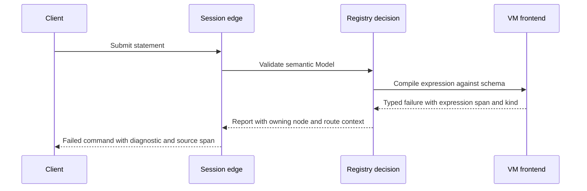
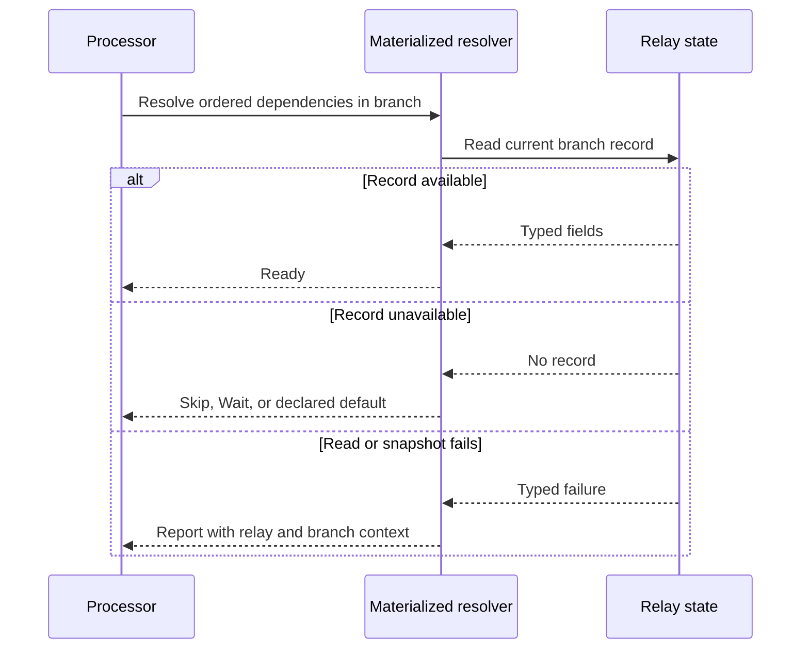
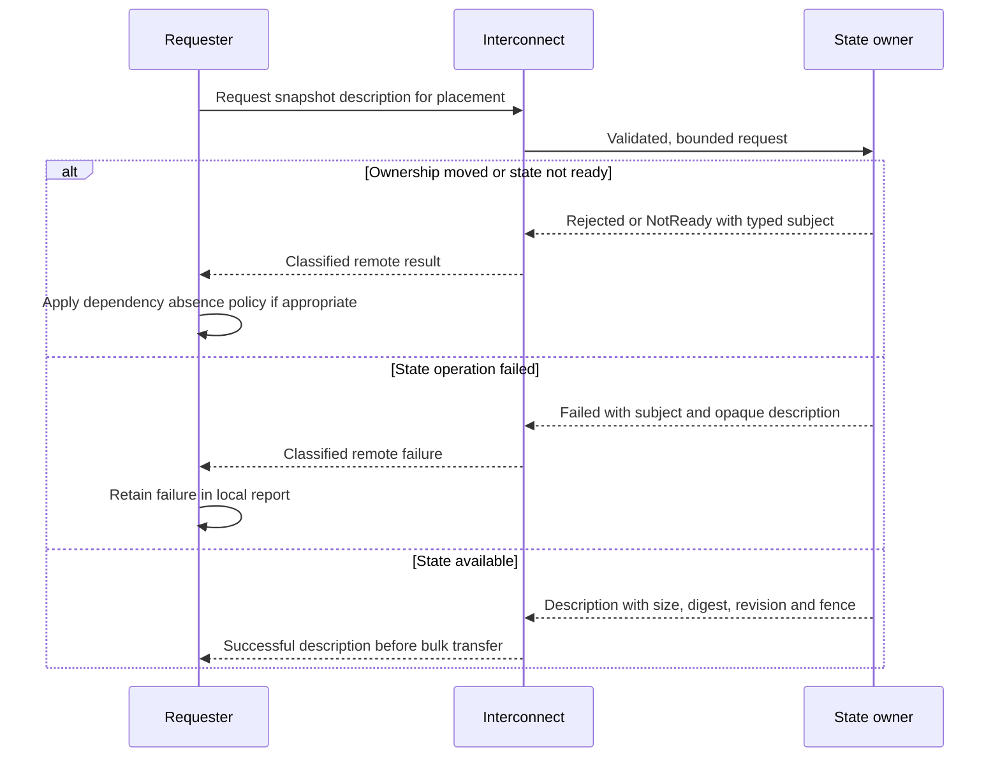

# Errors And Diagnostics

*Plexus, the Nervix graph definition language.*

Client CONFIG validation keeps vocabulary `ClientConfigSchemaError` beneath the registry's
client/domain context. The server's changed-model binding validation runs connector-owned offline
checks before standalone mutation or transaction commit. `OfflineClientConfigError` retains typed
native causes; the AMQP URI parser's string-only refusal is retained as a diagnostic attachment.
Public command projections render the invalid key and client identity without driver values,
including through transaction planning and commit wrappers. Resource resolution, file inspection,
worker admission and cancellation have distinct contexts. Admission failure never claims that a
key failed validation. Rendered WebSockets and Prometheus values retain their owning configuration
errors; the public projection uses their value-free key contexts. Redis's capacity refusal keeps
the ingestor plan's typed range error beneath `OfflineClientConfigError` for
`subscription_buffer_messages`. See [Connector Contract](connector-contract.md) for the offline boundary.

RabbitMQ's TLS file keys declare `amqps` as their permitted address scheme. The shared schema's
`ClientConfigSchemaError::RequiresScheme` refuses TLS files with `amqp` before file inspection
and commit, naming the key, `addr` and `amqps` without the configured values. The existing
certificate/key pairing refusal remains independent of the scheme check.

An OTEL literal outside its declared field domain is a typed registry mapping issue that names
the signal, key and required constraint. It carries no literal value. A TLS file key with a
plaintext endpoint is a typed client-schema scheme refusal before file inspection, for either
OTLP protocol. Header-pair parsing retains its typed cause beneath the value-free client key
context. Neither path includes configured header values, file paths or endpoint credentials.
The encoder verifies mapped types as a plan invariant; a violated invariant does not become a
repeated connector initialization attempt.

Sentry's offline DSN check retains `sentry_types::ParseDsnError` beneath
`OfflineClientConfigError` for `dsn`, and connector initialization retains that same report
beneath its open context. Public command refusals render the reviewed key context, never the
secret DSN. Its required request deadline uses the shared schema's `MissingRequired` or
`InvalidValue` refusal for `timeout_ms` before initialization.

MongoDB's explicit-seed URL and delegated options are checked by its native parser without
network I/O. Pool query options produce the typed `PoolSizing` outcome naming `POOL SIZE`;
other native refusals retain the driver's error beneath the value-free key context. Its resolved
database is required, and the collection checks the complete namespace budget before opening.
Client initialization also preserves the driver cause of option installation and the validation
ping. Public command refusal projection renders the reviewed key/pool context rather than driver
input.

MongoDB TLS preparation retains `MongoDbTlsError` beneath the client-initialization context
and preserves filesystem, executor and native driver causes. Its contexts name the operation and
certificate/key role without copying PEM contents or configured paths into diagnostic text.
Native client construction uses filesystem-worker admission before the driver reads or parses
TLS files. Admission/cancellation stays an initialization failure; a native TLS refusal retains
the driver's typed cause beneath its configuration context.
Explicit files combined with `tls=false` fail offline under the value-free `addr` key context.
The registry's `ConnectorDeclarationIssue::MongoDbFieldName` refuses a NUL byte in a mapped BSON
key at CREATE and ALTER; its debug-formatted key escapes control characters in the diagnostic.

The ClickHouse declaration checks a required positive `timeout_ms` and the address/TLS pairing
before inspecting mounted files or opening a client. Missing timeout or HTTPS trust is a
`ClientConfigSchemaError::MissingRequired` or `RequiresKey`; a TLS key with an HTTP address is
`InvalidValue` for that key. These reports name only the key, never its path or URL. A ClickHouse
table locator with an empty or third dot-separated part is an `ExternalNameError` at Plexus Model
construction; no malformed target reaches the insert SQL.

The declared ClickHouse connection keys reject unusable intervals with `InvalidValue` for the
offending key: the HTTP pool idle limit takes positive schedulable milliseconds, and TCP keep-alive
takes representable whole-second intervals expressed in milliseconds. Default values apply only
to omitted keys. `DESCRIBE CLIENT` projects effective configuration through the existing
confidential key policy; a missing client and a failed registry read use ordinary failed-command
outcomes without exposing configuration values.

ZeroMQ endpoint validation keeps the socket driver's endpoint error beneath
`OfflineClientConfigError` for `addr`. Its socket owners keep the shared Boolean parser's
`ClientConfigError` beneath their configuration context for `bind`; a malformed value does not
select a socket operation. Public CREATE refusals retain the key and client identity while the
driver's diagnostic remains internal.

Transaction model preflight adds its operation identity with `change_context` above the registry
report. It does not nest that report in a context field: the ordinary typed report chain remains
inspectable, so command projection can retain the schema's invalid-key diagnosis.


Connector-storage worker capacity crosses the typed node-capability setting boundary before
executor construction. A claim exceeding the primitive's permit representation returns
`ExecutionConfigError::WorkerCountTooLarge` with its class, requested count and maximum; the
nonzero semantic value already excludes an empty pool. Defaults and explicit claims use that
same validation boundary.

Setting construction preserves the definition owner's typed report. `Setting<D>::new` and
`resolve` run the same validation for explicit and default values against typed context; an
invalid default is a failure, and never a replacement value. The vocabulary formats no cause
into a string. [Node Settings](node-settings.md) owns classes, derivations and relationship
checks; [Typed States](typed-states.md) owns the construction boundary.

The [architecture rule matrix](architecture-enforcement.md) records the compiler contracts for
failure signatures, discarded outcomes, canonical panic operations and Option/Result control
flow. Expanding an error projection into an explicit Result branch preserves its complete report,
context and recovery disposition. The source parser reports malformed authored Rust through a
typed path/location context over the original parse cause; rendering includes that cause once.

Nervix gives a failure its meaning at the boundary that can decide what went wrong. That meaning
travels through the graph as a semantic error and an `error-stack` report. A public edge renders a
diagnostic only after it has made the decision the error permits. Ordinary control outcomes, such
as waiting for materialized state or following a new leader, remain distinct from failures.
The web console applies the same distinction to structured choice lookups: an absent form
prerequisite shows a neutral hint, and stale context offers a fresh request. A failed lookup,
closed session channel, or unreadable reply appears as an alert.
Client creation names its choice as a connector and presents the composed Plexus
`<CONNECTOR> CLIENT` head; a missing choice asks the operator to choose a client connector.

This chapter owns the error and diagnostic model across layers: who gives a failure its meaning,
how a report is created, enriched, inspected and rendered, which outcomes are not failures, where a
report ends at a fixed wire, ABI or stored shape, what a diagnostic may say, and how the rules are
enforced. It names the error types of every layer. The contract a failure belongs to stays with the
chapter that owns its subsystem:

| Subject | Owning chapter |
| --- | --- |
| Missing values, distinct semantic states and the boundary that validates them | [Typed States And Validation Boundaries](./typed-states.md#validation-and-failure-boundaries) |
| Row and batch errors of the expression VM, and each function's error contract | [VM Functions](./vm-functions.md#row-errors-and-batch-errors) and [Expression Functions](./filter-map-functions.md#errors) |
| Guest result codes, rejected saved state and failed checkpoints | [WASM State And Recovery](./wasm-state.md#rejected-state-recovery) and [Rust WASM Guest SDK](./wasm-guest-sdk.md#error-handling) |
| Source and emitter failures, per-record outcomes, retry and acknowledgement | [Connector Crates And The Connector Contract](./connector-contract.md#failure-and-observation) |
| Lookup outcomes and which caller owns a failed lookup | [Name Resolution](./name-resolution.md#failure-ownership) |
| Exchange forms, remote failure classes on the wire and relay acknowledgements | [Cluster Interconnect](./interconnect.md#failure-ownership-and-persistence) |
| Durable appends, uncertain writes and a failed consensus store | [Consensus Storage And Replication](./consensus-storage-and-replication.md#appended-batches) |
| Planning, binding and message-error delivery while a schedule is applied | [Execution Plans](./execution-plans.md#failures-guarantees-and-limits) |
| Primitive mode, target and permission rejection; distinctions between verification outcomes | [Execution Primitives](./execution-primitives.md#verification-contracts) |
| Branch-local execution and acknowledgement tracking | [Data Plane](./data-plane.md) and [Data-Plane Concurrency](./data-plane-concurrency.md) |
| Command dispositions, typed rejections and exact recovery | [Client Session Protocol](./client-session-protocol.md#command-dispositions) |
| Planned and actual transaction impact diagnostics | [Transaction Quiescence And Impact Inspection](./transaction-quiescence.md) |
| Stop and drain phases, and the outcomes a stopping node drops | [Shutdown And Recovery](./shutdown.md) |

The Plexus forms for error routes are in [Message Errors](./processors.md#message-errors) and
[Error Routes](./quickstart-error-routes.md).

Emitter ALTER validation belongs to the vocabulary: its typed declared-kind and replacement-kind
failures retain both connector/entity kinds and render their Plexus phrases. The parser constructs
only each destination's own publishing-policy enum, so no registry or planner failure represents an
impossible entity/policy pair. Reference validation still rejects a configured client of the wrong
kind; Iceberg reports its declared object-store alternatives and the actual resolved client kind.

## The Report Model

### A Failure Has One Owner

A fallible operation returns `error_stack::Result<T, E>`: a semantic `thiserror` context inside an
`error-stack` report. `E` belongs to the module that decides what the failure means, and the
report around it carries every cause and context the failure gathered on its way to the caller.
The owner extends its existing error type when an operation gains another failure case. A second
type for the same failure would force callers to reconcile two meanings. Values a caller acts on
belong in typed fields, such as a domain, a node, a relay, a revision, or a limit and the size
measured against it; display formatting happens when the result is reported.

### Creating A Report And Adding Context

The owner creates the report where it detects the failure, with `Report::new` over its own
context. An error a library returned enters the same way: `change_context` on the library's result
makes that error the first context of a new report and puts the owner's context above it. Each
outer layer that changes what the failure means then adds its own context with `change_context`,
naming its operation, node, route, branch, placement, or target, and keeps the report it received.
It does not format a cause into a string and then classify that text as a new failure, and it does
not replace the report by a clone of its current context.

A replacement keeps an informative failure beneath its context. For a foreign error this is
`Report::new(cause).change_context(context)`; for an existing report it is
`cause.change_context(context)`. A new outer report and a printable copy of the cause's text
do not preserve that failure. Storage, I/O, decoding and nested reports retain their typed
frames even when the caller needs only the outer context today.

A foreign failure without a standard error implementation still stays typed: the Wasmtime and
byte-quantity adapters own the original library value as a report frame. MongoDB's frame owns the
driver error while rendering only safe operation, I/O-class and numeric-code details. A scoped
benchmark worker's panic retains its original payload behind an ownership wrapper that requires
exclusive access; rendering reads its captured text without acquiring a lock.

A context describes its own failure once:

- It names its own operation and identity and leaves its cause to the frame beneath. `error-stack`
  records the `#[source]` chain of the error a report is created from as frames of their own, so a
  context that also printed its source would name the cause twice in the rendered chain. A context
  with a `#[source]` therefore leaves the source's wording to the next frame.
- It does not repeat an identity a context above it states. The node error policy names the node,
  so the contexts beneath it do not, and a node that declares a setting names itself above the
  setting's error.
- It carries no payload value. [Sensitive Data And Observability](#sensitive-data-and-observability)
  states what a context may name.

A source recorded that way is a frame of text: the rendered chain shows it, and a caller cannot
find it by type. A cause a caller must classify therefore stays a typed context of the report, or a
typed field of the context above it, as the resolver's `DnsLookupFailure` is of a RabbitMQ or MQTT
connection error.

Attachments are not contexts, and the rendered chain does not show them. A printable attachment
carries the description a connector or a task gives its own failure, and one reader uses it: an
emitter shows the first printable attachment of a failure as its transient error, and only without
one the outermost context. A typed attachment carries a value for one consumer, as an emitter attaches
the retry delay its receiver stated for the emitter host to read. Neither replaces a context: a
caller decides from contexts and typed fields.

A Core NATS flush keeps its driver's typed failure beneath `CoreFlushError::ClientFlush`.
A connection change is the separate `CoreFlushError::ConnectionChanged` failure, carrying the
nonzero count whose delivery can no longer be certified. Publication and finish add their own
`EmitterWriteError` or `EmitterFinishError::Flush` context and render the complete report for the
emitter's transient description. An elapsed write still names its configured `timeout_ms`; an
elapsed finish reports the pending count through `EmitterFinishError::Unsent`.

Two failures of one operation stay one report. When a model alteration fails after its domain
paused and resuming the domain fails too, the resume's report is added beside the alteration's and
one context is placed above both, so a caller still finds a leadership loss in either branch. A
report cannot be copied. A failure that reaches several routes or input batches is therefore
reported once, with the union of their acknowledgements, as one runtime event.

### Deciding From A Report

A caller decides from typed data and never from rendered text. Most decisions read the report's
current context. A few look for a typed context beneath it, or call the lookup the cause's owner
provides.

| Caller | Typed data it reads | Decision |
| --- | --- | --- |
| Rust client | `ClientError` as the current context | Recover the session and send the request again, report an uncertain command or upload, or return the failure |
| Shared C binding | `ClientError` as the current context, and the `BackupDownloadError` beneath a failed download | The `NX_ERROR_*` kind of the failure |
| Session edge | `ConsensusError::LeadershipLost` as the current context of a proposal report | A leader redirect in place of a failed command |
| Transaction application | `RuntimeError`'s revision preparation and readiness timeouts as the current context | Apply the cluster state again and retry, in place of failing the transaction |
| Quiesced backup cut | `RuntimeError::ApplicationDeadline` as the current context of its pause's application, then `DomainAlterError`'s pause application and drain timeouts as the current context | The cut's timeout with its active phase, in place of a failure to stop ingestion or a capture failure |
| Session transaction binding | `SessionTransactionBindingError` as the current context | The `TransactionTakenOver` or `TransactionDetached` disposition |
| Postgres, MySQL and ClickHouse emitters | The driver's SQLSTATE, code or named rejection in the current context | Whether the destination refused rows for good or the attempt failed as infrastructure |
| Connectors that resolve through a driver's DNS hook | `DnsLookupError::find_in` over the causes the driver wraps around the lookup | Keep the typed lookup failure beneath the connection failure |
| Emitter host | The retry delay an emitter attached to its publish failure | Lengthen the retry schedule to the delay the receiver stated |
| WASM runtime | The saved-state verdict of the guest-call failure, an invalid emission, or an exhausted execution limit | The stage the failure is reported under, whether rejected-state recovery starts, and whether the instance is discarded |
| Restore conversion | An execution admission or staging refusal among the report's contexts | Release what the conversion holds and convert again within its wait for room |

Snapshot metadata and Arrow decoders refuse additional bulk scratch without queueing while they
retain encoded input from that pool. The report preserves `AdmissionError` beneath the snapshot
context, and refusal releases the input. A generator reports the failed read and tries a complete
read again on its next occurrence; memory pressure never becomes absent or corrupt state.

Interconnect rkyv decoders also refuse overlapping admission without waiting while retaining
encoded input. Their local reports preserve `AdmissionError` beneath `TransportError`; a nested
decoder owns its input charge through CPU completion even if the enclosing request is cancelled.
At request dispatch, memory exhaustion, a request above the whole memory budget, a closed memory
budget, a full execution queue and a closed execution pool are distinct `RemoteRequestFailure`
variants. They preserve the traffic class and applicable byte or queue bounds. Temporary memory
or queue exhaustion is recognized by `RequestError::is_capacity_exhaustion`; a stream opening answers
503 for temporary refusal and 413 for a request above its budget. Malformed archive validation
retains `InvalidPayload` with its complete rendered cause chain.

### Outcomes That Are Not Reports

An ordinary outcome is a typed value, never an error report. Waiting for or skipping a message
whose materialized state is unavailable, following a new leader, a temporary `Busy` or `Suspended`
refusal a producer resends, a settlement's `StaleReference`, a domain clock attachment's
`AlreadyAttached` and every command disposition are results their caller branches on. Each section
below says which outcomes of its boundary are ordinary.

A failure of one row or one record is a typed value in its batch's outcome too. The expression VM
returns the row errors of a batch beside its result, each a `SideError` with its reason and
expression span. A emitter answers a write with the records it delivered, the records it rejected,
each with a structured message error, and at most one infrastructure failure of the attempt, which
is a report; a record in neither list stays unresolved. Branch construction keeps the outcome of
each row. None of these builds a report or formats a message per row: the typed value becomes a
structured message error only where a route's policy reports it, and hot paths do not allocate a
formatted diagnostic when the variant already names the failure. A source poll and a decode are
the exceptions that carry reports. A poll returns the report of each record it could not read
beside the messages it could, so the rest of one external response continues through intake. An
ingest group returns the codec's report for each payload it refuses, with that payload's place in
its batch, beside the payloads it decoded, so the host consumes each refusal as a
[decode rejection](#decode-rejections) while the rest of the batch continues. A refusal for room
judged no payload and is not one of these outcomes: it fails the whole batch's dispatch.

### Fixed Outcome Boundaries

A report is local to the process that created it. Where a failure crosses a wire, an ABI, a stored
record or a public protocol, the shape on the other side is fixed, and the report is projected
into it exactly where that shape is constructed. That construction is the one place a report's
current context is cloned or its chain rendered into a field;
[Guarantees And Limits](#guarantees-and-limits) lists the contexts that still copy a cause as text.

Leading empty consensus probes return their matching boundary, conflict or higher vote through
the existing management response. A conflict, higher vote or incomplete acceptance ends that input
before data-stream admission. A management request failure uses the same unreachable-peer error
as a heartbeat; subsequent data-stream setup failures remain transport failures. Neither path
retries inside the adapter or changes the caller's retry gate.

An ended consensus append input completes normally without a peer operation or a peer error. With
a first request available, stream setup may return the existing typed admission, membership or
transport failure as an unreachable-peer result. The caller's retry gate runs before that setup
attempt, so reporting an immediate local refusal does not create an unpaced retry loop.

| Boundary | Fixed shape | What crosses | Where a report resumes |
| --- | --- | --- | --- |
| Replicated transaction mutation | The Raft response's `TransactionMutationError` | The state machine's typed refusal, cloned from the report's current context when the response is built | The proposer creates a new report from the typed refusal |
| Consensus append stream and its initial prefix check | The stream's wire records and the management append answer | A matching, conflicting or higher-vote answer, or the request error | A rejected or incomplete prefix is returned as the typed Raft outcome before data admission; a failed management request crosses the foreign-error hook with its complete report before becoming an unreachable-peer error |
| Interconnect remote operation | The failure's class and subject, with the answering node's description for an executed failure only | The classified result; the local chain is not serialized | The requester keeps the class beside its own target and placement context |
| Interconnect connection handshake | The answer's refusal | The `PrerequisiteMismatch` the accepting node judged, seen from that node | The dialing node creates `TransportError::RefusedByPeer` from the mismatch, reversed to its own side |
| Remote relay payload refused before admission | The refusal's reason text | The rendered chain | The forwarding node receives the reason as text |
| WASM guest ABI | An integer result code, and the reason on the global-error channel | The code of the guest error's current context, or the rendered chain as the reason of a guest failure | The host creates a guest-call report that holds the code or the reason |
| Structured message error | The record's reference, code, operation, affected fields, time and message | The typed reason that selects the code and a non-sensitive message | The error route receives the record, never the report |
| Session command | The command's disposition, message and diagnostics | The disposition from typed data, and the rendered chain as the message | The client receives a value; the Rust client reports its own failures |
| gRPC and HTTP edges | A status | The status the failure's class selects; a refused credential check names only the refusal | A client classifies the status |
| Shared C binding | The `NX_ERROR_*` kind and a message | The kind from the current context and the rendered chain as the message | The host language raises its own error |

### Foreign Interfaces

A foreign trait that accepts only a standard error receives one that holds the whole report, never
a clone of the report's current context. The DNS hooks hand Hyper, Reqwest, Smithy, MQTT and Redis
a `DnsLookupReport`, and the owner's own lookup, `DnsLookupError::find_in`, recovers the typed
failure from the causes the library wraps around it. The node's command-line value parsers return a
refusal that displays the whole chain, because clap prints only the plain `Display` of the error a
parser returns. The consensus store hands OpenRaft's storage traits an I/O error that holds its
`StorageFailure`. `anyhow` remains at integration and tooling boundaries whose caller has no domain
choice to make: the gossip library's transport traits, whose methods return its result type, and
the benchmark load generator.

### Rendering

A report's plain `Display` is its current context alone. Its alternate form, `{error:#}`, is every
context from the outermost to the cause, joined by `: `, as in `failed to start domain 'edge':
failed to apply runtime revision 7: failed to build domain execution for 'edge': failed to load
lookup 'zips': ...`. Runtime reporting renders every context in the report it receives, using
alternate `Display` (`{error:#}`), including report-bearing tracing fields. A failed command's
message, a runtime event, a negative acknowledgement's reason, a domain's instantiation error, the
CLI's text and JSON reports and the C binding's error message are that chain.

Reports remain typed until these reporting decisions; sensitivity rules continue to apply to every
context. A boundary renders a failure once and reuses the text: a failed dead-letter dispatch
renders its report once and uses that chain in both its runtime event and its negative
acknowledgement. Clock arithmetic and attachment, source cadence and lifecycle, Kafka partition
inspection, relay dispatch and acknowledgement delivery, and state checkpoint publication and
replica catch-up preserve their causes at those boundaries. Nested message-error construction
reports retain the VM or Arrow cause.

Three renderings are not the whole chain, each by its owner's decision. An ingestor's transient
status shows the most specific cause of a source failure, because the connector contract's own
context names only the operation that failed. An emitter's transient status shows the description
its emitter attached, which for the HTTP emitter is the description of the whole chain. A failed
consensus proposal's message is its context followed by the storage or Raft error beneath it. A
node and the benchmark command return their report from `main`, so the process that exits with it
prints the report's debug form: every context, with its attachments.



Connector inspection renders configured error-policy expressions through the same canonical owner
as Plexus output. A canonical-rendering failure remains `CanonicalPlexusError` until the command
response boundary; `DESCRIBE INGESTOR` and `DESCRIBE EMITTER` return that failure instead of a
partially rendered description.

## Ownership And Propagation

### Layers

Dependencies point inward, and so does error ownership: a layer names the errors of the layers
inside it and adds context above them, and no inner layer knows how an outer one reports. The
subsections after the boundary table follow this order.

| Layer | Error owners | What their callers receive |
| --- | --- | --- |
| Primitives | Modeled adapters keep the error types of the library they stand in for, such as the watch channel's `RecvError` and `SendError` | The library's own error shape, never a report |
| Vocabulary | Model alteration errors, `CanonicalPlexusError`, `ArchivedCountError`, `DurationTextError` and the name and value errors of the shared types | A report that names the Model, field or value refused, with nothing above it yet |
| Language | `ParseFromSourceError` for the lexer and parser, `FormatError` for the formatter | A report whose context holds the stage, the rejected text and every diagnostic's byte span |
| Engines and infrastructure | The VM's `CompileError`, `RuntimeError` and row errors; `UdfError`; `JaqProgramError` and `JaqFormatError`; `CodecError`; the WASM `ProtocolError`, `GuestError` and `WasmGuestError`; the connector contract's `IngestorError`, `EmitterOpenError`, `EmitterWriteError` and `EmitterFinishError` above each connector's own errors; `ConsensusError` and `StorageFailure`; the interconnect's `TransportError`, `RequestError` and `RemoteOperationFailure`; `DnsConfigurationError` and `DnsLookupError`; `AdmissionError`, `BufferGrowthError` and `ExecutionError`; `ArchiveWriteError` and `ArchiveReadError` | A report, a typed per-row or per-record outcome, or a typed class of a remote result. An engine decides nothing about the graph, so its errors name no node policy |
| Decisions | `RegistryError`, `RelocationPlanError`, `RestorePlanError` and `TransactionPlanningError` | A report that names the node, route, operation and fields of the refused model or plan |
| Data plane | `RuntimeError` above `ExecutionBuildError`; `IngestorStartError`, `EmitterStartError` and `GeneratorError`; `PlannedGeneralError`, `RouteOutputError`, `RelayProcessorError` and the other node contexts; `RuntimePersistenceError`; the domain clock's `DomainClockAccessError` and `DomainClockWaitError` | A report for the node's policy, with the acknowledgements of the work that failed, or a structured message error for a route |
| Control plane | `AppError`, `DomainAlterError`, `BackupError`, `RestoreRefusal` and the transaction and lifecycle errors | A report the session edge turns into a command result |
| Edges | The session service's `GrpcAuthenticationError`, `SessionTransactionBindingError` and `SnapshotEncodingError`; `ClientError` and the Rust client's `DomainClockReadError`; the CLI's and the benchmark command's own contexts | A command disposition, a status, an `NX_ERROR_*` kind, or the rendered chain |

### Boundaries

| Boundary | Failure meaning it owns | What its caller can decide |
| --- | --- | --- |
| Vocabulary Models and the execution-graph description | Alterations the stored Model refuses; invalid placement members, inferencer tensor schemas, and upload identities; values canonical Plexus cannot spell; and execution-graph encoding or decoding | Refuse the command and keep the stored Model unchanged, or report which statement or graph could not be rendered or decoded. |
| Plexus language and formatter | Source text the lexer or parser rejects, with the stage that rejected it, the rejected text, and every diagnostic's message and byte span; statements the formatter cannot render, and formatted output that does not reparse to the statements it came from | Report the stage and underline each diagnostic in the text that was submitted, or leave a file unchanged and report the formatter defect. |
| Arrow record and batch layer | Schema, field, column, row, and batch construction or decoding failures | Reject a malformed batch or a field operation without inventing a replacement value. |
| Bounded execution | A memory charge a class could not grant (`AdmissionError`), a budgeted buffer whose growth its class did not back (`BufferGrowthError::NotCharged`, with that `AdmissionError` beneath it) or that would pass its operation's limit (`BufferGrowthError::LimitExceeded`), a job refused because its class's wait queue is full, a closed pool, a job that panicked on its worker (`ExecutionError`), and a job that stopped at a `Cancelled` check because its caller stopped waiting | The job's owner maps each to its own typed outcome. A refusal judged nothing, so it stays retryable: an emitter keeps its rows, an ingested payload fails its dispatch rather than its decode and an endpoint answers it as a retryable rejection, a credential check answers `UNAVAILABLE` rather than failing authentication, and a restore's deduplicator or window conversion releases what it holds and converts the refused window section or keyspace again, within a 30-second wait for room, rather than reporting archived state of another shape. The unfolding of a payload a quiesce buffer retained, or of a poll a paced ingestor handed over, is not refused at all: nothing could present it again, so it waits for a place. The job that admits one key group into a keyspace a restore is converting waits for a place too, because the keys admitted so far could be presented again only by converting the keyspace from its first group. So does a payload a source handed over without an acknowledgement, when its transport survives a held loop; any other such payload is refused, reported as an ingestor error and counted in `nervix_ingestor_unfolding_refused_total`. An Iceberg commit's read of the staged files its emitter already accepted waits for a place as well, while the bulk memory charge it takes first, without queueing, is refused when the class has no room and the emitter retries the commit with its policy. A panic is the job's own defect. The executor catches it at that callback, reports `JobPanicked` to its caller, completes its service accounting and continues draining its admitted successors. |
| Expression VM frontend and runtime bridge | Invalid expression scopes, types, sensitivity, compiled program inputs, and evaluation failures | Refuse a model during validation, or classify an affected row or batch during execution. [VM Functions](./vm-functions.md) owns execution detail. |
| Stateful processors | Branch-local deduplication, ordering, window, correlation, inference, and WASM execution or state failures, and a processor task's restore of the branches its lifecycle checkpoint names (`ProcessorBranchTaskError`) | Apply the processor's message or node policy, or fail a checkpoint and its held acknowledgements. A restore that fails installs no branch and stays pending: the task retries it after a backoff, holds its input, and refuses a lifecycle checkpoint or guest-state reset with `BranchesUnrestored` until an attempt succeeds. [Shutdown And Recovery](./shutdown.md#restoring-processor-branches) owns that sequence. |
| Connector crates and host | Integration-specific configuration, decoding, external ingestor and emitter outcomes; host-owned routing, retry, flush, and acknowledgement failures | Separate a record rejection from a source or emitter failure and follow the configured retry or acknowledgement contract. [Connector Crates And The Connector Contract](./connector-contract.md) owns those contracts. |
| Materialized state and lookups | Dependency resolution, field and schema checks, defaults, lookup evaluation, snapshot opening, and state exchange | Use a declared absence policy only for unavailable state; report a genuine failed read or invalid state. |
| Ingest grouping and relay batching | Route grouping, branch-key construction, Arrow batch assembly, relay admission, and delivery failures | Keep the affected concrete branch and fail or retry the correct in-memory attempt. |
| Client ingestor endpoint | Whether a submitted batch is a canonical Arrow IPC stream of the input schema (`ClientBatchError`), whether the node had capacity to validate it, and how its acknowledgement root resolved | Answer the batch as not admitted with its defect or a temporary refusal, or with its terminal outcome, and end a producer with the reason its attachment ended. |
| Registry, placement, and planning | Invalid domain models, references, capabilities, branch relationships, flush contracts, schedules, and placements | Reject the command before activating an invalid graph or refuse a relocation plan. |
| Runtime installation | A committed revision this node cannot plan or apply, a domain execution it cannot build or change (`RuntimeError::BuildDomainExecution` above the `ExecutionBuildError` step that failed), and ingestors that do not start once their revision is prepared | Keep the previously applied schedule as the predecessor for a retry, and report the whole chain with the failed command, the domain's instantiation error and the runtime event. |
| Backup archive format | Records that do not encode or exceed their size limit, and archives whose structure, record headers, record values, section lengths or digests do not match what the manifest declares | Refuse to write an archive, or refuse a whole archive naming the section and the check that failed. |
| Restore planning | Archives a restore cannot apply to the cluster: the wrong scope, a domain the archive lacks or the cluster has, an archived user the cluster has under `ON EXISTING USER FAIL`, resource versions the archive does not hold consistently, models that bind no restored version, and archived branch keys that are not keys of the branching their restored entity declares | Refuse the restore before it changes anything, naming the domain, user, resource, version, or model, or the archive section, entry, entity, branch and field of the key. |
| Interconnect | Authentication, framing, limits, transport, and the class and subject of a remote operation failure | Distinguish a transport failure from a peer's rejection, absence, unreadiness, or executed failure. |
| Deadlock detector and diagnostic run | A detector that cannot be installed or is installed twice (`InstallError`), a diagnostic run that cannot install it or record its starting evidence (`DiagnosticError`), and evidence that does not encode, decode, fit its bounds, write or read (`EvidenceError`) | Refuse to start a diagnostic process, or refuse a whole evidence file naming the check that failed. A deadlock finding is not one of these errors: it is a diagnostic result that ends the process with its own status. |
| Native client and its edges | A call that could not connect, was refused or cancelled, was answered outside the protocol, or lost its session (`ClientError`), above the transport status, the codec's report, a local archive's I/O error, or the failure that left a command or upload uncertain | Retry, recover the session, recover an uncertain command or upload by its reference or identity, or display the whole chain; the CLI and the C binding classify from the current context. |
| Control plane and public edges | Transaction and lifecycle results, command dispositions, session diagnostics, and HTTP response selection | Return a recoverable command outcome or an appropriate response to a client or operator. |

Forced ownership installation retires changing relay channels before its dispatch fence waits.
The remote delivery owner maps a cancelled or unconfirmed admission through its existing typed
delivery failure and fails the record ACKs it retained, rather than reporting successful processing
or a codec/message error. The acknowledged source can then retry through the newly published route.
An already admitted result keeps its record-ACK obligations; uncertainty can produce replay
duplicates. Cancellation reconciliation keeps its five-second attempt budget independently of the
entity gate deadline. [Cluster Interconnect](./interconnect.md#cancellation-and-branch-changes)
owns the admission verdict and [Execution Plans](./execution-plans.md#incremental-changes-and-rebuilds) owns
installation and publication.

### Cluster Availability Reports

`SHOW CLUSTER STATUS` keeps gossip visibility and effective member unavailability separate. A Raft
member missing from the raw live gossip set gets a visibility warning. Its unavailable-member
warning comes from the cluster's effective availability snapshot, which retains an established
peer while its health observation still bridges a gossip lapse. The reason names application
health when that owner excludes the peer, or Chitchat when gossip excludes it after the retained
observation ages out. A client observing the warning therefore sees the same availability owner
that controls member removal. The report is an observation; the mutation checks availability again.

### Vocabulary Models

The vocabulary is the innermost owner, and its Model operations report the same way. An alteration
is applied to a copy of the stored Model, which replaces the original only when every operation
succeeds, so a refusal leaves the stored Model unchanged. Each refusal names what it refused in
typed fields: the field, input relay, route target, or materialized dependency, or the stored and
requested names when an alteration targets another Model. An ingestor alteration whose head names
another connector and entity than the stored ingestor reads is refused with both typed kinds, which
its message renders as their phrases, such as `the stored ingestor reads HTTP ENDPOINT, so ALTER
KAFKA TOPIC INGESTOR cannot alter it`. A Pulsar `SET START AT` on a provisioned subscription is a
typed vocabulary alteration refusal; the existing definition and broker cursor are unchanged.
An input, route, or dependency operation
that junctions, deduplicators, reorderers, and reingestors share is reported in the altered
processor's own error where it is detected, so the report begins at the failure rather than at a
conversion. Canonical Plexus rendering refuses only a value the language has no spelling for: a NaN or
infinite `F64` literal, which the error carries, or a codec declaration its wire format cannot
express, such as encoding rules on `SYSLOG` or a JAQ-transformed format without a program, which the
error names by codec. The execution-graph description keeps the JSON encoder's or decoder's error
beneath its own when the public wire form cannot be written or read. It keeps a typed columnar
JSON writer error beneath a named codec encode failure. Unsupported columns and invalid string
offsets fail batch preparation with the codec name. Required nulls identify their field and row;
write failures retain their source without quoting a payload value. Registry planning keeps an
alteration's report beneath its invalid-model refusal of the named Model, and the refusal quotes the
rejection's message, so a failed `ALTER` shows the same reason the vocabulary gave. `SHOW CREATE`
answers a Model canonical Plexus cannot spell with a fixed diagnostic.

### Plexus Language And Formatter

MQTT QoS refusals identify the supplied number, its source span, and the levels that the ingestor
or emitter accepts. An MQTT ingestor `ACK` mode outside a persistent session at QoS 1 or 2 is
refused with the mode underlined and the session and QoS the statement writes named beside the
required pairing. A refused `ON QUIESCE SUSPEND` identifies `SUSPEND` and its required
`SESSION PERSISTENT` pairing at `QOS 1` or `QOS 2`. Completion offers the quiesce modes the
written session can use; a clean session or QoS 0 offers `BUFFER` and `DROP`.

The language layer reports rejected source the same way. Lexing and parsing each create the report
at the stage that failed, and its context names that stage and holds the rejected text with every
diagnostic's message and byte span into it. A batch of statements is lexed once and each statement
is parsed from its own run of those tokens, so a diagnostic indexes the whole submitted text
wherever in the batch the rejected statement starts. The session edge turns the stage into the
failed command's `lex error` or `parse error` message and passes every span through unchanged, so a
client underlines it in the text it sent. A statement grammar reads an expression it embeds from
the statement's own tokens, with the grammar a standalone expression uses, for as long as that
grammar can go on, and its next clause begins where the expression ends. Where the expression
cannot begin at all, the diagnostic expects the placeholder the clause names, such as
`where_expression`. Where the expression goes on with a token and then fails, the statement reports
the expression grammar's first diagnostic at the tokens of the statement where it failed, with the
message the standalone reader gives the same text. Where a complete expression is followed by a token
no clause of the statement expects, the statement reports that token with its own expectations. An
expression's diagnostic carries no expectations of the expression grammar, so completion inside an
unfinished expression offers nothing rather than guessing at expression syntax. A caller that owns
a larger operation adds its own context above the
language's report instead of copying the diagnostics into its error: splitting a client batch reports
that the batch could not be split, and the formatter reports a source that did not parse, the line
of a statement the vocabulary could not render, or a rendering defect whose output changed meaning
or no longer parses. The formatter's command line reads the language's report beneath its context
to draw each diagnostic over the whole file at its line, and writes a defect as the report's whole
chain, ending with the cause the vocabulary or the reparse gave.

### Expression VM, UDFs And Jaq

The expression VM returns reports for compile, batch, and runtime failures. `CompileError` keeps
its typed diagnostic code, stable code spelling, operation span, and safe message; validation adds
the model and route context without losing that cause. Roto setup returns `UdfError` reports and
Roto's VM injector returns runtime reports, so a failing Arrow operation can remain in the chain.
Jaq returns `JaqProgramError` or `JaqFormatError` reports for compilation, evaluation, and format
conversion. A codec or runtime caller retains that report under its operation context. VM row
errors remain typed values in the batch outcome and are formatted only when a message error is
reported; this conversion does not turn them into report allocations per row.

A compile failure fails validation or binding as a report. An evaluation failure of one row is a
row error in the batch's outcome, which the route's `ON MESSAGE ERROR` policy receives as a message
error with the `evaluation` code, and only a failure of the batch as a whole is a runtime report.
[Row Errors And Batch Errors](./vm-functions.md#row-errors-and-batch-errors) owns which failure is
which.

Binding a lowered program on a node returns a `RuntimeVmCompileError` report that names the
program and its node: a filter, a FILTER-MAP route, an output branch construction, a WASM output
construction or its refused `INVOKE`, and a generator output. The lowering, `LOOKUP_HASH_MAP`,
materialized-state binding or VM compile failure stays beneath it. The binding names no domain;
its caller adds that context above it, as the processor plan, the entrypoint binding, and an
emitter's or generator's start do.

### WASM Guests

The WASM FlatBuffers decoder reports protocol failures with their verified payload cause. It checks
the complete header length before reading the identifier; a truncated header returns the typed
length or identifier error even when its size prefix matches the received bytes. The Rust
guest SDK retains that report beneath its envelope or snapshot meaning, and its `Processor`
callbacks return guest-error reports. It renders a failure only when returning an ABI code or
global-error reason; rejected snapshot bytes and rejected application state keep their distinct
codes and text. The host retains a typed guest-call cause beneath the failed operation, so its
runtime caller can still distinguish a resource limit, invalid emission, and a saved-state verdict
without classifying a rendered string. Callback and checkpoint acknowledgement decisions stay the
same; [WASM State And Recovery](./wasm-state.md) owns those boundaries.

The reset coordinator preserves the typed `ConsensusError::LeadershipLost` beneath its publication
error. Transaction application inspects that cause before rendering a diagnostic: authority loss
leaves the durable reset step applying in both its first attempt and recovery. Other preparation,
storage and publication failures keep their terminal failure behavior. A rendered message is not
used to decide whether a reset can resume.

A guest export answers the host with an integer, and the SDK renders a guest report only there. A
guest's own failure puts the rendered chain on the global-error channel, latches the instance's
error state and returns the error-state code; a panic latches the same state with the panic's
reason. Any other guest error returns the code of its current context: an invalid size, an access
out of bounds, an uninitialized guest, an Arrow IPC failure or an envelope protocol violation. A
saved state the guest refuses returns one of two codes of its own, for snapshot bytes it cannot
decode and for application state it rejects, and reports its reason on the same channel without
latching, because the host discards an instance whose restore failed. The host turns each answer
into a typed guest-call cause: the code of an export, a global-error reason, a trap, exhausted fuel,
an exceeded memory limit or an invalid emission. [Rejected-State
Recovery](./wasm-state.md#rejected-state-recovery) owns what the host does with each verdict, and
[Error Handling](./wasm-guest-sdk.md#error-handling) what a guest author returns.

Ownership preparation of a stopped WASM domain carries its validated durable checkpoint inventory
without guest execution. A stopped clock is ordinary passive state, not a missing-checkpoint
failure or a reason to reset guest state. Guest restore failures are classified when the running
revision restores the save under the active clock at `START`.

### Codecs And Ingress

Codec compilation, decoding and encoding return `CodecError` reports. The codec context names the
codec, and the field when one is at fault, and the typed reason stays beneath it: a
`CodecContractError` for a declaration or use the wire format does not support, such as a missing
wire field or `ON INGESTION` program; a `FieldDecodeError` or `FieldEncodeError` for a value that
does not fit its field; a `SyslogDecodeError` or `SyslogEncodeError` for a syslog frame; the Arrow
builder's `RuntimeSchemaError`; or the CBOR, Avro, simd-json, protobuf or UTF-8 error that failed.
An unfolding payload keeps the report of the message that failed and names its zero-based input and
output position after it. The ingest group returns that report unchanged. A source host and an HTTP
or WebSocket endpoint render the whole chain once as the message of the decode rejection that
replaces the refused payload, described in [Decode Rejections](#decode-rejections). A lookup line
keeps it beneath the line it failed on, and an emitter keeps it beneath the record it rejects or the
encoding it could not start. The rendered chain reads as the codec
diagnostic did before: `codec 'events_codec' failed to parse field 'user_id': ...` followed by the
Arrow builder's own reason. A codec that fails to compile while a domain execution is built keeps its
report beneath `RuntimeError::BuildDomainExecution`, which names the domain. A codec failure whose
parser or writer error is its `#[source]`,
such as a simd-json, CBOR, Avro, protobuf, I/O, UTF-8 or timestamp error, leaves that error out of
its own message: `error-stack` records a context's source as the frame beneath it, so the rendered
chain names each cause once.

Schemaful JSON parsing has one codec decode failure carrying the simd-json source. Malformed
syntax, invalid UTF-8, and invalid escapes enter through that failure; object shape, missing or
unexpected fields, nullability, exact wire types, integer ranges, datetime parsing, base64, and
nested sequence shapes keep their existing typed codec or runtime-schema failures. Diagnostics name
the codec and field when one is known and never attach the rejected payload value.

Codec jaq transformations are compiled during registry validation for every declared direction.
A syntax error names the codec, domain, and direction and rejects the transaction before the model
is committed. The browser keeps the draft editable so the program can be corrected and submitted
under the same name.

An endpoint that decodes a payload but cannot dispatch or flush its ingest group uses the same
rendered report chain in its runtime event and log. A temporary unfolding admission refusal logs
its report chain while preserving the endpoint's retryable refusal outcome.

In endpoint `MODE ACK`, the public HTTP or WebSocket reply exposes exactly the shared client
submission outcome's class and cause labels. A codec or local route refusal is HTTP 400 with
`processing_failed` / `rejected`; downstream NACK has the same cause with HTTP 503. Capacity,
timeout and interruption retain their existing typed client causes. No rendered report, payload,
or error detail enters that object. Decode rejection and route error policies still consume the
full typed report through their normal owner. Invalid request durations and ACK quiesce contracts
are entrypoint-planning errors naming the ingestor and clause. A WebSocket ACK without a declared
signaling protocol fails planning; an outbound format that cannot encode every outcome fails
source composition with the protocol encoder's typed cause retained beneath the ingestor context.

### Stored Shapes And Archives

The resource store treats a missing installed manifest as ordinary absence. Other filesystem and
manifest decoding failures retain their typed causes. Resource reconciliation renders the complete
report only when it records a failed replica, so an upload refusal and `DESCRIBE RESOURCE` can
distinguish a filesystem failure from malformed JSON. An absent local copy of a published version
is pending while it awaits a live source and supplies no failure reason. Recovery of an unpublished
upload instead reports the admitted archive unavailable when that local copy is absent; a genuine
read failure keeps its cause. [Resource Versions And Bindings](./resource-versions.md#publication-and-transfer)
owns those installation states and their retry behavior.

The native Kafka checkpoint decoder checks its required format signature before exposing offsets
or the optional applied-start generation. A mismatched signature retains the typed
`KafkaOffsetCheckpointError::FormatSignature` cause beneath `RuntimePersistenceError::DecodeState`.
Loading, replica conversion and backup capture all use that owning decoder; no missing marker is
filled from domain metadata.

The vocabulary's `ArchivedCountError` reports a fixed-width archived count that the receiving
target's `usize` cannot represent. Archive decoding retains it beneath the owning storage or
transport failure. Registry Model records validate their current frame signature and report
`RegistryError::InvalidModelArchive` with a recreation instruction for an unrecognized shape. A
record's key holds its domain, Model kind and name exactly as a commit encodes them; a key spelling
a name another way or holding bytes after its encoding is `RegistryError::DecodeKey`, so no stored
record is read as another Model. Consensus validates its complete current keyspace namespace and
state encoding and reports `StorageFailure::InvalidState` with a recreation instruction. Window snapshot decoding reports
`WindowSnapshotIssue::Header` with a recreation instruction for an invalid current frame signature.
These boundaries reject unrecognized data before its counts can be reinterpreted; none clamps,
truncates, or supplies a replacement value. See [Archived Counts](./typed-states.md#archived-counts).

An rkyv archive can pass shape validation and still contain a value that its vocabulary decoder
refuses, including a typed name, size limit, reference, or range inside a list. The owning boundary
reports its existing decode failure with the value's cause. The decoder drops values it has already
read and releases any partially read list or fixed array, boxed value, or shared pointer allocation
before returning that failure; it neither publishes a partial value nor retains memory for a
refused archive.

### Runtime State Storage

Runtime state storage keeps the cause of each failure beneath its `RuntimePersistenceError`. Opening
the store keeps the storage engine's error beneath its keyspace, read, write or synchronization
failure. An encoding or decoding failure keeps the serializer's error, or the `StoredStateIssue` the
stored bytes have, such as a key without its domain separator or a restore whose staged inventory
differs, beneath `EncodeState` or `DecodeState`, so the rendered chain still reads `failed to decode
runtime state: runtime state key has no domain separator`. A memory or storage refusal while a
materialized relay's restored snapshot is opened is a storage admission or execution failure, never
a decoding failure. The required execution-unit marker, tag and ordinal in a state key report a
missing marker, truncation, invalid unit or missing separator as distinct `StoredStateIssue` causes under
`DecodeState`; no unit is inferred from an incomplete key.

A caller keeps the storage report beneath its own context:
`RuntimeStateOperationError::Persistence` for a replica's installation or a snapshot task,
`OwnershipHandoffError::Persistence` for a handoff, and the domain build's `ExecutionBuildError`
step, which names the node and the state kind, for a state assignment.

Bulk overlap refusals retain `AdmissionError` beneath `MaterializedSnapshotError::Admission`
for captured checkpoint reads and group metadata, and beneath `SnapshotStagingError::Admission`
for staged file operations. These are capacity failures, not malformed snapshots. A stopped
materialized backup keeps the report beneath its capture context and refuses the backup without
publishing an inventory. Its incomplete staged sections are released; a new backup after capacity
returns reads the complete checkpoint afresh.

Native Kafka stream conversion retains the rkyv validation failure beneath `DecodeState` and the
placement-qualified `StateReplicationError::Capture`. A cancelled conversion keeps `Cancelled` at
that same boundary without publishing the candidate table. Installation refused after an assignment
changes retains `StateAuthorityError` beneath `RuntimeStateOperationError::Authority` and that
placement-qualified capture context, so a caller can distinguish malformed bytes from lost
authority.

### Name Resolution

The node resolver's own errors belong to `nervix-dns`. A resolver configuration that cannot be
loaded is a `DnsConfigurationError`, which fails node startup beneath the startup preflight's
`PreflightError::Resolver`, `failed to load the name resolver configuration`, and a native client's
connection as `ClientError::LoadDnsConfiguration`. A lookup that fails is a `DnsLookupError`: the
host as the caller wrote it and one `DnsLookupFailure`, the closed set that
[Lookup Outcomes](./name-resolution.md#lookup-outcomes) lists. A client library that resolves
through one of the resolver's hooks receives the `DnsLookupError` itself and keeps it among the
causes of its own connection error, where `DnsLookupError::find_in` recovers it. The HTTP request
emitter, RabbitMQ, Syslog, WebSocket, Redis, MQTT, ClickHouse, SQS and the native session client keep
it beneath their own failure, as the paragraphs below describe. HTTP polling, Prometheus, Sentry,
OTEL and Iceberg report their failed request, export or catalog call without it, so their
diagnostics do not name the lookup failure.

During cluster startup, a node that has recovered Raft peer endpoints logs a failed lookup of its
configured bootstrap host at `warn` and continues with the recovered seeds. A node without recovered
peer endpoints keeps the lookup error beneath `AppError::StartCluster`, because it needs the
configured bootstrap host for first contact. A failed lookup of the node's own advertised endpoint
also fails startup.

The node's own trace export waits for the resolver installed by startup. Its connector's
`TraceConnectError` distinguishes a closed installation, a connection timeout, and a Hyper
connection failure retaining its `DnsLookupError` cause. Tonic and the OTLP SDK report the failed
export. The export timeout encloses DNS and TCP after resolver installation; a missing DNS
configuration still fails startup, in the startup preflight, as `PreflightError::Resolver` beneath
`AppError::Preflight`. Telemetry failures have no connector retry or ACK disposition.

### Connectors

A connector reports through the contract's own contexts and keeps its integration's error beneath
them. `IngestorError` names the connector and the operation that failed: opening, reading,
acknowledging, rejecting, suspending, resuming or closing. `EmitterOpenError` separates an invalid
configuration and a missing external entity from a failed initialization. `EmitterWriteError`
separates a failed publish or commit, which the host retries on its backoff, from a
misconfiguration, which it does not retry. `EmitterFinishError` reports a finish that did not send
everything the emitter's client still held when the emitter stopped: `Unsent` when the deadline passed,
with the count of records the client still held, and `Flush` when the client failed while it sent
them. The host does not retry a finish; a stop that asked for it fails, and teardown records it as
the emitter's transient error. A record the destination refuses for good is none of
these errors: it is a rejection in the write's per-record outcome, with the structured message
error the route's policy receives.
[Failure and observation](./connector-contract.md#failure-and-observation) owns the contract, and
the paragraphs below record what each integration keeps beneath it.

An Iceberg object-store failure retains its OpenDAL cause beneath the external Iceberg error.
When the storage client sets `timeout_ms`, that error also names the configured millisecond bound
as configuration context. The host reports the failed commit and its declared reconnect backoff; one
storage failure consumes one host attempt. Catalog requests keep their separate failure path.

The connector helper errors for OTEL, Syslog, WebSocket signaling, Postgres, MySQL and ClickHouse
carry `error_stack::Report` from the failing operation. A caller adds context at a connector or
host ownership transition; it does not recreate the top-level error from its formatted text.
Syslog TLS material reports keep the file, certificate or rustls cause, and stream frame reports
remain beneath the connection failure. Its configured accept capability maps socket failures into
`SyslogListenerError::StreamAccept` before the listener returns them to the source owner; the test
injector follows the same typed path. WebSocket signaling compilation and execution retain jaq,
frame encoding and transport causes. The runtime's Syslog source-plan and signaling compilation
errors keep those reports as typed fields while preserving their startup messages.

A Syslog listener that cannot decode the subject of a verified TLS client certificate keeps the
X.509 parser's typed cause beneath `SyslogConnectionError::TlsPeerCertificate`. It ends that
connection before handing over frames. A connection without client authentication is an ordinary
absent TLS peer and produces no failure.

A MySQL pool is kept at its `POOL SIZE MIN` by a task no caller waits on, so that task is the only
witness of a pass that ends below the minimum. It reports `PoolMinimumError::NotRestored`, naming
the minimum, above the failed checkout's `PoolMinimumError::CheckOut` and the driver's error, at
`debug`, returns the connections the pass held, and passes again a second later. An emitter that
needs a connection meanwhile reports its own failed checkout. The shared MySQL pool retains
`ConfiguredDeadline` for `timeout_ms`, when present, and every checkout, validation and insert
keeps a typed `DeadlineElapsed` on expiry. Driver checkout and validation errors retain their
typed causes through the open/write contexts. The emitter's pool-borrow context adds no rendered
copy of the report. Its deadline report also attaches the safe operation, key and duration for
the host's public emitter diagnostic. MySQL initialization changes context on the shared-client
report rather than reducing it to Display text, so that projection and the typed cause survive.
Deadline failures are infrastructure outcomes and leave pending rows on the host's retry policy;
they do not become definite record rejections.

An HTTP request attempt that fails is an `HttpAttemptError`, owned by the HTTP emitter: a timeout, a
DNS, connection, TLS, send or response-header failure, an invalid destination, a declared proxy that
could not be reached, a tunnel request the proxy did not answer or refused with its status, or a
retryable or authentication status with its number. A failure to reach the proxy keeps its own DNS,
connection or TLS failure beneath `HttpAttemptError::Proxy`. The emitter keeps the resolver's
`DnsLookupError`, hyper's error for an exchange or a response head hyper could not complete, the
socket or TLS error, or the `AddressShareElapsed` of an address that accepted no connection within
its share of `timeout_ms` as the context beneath it, and attaches the
description of the whole chain, such as
`HTTP TLS handshake failed: invalid peer certificate: UnknownIssuer`, to its publish failure. The
emitter reports that description as its transient error and runtime event for as long as the
request stays pending, which `DESCRIBE EMITTER` shows. It names the status or the cause of the
connection and never the evaluated target, a redirect's `Location`, a header value, a credential,
the proxy's credentials or a body. A refused request is not an attempt failure: it is a record
rejection with code `external`, operation `publish` and its numeric status, and so is a redirect
its client does not follow.

HTTP request-field compilation retains the VM report beneath the emitter's request-field context
and attaches its safe message for diagnostics; an invalid request program never starts the emitter.

A Prometheus query that fails is a `PrometheusQueryIngestorError` beneath `IngestorError::Read`: a request
that could not be sent, a status other than success, a response whose announced length or body
exceeds the ingestor's `MAX BODY SIZE`, a body that could not be read, a payload that does not
decode, a query Prometheus answers with an error status, or a result that is not a vector. The
oversized response is `ResponseTooLarge`, which names the bound and never the body, such as
`Prometheus query response exceeds MAX BODY SIZE 16MiB`. The host shows the chain as the
ingestor's transient error, which `DESCRIBE INGESTOR` prints, and the next poll queries again. A
sample whose value or timestamp cannot be read fails only its own record, reported beside the
poll's other messages.

Iceberg object storage retains the Iceberg storage error contract when it installs the node's
HTTP resolver. Invalid object URLs are `DataInvalid`, and an unsupported Azure connection string
is `FeatureUnsupported`. Building the storage HTTP client or an OpenDAL operation can fail as
`Unexpected`, with the underlying error retained as its source. Those failures enter the existing
emitter failure and retry path; they do not release a staged record's acknowledgement before commit.

A RabbitMQ connection that fails is a `RabbitMqConnectError`, owned by the connector's connection
module: an invalid address, with the address owner's typed reason beneath it, such as an address
that names no host or port 0; an invalid CA file; an incomplete client identity; a client
certificate or private key file that cannot be read, keeping the connector contract's file failure
beneath it, or that holds no PEM certificate or key, naming which; a lookup failure that keeps the
resolver's `DnsLookupFailure` as a typed field; no address that accepted a connection; a socket the
node could not hold the second handle on that ends an unopened connection; a failed or overdue TLS
handshake; a broker that refused the TLS session, carrying the TLS alert it sent as a typed field
whether that alert ended the handshake or, under TLS 1.3, the first read of the AMQP handshake; a
Lapin runtime that could not be created; or a failed or overdue AMQP handshake, each naming the
broker host where one is involved. An overdue step keeps the elapsed `connect_timeout_ms` as its
typed cause. The address refusal never repeats the address, which can carry credentials, and the
CREATE-time check of the same address keeps the same typed reason beneath the client's key error. A step of opening the entity's channel that fails or runs out of the same deadline is
reported beneath the source's or emitter's own context for that step, with the elapsed deadline as its
typed cause and its text leading the report. The source keeps these beneath its connect and resume
contexts, so `DESCRIBE INGESTOR` shows the deepest cause, such as the resolver's own lookup error or
the deadline that ran out. The emitter changes them into a configuration failure for an invalid
address, CA file, client identity or deadline key and an initialization failure otherwise, leading
with the failure's chain, down to a `connect_timeout_ms` it ran out of, which `DESCRIBE EMITTER`
shows. Neither
attaches credentials from the address. A `NO ACK` round trip that runs out of the client's
`timeout_ms` fails the write as a publish failure with the elapsed deadline as its typed cause and
its text leading the report.

RabbitMQ consumption keeps a failed Lapin receive, ACK or NACK as the typed cause beneath
`RabbitMqQueueIngestorError`; the host reports that chain through its ordinary ingestor-failure boundary.
A requested batch deadline that cannot be represented is `RabbitMqQueueIngestorError::BatchDeadline`.
If a stream failure or invalid deadline follows gathered deliveries, the reader hands those
deliveries to the host before reporting the deferred failure on its next read. A parallel
delivery's graph refusal rejects only its own position. A failed transport settlement retains
the unresolved positions for the broker-redelivery recovery path, without counting positions
already confirmed or requeued on that connection.

A RabbitMQ publish that ends with the broker closing the emitter's channel is classified by the
broker's own reason, which the emitter reads from its connection. A refusal of a message body larger
than `max_message_size` is a `RabbitMqRecordError`, owned by the RabbitMQ emitter, which carries the
body size and the limit as typed fields and becomes a record rejection of that message with code
`external` and operation `publish`, reaching every member of a batch message. Any other close, a
lost connection, and a close whose reason never arrives fail the attempt as an infrastructure
failure, which the emitter retries on its backoff.

A message the broker returns unrouted under `MANDATORY`, with its publisher confirm under `ACK` or
before the round trip that ends a `NO ACK` write, is a record rejection with code `external` and
operation `publish` whose message names the broker's reply code and text, such as `rabbitmq
returned the message unrouted with reply code 312: NO_ROUTE`. A routing key longer than an AMQP
short string carries is a `RabbitMqRecordError` keeping the driver's `ShortStringError` as its
source and the key's length as a typed field, and becomes the same kind of rejection before the
message is written. A return the emitter cannot attribute to a message of its write fails the
attempt instead, because no record can be named as unrouted. An exchange emitter whose passive check
finds no exchange fails to open with `EmitterOpenError::MissingExternalEntity`, naming the exchange
and keeping the broker's `NOT_FOUND` answer, a `lapin::Error`, as its typed cause; `DESCRIBE EMITTER`
shows it as `RabbitMQ exchange '<name>' does not exist`. Any other failure of that check is an
initialization failure. Both are retried on the emitter's backoff.

The registry refuses a `ROUTING KEY` that does not compute an exact, non-null, non-sensitive
`STRING` as `ConnectorDeclarationIssue::EnvelopeValue`, the issue envelope values share, with the
site written as the statement writes it: `ROUTING KEY requires an exact, non-null, non-sensitive
STRING value`. The host reports a routing key that fails or produces no value for a record as an
`evaluation` error of the `publish` operation whose message begins `ROUTING KEY`.

Syslog emission and WebSocket-client ingestion retain DNS failures from the node resolver beneath
their existing infrastructure contexts: `EmitterOpenError::Initialize` while a Syslog sender opens
and `IngestorError::Resume` while a WebSocket source connects or reconnects. The resolver's typed
missing-name, no-address, timeout, invalid-name or transport cause stays in the error report.
Address, TLS and WebSocket-upgrade failures remain connection outcomes. A WebSocket peer whose
upgrade answer contradicts the request's subprotocol offer fails resume with the connector's typed
refusal, which keeps the transport's refusal attached for typed inspection and prints no
subprotocol, since an offer can carry a credential. None is a record rejection, and a DNS result
by itself never marks a Syslog record delivered.

Redis command connections receive the node resolver through the driver's DNS hook. A failed
initial or later pool connection keeps the resolver's typed failure in
`RedisClientError::Resolve`; a later failure sits beneath `EmitterWriteError::Publish` for the
emitter host to retry. No caller waits on the connections a pool opens to restore its
`POOL SIZE MIN`, so the pool itself is the only witness of a restoration that fails: it reports
`PoolMinimumError::NotRestored`, naming the minimum, above the checkout's `DeadlineElapsed` for
`connect_timeout_ms`, at `debug`, and tries again.
A Pub/Sub source resolves before opening its dedicated stream and retains `DnsLookupError` beneath
`RedisPubSubIngestorError::Resolve` and `IngestorError::Resume`. A refused address, failed TLS name
check or failed Redis protocol setup is also a connection failure. None rejects an input message
or changes Redis Pub/Sub's server-acceptance boundary for `PUBLISH`.

A Redis source client must declare `subscription_buffer_messages` and `idle_timeout_ms`.
A missing key is `RedisPubSubIngestorError::MissingConfiguration`, naming only that key; a capacity
outside the bounded channel's range is `InvalidBufferCapacity`, and an invalid idle deadline keeps
`ClientConfigError::InvalidDeadline` beneath `InvalidIdleTimeout`. These are source configuration
failures before a subscription opens, not record rejections.

A Redis client's command-pool lifetimes, `pool_idle_timeout_ms` and `pool_max_lifetime_ms`, are
refused at `CREATE CLIENT` unless they are positive, schedulable whole milliseconds. The pool reads
them from the client's effective entries and checks them again: an invalid value fails opening the
pool with `RedisClientError::InvalidPoolLifetime`, naming the key above the schema's
`ClientConfigSchemaError::InvalidValue`, which the node reports as
`OpenClientError::InvalidPoolLifetime`. It is a configuration failure, not a record rejection.

Redis subscription protocol and read failures retain their driver causes beneath
`RedisPubSubIngestorError::SubscriptionSetup` or `SubscriptionRead`. An unanswered idle probe keeps
the shared `DeadlineElapsed` with `idle_timeout_ms` and its configured bound beneath `IdleProbe`
and `IngestorError::Read`. The host displays that transient failure and reconnects on its existing
policy. Reader task failures retain the typed join cause. A source explicitly ending its lifetime
joins its reader; it owes no further read outcome after intake ends.

A connection that runs out of the client's `connect_timeout_ms` keeps the connector contract's
`DeadlineElapsed` as its innermost cause, naming the step that did not finish, the key and its
bound, beneath the connector's own context: `RabbitMqConnectError::Unreachable` or `TlsHandshake`
for a broker connection, `RedisClientError::Connect` for a new pool connection,
`EmitterWriteError::Publish` for a pool checkout, `RedisPubSubIngestorError::NotEstablished` or
`Subscribe` for a subscription, `EmitterOpenError::Initialize` for a Syslog sender and
`IngestorError::Resume` for a WebSocket connection. `DESCRIBE INGESTOR` shows it as the deepest cause.
An emitter shows the message its emitter attached last, so a Redis or Syslog emitter attaches the
deadline's message after its other attachments, and a RabbitMQ emitter attaches its connection
failure's whole chain. A deadline key whose value breaks the vocabulary's rule is
`ClientConfigError::InvalidDeadline`, naming the key above the `ClientDeadlineError` that says why,
and each connector reports it as a configuration failure.

A Core NATS write that runs out of the client's `timeout_ms` keeps `DeadlineElapsed` beneath
`EmitterWriteError::Publish` and attaches its message, which `DESCRIBE EMITTER` shows; the write's
records stay unresolved for the emitter's retry. A NATS emitter whose client still holds records when
its finish deadline passes fails its finish with `EmitterFinishError::Unsent` and their count, and one
whose client fails while it flushes them with `EmitterFinishError::Flush`, the driver's flush error
beneath.

A Syslog frame write that runs out of the client's `timeout_ms` keeps `DeadlineElapsed` beneath
`EmitterWriteError::Publish`, and the emitter attaches the deadline's message last, so
`DESCRIBE EMITTER` leads with it; the emitter rebuilds its connection and retries on its policy. A Syslog
listener's connection whose TLS handshake runs out of `connect_timeout_ms`, or which sends nothing
for its `idle_timeout_ms`, ends with `DeadlineElapsed` beneath the listener's connection failure.
That failure closes only the connection and is logged at debug level; it is never the ingestor's
transient error. A Syslog client that sets a deadline key its direction and protocol never wait on
is refused as `SyslogConfigError::InapplicableDeadlineKey`, naming the key and the clients it
applies to.

An MQTT client's event loop reports a failed or lost broker connection as an
`MqttConnectionError`, owned by the connector's connection module. The socket connector hands the
driver the resolver's `DnsLookupError` as the failure of a lookup, and the driver keeps it as the
cause of its connection error. The connector finds it there and reports
`MqttConnectionError::Resolve`, with the host and the resolver's `DnsLookupFailure` as typed fields
and the `DnsLookupError` beneath it. Any other failure keeps the driver's own description, such as
an address that refused the connection, a failed TLS handshake, including a certificate that does
not name the configured host, or a refused MQTT handshake. A source keeps the error beneath
`MqttTopicIngestorError::Connect` while it connects and `MqttTopicIngestorError::Receive` while it reads, and
those beneath `IngestorError`, so `DESCRIBE INGESTOR` shows the deepest cause: the resolver's lookup
error or the driver's description. The task that drives a ingestor's connection hands the lost
connection to the ingestor's next read, or to an acknowledgement that finds the connection ended,
which keeps it beneath `MqttTopicIngestorError::Acknowledge`; a task that fails without a report keeps its
`JoinError` beneath `MqttTopicIngestorError::Driver`. An acknowledgement that meets the task holding a
publish for room in a full read-ahead fails as `MqttTopicIngestorError::ReadAheadFull`, naming the
read-ahead's capacity, because nothing would write it before the host reads again, and one whose
connection wrote nothing for a keep-alive interval fails as
`MqttTopicIngestorError::AcknowledgementDeadline`, naming the keep-alive. The same causes apply when an
ingestor read acknowledges an oversized publish: they remain beneath `IngestorError::Read`, and the
ingestor drops the connection. A successfully acknowledged oversized publish is an ordinary
`IngestorBatch::Oversized` outcome, counted by the host without a diagnostic or codec rejection.
An emitter's event
loop records the connection error's message as the emitter's transient error, which
`DESCRIBE EMITTER` shows, and reconnects on the emitter's retry policy. None rejects a record or
acknowledges input. A QoS 1 or 2 publish keeps the driver's `ClientError` when the client refuses
to take a record, and its `PublishNoticeError` when an answer leaves a record unresolved, beneath
`EmitterWriteError::Publish`, each with the connector's description of the failure for the
emitter's transient error. A missed `ACK TIMEOUT` is the confirmation window's
`ConfirmationWindowError`, which the window describes the same way.

MQTT input retirement reports `RuntimeError::RetireIngestorEntity`, naming its domain and
ingestor, above the connector's `MqttTopicIngestorError::RetireInstance` and instance index. The report
keeps typed client and connection causes, an unsubscribe refusal's reason codes, or the cleanup
deadline's budget. Invalid endpoint URLs retain their parse cause, and client construction keeps
its driver cause. Cleanup failures at the preceding endpoint are rendered once into runtime error
events and do not fail a drop or prevent moving to another reachable endpoint. Failure to prepare
the replacement's changed sessions remains an installation failure. Neither path rejects a record
or confirms payload delivery.

Pulsar input retirement reports `RuntimeError::RetireIngestorEntity` above the connector's
`PulsarTopicIngestorError::RemoveSubscription`, which names the subscription and its qualified topic.
Beneath it is the step that failed: the client's connection failure, `JoinSubscription` or
`Unsubscribe` above the driver's `pulsar::Error`, which keeps a refusal's server error and reason,
or `RemovalDeadline` with the connection budget it exceeded. A client whose configuration does not
resolve keeps `IngestorConnectorStartError::ClientConfiguration` beneath the retirement context instead. Each
report is rendered once into runtime error events and never fails the drop or replacement.
Comparing a replacement's subscription retains URL parse causes beneath `PulsarTopicIngestorError::ClientConfig`,
or uses `InvalidServiceAddress` for an unsupported service scheme or missing host, beneath the
retirement context. A comparison failure preserves the subscription and is reported separately
from any failure to start the replacement. A provisioned
subscription that does not exist is `PulsarTopicIngestorError::MissingSubscription` beneath the source's
resume context, which the ingestor's transient status shows by its subscription and topic; a check
that could not learn whether the subscription exists is `VerifySubscription` above the driver's
error.

A Kafka emitter keeps librdkafka's `KafkaError` beneath `EmitterWriteError::Publish` when a producer
failure ends admission or a delivery report leaves a confirmed publish's record unresolved.
Temporary `QueueFull` applies confirmation-window backpressure in `ACK`; in `NO ACK` it is the
producer failure that ends the attempt. A payload exceeding the entire native queue byte capacity
is a record rejection naming the payload bytes and the capacity in either mode. An empty-window
queue wait that expires reports `KafkaQueueWaitError::TimedOut`, retaining the producer's
`QueueFull` beneath it; a wait whose deadline cannot be represented uses `DeadlineOutOfRange`.
A record the producer
drops without a delivery report keeps the report channel's cancellation the same way. Each carries
the connector's description of the failure for the emitter's transient error, and a missed `ACK
TIMEOUT` is again the confirmation window's `ConfirmationWindowError`. A delivery error about the
record itself, an invalid or oversized message, timestamp or record, rejects that record through
`ON MESSAGE ERROR` instead. A producer that librdkafka cannot create keeps its `KafkaError` beneath
`EmitterOpenError::Initialize`, and an `ACK TIMEOUT` longer than librdkafka's `delivery.timeout.ms` can
hold is `KafkaMessageTimeoutError::TooLong` beneath `EmitterOpenError::InvalidConfiguration`. A
finish whose producer queue does not empty before its deadline keeps librdkafka's `KafkaError`
beneath `EmitterFinishError::Unsent`, which counts the records whose delivery report has not been
served and never the errors, statistics or other events waiting in the producer's queue; a flush
that gives up only after every record's report was served is no failure. A flush that fails
otherwise, or whose blocking task does not complete, keeps that cause beneath
`EmitterFinishError::Flush`.

A Kafka source classifies an unknown topic from a subscription or topic metadata as
`KafkaTopicIngestorError::MissingTopic`, retaining the driver's typed `KafkaError` as an attachment.
The named topic is the semantic failure shown in `DESCRIBE INGESTOR` until the operator provisions
it. Partition watches recognize this variant as an empty topology; other inspection failures keep
their existing reporting path. A Kafka client's attempt to set a host-owned key, such as
`allow.auto.create.topics` or `delivery.report.only.error`, is
`ClientConfigSchemaError::Reserved` beneath the registry's client context, naming the domain,
client and owned key without its configured value. The source and both inspectors enforce `false`
after pass-through configuration. A key librdkafka reads as another name for a property the
client accepts under one name, such as `metadata.broker.list` for `bootstrap.servers`, is
`ClientConfigSchemaError::DriverAlias`, naming the key and the accepted name. A key written under
librdkafka's `topic.` prefix is `ClientConfigSchemaError::DriverPrefix`, naming the key and the
prefix. Both refusals sit beneath the same client context and carry no configured value.

A Kafka source keeps librdkafka's `KafkaError` beneath `KafkaTopicIngestorError::CommitOffset`, which names
the consumer group, when the group's coordinator refuses an offset commit. A commit the coordinator
does not answer within thirty seconds is `KafkaTopicIngestorError::CommitUnanswered`, and a blocking-pool
job that ends without the answer keeps its `JoinError` beneath `KafkaTopicIngestorError::CommitTask`. The
commit of an acknowledged batch fails beneath `IngestorError::Acknowledge`, so the ingestor's
transient status in `DESCRIBE INGESTOR` shows the deepest cause, such as the driver's description of
the refusal, and the host rejects the batch's positions, which the source reads again. The commit a
`MODE NO ACK` consumer makes as it leaves its group fails beneath `IngestorError::Suspend` or
`IngestorError::Close`, which the source loop reports as a runtime event. None rejects a record.

Kafka control-call admission keeps `AdmissionError` beneath `KafkaTopicIngestorError::ControlAdmission`,
and a refused queue or failed admitted worker keeps `ExecutionError` beneath
`KafkaTopicIngestorError::ControlExecution`. These are transient failures of resume, rejection or
acknowledgement, rather than failures to decode a record. A control call that exhausts its native
`socket.timeout.ms` budget reports `KafkaTopicIngestorError::ControlTimeout` with that bound. Metadata,
watermark, timestamp and seek failures preserve the driver's typed cause beneath the operation
that failed.

After an explicit domain start is accepted, another explicit start in the canonical-position read
ends that resume attempt with `KafkaTopicIngestorError::UnresolvedDomainStart` beneath
`IngestorError::Resume`. Its typed fields retain the accepted and observed generations. The host
retries on its existing cadence; the connector polls only after it has canonical resume positions.

A domain-offset Kafka ingestor that must start a partition without a domain offset while its
client's `auto.offset.reset` is `error` fails its resume with
`KafkaTopicIngestorError::ResetRefused`, which names the topic and partition, beneath
`IngestorError::Resume`; the host shows it as the ingestor's transient status and resumes again on
its cadence. A timestamp lookup whose answer carries a partition error keeps that `KafkaError`
beneath `KafkaTopicIngestorError::ResolveTimestampOffsets`. A consumer-group rebalance runs in the consumer's context, which has no caller to return a failure
to: a rejected partition's floor that cannot be set on the assignment, and an assignment or
revocation librdkafka refuses, are logged at `warn` with the driver's error, and the partition then
starts where the group's committed offset or the client's reset policy places it.

A Kafka consumer takes the commands charge of the job that will destroy it before it is created,
and a refused charge keeps `AdmissionError` beneath `KafkaTopicIngestorError::RetirementAdmission`. It
fails the source's open or the partition inspector's start, as transiently as a refused control
call. A Kafka producer takes the same charge, and a refused one keeps `AdmissionError` beneath
`KafkaProducerStartError::RetirementAdmission` beneath `SinkStartError::Initialize`, whose
description names the refused charge; the emitter starts its sink again after its retry delay. See
[Kafka client retirement](./connector-contract.md#kafka-client-retirement). A retirement has no
caller to fail, so its supervisor reports a destruction job that panicked at `debug`.

ClickHouse and SQS reach the node resolver through their drivers' own DNS hooks, which hand the
driver the resolver's `DnsLookupError` as the failure of the lookup. The driver carries it as a
cause of its connection error, and the connector finds it there by type and keeps it as the context
beneath its existing infrastructure failure: `EmitterWriteError::Publish` for a ClickHouse insert or
an SQS send, `EmitterOpenError::Initialize` while an SQS emitter looks up its queue, and the
`SqsQueueIngestorError` of looking its queue up, receiving or deleting beneath the source's `IngestorError`.
An SQS source looks its queue up when an instance resumes, so that failure is `IngestorError::Resume`
above the typed lookup failure: a queue the service does not have is `SqsQueueIngestorError::MissingQueue`,
which names it, and the source host shows the deepest cause as the source's transient error and
retries it. The failure's message names the host and the lookup failure, which `DESCRIBE EMITTER`
and `DESCRIBE INGESTOR` show. Any other failure to reach the service, such as a refused connection
or a certificate that does not name the configured host, is described by every cause of the driver's
connection error, which describes the connection and carries neither credentials nor a record; a
response from the service keeps its existing description. None is a record rejection, and none
acknowledges input. A source read the host cancelled still waits for its receive in flight, and a
service that has not answered it within 10 seconds of the cancellation ends the read with
`SqsQueueIngestorError::CancelledReceiveUnanswered`, which names that budget, beneath `IngestorError::Read`.
The host shows it as the source's transient error; nothing is rejected or acknowledged, and a message
the receive was returning stays invisible until its visibility timeout.

An SQS request that runs out of its client's `timeout_ms` keeps the connector contract's
`DeadlineElapsed` as its innermost cause, naming the request, the key and its bound: the queue
lookup, a receive after its long poll, a delete, a send or a batch send. It sits beneath the same
context as any other failure of that request, so the source host shows it as the deepest cause, such
as `the SQS queue lookup did not finish within timeout_ms 5s`, and an emitter attaches its message
last, which `DESCRIBE EMITTER` shows. An SQS client whose keys its connections cannot use is
`InvalidSqsClientKey`, which names the key, above its cause: the contract's `ClientConfigError` for
a missing key, an unreadable file or an invalid deadline, `TlsClientConfigError::ParseCaCertificate`
or `AddCaCertificate` for a `tls_ca_file` rustls cannot take as a trust store, and `EmptyCaFile` for
one without a certificate. The source reports it as `SqsQueueIngestorError::ClientConfig`, the
emitter as `EmitterOpenError::InvalidConfiguration`, and `CREATE SQS CLIENT`, which reads the client
the same way before it commits it, as `OfflineClientConfigError::InvalidKey`, whose public message
names only the key.

OTEL keeps a row conversion failure in the invalid-record channel and names its mapped key as the
affected field. A lower OTEL value type or range error stays in the internal report until the
rejection is constructed. Database emitter insert reports keep transport driver or pool causes while the
connector inspects the current typed error for definite row rejection. Postgres SQLSTATE, MySQL
SQLSTATE and code, and ClickHouse named rejection remain the same external classifications.
Database response text that could quote a bound value is discarded after extracting that safe
classification; diagnostics do not quote the row payload.

A Pulsar message refused for good is a `PulsarRecordError`, owned by the Pulsar emitter: a message
larger than the maximum message size the broker announced, which carries the measured size of its
metadata and payload and the limit as typed fields, or a message the broker answered with
`NotAllowedError`, which carries the broker's reason. Either becomes a record rejection with code
`external` and operation `publish`. Every other failure of the client, its connection or the broker
stays an infrastructure failure of the attempt, which the emitter retries.

The Pulsar emitter preserves the driver's `pulsar::Error` beneath `EmitterWriteError::Publish` for
enqueue failures and failed receipts, with its description in a printable attachment. Its shared
confirmation window owns a missed `ACK TIMEOUT` as `ConfirmationWindowError`. A `NO ACK` finish
keeps the first failed receipt beneath `EmitterFinishError::Flush`; if its deadline expires with
receipts still unanswered, `EmitterFinishError::Unsent` counts those receipts, retaining an earlier
driver failure beneath it when present. An unanswered receipt leaves delivery unknown rather
than proving that the broker did not store the message.

A Pulsar source classifies an acknowledgement or a redelivery request that did not take effect in
`PulsarTopicIngestorError`, beneath `IngestorError::Acknowledge` or `IngestorError::Reject`. An
acknowledgement the broker answered with a server error is `AcknowledgementRefused`, whose typed
`PulsarRefusal` keeps the server error, absent for a code the client does not know, and the reason
the broker gave. An acknowledgement nothing answered is `AcknowledgementUnconfirmed`, and a
redelivery request the consumer could not send is `RedeliveryRequestUnsent`; both carry a typed
`PulsarUnresolvedRequest` naming whether the client's operation timeout passed, the connection
closed or the consumer stopped first, because the broker may or may not have applied the request. A
client failure the source does not classify keeps the driver's error as the typed cause beneath
`Acknowledge` or `NegativelyAcknowledge`. The innermost context is the reason `DESCRIBE INGESTOR`
shows.

A NATS source whose client loses its connection to the server reports
`NatsSubjectIngestorError::ConnectionLost` beneath `IngestorError::Read` once it has handed over what the client
received, and each reconnect that fails reports `NatsSubjectIngestorError::Connect` beneath
`IngestorError::Resume`; the source host shows the deepest cause as the ingestor's transient error.
The driver's `ConnectError` remains beneath `Connect`, so a peer that closes before its initial
INFO message is reported as `expected INFO, got nothing`. A
NATS JetStream publish keeps the driver's `PublishError` beneath `EmitterWriteError::Publish` when the
client does not take a record within `ACK TIMEOUT` and when a record's `PubAck` fails, each with the
connector's description of the failure for the emitter's transient error. A message above the
server's `max_payload` becomes a record rejection with code `external` and operation `publish`, and a
missed `ACK TIMEOUT` is the confirmation window's `ConfirmationWindowError`.

A ZeroMQ source keeps the driver's `ZmqError` as the typed cause of its `ZeroMqPullIngestorError`. `Bind`
and `Connect` name the configured address and sit beneath `IngestorError::Resume`, and `Receive` sits
beneath `IngestorError::Read`. The rendered chain therefore names both the address and the driver's
cause, and the source host shows the deepest cause as the ingestor's transient error, such as the
operating system refusing a bind because another socket holds the address.

### Connector Status Observation

An outbound WebSocket peer's Close is a typed read failure preserving its status code and reason;
an end without a status has its own typed state. Transport failures keep the WebSocket driver's
error beneath `IngestorError::Read`. A locally initiated close whose handshake exceeds its one-second
budget keeps a typed timeout beneath the suspend or close context. The broker host retains a read
failure and its growing retry delay across successful reconnects until a batch is accepted. A
broker ingestor's acknowledgement that its transport fails to confirm, and a rejection it fails to
take back, become the ingestor's transient status with the innermost context of the source's
report as the reason, and only a later confirmed acknowledgement clears it.

A WebSockets connection's idle expiry keeps `DeadlineElapsed` with the explicit
`idle_timeout_ms` key, or `WebsocketsConnectionIngestorFailure::IdleTimeout` with its derived effective budget,
beneath `IngestorError::Read`. The fieldless timer expiry is retained as a typed attachment, so the
innermost context projected into `DESCRIBE` still names the actionable key or bound. Oversized
frames or messages retain the driver's typed capacity failure and end that connection's read.

Each source or emitter publishes its safe transient error and optional retry together. An emitter
retains task-owned and connector-owned failures independently in one atomic publication. A publish
or commit outcome clears the task failure; a retained connector's progress clears the connector
failure. MQTT packet progress therefore preserves the host's unanswered-publish diagnostic until
the task succeeds. Repeated healthy operations only read, and reporting a task error without
selecting a new retry preserves that task's active retry. DESCRIBE renders both retained errors
with their `task` and `connector` owners when both fail. It selects an active task retry, then an
active connector retry, then a task error without a retry, rendering that retry's backoff and
remaining wait from the same immutable publication as the errors. A failed record obtains
its prepared message-error route from its task's retained routing publication and preserves that
plan while its VM program and delivery execute.

### Console Drafts

The visual hash-map and Roto UDF forms validate incomplete drafts before rendering canonical
Plexus. Missing resource versions, codec output fields, argument types, or source are shown as form
validation errors while the draft stays editable. After submission, lookup loading and Roto
compilation or test failures retain their server diagnostics; correcting the same draft starts a
new command without claiming the failed creation succeeded.

Junction and reingestor drafts report the input, materialized dependency, route, or assignment
whose required reference or expression is incomplete. A retained reference whose domain or
upstream choice changed is reported as a changed context and must be selected again. These are
local draft errors before canonical Plexus exists. A completed Model still passes through registry
validation, whose schema, branch, sensitivity, and graph diagnostics remain authoritative and
appear in the editable form after a rejected submission.

## Absence, Validation, And Planning

### Materialized Dependencies

Materialized dependencies run in declaration order against the current branch. An available
record binds at once. A declared default supplies typed constant fields, with omitted optional
fields becoming typed nulls. `REQUIRED SKIP` drops that message; `REQUIRED WAIT` retains its batch
in memory, applies backpressure, and restarts resolution from the first dependency after progress.
These are successful *resolution outcomes*, not error reports. A missing record during an ownership
handoff may take the same declared policy when a remote description says rejected, absent, or not
ready. A transport failure or an executed remote failure does not become absence.

Schema mismatch, a repeated dependency, an invalid default expression, a missing required default
field, and a snapshot that cannot be decoded are failures. The materialized read or snapshot owner
reports them with relay and placement context, and the branch-local processor that resolved the
dependency names its concrete branch. Branch-local processor and relay failures name their branch
the same way, so another branch cannot be mistaken for the failed one. A failure names a concrete
branch by the fingerprint of its key, as described under
[Sensitive Data And Observability](#sensitive-data-and-observability), and unbranched work as
`unbranched`. [Data Plane](./data-plane.md) owns branch execution and
[Cluster Interconnect](./interconnect.md) owns snapshot exchange.

The materialized installation owner refuses a lower snapshot revision with
`RuntimeStateOperationError::MaterializedSnapshotRevision { received, current }`, a snapshot from an
earlier branch lifecycle with `MaterializedSnapshotBranchGeneration { received, current }`, and one
sealed under a superseded ownership fence with `MaterializedSnapshotFence { received, current }`,
preserving both values in each diagnostic. It checks these before publishing any restored row,
alongside assignment validation. An assignment that no longer grants the installation fails as
`RuntimeStateOperationError::Authority` with the assignment's `StateAuthorityError` beneath, and the
snapshot exchange keeps the refusal beneath its own install failure. A cached snapshot from another
assignment is rebuilt under the current fence rather than reported as current; a fence change during
encoding remains the snapshot owner's typed `OwnershipChanged` failure.



### Registry Validation And Planning

Connector declaration failures carry `RegistryError::InvalidConnectorDeclaration` with the domain,
typed node identity, and a `ConnectorDeclarationIssue` naming the refused clause or mapping key.
Duration failures retain the duration reader's typed cause; an unschedulable duration and an
inverted retry range are distinct issues. A mapped-value type failure reports the declared type
and the expression's inferred Arrow type, such as `VALUES key 'severity_number' requires I32,
found Int64`. If expression inference fails before a type exists, `MappedExpressionInference`
names the declared section and destination key while retaining the VM's typed `CompileError`
beneath it. The registry associates the compile error's operation span with the lowered mapping;
it does not recover a key from diagnostic text or expose a generated assignment name. A null-only
mapping is refused at this boundary during both `CREATE` and `ALTER`.
An envelope clause or `PROPERTIES` key the entity does not declare is
`ConnectorDeclarationIssue::Envelope`, carrying the vocabulary's typed
`EnvelopeDeclarationError` that names the entity and the clause or key; an envelope duration
reuses the duration issues under `DELIVER AFTER` or `DELAY`, and an envelope expression that is
not an exact, non-null, non-sensitive value of its type is `EnvelopeValue`, naming the clause or
key and the expected type with the VM's compile failure beneath it. An `SQS QUEUE` emitter that
writes `DELAY` for a FIFO queue, a `DELAY` other than whole seconds up to 900s, or a
`DEDUPLICATION ID` for a standard queue is refused with `SqsFifoQueueDelay`, `SqsDelay` or
`SqsStandardQueueDeduplication`, naming the queue or the duration as written. These are command
refusals before publication, including during `ALTER`, rather than retried source or sink
initialization failures. They never include a record's values. An ingestor whose delivery mode lacks
the option choices its entity declares for it, such as an MQTT `ACK` mode outside a persistent
session at QoS 1 or 2, is `ConnectorDeclarationIssue::Delivery`, carrying the vocabulary's typed
`UnmetDeliveryRequirement` that names the entity, the mode, every required choice and the choice the
statement writes for each option. The grammar refuses the same statement with the same text,
underlining the mode.

MySQL table-name construction refuses empty path parts and more than two parts with typed
`ExternalNameError` outcomes. Its offline client check refuses pool-sizing URL parameters through
`OfflineClientConfigError::PoolSizing`, whose public message names the setting key and `POOL SIZE`
without the address, credentials or parameter value. Driver URL syntax failures keep the driver
cause under the existing key-bearing offline context; public projection still renders only that
reviewed context.

Registry validation and planning refuse invalid models before graph activation. Validation names the
owning node, the route when the rule is route-local, the operation, and relevant fields or
references. A branch mismatch in an error route, for example, identifies the source route, error
relay, and both branch declarations. A flush-based route without `FLUSH EACH` or `FLUSH IMMEDIATE`
fails validation; the registry does not supply a cadence. The current registry reports this as an
invalid-model failure naming the node and output in its diagnostic. An ingestor whose body names a
client of another connector, or an endpoint of another `TYPE`, than its head's entity reads is
refused with a typed failure naming the domain, the ingestor, its connector and entity, the client
or endpoint, and both connectors or both endpoint types, such as `KAFKA TOPIC ingestor 'orders_in'
in domain 'shop' requires a KAFKA client, but client 'cache' is a REDIS client`. A `PROMETHEUS CLIENT`'s `CONFIG` is held to the keys the vocabulary declares for it when the client
is created. The refusal names the connector, the client and the domain, with the vocabulary's
`PrometheusClientConfigError` beneath it naming the key. Where the key's value breaks its address
or timeout rule, that rule's error is beneath the key, such as `PROMETHEUS client 'prom_main' in
domain 'shop' cannot use its CONFIG: 'addr' is not an API root: the URL has a query string`.
A `WEBSOCKETS CLIENT` uses the same validation boundary with
`WebsocketsClientConfigError`: unknown/repeated keys, invalid endpoint, positive-duration or
portable positive limit values, an unschedulable ping-derived idle bound,
TLS keys on `ws`, and unpaired identity files are typed refusals naming their key, client and domain.
`WebsocketsUpgradeHeadersError` names the connection ingestor and offending field without printing
its value; shared HTTP name, value and limit causes remain beneath it. Planning retains that typed
cause if a ingestor cannot produce its validated header collection. Rendered client values are
validated again by the connector before opening transport.
An Iceberg emitter's location refusal names its domain, emitter and `LOCATION`, with the
vocabulary's typed location failure beneath that context. A malformed URL retains its URL-parser
cause; a storage-scheme mismatch names the found scheme and the schemes its declared client
accepts. Namespace literals are validated external identities, and commit-size literals use the
same positive whole-byte refusal as batch-size literals before a plan is installed.
Its client schema names invalid Nervix-owned keys before commit. Offline storage inspection
projects the offending driver property key through `OfflineClientConfigError`, retaining the
Iceberg storage reader's typed error beneath it. The public refusal does not print the property's
value. Properties requiring a table or an initialized OpenDAL operator remain initialization
checks.
An Iceberg emitter whose catalog client sets a file I/O property that its storage client supplies
is refused with `RegistryError::EmitterClientPairing`. That context names the domain, the emitter,
its entity kind and both clients. Beneath it, the vocabulary's `IcebergPropertyCollision` names the
property and the storage key that supplies it, as in `ICEBERG TABLE emitter 'output' in domain
'shop' cannot pair storage client 'storage' with catalog client 'catalog': Iceberg property
's3.endpoint' is set by the storage client as 'endpoint' and by the catalog client`. Neither
client's value is printed. A TLS file that either Iceberg client cannot use stops the emitter at
open with `EmitterOpenError::InvalidConfiguration`. Beneath it, `IcebergClientTlsError` names the
catalog or the object-store client, and the shared `TlsClientConfigError` beneath that names the
file and the step that failed.
An Iceberg emitter whose catalog does not hold the declared table stops at open with
`EmitterOpenError::MissingExternalEntity`: its kind is `namespace` when the catalog holds no
namespace of the declared name, and `table`, named `<namespace>.<table>`, when it holds the
namespace without the table. Beneath it, `IcebergTableOpenError::MissingNamespace` or
`MissingTable` names what the catalog lacks, and its description is the emitter's transient error,
such as `ICEBERG table 'orders' does not exist in namespace 'Analytics.Events'`. A catalog that fails
the load, or fails the namespace lookup that tells the two apart, stops the open with
`EmitterOpenError::Initialize`, with `IcebergTableOpenError::Load` or `NamespaceLookup` above the
catalog's own typed error.
An emitter whose connector keeps one value per header name and whose `INVOKE` clause writes one literal
header name twice is refused with `RegistryError::ReplacedHeaderWrite`, which names the domain, the
emitter, the emitter's connector and entity, the header as the emitter's
[header model](./connector-contract.md#header-models) records it, and both `INVOKE` positions, such as
`emitter 'out' in domain 'shop' writes header 'route' at INVOKE #1 and again at #3, but PULSAR TOPIC
emitters keep one value per header name, so the later write would replace the earlier one on every
record`. The header is a name the statement writes, never a value a record carries.
An ingestor route that reads a `metadata.<field>` its entity does not declare is refused with
`RegistryError::UndeclaredIngestorMetadata`, which names the domain, the ingestor, the route's relay,
the field and the entity with the fields it declares, such as `ingestor 'orders' in domain 'shop'
reads metadata.key in its route to 'events', but KAFKA TOPIC ingestors declare only metadata.topic,
metadata.partition and metadata.offset`. A `TIMESTAMP AT metadata.<field>` that names an undeclared
field is refused with `RegistryError::UndeclaredIngestorTimestampMetadata`, and one that names a
field declared as another type than `DATETIME` with `RegistryError::IngestorTimestampMetadataType`,
which names the declared type.
Planning failures
likewise retain the selected entity or placement so an operator can correct the request. A
relocation the graph cannot plan is a `RelocationPlanError` report beneath `RelocationError::Graph`:
a member that does not exist names the domain and the member, a server-listener ingestor names the
ingestor, a corridor whose `FROM`/`TO` pairs are all disconnected, a hard group whose overrides
request different strategies lists every member of that group, and an override outside the unit
names its member. The failed command renders the chain, such as `relocation plan failed: junction
'chain_distant' is not part of the relocation`. See [Control Plane](./control-plane.md) for
activation and [Typed States And Validation Boundaries](./typed-states.md) for required state.

Visual schema, branch, relay, and subscription editors report incomplete names, fields, types,
modes, references, branching, capacities, instance limits, filters and sample rates before
submitting, while retaining the editable draft. Once a completed branch command reaches the
registry, the registry remains the owner of branch key validation: a schema containing `BYTES`,
even under a collection type, returns the branch, domain and field in its diagnostic. The console
presents that command failure inline and does not replace it with a local guess or silently change
the selected schema. A subscription filter is parsed locally only to confirm that it is an
expression. The server compiles it against the relay's schema when it creates the subscription, and
its refusal of an unknown field or scope, a type mismatch, a relay that no longer exists, or an open
transaction is the subscription's failure, shown inline without opening a tab. A predicate that does
not lower or compile is a `SubscriptionPredicateCompileError` naming the subscription, with the VM's
failure beneath, and the failed command renders the whole chain.

Domain activation has typed failures for a relay or codec missing its schema, a codec missing its
wire definition, a relay missing its branch or carrying an invalid branch TTL, and an endpoint
missing its VHOST or signaling protocol. The report identifies the owning relay, codec, or
endpoint and the missing reference. The control plane builds activation, resources, entrypoints,
emitters, processors, message-error routes, placement and the ownership fingerprint as one typed
revision before runtime installation. A planning failure leaves the previously applied schedule as
the predecessor for a retry; runtime installation adds domain context and never selects a fallback
configuration.

The background runtime-installation supervisor logs a failed application's complete typed report and
retries on the admission loop's half-second cadence, or sooner when the committed schedule or domain
state changes. It reads current admitted state on each attempt and retains the last successful
schedule as its predecessor. A repeated failure remains visible; retry does not turn it into a
successful command outcome, change its classification, or require a new configuration command.
Successful installation ends the retry cadence, and shutdown ends a pending retry wait.

Resource planning checks the committed lookup key and codec, generator materialized source,
output branch and route construction, and WASM guest-state generation before runtime binding.
These failures name the owning node and relevant relay, codec, or field. A missing
lookup file is rejected during candidate binding validation; malformed records remain a loader
failure when the pinned file is decoded. Neither failure silently selects another resource version.

ONNX binding preflight preserves the distinction between invalid tensor bindings, an ONNX loading
failure, worker refusal, worker panic and inspection timeout. Worker refusal retains the bounded
executor's report beneath the inferencer context; it does not classify an uninspected model as
malformed. The thirty-second inspection bound begins before the bulk-memory reservation and ends
after release of the temporary session. A cancelled image read preserves the executor's ordinary
`Cancelled` outcome beneath its inspection context; the awaiting request still receives its timeout
or ends with its caller. Advisory image-read failures leave native image selection and load errors
to ONNX Runtime. Debug events record memory admission, submission, worker entry, native-image
preparation, builder initialization, model loading and session release. A timeout also records bulk
memory capacity and reserved bytes beside configured workers, running jobs and pending jobs, so an
operator can distinguish memory waiting, worker waiting and dependency work. These are
observations of the run; a successful later inspection does not identify the cause of an earlier
timeout.

### Client Inspection Admission

Client inspection during incoming preflight may refuse full command-memory or filesystem queue
capacity. An accepted transaction or restore model step waits for that capacity instead: temporary
pressure is not an invalid configuration or a failed restore step. Oversized charges and closed
executors retain their typed admission causes beneath the inspection context. Existing service-task
cancellation ends a waiting inspection without converting it into an invalid-key diagnosis.

### Runtime Installation

Installing a domain on a node, whether it builds the domain's execution, applies a schedule delta,
swaps or reassigns nodes, or applies a dynamic update, returns a report whose top context is
`RuntimeError::BuildDomainExecution`, naming the domain. The step that failed stays beneath it as an
`ExecutionBuildError`, which names the node, relay, lookup, codec, signaling protocol or WASM
processor it concerns and keeps the step's own report beneath itself: a domain clock that does not
bind; UDFs, protobuf descriptors or a lookup that do not load; a WASM module that is not prepared;
forced recovery or prepared handoff state that does not activate; runtime state that cannot be
placed, assigned, restored, shared or purged; a relay, emitter or processor task that does not stop
or hand off its branches; processor plans, message-error routes or reingestors that do not bind or
start; an emitter flush change the running task does not apply; an execution revision without the
plan of a node it names; an installed execution that is gone; and a node whose state access its
assignment does not grant. A codec or signaling protocol that does not compile, an ingestor, emitter
or generator that does not start, and a WASM state reset the processor's task does not take,
answer or apply keep their own reports directly beneath the domain context, because those already
name what failed.

Each admitted runtime revision is applied by the session service. A committed revision that cannot
be planned against the one applied before it is `RuntimeError::PlanScheduleRevision`, with the
decision layer's report beneath. A revision this node cannot apply fails as
`RuntimeError::ApplyRevision`, naming the revision, above the runtime's report, and an ingestor of a
running domain that does not start once the revision is prepared fails as
`RuntimeError::StartIngestors` above the ingestor's start report. A failed command and the event a
session receives render the whole chain, such as `failed to start domain 'edge': failed to apply
runtime revision 7: failed to build domain execution for 'edge': failed to load lookup 'zips': ...`,
and a domain whose build failed records the same chain as its instantiation error. Revision
preparation and readiness timeouts keep variants of their own, which a transaction recognizes in
the report's top context to retry its application rather than fail it. A caller that bounds the
application by a deadline of its own, as a quiesced backup cut applying its pause, receives
`RuntimeError::ApplicationDeadline` when that deadline ends one of the application's waits, naming
the wait: an installation slot, or every live node preparing or readying a revision. The pause path
reports it beneath `DomainAlterError::BackupPauseTimeout`, and the cut attributes that to its drain
phase as its timeout, such as `timed out waiting to capture domain 'edge': phase=drain, ...: timed
out applying the backup pause of domain 'edge': the caller's deadline ended the runtime application
while it waited for every live node to ready runtime revision 9`. An already elapsed deadline
refuses the first installation wait immediately, even when its slot is available; attribution
does not depend on whether the timer driver has processed that deadline yet. A pause committed
after its cut's deadline therefore retains the installation refusal beneath the pause timeout.

### Ingestors, Emitters And Generators

Ingestor and reingestor planning has typed failures for an ingestor whose source is missing or
resolves to another kind or name, a missing codec, a route or input relay missing from the domain,
a route whose declared branch is not the branch of its relay, reingestor inputs whose schemas
differ, a node without inputs or routes, and a filter, route or branch construction that cannot be
lowered. The report names the ingestor or reingestor, the route or input relay where the contract
is route-local, and the operation. Binding the lowered programs on a node has its own typed
failures: a relay or branch schema the node has not instantiated, a program that does not compile
against the node's schemas, lookups, state and UDFs, and a route or input the node cannot prepare.
The last carries the runtime planning failure beneath it, such as a relay without its registry or
an unparseable flush or collection cadence, rather than restating it. Runtime installation adds
domain context to either report, and an ingestor that fails to start while its domain execution is
built records that report as its transient error. A program that does not compile keeps the
runtime binding's `RuntimeVmCompileError` beneath the binding context, and the domain's binding
failure renders the whole chain, ending with the VM's own `CompileError`.

Starting an ingestor on a node returns an `IngestorStartError` report. An ingestor already running,
a domain execution or codec the node has not instantiated, and a binding failure beneath the
binding context are start failures of their own. Every failure to compose or open the source is
`IngestorStartError::Initialize`, naming the ingestor and its domain, with the cause beneath it: a
`IngestorConnectorStartError` for a missing node resolver, signaling protocol or endpoint, Kafka `DOMAIN`
offsets this node does not own, or a delivery-mode duration that does not parse, or else the report
of the client configuration, connector plan, source instance or domain cadence that failed. The
runtime keeps the whole report beneath its own context: the domain build's
`RuntimeError::BuildDomainExecution`, or `RuntimeError::StartIngestors` when the session service
starts the ingestors of a prepared revision. The ingestor's transient status shows the start
report's chain, such as `failed to initialize ingestor 'syslog_source' in domain 'edge': invalid
Syslog client config key 'framing': UDP does not use stream framing`, and the failed command shows
the same chain beneath the contexts above it. An ingestor that recorded no start failure of its own
is not running because its domain's execution failed to build, and its transient status shows the
domain's instantiation error instead. A build attempt clears the start failures its predecessor
recorded before it can fail, so an ingestor never shows a failure a later attempt did not record.

Emitter execution planning has typed failures for missing source relays or codecs, an unresolved
or mismatched client, unsupported publishing mode, an invalid source predicate or route, invalid
HTTP request fields, SQS ordering group or envelope, empty or invalid row mappings, nonliteral OTEL
resource attributes, and invalid Iceberg commit settings. Each report names the emitter and, for a
source predicate, its relay. The decision fails before a new emitter plan or remote consumer edge is
published. Binding a valid plan against installed schemas and UDFs may still fail during startup;
opening an external emitter may fail independently and follows the emitter's retry policy.

OTEL's field declarations supply exact-type and missing-key diagnostics to the registry, including
the required start time of a DELTA metric. Histogram count and bucket-count mappings require U64;
sum, min and max require floating-point mappings. Every OTEL client requires its positive
`timeout_ms` before commit. The connector also validates the rendered client schema when opening
and keeps its `ClientConfigSchemaError` report beneath `EmitterOpenError::InvalidConfiguration`,
so an offline refusal retains the offending key and its declared constraint.

The Iceberg emitter plans how its commits write the mapped columns into the table, matching them to
the table's columns by name, once while opening and again against the table's current schema before
each commit writes data files. A plan the table cannot take is an `IcebergColumnError` naming the
column: a mapped column absent from the table (`Missing`) or of an incompatible Iceberg type
(`TypeMismatch`, which carries both types), a required table column `VALUES` leaves out
(`UnmappedRequired`), and a required column mapped from an expression that can produce a null
(`NullableIntoRequired`), or whose nested values the table requires and the expression can leave
null (`NullableNestedIntoRequired`). While opening, the error stays beneath
`EmitterOpenError::InvalidConfiguration`, before staging records; before a commit, beneath
`EmitterWriteError::Commit`, so the commit keeps its staged rows and their acknowledgements. Either
way the report attaches the error's own description, which the emitter shows as its transient error
while it retries. An Arrow schema that Iceberg cannot represent keeps the typed Iceberg conversion
error beneath `IcebergColumnError::MappedSchema`. The plan compares names and nested types after
narrowing UTC datetimes to microseconds.

An Iceberg emitter with `BATCH` also lays out the selected rows against the table schema before
staging, so a projection failure there remains an `IcebergColumnError` beneath
`EmitterWriteError::Publish`. Its Parquet size measurement retains the Parquet cause beneath that
publish error if encoding fails. A successfully measured row whose complete Parquet file exceeds
the declared `MAX SIZE` is instead a definitive per-row `validation` message error of the `encode`
operation; `ON MESSAGE ERROR` routes it before the other rows are staged. A data file whose
physical count or byte length violates a bound after a table schema change is a commit failure:
the emitter does not append it and keeps the staged rows and acknowledgements for retry.
Cleanup failures for incomplete staged files or a rejected data file are logged with their paths
without replacing the original publish or commit failure.

An Iceberg commit charges the bulk memory class for the staged files it reads back with
`Executor::try_reserve`, so a charge the class has no room for is refused rather than queued. The
refusal keeps the typed `AdmissionError` beneath `EmitterWriteError::Commit` and attaches the
description the emitter shows as its transient error: `Iceberg commit waits for room in the bulk
memory class for <bytes> staged bytes` when the class has no room now, and `Iceberg commit waits
for the whole bulk memory class of <capacity> bytes for a staged file of <bytes> bytes` when one
staged file is larger than the class, which charges the whole class and so waits until all of it
is free. The emitter retries either with its policy, and neither releases a staged record's
acknowledgement.

Starting an emitter on a node returns an `EmitterStartError` report. `EmitterStartError::Start`
names the emitter and its domain, and the step that failed stays beneath it: an input relay the
node has no schema or resolved branching for, a client whose configuration does not resolve, a
codec the node has not instantiated or that cannot hold a batch, a route, HTTP request fields,
ordering group, envelope or `FROM WHERE` that does not compile, with the compile failure beneath
it, and an invalid emitter client configuration or input collection policy. Starting a generator
returns a `GeneratorError` report the same way: `GeneratorError::Start` names the generator and its
domain above an output relay the node has not instantiated, an output program that does not compile,
a cadence the domain clock cannot bind, an invalid output flush policy, or a source relay without a
dispatch gate. The domain build keeps either report whole beneath
`RuntimeError::BuildDomainExecution`, so a failed command renders it after the domain, such as
`failed to build domain execution for 'edge': failed to start emitter 'audit' in domain 'edge': the
route program did not compile: FILTER-MAP compile failed for 'audit': ...`.

A relay, processor, generator or emitter setting whose value does not parse is a
`NodeSettingError` naming the setting and its value, with the duration parser's error beneath it or
the byte-size parser's reason in its message. The node that declares the setting adds its own
context above it, so the setting's error does not repeat the node: `GeneratorError::FlushPolicy`
names the output relay, `EmitterStartError::CollectPolicy` the emitter's input collection, and
`MessageErrorHandlingError::FlushPolicy` the message-error route and its relay. An emitter's
`VALUES` mapping that does not compile is a `MappedValuesError` naming the connector and the emitter, with
the VM's failure beneath, under the emitter's connector initialization failure.

Stopping an emitter's task to swap it fails as a `ScheduledEmitterStopFailure`, which keeps the
task running beside a `ScheduledEmitterStopError` report: the task was unavailable, did not accept
its stop command in time, dropped its answer, did not drain before its deadline, or answered that
its drain failed, with the task's own failure beneath. The swap installs the retained task again
and fails with `ExecutionBuildError::StopEmitter` above the stop report, beneath
`RuntimeError::BuildDomainExecution`. The emitter holds the task's own description of a failed
drain as a printable attachment, which a rendered chain does not show, so `StopEmitter` carries that
description and its message ends with it. A later stop can still end the retained task.

The task bounds buffer draining by its deadline, then lets the emitter's finish answer within half the
supervisor's response grace while still passing the original deadline to the emitter. A finish that
reports unsent records at its deadline supplies its own count to the stop report. A buffer drain
that misses the deadline, or a finish that never answers within that reporting window, reports the
stop deadline instead.

### Node Startup

The integration harness keeps a readiness failure and the exact node task's cleanup outcome in
one attempt record. Retry classification happens after cleanup: a joined application error, panic
or cancellation supplies the task's cause even when the probe was still waiting for a session.
A joined listener bind failure selects its own listener family for a retry. A clean exit after the
harness requested stop leaves the readiness timeout as the retry cause. Cleanup receives the
remaining absolute startup budget; exhaustion with the task still running retains that task and
reports its pending cleanup. [Integration Test Lifecycle](./integration-test-lifecycle.md#node-startup)
owns these harness bounds and the distinction from product shutdown deadlines.

The WebSocket declaration fixture treats `Protocol(HandshakeIncomplete)` during an opening
upgrade as a cancelled attempt. It records that outcome and keeps its payload gate for the next
completed upgrade. A received Close frame supplies the graceful-close observation. When flushing
its reply, `ConnectionClosed`, a TCP reset or a broken pipe means the initiator already ended its
transport, so that observed close completes normally. Other handshake errors, established-stream
reads and unexpected reply failures preserve their typed tungstenite cause beneath the I/O error;
a fixture task ending with one still fails the scenario's After hook.
[Fixture cleanup](./integration-test-lifecycle.md#what-cleanup-releases) owns the listener's lifetime.

Node startup validates execution memory limits before admitting any work. A Commands budget must
hold both the bounded resident replication window and one bounded normalized command-state write;
the larger requirement controls admission. Arithmetic that cannot represent either requirement is
a typed execution-configuration failure. A budget below the selected requirement names the memory
class, operation, configured budget, and required bytes, so the node fails startup with an
actionable diagnostic instead of discovering insufficient storage capacity while applying a
transaction.

The node converts its settings once, where it reads its options, and before it opens a store. Each
owner's definition validates its own value and its relationships with the settings it depends on,
so defaults and an operator's values cross the same check, and each refusal names the settings by
their option names with their values. A Raft heartbeat below one millisecond, or one so long that
twelve of it do not fit the milliseconds consensus counts an election timeout in, is a
`RaftTimingError` beneath `AppError::InvalidRaftTimings`. A gossip interval or a clock-skew
tolerance below one millisecond, or a gossip interval twenty of which do not fit a duration, is a
`MembershipSettingsError` beneath `AppError::InvalidMembershipSettings`, and a memory limit of zero
a `CapacitySettingsError` beneath `AppError::InvalidCapacitySettings`. A drain timeout above the
shutdown timeout is a `ShutdownSettingsError` beneath `AppError::InvalidShutdownTimeouts`. A
setting that a test names for a node but that the server's command line does not read keeps clap's
error beneath `AppError::ReadSettings`.

The startup preflight runs once the settings have converted and before the node binds a listener
or opens a store. Each check that fails is a `PreflightError` beneath `AppError::Preflight`, and
each variant names what it judged with the values involved: `ExecutionLimits` for execution limits
the memory budgets cannot hold, `Execution` for preflight work the executor could not admit,
`UnaddressableBudgets` for budgets whose sum is no byte count, `MemoryBelowBudgets` and
`WatermarkAboveMemory` with the memory limit and where it came from, `DirectoryUnavailable` and
`DirectoryNotWritable` with the directory and its path, `VolumeUnreadable` for a volume whose size
cannot be read, `QuotaExceedsVolume` with the setting, the quota, the volume's capacity and the
directory, and `Resolver` for a name resolver that does not load. A check that failed on an
operation keeps that operation's report beneath its variant: the operating system's error for a
directory or a volume, the executor's for its limits or its admission, and the resolver loader's.
The node logs the whole chain at `error` as `the startup preflight refused this node` and exits
with it. [The Startup Preflight](./node-settings.md#the-startup-preflight) lists the checks.

A node that is refused as it joins stops with `AppError::JoinRefused` above a `JoinRefusedError`.
`Prerequisite` holds the `JoinRefusal` that names the peer and the `PrerequisiteMismatch` from this
node's side, and `ClockSkew` names the peer whose clock was judged, the skew one probe proved and
this node's tolerance. The refusal is logged at `error` as
`this node was refused at join and stops` when the node requests its own stop, and returned once
its shutdown phases have run, so the exit renders the whole chain.

Memory-pressure watermarks are validated the same way. A watermark set without its pair, a low
watermark that is not below the high one, or a zero check interval while the watermarks are set is
a `MemoryPressureConfigError` carrying the configured values beneath
`AppError::InvalidMemoryPressureConfig`, so the node does not start. The
supervisor's constructor validates the same configuration beneath
`MemoryPressureError::InvalidConfig`, and an allocator sample that jemalloc refuses is
`MemoryPressureError::ReadJemalloc`, naming the control it read, the epoch, `stats.allocated` or
`stats.resident`, with jemalloc's own error beneath. A refused sample at startup fails it beneath
`AppError::InitMemoryPressureMonitor`; a refused sample while the node runs is logged with its whole
chain and the supervisor keeps its current pause state until the next sample.

Startup applies each domain's stored schedule before the node serves. A registry that cannot list
those changes fails as `AppError::ReadStartupRuntimeChanges`, a stored graph that does not plan into
an execution revision as `AppError::PlanStartupRuntime`, and a revision the runtime does not install
as `AppError::ApplyStartupRuntime`; the last two name the domain. Each keeps the registry's or the
runtime's report beneath it, so the node's exit renders the whole chain rather than the top context
of the failure.

## Runtime Message Errors

### The Message Error Record

A record-specific failure can become a structured message error. It carries a stable reference,
machine-readable code, operation, affected field paths, occurrence timestamp, and a non-sensitive
message. The code classifies evaluation, validation, external, or internal failure; the operation
names the work that failed. This record is the route-policy view of the failure, rather than a copy
of the internal report. The route may inspect the eligible original input, its captured
materialized-state snapshot, and an all-optional `partial_output` of construction completed before
failure. An error handler whose own construction fails does not recursively invoke itself.

Paced ingest admission reports a rejected event timestamp as a message error with code
`validation` and operation `admit`. A null declared timestamp has the same classification and
names its field. The host keeps the rejected row's source metadata and ACK attached while each
output route applies its message-error policy. Accepted rows from the same decoded group continue
through their normal routes.

Before a domain execution or replacement becomes active, the registry selects each DLQ route and
resolves its source, partial-output and destination schemas, branch declarations and flush
contract, then lowers its ordered SET assignments. The runtime binds that program, lookups, state
and UDFs once for that installed revision. Missing inputs, codecs or relays fail planning;
missing runtime relay services, invalid flush settings or a failed VM compilation fail binding
with the owning node and DLQ relay. A failed record uses the installed plan and never reads the
scheduled Model or compiles its handler. If unavailable, it reports the delivery failure and does
not acknowledge the source record. Binding a buffered route prepares its bounded queue; successful
running publication starts the worker once and the plan retains its exact delivery handle. A failed
record sends directly through that handle. Replacement cancels the preceding handle before
installing the new worker and drains the earlier task, preserving its pending acknowledgements.
Changing to immediate delivery or withdrawing the route also retires its buffered worker.

`ON MESSAGE ERROR` belongs to the route and handles record-specific work. Ingestor and emitter
`ON GENERAL ERROR` handles node-wide ingestor and emitter failures, and an ingestor's also reports the
[decode rejections](#decode-rejections) of payloads that never reached a route. A WASM processor's node-wide `ON
GLOBAL ERROR` handles guest failures outside an individual message route. Error delivery preserves
the branch in which the operation failed; ingestor errors are unbranched. See [Runtime Node Error
Policies](./plexus-overview.md#runtime-node-error-policies), [Message
Errors](./processors.md#message-errors), and [Error Routes](./quickstart-error-routes.md) for the
public behavior and syntax.

Hot paths retain typed failure variants and row or batch error masks; they do not allocate a
formatted diagnostic for every row or batch when the variant already names the failure. Formatting
belongs at the policy or public reporting boundary. This keeps error construction from changing
the processing cadence and avoids putting source payloads in reports.

### Decode Rejections

A source payload its ingestor's codec refuses is the codec's own judgement of that payload, which
presenting the payload again would only repeat. `PayloadDecodeFailure::Codec` carries that refusal,
and `PayloadDecodeFailure::NotAdmitted` the executor's refusal to unfold the payload now, which
judged nothing. The two are told apart by these typed variants, never by text. An ingest group that
decodes a batch keeps decoding the payloads after a codec refusal and returns each refusal with the
payload's place in its batch. An unfolding refusal takes the whole batch back out of the group and
is returned as the batch's own failure, which the source host reports beneath its intake's dispatch
failure.

The source host, or the endpoint that received the payload, turns each codec refusal into a
`DecodeRejection`: a UUIDv7 reference, the code `validation`, the operation `decode`, the codec,
the fields its `MissingField`, `UnexpectedField` and `ParseField` contexts name at fault, including
those of a failed message an unfolding kept as a report of its own, the instant the source took the
payload in, the transport position the payload's ingest metadata row names, and the codec report's
whole chain rendered once as its message. The code and the operation are the same for every decode
rejection, so the record does not store them. The record never holds the payload, and the codec's
contexts name the codec and the field, never a value. The ingestor's `ON GENERAL ERROR` policy then
reports the rejection: `LOG` publishes `ingestor '<name>' general error in domain '<domain>': decode
rejection <record>` as a runtime event and logs the reference, code, operation and codec as fields,
and `IGNORE` reports nothing. Unlike a node failure under `LOG`, a decode rejection is never
negatively acknowledged, because a source that presented the payload again would only be refused
again. In an acknowledged mode the host resolves the payload's acknowledgement root at once. In
every mode it counts the payload in `nervix_ingestor_decode_rejections_total` and publishes the
record as the ingestor's last decode rejection, which `DESCRIBE INGESTOR` reads from the node that
runs the ingestor through the typed fields of its describe envelope.

### Emitter And Emitter Rejections

A batch payload's rejection becomes one message error per member, each a copy of the emitter's
structured error: the members share its reference, so an operator can see that they failed
together, while each keeps its own occurrence time and branch. A prepared row request's rejection,
such as an OTEL Export request the receiver refused, does the same for every row the request
carried. A emitter answer that breaks the write contract, by naming a record the write did not carry
or answering twice for one, is not a message error of any member. Neither is a row request emitter's
preparation that breaks its contract: one that answers for a row the write did not hand over,
answers twice for a row, prepares rows out of source order, prepares a request that carries no row,
or leaves a handed-over row unanswered. Either fails the attempt without a retry as the typed
emitter error that names the violation, the preparation keeps nothing, and the emitter's unresolved
rows then follow `ON MESSAGE ERROR` as a failed publish.

The Sentry emitter prepares its envelope before the host retains the payload. Invalid event JSON,
invalid event fields and a final serialized event above its decompressed limit become definitive
payload rejections at that boundary. The full typed preparation report is projected into the
external message error once; all source members share its reference while keeping their own
execution times. No refused envelope is sent or retained for a transport retry. The Syslog emitter
rejects a UDP datagram above its payload limit, a stream frame whose
octet count needs more than ten digits, or an LF-bearing non-transparent TCP frame before writing.
A row emitter — ClickHouse, Postgres, MySQL or MongoDB — and a batching OTEL emitter, which prepares
its requests from mapped rows, measure each request they would send. If halving still leaves one
row whose own request exceeds `MAX SIZE`, that row receives a `validation` message error of the
`encode` operation naming the measured size and the limit, such as
`Postgres insert of one row measures 1219 bytes, above MAX SIZE 600B`, and the other rows are sent
in bounded requests. A row within `MAX SIZE` that its destination could never
accept is the destination's `external` rejection of the `publish` operation, named with the
destination's limit: a MongoDB document above its 16 MiB document limit, which is rejected before
the write that would carry it. A Postgres emitter cannot declare a `MAX SIZE` above the largest
protocol message the server reads, which `CREATE` refuses, so its rows never reach that limit. A
SQL write that fails for a reason specific to its rows is written again one row at a time, and
each row the destination still refuses receives an `external` `publish` error with the
destination's reason. That includes a violated MySQL `CHECK` constraint, which the server reports
under the generic SQLSTATE `HY000`, and a Postgres cardinality violation, which is how
`ON CONFLICT DO UPDATE` refuses one insert that carries a key twice. A MongoDB write answers for
each document even when it fails: a document the server refused for good receives an `external`
`publish` error with the server's code, a document it applied is delivered, and every other
document stays unresolved. A write concern the deployment could not satisfy is an infrastructure
failure the host retries, named with the server's code, such as
`MongoDB insert_many write concern failed with code 100 (UnsatisfiableWriteConcern)`, and it never
undoes the documents the server applied, so the retry carries only the rest. An OTLP receiver's
`partial_success` has no member identities, so it acknowledges the entire request and emits a
warning instead of inventing per-record rejections. An OTLP/gRPC export the receiver never answered
— a timeout, a lost connection, an unreadable answer — is an infrastructure failure the host
retries, whatever code tonic reports for it. An answered status other than `INVALID_ARGUMENT`,
`RESOURCE_EXHAUSTED` or a code the OTLP specification lists as retryable is a misconfiguration
failure, which the host does not retry.

An HTTP polling request whose response exceeds `MAX BODY SIZE` fails that poll with a typed
`ResponseTooLarge` cause. DNS, connection, TLS, response-body and timeout failures retain their
typed transport causes with the request URL removed. A non-`2xx` answer, a redirect the client
does not follow included, reports its numeric status without target, `Location` or header values.
The ingestor host applies its general-error policy and may poll again on its next cadence.

An HTTP emitter rejects a record at the first request field that fails, in the order it evaluates
them: `METHOD`, `PATH`, and then each header write. A failed expression keeps the `evaluation`
code and an invalid value has the `validation` code. Method and path failures report the `publish`
operation and name their request field, `method` or `path`, beside the fields the expression reads;
a header write reports `invoke` with its zero-based invocation position. A body the codec cannot
encode rejects its record with the `encode` operation when a flush releases it. The message names
the emitter and the violated rule and never quotes the evaluated value. An admitted request keeps
its original source record and the materialized state its batch was admitted with until it
completes, so every rejection of it after admission gives the handler the same input, state and
attempted codec record that a request-field failure does.

An HTTP endpoint's complete final `2xx` headers deliver the record. Other `3xx`/`4xx` statuses,
except `401`, `403`, `407`, `408`, `425` and `429` and a redirect the client follows, reject only
their record with code `external` and operation `publish`; `101` has the same outcome. The rejection message includes the numeric
status but no evaluated destination, headers or body. The exception statuses and `5xx` keep the
request pending as infrastructure failures; `401`, `403` and `407` name authentication or
authorization in their typed cause. DNS, connection, TLS, timeout, malformed or oversized response
headers, invalid final framing, loss before complete final headers, and a declared proxy that
cannot be reached or refuses its tunnel are infrastructure failures as well. The connector reports
them without a request URL or sensitive response value. The emitter
host owns their retry schedule and keeps the prepared request and ACK lease while they are pending.
A valid `Retry-After` on a retained status can only lengthen that schedule: it never turns a
delivered or rejected record into a retry, and an invalid one is ignored rather than reported.

A batch container that cannot be produced keeps its `BatchContainerError` report in the packing
outcome until the emitter builds the message error of each member. That message error is a fixed
public outcome, so only the report's typed reason selects its code and message: the evaluation
failure beneath the reason can quote the payload it evaluated, and is not rendered.

### Whole-Batch And Node Failures

A planned batch that fails as a whole, rather than one message at a time, returns a
`PlannedGeneralError` report together with the acknowledgements of every message the batch held.
The error names the step that failed: preparing lookup inputs or the input batch, executing the
program, materializing an error input row or the successful rows, building the output batch, a row
sidecar whose count differs from the batch, a row selected outside the input, an output relay whose
schema was not prepared or does not match, an ordering group column that is missing or not
`STRING`, the HTTP requests of the batch, or the envelopes of the batch, whose
`EmitterEnvelopeError` names a value column that is not the clause's type or the source records
that could not be selected. A record whose own envelope fails keeps its `EnvelopeError` instead:
the host rejects only that record, as an `evaluation` error of the `publish` operation whose message
begins `envelope`. It names the program by its clause, such as
`FILTER WHERE`, `FILTER-MAP` or branch construction, and the failure the step returned, such as the
VM's `RuntimeError` or a `RuntimeSchemaError`, stays beneath it. The node's general or internal
error policy renders the whole chain when it reports the failure and resolves the
acknowledgements. That report already names the node, so the planned failure does not repeat it.

Branch construction keeps the outcome of each row as a typed value. A row whose branch `SET`
recorded an error holds that `SideError`, and a row the program did not select says so; neither
builds a report or a message until the row is reported. An ingestor route reports such a row
through its `ON MESSAGE ERROR` policy with the `evaluation` code and the `set` operation. A
reingestor route fails its whole batch with a `PlannedGeneralError` naming the input row, with the
row's failure beneath it. On either kind of route, a branch field that cannot be read or is null,
and a program that writes no branch field, fail the whole batch.

A failure that ends a node's work as a whole, rather than one message of it, reaches the node's
policy as a typed `error_stack::Report`. An ingestor and an emitter apply their `ON GENERAL ERROR`
policy to such a failure, and so does a WASM processor whose guest instance cannot be created,
whose input cannot be encoded for its guest, or whose guest callback fails. Every other processor
failure, every reingestor failure and a branch dispatch task that fails are internal errors, which
always fail the acknowledgements of the work. The policy renders the report's whole chain once.
The runtime event and every negative acknowledgement carry that chain after the node's kind, its
name, the policy's class and its domain, such as
`junction 'enrich' internal error in domain 'orders': ...`, and the log entry records the chain
beside the node and domain fields. No owner formats a reason string for the policy, and the context
an owner adds does not repeat the node's name. Two contexts keep naming their node because they are
also reported without the policy: a WASM instance's lifecycle failure, which a coordinated or
guest-requested state reset reports on its own, and an ingest group's failure to hand a batch to a
branch entrypoint, which the group's flush also returns to its caller. A branch whose domain
routing can no longer be read fails the acknowledgements it was handed with that routing failure
directly, without a policy or a runtime event.
An ingest group's metadata builders refuse a message that hands over another number of metadata
values than its entity declares, or a value of another type than its field's, with
`IngestMetadataError::ExcessValues`, `MissingValues` or `ValueType`, which name the declared count
or the field with its declared and handed type. Such a message is a connector defect: the ingest
group retains the refusal below its `append ingest metadata` operation and the source's
general-error policy reports that chain. An ingestor whose programs and the declaration they were
validated against disagree fails to bind with `EntrypointBindingError::ProjectMetadata` above
`IngestMetadataError::UndeclaredField`, which names the field.

Each failure reports its owner's typed context above the cause it kept:

- `RouteOutputError`, which every node that buffers route output shares, for holding a route's
  output under its flush policy and releasing it: a domain clock that cannot be read while output
  is buffered or released, a flush deadline that cannot be started, inspected or waited for, a
  route without a flush policy, buffered output that does not concatenate, a relay without a
  branched entrypoint on the node, and a relay that refused the forwarded output. A clock that
  cannot be read while output is released fails the output of every route the node holds, as one
  report.
- `RelayProcessorError` for a relay processor's input and its own operation: collected input that
  cannot be inspected or concatenated, an unprepared `FROM WHERE` or `FILTER WHERE` program, an
  execution time that cannot be read, a `DEDUPLICATE ON` or reorderer `BY` key whose input cannot
  be built or whose expressions fail, an input batch that does not decode into messages, and output
  buffers that do not match the routes.
- `CorrelatorError`, `WindowProcessorError` and `InferencerOutputError` for the steps of a
  correlator, a window processor and an inferencer, and `WasmInstanceError` and `WasmOutputError`
  for a WASM processor's instance and the output its guest emitted. The VM, Arrow, ONNX or relay
  batch failure stays beneath. A WASM output route's FILTER-MAP reports the `PlannedGeneralError`
  step a planned batch reports, and the callback whose output did not forward is named by its kind.
  Window statistics reject non-finite arguments or results at their respective boundaries.
  Overflow of a finite-input intermediate sum is handled by the moment kernel's normalized mean,
  so it does not itself classify the window as failed; constant overflow-scale runs keep zero
  centered moments. [SIMD Kernels](./simd-kernels.md) owns that numerical path and its reference bounds.
- `ProcessorBranchTaskError`, `BranchEntrypointError` and `ReingestorError` for the concrete branch
  work of a processor, a branched entrypoint and a reingestor: the domain time of accepted input
  that cannot be read, a branch that cannot be instantiated, a branch task that is gone or whose
  dispatch task failed, and input a processor receives before it has restored its branches.
- `EmitterRuntimeError` for an emitter's own processing: a publish batch whose rows stopped
  agreeing, a source filter that failed for its named input relay, and a batch whose publish failed
  but which cannot be split into the messages its message-error policy decides, which keeps the
  emitter's description of the publish failure.

The relay interaction a node consumes its inputs through fails with a `RelayInteractionFailure`:
a `RelayInteractionError` report together with the acknowledgements of every batch the interaction
still held. A failure to collect names the relay, with the domain clock, deadline or concatenation
failure beneath it, and a deadline the interaction cannot resolve is its own variant. The consumer
reports the failure under its own policy. An emitter whose own wake deadline cannot be resolved
keeps its buffered work and records the failure as its transient error instead, because no
wall-clock fallback exists for a logical cadence.

A branch runtime, processor branch, generator, reingestor, emitter or relay task that stops because
it cannot bind or read its domain clock or routing snapshot, or cannot wait for one of its
deadlines, reports a runtime event that names the task and its domain and renders the whole chain
of the failure, so a stale clock generation or an unrepresentable deadline beneath the clock
failure stays visible.
The materialized relay reads that clock before rebuilding its branch activity registry. An
unreadable activation time ends the task with this event; record event watermarks cannot supply
the missing domain time.

An owner-delivery admission failure, and an owner delivery whose acknowledgement records could not
be stored, log the domain, relay, branch scope and target together with the report, including
retained cancellation, rejection and admission causes, before returning the undelivered batch.
This keeps admission and connection failures visible even when the batch carries no
acknowledgement, without logging branch field values.

## Cross-Node And Public Boundaries

### Interconnect

The duplex writer's typed `TransportError::ProgressTimeout` means that a frame awaiting send
capacity received no nonzero flow-control grant for its write progress bound. It does not bound
the total time to transfer a frame. Expiry resets the exact stream; steady byte progress preserves
the stream even when a large frame spans several progress intervals.

The interconnect owns three kinds of failure. `TransportError` is a connection, TLS, framing,
limit, deadline or relay delivery failure of the transport itself, or a prerequisite refusal:
`RefusedByPeer` when the dialed node refused this node and `IncompatiblePeer` when this node
refused a peer, each with the peer and the typed `PrerequisiteMismatch`. `StaleRoute` names an
endpoint the stored membership recorded for a member that now leads to another cluster, above the
cluster-identity mismatch it replaces; it refuses no one. A judged mismatch, and the
`JoinRefusal` the transport's join progress holds, are declared outcome boundaries: they are what a
join decided, not a failure of the node that judged it, and the server decides from their typed
values. `RequestError` is a typed request that could not be admitted, encoded, delivered or
answered, with the peer's own `RemoteRequestFailure` when the peer's transport refused it.
`RemoteOperationFailure` is the answering node's classified result of an operation it received,
`Rejected`, `Unavailable`, `NotReady` or `Failed`, with a subject that is a domain, an entity, a
state or a subscription interest.
[Failure Ownership And Persistence](./interconnect.md#failure-ownership-and-persistence) owns what
each means for a requester.

A bulk stream that cannot back its receive window sends nothing. Waiting for a window past the
request's deadline reports `RequestTimeout`, like waiting for a stream slot. A `bulk_window` budget
that refuses the reservation reports `BulkReceiveWindowRefused` naming the peer, with the typed
`AdmissionError` beneath it. A transport whose budget cannot back even one window refuses to bind
with `BulkReceiveWindowUnbacked`, which carries the window and the budget as numbers.

The interconnect validates and bounds the wire request before its operation handler runs. A delivery
correlation that has no free position reports `CorrelationCapacity`; an exhausted generation reports
`CorrelationIdentityExhausted`. Record storage the sender's relay budget has no room for waits for
room before the delivery's body is encoded, because that lack of room is temporary, and reports
`CorrelationMemory`, with the budget's typed `AdmissionError` beneath it, only when it is larger
than the whole budget or still without room when the delivery's five-minute bound has passed. A
receiver that cannot issue a relay grant answers with a typed `RelayGrantRefusal`, never an HTTP
status, and the sender decides from the refusal's class, a method of the refusal, without reading
any text. A grant request the receiver's relay budget has no free room to read or decode is answered
with the memory refusal too, decided from the budget's typed `AdmissionError`, rather than waited on
or failed as a decode. The sender's transport reports the refusal as
`TransportError::RelayGrantRefused`. A capacity refusal is temporary: the delivery is held back, the
refusal counts as the receiver's progress, and the sender asks for the grant again. A permanent
refusal fails the delivery at once with `RemoteDispatchError::GrantRefused`, which names the target
and the refusal and keeps the transport report beneath it. A delivery still held when its bound
passes fails with `AdmissionTotalTimeout`, with the last capacity refusal beneath it. A receiver
whose relay budget has no room for a batch's acknowledgement watches holds the batch back unadmitted
rather than failing it, because that lack of room is temporary. It reports `RemoteAckAdmission`,
with the typed `AdmissionError` beneath it rather than rendered into its own text, only for watches
larger than the whole budget or a hold still without room when the five-minute admission bound has
passed, before runtime admission. These refusals judge no payload and preserve source retry
ownership. Ending a registered delivery before admission or shutting its owner down resolves its
held shares negatively once. Stale generations and registrar runs are ordinary unmatched reports
logged at `debug`, and never resolve current work.

A transport error describes connection, admission, framing, deadline, or delivery failure. A remote
control response instead preserves a typed failure *subject* and one of four classes: rejected by
the answering node, unavailable there, temporarily not ready, or executed and failed. A requester
can use class and subject for routing, retry, and recovery without parsing text. Only an executed
failure carries the answering node's opaque operator description. That text is an explicit wire
boundary for an already classified failure; it is not used to recover a new class. Runtime-state
replication, a replica's branch checkpoint listing included, and materialized-snapshot description
use this envelope, and local errors retain the remote class alongside their target and placement.
Checkpoint and branch catalog request failures keep the typed interconnect request cause beneath
that target and placement context. Their replica diagnostics render the cause chain, distinguishing
deadline, admission, connection and framing failures without retaining checkpoint payloads.
The checkpoint description carries only revision, length and digest. Its subsequent bulk fetch
retains the target and placement context on a transport, memory admission, declared-length,
truncation or digest failure; none can publish or acknowledge a partial checkpoint. An ownership
handoff destination converts the same fetch failure to a checkpoint preparation failure before
persisting or activating the candidate state. Diagnostics include the revision and lengths when
useful, never guest bytes.
Forced-recovery preparation treats an absent destination execution during startup as an installation
wait within its current operation deadline. Its `ScheduleInstallationDeadline` context carries the
typed domain and node when that wait expires. An installed fingerprint mismatch remains a schedule
validation failure. Neither diagnostic includes checkpoint contents.
Kafka offset replica catch-up uses the same typed envelope for its revision description. A
subsequent bulk stream failure remains a transport request failure, with the target, placement and
typed staging, admission, verification or native conversion cause retained beneath it. The
replica diagnostic prints that cause chain. Cancellation or failed conversion publishes no
partial table, and an assignment-token refusal keeps a delayed transfer from overwriting a
promoted owner. A commit that lacks its required replica acknowledgement still reports the
existing quorum deadline; catch-up retries do not turn that deadline into a successful commit.
A stopping node's `stopping_node_drain` request answers with outcomes of its own instead, because
its only subject is the authenticated sender: completed or failed, each with the leader's report for
the sender's log, or not the leader, which sends the sender to the leader it observes next. A node
that receives the request without leading changes nothing. If leadership is lost during a drain,
the interrupted report remains in the former leader's log and the new leader continues from the
committed schedule within the original remaining budget. This classification uses the typed
command disposition and the retained consensus leadership observation; it never interprets report
text. A failed drain while the answering node still leads remains failed. When that request fails
in transport, the drain counts as requested but unanswered:
the sender reports its drain-support phase abandoned and still clears the cordon the request may
have set; see [Topology Cases](./shutdown.md#topology-cases). A unit whose ownership handoff
cannot prepare within its share of the stopping node's drain budget appears in the leader's failed
drain report with its kind, name, former owner and typed entity-gate cause, including pending node
and work counts when quiescence timed out. Exhausting the remaining unit budget is reported as a
failed drain instead of waiting for the sender's outer timeout.

Schedule eligibility compares live voter identities and the placement candidates after the
captured cordons and terminating flags are applied. A cordoned former owner's later terminating
advertisement is an unchanged planning input. A changed live incarnation or eligible destination
still reports `SchedulePlanningStale::Eligibility`; changed membership or cordons is rejected
by the separate topology fence.

Relocation validates membership and liveness, then reports a captured terminating incarnation as
`RelocationError::DestinationTerminating`, then a committed cordon as `DestinationCordoned`.
The planning snapshot captures termination independently from the composed placement destination
set, so a cordon cannot be interpreted as termination and a terminating cordoned voter retains its
termination reason. These diagnostic facts do not add a publication fence for an already excluded
former owner.

A handoff confirms closed admission while its local admitted work and flush can still be pending.
The coordinator's exact-operation drain query retains the pending node and counts; exhaustion
reports `DomainAlterError::EntityQuiesceTimeout` and releases the held scope. Independent schedule
units remain available to continue, and a subsequent attempt can retry the stalled unit. A gate
that expires during engagement reports `EntityGateOperationError::EngagementExpired` and releases
its partial intake and relay holds. The preparation deadline bounds engagement, drain and capture
independently of the activation lease. A typed reply timeout, or a transport failure that broke the request's
stream, can retry the same engagement identity and scope within that budget; rejection and other
request failures keep their classification.

A destination whose own process incarnation advertised that it is terminating refuses a
planned-handoff preparation with `OwnershipHandoffError::DestinationTerminating`, which names the
destination. The coordinator receives the destination's complete chain in its rejection and reports
the unit's preparation as failed, as it reports a destination's other refusals, before it releases
the gate. An engagement that reaches a node whose runtime stopped, or that was still waiting for
its relays when the runtime stopped, reports `EntityGateOperationError::RuntimeStopped` naming the
domain; a peer receives it as a failed operation, not as a rejection of its identity or scope.

A listing that arrives but names a
branch key that does not decode is a failure of its own, distinct
from a failed request. A relay payload that does not decode is `RuntimeError::DecodeRemoteRelay`,
naming the domain and relay, with the `RemoteRelayDecodeError` that says what the payload got wrong
beneath it: no admission registration, a body that is not one Arrow section of the relay's schema,
metadata or acknowledgement sidecars whose row count differs from the body's, acknowledgement
registrations on a subscription fan-out, a branch key that does not decode, or rows that do not
assemble into a relay batch. The Arrow body, `BranchKeyError` or relay batch failure stays beneath
that. An Arrow body that is not one canonical IPC stream framed within its own bytes is
`ArrowBodyError::Framing`, naming the `IpcFramingDefect`: a message without its continuation
marker, a stream cut inside a message, a negative length, metadata that is not an Arrow message, a
column buffer outside its message's body, or bytes behind the end-of-stream marker. The decoder
refuses it before it allocates or reads anything from a declared length, for a relay body and for
an Arrow section of a sealed snapshot or a backup archive alike. A client batch names the same
defects as the reason of its `Malformed` defect. A stream that is framed within its bytes and
declares what Arrow's reader would panic on, a field type Nervix does not carry or a record batch
at odds with its own schema, is refused by the same scan as `ArrowBodyError::Decode`, a defect of
the body, before the reader reads it. Should the reader still panic on a body the scan admitted,
that ends its decode job, and the decoder reports it as `ArrowBodyError::Decode` too rather than
as work the node could not execute: decoding the same body again would panic again. A decoded
batch the local relay boundary refuses is the separate
`RuntimeError::DispatchRemoteRelay`. Remote payload handling returns these as `error-stack`
reports: the receiver logs the whole chain, and a payload it refused before admitting it is
answered with the chain rendered as the reason.
[Cluster Interconnect](./interconnect.md)
defines the exchange forms, limits, deadlines, and relay acknowledgement boundaries. A record
acknowledgement lost between two nodes becomes an ordinary negative acknowledgement: the node that
forwarded it fails it once the receiver has reported nothing about it for fifteen seconds, with a
reason that names the silent receiver, and the source retries the record as it retries any failed
acknowledgement; see
[Record Acknowledgements The Receiver Stops Reporting](./interconnect.md#record-acknowledgements-the-receiver-stops-reporting).
Local interconnect transport, typed request, and streaming-handler failures carry reports through
their callers. A layer that changes the failure's meaning adds context to the existing report, so
the caller can still inspect the transport or producer cause. The HTTP/2 and rkyv boundary sends
the classified remote result or its rejection text, rather than serializing the local cause chain.



### Replication Routing

Replication frame routing treats an absent state, an ended route or a replaced assignment as an
ordinary non-admission: it creates no state and records no replica progress. Synchronization
request admission retains the existing rejected-assignment outcome. A WASM reset lifecycle wait
reports the existing typed superseded-state failure when its retained assignment loses identity
or primary ownership, the existing replica-plan-shrunk failure when its promised boundary loses
replicas, and the existing replica-confirmation failure when its deadline expires.

### Consensus

A proposal, a linearizable read or a membership change returns a `ConsensusError` report, and its
variants are the classes a caller routes on. `LeadershipLost` carries what this node observed
about leadership when it could not propose as the leader: another node that leads, no known leader,
or its own lease it could not confirm in its term. `RaftStorage` is a fatal storage error Raft
reported for a write, and
`Storage` a failure of the node's own consensus store. `RaftWrite` is any other failed write,
`Conflict` a change the replicated state machine refused, and startup, transport, linearizable-read
and membership failures have variants of their own. The class of a failed write is decided once,
from the type of the Raft error: an answer that forwards to a leader is `LeadershipLost`, a fatal
storage error is `RaftStorage`, and everything else is `RaftWrite`. An answer that names the
leader it forwards to observes that leader. A leader whose lease lapsed refuses a write before
appending it with an answer that forwards to no one, and so does a node that knows no leader, such
as during an election. The two are told apart by the leader and term the node observes when it
proposes the write and again after the refusal. When the node led the same term both times, the
refusal is an unconfirmed lease in that term, because a node that stops leading can lead again only
in a later term; otherwise no leader is known. An unconfirmed lease is never reported as a move,
and a move never as an unconfirmed lease: the context's text says which, so an operator reading a
rendered report or log line tells lease trouble from an election without a separate counter. The
Raft or I/O error stays beneath the context as the report's cause.

The session edge reads the current context of a proposal's report. `LeadershipLost` becomes a
`NotLeader` disposition with a redirect to the observed leader when nothing of the command was
admitted, and `OutcomeUnknown` with leadership loss as its cause when leadership moved, or the
leader could not confirm its lease, while the command's admission was being decided or after it.
The redirect names a leader only when another node is known to lead. The message and diagnostic say
which happened: a move names the leader when the node knows it, and an unconfirmed lease names its
term and says the node may still lead. Any other class fails the command with the
operation and the consensus owner's message: the context's text, followed by the storage or Raft
error beneath it for a storage or write failure.

A refusal of the replicated state machine is data every voter must agree on, so it is a typed value
in the Raft response and never a report. `ConsensusConflict` distinguishes an expired execution
reference and a conflicting one, with the kind of the conflict, from a refusal described by its
reason. `TransactionMutationError` is the refusal of a transaction mutation, such as an unknown or
finished transaction, an owner or position that does not match, a stale preview, or a lost domain
mutation fence. The state machine evaluates a mutation with reports and clones the report's current
context into the response where the response is built; the report's frames stay on the node that
evaluated it. The proposer wraps the typed refusal in a new report as
`ConsensusTransactionError::Mutation`, beside `Consensus` for a proposal that failed and
`InvalidResponse` for a response of another kind.

A leader that refuses a run, or leaves a gossip-discovered node outside the membership, records why
as a typed admission refusal rather than a report: the node has published no prerequisite record the
leader can read, or it cannot run beside a live voter whose run the leader accepted, which it names
with the mismatch. The refusal is an outcome of membership reconciliation, logged once while it
holds, and never fails the reconciliation. The leader publishes a refused run's `AdmissionVerdict`
in gossip, and the joining node turns its own into the `JoinRefusal` it stops with, the mismatch
reversed to read from its side.

The durable store's own failure is a `StorageFailure`: a write beyond its admitted byte budget, a
record that does not encode, a failed database write, stored state of an unrecognized shape, a
superseded snapshot generation, and `Stopped` for every operation after a failed write, whose
message tells the operator to restart the node. [Appended
Batches](./consensus-storage-and-replication.md#appended-batches) owns what a failed write means
for the requests that waited on it.

### Commands And Sessions

At the public edge, the session maps a typed validation or execution result to a command
disposition, message, and diagnostics; a transaction's admitted and retained outcomes stay
distinct from a new execution. Replicated admission preserves an expired execution reference and
the kind of a conflicting reference as typed consensus conflicts. The session returns
`ExecutionReferenceExpired` or `ExecutionReferenceConflict` from those variants, including when a
leader change lets the replicated check discover the conflict after the leader's local check. A
client never has to classify those refusals from message text. Consensus reports also keep Raft
leadership, fatal storage, and other write failures distinct through the control plane. A
command attempt that returns `OutcomeUnknown`, a leader redirect, or `TransactionDetached`
preserves that disposition at finalization and leaves its admitted execution applying. Recovery
determines its terminal outcome under the same reference, including during reconciliation. A
transaction mutation refusal crosses the Raft response as its exact typed outcome and becomes a
new report on the proposing node; the client still receives the same disposition and
acknowledgement semantics. [Command
Dispositions](./client-session-protocol.md#command-dispositions) defines each disposition, the phase
that produces it, and what a client may conclude from it, and typed request rejections are covered
in [Rejections](./client-session-protocol.md#rejections). `DESCRIBE TRANSACTION` and
`SHOW TRANSACTIONS` read beside an attached transaction only as separate requests; combining either read with another statement
returns a session planning diagnostic before anything enters the queue. An incomplete impact
report carries its planning diagnostics and cannot supply a commit preview. A stale preview is a
recoverable command disposition that applies no effects and tells the client to refresh its
inspection before retrying `COMMIT`. [Transaction Quiescence And Impact
Inspection](./transaction-quiescence.md) defines the planned and actual report outcomes these
diagnostics describe. A buffered ingestor's intake-only drain uses the same typed entity-quiesce
timeout, naming the domain, pending node, work counts, and outstanding ACK roots. Its failure
releases the attempted hold and retains the committed endpoint contract. A failure while
releasing that intake hold keeps the typed release cause beneath the model alteration's gate
error; it cannot publish the replacement. Parse diagnostics retain precise expected and found tokens and byte spans
into the submitted source for a client to underline, whichever statement of a batch was
rejected. Validation diagnostics attach a source span when the
relevant identifier is present in the submitted text; failures without a source location have an
unlocated diagnostic. HTTP endpoints choose their response status at the boundary according to
the request and failure category. For example, HTTP ingestion returns `202 Accepted` after
admission and `503 Service Unavailable`, with `Retry-After` when provided, when the runtime cannot
admit the payload; malformed requests and unknown paths are rejected separately. The resource
upload edge maps classified archive quota failures to `413`, invalid archives to `400`, and
unclassified store failures to `500`. [Sessions](./sessions.md) describes client command and delivery
behavior, while [Inspecting A Transaction](./control-plane.md#inspecting-a-transaction) describes
retained command outcomes and [ALTER Lock And Quiesce Classification](./control-plane.md#alter-lock-and-quiesce-classification)
describes impact inspection.

The session service's own edges report the same way. A gRPC call whose credentials do not
authenticate it fails as a `GrpcAuthenticationError` report, `Required`, `Failed` or `Busy`, and the
call ends with `UNAUTHENTICATED`, or with `UNAVAILABLE` when the node could not verify the
credentials now; the status names only the refusal. A command on a transaction its session is no
longer bound to fails as a `SessionTransactionBindingError` report, whose current context selects
the `TransactionTakenOver` or `TransactionDetached` disposition and whose chain is the command's
message. A domain snapshot that cannot be encoded for a session is `SnapshotEncodingError::Graph`
or `Frame` above the graph serializer's or the frame encoder's report, and the node logs that chain
instead of sending the snapshot.

A model alteration that pauses its domain reports each step of the pause and the resume above the
report of the owner that failed: `DomainAlterError::PauseDomain` and `ResumeDomain` above the
consensus report of the domain's lifecycle change, and `StopIngestion` and `RestoreIngestion` above
the runtime's report of the cluster state it could not apply. When the alteration fails after the
pause and resuming the domain fails too, `ResumeAfterAbandonedAlter` keeps both reports beneath it,
the alteration's failure first, so a consensus leadership loss in either still answers the command
with a leader redirect. The failed command, the session's error broadcast, a backup's capture
failure and the step's impact diagnostic render the whole chain.

Transaction application completion also recovers any engaged domain pause before proposing its
terminal result. A failure there remains a typed `TransactionCommitError::RecoverQuiescence`
report above the domain lifecycle and consensus or runtime cause, and leaves the step applying.
A refused resume updates the coordinator's current quiescence diagnostics; it does not become a
definitive application failure merely because the coordinator temporarily lost its authority. An existing
definitive effect failure is retained when cleanup succeeds in that same completion attempt.
An ordinary command whose internal transaction is still committing when its commit attempt ends on
any other report, such as `TransactionCommitError::RecoverQuiescence` above a drain timeout or a
consensus write refused by a saturated log, answers `OutcomeUnknown` with the `StillApplying` cause
rather than `Failed`. That report describes one attempt, and the committing transaction keeps the
command's domain mutation lease until recovery under the same reference records the outcome. A
model step that adopts its transaction's own pause validates its frozen planning inputs against
the domain as that pause left it, so `PlanningInputsChanged` names only inputs that another owner
changed.

An ordinary command's preflight, queue, and commit-planning refusals are reports decided against
its coordinator's observation of the command's internal transaction. Before the session maps such a
report to the command's `Failed` disposition, the coordinator reads that transaction again. A
refusal reached against a transaction that another coordinator has since opened or advanced, such
as `TransactionPlanningError::DomainPaused` caused by the same command's own pause, is not that
command's failure:
the coordinator recovers the recorded progress under the same execution reference instead. A
refusal against an unchanged transaction keeps its report, message, and disposition.

### Domain Clock Attachment

A domain clock attachment answers with its own typed disposition rather than a command disposition.
An attach is `Attached` with the observed clock, `AlreadyAttached` when the session already follows
that domain's clock, `DomainNotFound` when the committed domains the serving node installed hold no
such domain, or `Failed`; a detach is `Detached`, `NotAttached` when the session does not follow
that clock, or `Failed`. Every disposition but `Failed` names its domain. `Failed` carries only its
message, and the server answers it only while the session holds a transaction. A node that is still
starting answers an attach only once it has installed the committed domains, so `DomainNotFound`
never reflects a restart. While the session holds a transaction, both fail with the session-local
refusal that other session-scoped statements receive. The server ends an attachment with a frame
whose typed reason is `DomainRemoved`, and the Rust client reports a lost session as an interruption
of each clock it follows before it attaches again. An attach the new session refuses is not an error
of any call: the Rust client reports it as a typed restoration failure carrying the refusal's
message and the wait before it tries again, and reports a refused subscription reopening the same
way. An attach the new session leaves unanswered past the request timeout ends that session instead,
and the next session attaches the clock again; one it answers `DomainNotFound` ends the attachment
as the server would. In the shared C binding a restoration failure carries only its domain, without
the message or the wait. Each disposition's message is display text for a client that prints it; a
client decides from the variant. The Rust client's `execute` turns any disposition but `Attached` or
`Detached` into a `Failed` command outcome carrying that message, and its clock helper reports a
stopped or uninstalled clock, or a projection outside the timestamp range, as a typed
`DomainClockReadError`. When `execute` runs either statement, it fails with `NoActiveDomain` while
no domain is selected and refuses the statement as client-local while a transaction is active,
before it sends a request. Waiting for the next clock event returns a failure to reopen a session
while the followed clocks keep waiting to be restored. The same statements sent as command text are
refused as session-local commands that need their own request. See [Domain Clock
Attachment](./sessions.md#domain-clock-attachment).

On the serving node, a state, tick or end frame that does not fit the session's frame limit is not
sent and is logged as a warning: delivery waits for the next state or tick, and an end it could not
send still ends the attachment. Accepting clock progress fails only for a domain the node does not
hold, and a report that does not match the committed fence, or is not newer than the accepted tick,
is ignored without an error. That failure reaches the node's sessions as the error notice
`failed to apply domain clock progress for '<domain>'` with its whole chain, and its log as a
warning.

The CLI's `domain-clock` subcommand classifies attach refusals from those variants. A missing
domain and an already attached clock have distinct typed CLI errors. An attach or detach answered
`Failed` is `ClockAttachRefused` or `ClockDetachRefused` with the server's message attached to the
report, and exits nonzero; a detach answered `NotAttached` succeeds, because the clock is not
followed either way. Transport or session failures
while attaching, reading events, or detaching retain their underlying report beneath the CLI
operation that failed.

The web console shows an automatic attach refusal in the clock panel and event log without
retrying it. If its bounded request hand-off refuses a clock request before the session sends it,
the console reports that local refusal in the event log; an automatic attach also leaves the panel
in the refused state until the selected domain or connection changes.

If a paced clock cannot convert one period through its rate, the authority can still emit its
already-due first tick. Scheduling a later tick then reports a rate-conversion or cadence error and
stops production. A next-boundary overflow reports its own clock arithmetic error. None of these
cases emits an early tick or silently clamps the interval.

### Rust Client, CLI And C Binding

Every call of the Rust client returns an `error_stack::Report<ClientError>`. Its current context is
the failure a caller acts on, and the frames beneath keep the cause: a call's transport status, the
wire codec's report beneath `EncodeRequest`, `InvalidUploadReply` or `InvalidRestoreReply`, the
name's report beneath `InvalidResourceName`, a local archive's I/O error beneath
`BuildUploadArchive` or `ReadRestoreArchive`, a suggestion request's value report beneath
`InvalidCursor` or `InvalidCompletionPageSize`, the event queue's overflow beneath `EventOverflow`,
and the `BackupDownloadError` beneath `BackupDownload`. A failure that may hide an admitted command
or an installed upload is `UncertainCommand` or `UncertainUpload` above the failure that left the
outcome unknown. The client decides retries, session recovery and uncertainty from those typed
contexts and never from text, and a context names its own operation without repeating its
transport status, which the next frame shows. The CLI adds the operation it ran above the client's
report, `failed to connect to the server` or `the request to the server failed`; its text and JSON
failure reports, its JSON inspection errors and its event-stream notices render the whole chain. A
restoration failure the client reports as a subscription or domain clock event carries the whole
chain as its message. The shared C binding classifies a failure from the current context, a failed
backup download from the `BackupDownloadError` beneath it, and returns the whole chain as the
error's message.

Resource archive construction returns its first I/O failure beneath `BuildUploadArchive`.
Failure and cancellation abandon the partial temporary archive; they perform no destructor
finalization that could replace the cause, panic, or start asynchronous cleanup. If the enclosing
command deadline cancels local construction, the caller receives its typed `RetryDeadline`.
The client opens no upload call until archive finalization and flush have both succeeded.

A Rust client subscribe or unsubscribe runs on a task of its own, so that an attempt its caller
stops waiting for still completes. Its caller classifies that task's report by its current
context, and recovers the session and sends the request again exactly as for any other call; a
failure a new session cannot remedy is returned as that report, with its own classification.

The native Rust session client loads its Hickory resolver before opening a server channel. An
unreadable or invalid resolver configuration is `ClientError::LoadDnsConfiguration` above the
resolver's configuration report; the shared binding classifies it as a connection failure. A
failed lookup within an initial, seed, redirect, or reconnect attempt is
`ClientError::ConnectServer`. Tonic retains `DnsLookupError` in that transport error's cause chain,
so callers can inspect its host and typed failure. The outer session retry deadline can instead
end the wait as `RetryDeadline`. Connection timeouts and TLS name failures remain connection
failures and do not become command dispositions. OTEL gRPC reports a failed lookup or
connection through its existing infrastructure export failure; the emitter host keeps the batch
and its acknowledgement under the declared retry policy. No record rejection is inferred from DNS.

Native endpoint recovery keeps failure states distinct. A lost producer submission resolves to
`ProducerOutcome::OutcomeUnknown(SessionLost)` when its frame was sent but no outcome arrived; the
client never calls that batch not admitted or replays it automatically. A consumer read crossing a
session gap returns `ClientError::ConsumerInterrupted` before any batch from the replacement
attachment. `ClientError::ConsumerReopenRequired` names a changed, stopped or removed endpoint that
needs a fresh application open; `ConsumerSessionUnavailable` means the bounded reconnect attempt
did not establish a session. A delivery from a revoked attachment returns
`DeliveryReferenceExpired` before settlement, while `SettlementUnknown` means a settlement request
may have reached the server but its answer was lost. The application must resolve such an ACK with
its own idempotency policy. None of these errors claims that a downstream effect did or did not
occur.

Before a restarted serving node has proved linearizable catch-up, both native endpoint opens use
the ordinary retryable `EndpointUnavailable` refusal. They do not report a missing or stopped
domain from that node's stale local snapshot as a terminal application error. The node executing
the endpoint follows the same rule after the serving node's checks passed: an endpoint it has not
installed is `EndpointUnavailable`, so a node that restarted after the serving node never turns a
restored producer's open into a terminal missing-domain or removed-endpoint refusal.

The shared C binding converts a clock-event wait's `error_stack::Report<ClientError>` at its
reporting boundary. It classifies the typed current context as an `NX_ERROR_*` kind and retains
the report's contextual message. A cancelled or expired wait returns `NX_ERROR_CANCELLED` or
`NX_ERROR_DEADLINE` without writing an event handle. Clock accessors return `NX_ERROR_TYPE` when
the event kind or installation state lacks a requested field and leave outputs untouched;
generation, state, and end-reason accessors require a non-null output pointer. The projections of
an `nx_domain_clock` convert the Rust client's `error_stack::Report<DomainClockReadError>` the same
way: a stopped or uninstalled clock is `NX_ERROR_TYPE`, because it holds no logical time to read,
and arithmetic outside the timestamp range is `NX_ERROR_INVALID_ARGUMENT`, because the instant the
host passed is out of range for that clock. An attach refusal is not an error of the call: it
completes with `NX_DISPOSITION_FAILED` and the server's message, and `nx_session_domain_clock`
reports whether the session follows the clock afterwards.

### Producers And Consumers

A producer answers with typed values rather than command dispositions. A refused open carries a
`ClientProducerRefusal`, every submitted batch one `ClientSubmissionOutcome`, and an ended producer
one `ClientProducerEndReason`; see [Producers](./client-session-protocol.md#producers). The outcome
classes are the failure classification for a batch, and a client decides from them alone:
`NotAdmitted` guarantees that no row entered the graph, `ProcessingFailed` reports an admitted batch
whose acknowledgement failed and may have had effects, and `OutcomeUnknown` reports a batch whose
effects cannot be established. An invalid batch names one `ClientBatchDefect`; its message and the
detail of a processing failure are bounded to 1 KiB, never quote a payload value, and are display
text only. A temporary refusal, `Suspended` or `Busy`, is an ordinary outcome that a producer
resends on its declared backoff, not a failure. A node that cannot reserve memory or a worker to
validate a batch answers `Busy` rather than holding the batch, and a batch that fails after it was
dispatched resolves its acknowledgement root negatively, which the producer receives as
`ProcessingFailed` with `Rejected`.

A consumer open is either `Opened` or a typed `EmitterOpenRefusal` for the domain, emitter kind,
schema, execution availability or capacity. A settlement is an ordinary typed outcome:
`Confirmed`, `StaleReference`, `WrongConsumer`, `InvalidReason`, or `ConsumerEnded`. It is never
inferred from a timeout or from reading a batch. A bounded application rejection reason is
treated as non-sensitive display text and applies the emitter route's message error policy to
each member. IPC encoding failures and an output row above the declared byte limit follow that
policy, without quoting the row. Owner or forwarder loss revokes the attempt; the delivery remains
volatile, and a client must not interpret a lost ACK reply as successful processing.

The shared C binding converts the producers' and consumers' reports at its reporting boundary as it
converts a clock-event wait's. A refused open is `NX_ERROR_REJECTED`, and `nx_error_open_refusal`
reads its typed refusal. A batch built for another schema, or with too many rows or bytes, a
builder input that does not fill its level or is not UTF-8, and an identity the producer does not
hold are `NX_ERROR_INVALID_ARGUMENT`, and nothing is sent. A stream a host submits is not checked
before it is sent: the producer answers it with its outcome, which a submission reports as a value
rather than a failure, `NX_SUBMISSION_NOT_ADMITTED` with its batch defect for a stream that is not
the canonical one. A closed or ended producer is `NX_ERROR_CLOSED`, and a consumer read past its
close is too. `ConsumerInterrupted` is `NX_ERROR_INTERRUPTED` and `ConsumerReopenRequired` or a
producer that must be opened again is `NX_ERROR_REOPEN_REQUIRED`, read with the handle's reopen
reason; a consumer whose bounded reconnect failed is `NX_ERROR_CONNECT`. A settlement of an
expired reference is `NX_ERROR_REJECTED`, and `SettlementUnknown` is `NX_ERROR_UNCERTAIN`. A
cancelled or expired wait returns `NX_ERROR_CANCELLED` or `NX_ERROR_DEADLINE` without writing its
output. A submission cancelled that way sent nothing, and an outcome wait leaves its submission
with the producer. A read stays with the consumer, which hands its reply to the next read, and a
settlement may still have reached the server.

The [paced simulation drivers](./paced-simulation-drivers.md) classify a refused replacement
producer or consumer as a configuration error and exit with status `2`, retaining the typed
refusal or schema diagnostic. A consumer's refusal ends input planning and interrupts outstanding
outcome, rejection-notice and producer-close waits, including after planning finished: batches
whose output contract cannot be consumed cannot finish that close.
The application retains their ledger entries for an explicit `--replay`; reopening never resends
an unknown submission automatically.

## Backup And Restore

### Backup

A backup's failures are owned where they are decided. The archive format reports an
`ArchiveWriteError` for a record that does not encode, a record above the 64 MiB record limit, a
streamed record whose caller stopped it or whose destination failed, a section path a tar header
cannot name, or bytes that differ from the manifest entry they were written for, and an
`ArchiveReadError` for an archive whose first entry is not the manifest, a
record with a foreign magic, kind, or format version, an invalid record value, a missing,
misplaced, unexpected, or out-of-order section, and a section whose length or digest differs from
the manifest. Each names the section path and the check as typed fields, and none carries section
bytes. The control plane's backup execution reports a `BackupError`: no configuration yet, no
selected or no existing domain, models that are not a valid graph or do not render or parse back to
themselves, a clock mapping that cannot be projected, a resource version that is missing on the
leader or differs from its catalog entry, a record that does not encode, and an archive the
staging area cannot hold. A quiesced capture also names its domain when the mutation lease, pause,
drain, owner capture, or resume fails or times out, or when its coordinator loses the leader tenure
under which it acquired the cut. `CaptureTimeout` carries a typed active phase, its elapsed time,
the elapsed cut time and the ordered durations of completed phases. Lease admission and alteration
guard waits have their own phases; a capture held after the drain names `capture` and retains the
completed `drain` duration. These are measurements of the same cut budget, never fresh timeouts.
An owner request remains a terminal operation: a coordinator waiting for owners names that phase,
and owner-local administrative logs distinguish revision catch-up, cluster-state application,
lifecycle checkpoints, storage capture and staging. No remote progress is inferred from elapsed
time. A cut that cannot reach a node it needs is refused as
`StateOwnerUnreachable` when the cluster does not report a placement's scheduled primary live, and
as `ExecutorUnreachable` when, before a quiesced cut pauses, it does not report a node that runs the
domain's work live. Each carries the domain, the entity's kind and name and the node as typed
fields, and names no state. A cut whose schedule places an entity whose state it archives on no
node is refused as `StateUnplaced`, which carries the domain and the entity. Owner capture failures are classified at the
interconnect boundary without guest bytes in the failure. A branch lifecycle or Kafka offset
section names its entity when its checkpoint does not decode, its serializer scratch or conversion
cannot be admitted to `restore_metadata`, or its record cannot be written; the failure renders every
context of its report. A selected WASM guest section likewise names its processor when its
checkpoint read, `restore_metadata` admission, or staged write fails or is interrupted; no failure
includes guest bytes. Stored materialized capture refuses
malformed headers, inconsistent group or row counts, oversized identity or column frames,
truncated checkpoints and failed stored chunk digests. These
typed codec/storage failures follow the same domain capture failure path without column bytes.
An owner still applying the selected revision waits within a five-second bound; a closed
applied-state authority or an expired catch-up
wait is a domain capture failure. A leadership change during that wait refuses the capture before
state is read. The failed command's message is `backup failed:` followed by the complete
domain-capture context and cause chain, including an interrupted guest or native-metadata capture.
A download the server does not serve is answered with a typed refusal,
`InvalidRequest`, `NotRetained`, `Expired`, `NotOwner` or `ReadFailed`, with the endpoints of the
node that retains the archive, or with a redirect to the leader, and a call without valid
credentials ends with `UNAUTHENTICATED`. A `NotRetained` refusal names why no live node retains the
archive: the backup is still assembling it, assembled none, a download collected it, or the node
the recorded outcome names restarted or left the cluster. The client reports a
`BackupDownloadError` beneath `ClientError::BackupDownload`, which carries the backup's execution
reference: the server's refusal, a transport failure, a stalled or interrupted stream, a missing
leader or a redirect loop, a holder that could not be reached, frames out of order or undecodable,
an archive that differs from the backup's summary, or a local write failure. An undecodable frame,
a request that does not encode and a failed connection to the holder keep their report beneath
`InvalidFrame`, `EncodeRequest` and `HolderUnreachable`, rather than a copy of its error in the
context. Only a transport failure, a stall, an interrupted stream and an unreachable holder are
retried, from the archive's first byte. The C binding classifies a refusal as
`NX_ERROR_REJECTED`, a transport failure as `NX_ERROR_TRANSPORT`, a mismatched or malformed
archive as `NX_ERROR_PROTOCOL`, and a write failure as `NX_ERROR_INVALID_ARGUMENT`, and names the
execution reference so a host can run the backup again. No diagnostic of a backup includes archive
contents, password hashes, or resource bytes.

The native backup command wait is bounded independently of each domain's quiesce budget and the
archive's per-frame stall bound. An exhausted command wait reports `ClientError::UncertainCommand`
with the durable reference. The CLI's JSON `BACKUP_FAILED` report includes
`error.execution_reference` for that uncertainty and for `ClientError::BackupDownload`; its text
report names `--execution-reference` as the recovery option. Reusing that reference preserves the
server's conflict, expiry and retention authority.

The CLI's delivery of a downloaded archive to standard output has failures of its own, which
follow the complete download that released the server's copy. A staged archive that could not be
read, or a write to standard output that failed, is `WRITE_FAILED`: the report keeps the typed
error and its I/O cause, and names the durable reference with the verified archive the CLI kept,
`error.archive` in JSON, as the recovery, because running the backup again cannot download a
collected archive. A staging directory that could not be removed after every byte was delivered is
`CLEANUP_FAILED`, which names the reference and the directory, `error.staging` in JSON. A staging
directory that could not be created is `WRITE_FAILED` before admission, without a reference. So is
a standard output that would discard the archive, checked before anything is staged: the null
device, and a standard output that was closed when the CLI started, which the CLI finds holding the
null device and cannot tell apart from it. A standard output the CLI could not inspect is
`WRITE_FAILED` before admission as well, with its I/O cause.

The web console owns its own typed download and restore failures. A download failure names the
server's refusal, a transport failure, a stalled or interrupted stream, a missing leader or a
redirect loop, frames out of order or undecodable, an archive that differs from the backup's
summary, or an archive the browser could not save; it retries a transport failure, a stall, an
interrupted stream and `ReadFailed` from the first byte, and reports the rest as the reason the
completed backup's archive was not downloaded, never as a failure of the backup. A restore stream
failure names an archive file the browser could not read or that is empty, a transport failure, a
stall, a missing reply, a reply that does not decode or answers another request or reference, or a
restore whose outcome stayed unknown through its repetitions, which the dialog reports naming the
execution reference. A refusal of the stream is shown as `restore refused (<failure>): <message>`,
and the restore's own outcome as the dispatcher renders any command's. The console WebSocket
transport closes a call whose client broke its framing with the codec's close code, a second
download request with `1008`, an answer that does not fit a frame with `1011`, and every call when
the node stops with `1001`.

A captured-section opening refused only for Snapshot request capacity retains its inventory and
retries within one 30-second opening deadline. The typed capacity classification determines this
retry; other request failures end the fetch. Deadline expiry remains a capture failure, and an
admitted or partially consumed response is never reopened by this admission retry.

Stored branch capture keeps storage and admission failures beneath `BackupStateCaptureError`,
with `Keyspace` or `Window` naming the entity at native conversion. Mapping admission is decided
before a file is mapped and before a group allocates its owned values. Keyspace execution refusal
uses `DeduplicatorArchiveError::Admission` with the executor report beneath it; it does not
classify an unexamined checkpoint as undecodable. A cancelled or refused reader releases its view,
staged files and reservations, and the capture owner discards the incomplete section inventory.

### Restore

A restore's failures are owned where they are decided, in the order the restore meets them. The
restore stream refuses what its frames get wrong with a typed `RestoreUploadFailure`:
`InvalidStream`, `InvalidStatement`, `SizeMismatch`, `DigestMismatch`, `QuotaExceeded`, or
`StagingFailed`, and a call without valid credentials ends with `UNAUTHENTICATED`. The control
plane's `RestoreRefusal` then names an archive the leader could not read, an unavailable or
unaddressable retained preparation reservation (`MetadataAdmission`, with the executor's typed
admission failure beneath it), one that does not verify, with the archive format's
`ArchiveReadError` beneath it, a domain whose `models.plexus` does not parse, with the line and the
parser's diagnostic, a statement that creates no model, with its number and line, a restore that
cannot apply to this cluster, and a domain whose models do not form a valid configuration, with the
transaction planner's report beneath it.

`BranchKey` names the archive section, the lifecycle entry or descriptor, the entity and the domain
of an archived branch key that is not a key of the branching its restored entity declares, with
`ArchivedBranchKeyError` beneath it: a key that is no typed branch key, with the runtime's
`BranchKeyError` naming the field beneath that, a key that is unbranched where the entity runs in a
branch or concrete where it runs unbranched, a key of none of the branches an ingestor's or
reingestor's routes write, or a key that is not a key of the entity's one branch, with
`BranchKeyShapeError` naming the missing, undeclared or mistyped field and `RuntimeValueTypeError`
the declared and found types beneath it. `UndeclaredBranching` names an entity for which the
restored schedule resolves no branching, with `RestoredBranchDeclarationError` beneath it.
Installation repeats both checks before it stages any state and keeps the same chain beneath the
failed step.

Beneath a restore that cannot apply, the decision layer's `RestorePlanError` names the domain, user,
resource, version, or model: a domain archive given to `RESTORE CLUSTER`, a domain the archive does
not hold or the cluster already has, an archived user the cluster has under `ON EXISTING USER FAIL`,
a resource the domain does not declare, a version outside its declared sequence, completed without
checksums, or without its bytes, bytes that do not match the version's root checksum, and a model
that binds a version other than a restored one by number. Each of these is reported as `restore
refused:` and its reason, and changes nothing.

Materialized archive descriptors and identities reject invalid counts, names, typed branch fields,
watermark order and supported record headers before runtime installation. `RestorePlanError::MissingClock`
refuses a paced `RESUME` without its committed mapping. `RestoreRefusal::MaterializedState` names
the domain and relay when preflight conversion fails; `MaterializedRestoreError` distinguishes
invalid section lengths, identities, a record identity whose branch key is not a key of the
relay's branching (`BranchKey`, naming the section and the identity), Arrow schema or row counts,
metadata limits, admission, cancellation, framing and staging. A preflight admission refusal records no restore progress and
can be presented again; it is reported as preparation refusal without judging the archive invalid.
Native `MaterializedSnapshotError` checks framing, metadata bounds, unique keys,
counts, exact schemas and complete container consumption. Diagnostics carry typed causes and
entity identities, without payload columns or branch field values. Replica installation refuses
a revision older than its currently installed materialized revision.

Generator source-read failures retain `MaterializedReadError::RemoteSnapshot` above the typed
snapshot-exchange cause and the interconnect's `RequestError` when describing or opening the
transfer fails. Each layer changes the report's context without flattening the transport cause
into a printable attachment. The generator event renders the complete report chain with its domain,
generator and source relay, without logging row columns or branch values. A failed read discards
its retained remote generation and skips that occurrence; it cannot emit a cached success while
the selected owner's description or transfer failed.

Once admitted, a step that fails ends the restore as `restore failed at step '<step>':` and its
reason, with the restore's report: the consensus command that records a step refuses it with a
`RestoreStepConflict` naming the step and the domain, user, resource, or version, and a resource
import, domain model batch, or state installation renders its own failure's complete chain into
the step's reason. Both a checkpoint handled by the coordinator and one installed through an
interconnect request retain that chain, including runtime-state and staging-quota failures.
The steps before it stay applied, and the message says so. An admitted restore
that cannot reach its first step not recorded, because its leader no longer holds the archive or
the restore no longer plans against the cluster, ends as `restore failed:` and its reason, and the
steps it recorded stay applied. `RestoreStateInstallationError` distinguishes an
incomplete installation that blocks starting a domain from authority that no longer permits
mutation. The runtime store reports a stale or competing published generation as
`RuntimePersistenceError::RestoreGeneration`.

Native conversion keeps its codec failure beneath `SnapshotStagingError::Encode` and the restore
step; cancellation and encoding beyond admitted disk quota discard the temporary artifact while
retaining its memory and quota until the job actually exits. `NativeEncoding` identifies the native
state kind and retains the serializer's typed cause. Staging `Create`, `Write` and `Read` also
retain the underlying I/O cause beneath a semantic context. `Window` reports the requested position
and length and the artifact's exact length without overflowing a diagnostic sum or exposing
checkpoint contents. `InvalidCheckpointChunks` covers a missing, misordered, truncated or
digest-mismatched current chunk set or a conflicting publication inventory. `RestoreRead`,
`Cancelled`, `Synchronize` and storage admission preserve their owning failure boundary.
`CheckpointPlacementTooLarge` rejects an encoding beyond the bounded storage key allowance.
`InvalidStorageFormat` requires recreation of the node state directory when the required current
format marker is missing or invalid. The unit-keyed checkpoint format uses a distinct marker, so
state written under an earlier key shape fails at open rather than disappearing from a read.

`RestoreStagingQuota` carries the node's unpublished checkpoint limit, current usage and incoming
checkpoint footprint; `RestoreStagingSize` rejects an unrepresentable accounting sum. A quota
failure remains a storage failure beneath the admitted restore step and leaves its activation gate
closed.

Node-local maintenance logs admission, cancellation or storage failure and retries on its next sweep
without changing the command outcome or gate. Metrics are updated only for a completed sweep, so a
partial cancelled deletion cannot claim a completed reclamation count. Maintenance treats an absent
or inline selected header, or another selected checkpoint revision, as ordinary chunk
unreachability. Malformed chunk coordinates or bounded checkpoint headers keep their typed storage
errors. Bounded deletion may already have committed earlier batches before cancellation or a later
error; restart or the next successful sweep resumes from remaining keys. Completed reclamation
counts include unreachable active chunks as well as unpublished staging.

Staging or publication failure leaves the durable start gate in place, including a failure after the
complete generation's pointer became durable but before runtime handles were cleared. Exact
publication retry completes durability and bounded cleanup under the same authority and inventory.
Transaction planning reports a blocked `START` as `TransactionPlanningError::RestoreInstallation`,
naming the domain and restore execution before lifecycle admission. The client receives a definitive
failure.

No restore diagnostic includes password hashes or resource bytes. When a state section's entity is
absent from the restored schedule or its schema fingerprint differs, installation skips that section
and the successful command carries an unlocated warning diagnostic. The same applies to a state
record whose header names another state kind than the manifest declares, or whose version is
unsupported; an unknown record kind in the manifest refuses the archive. The CLI includes those
warnings in text and JSON reports.

The client reports an archive it cannot read as `ClientError::ReadRestoreArchive` with the path and
the I/O error kind, above the I/O error when the client read the file itself, an empty file as
`ClientError::EmptyRestoreArchive`, a failed call as `ClientError::Restore` with its status, and a
reply that does not decode as `ClientError::InvalidRestoreReply` above the codec's report; an error
that may hide an admitted restore is `ClientError::UncertainCommand` with its execution reference,
above the failure that left the outcome unknown. The C binding classifies an unreadable or empty
archive as `NX_ERROR_INVALID_ARGUMENT`, a failed call as `NX_ERROR_TRANSPORT`, and an undecodable
reply as `NX_ERROR_PROTOCOL`.

## Sensitive Data And Observability

Error variants and public diagnostics identify operation, field, entity, and placement rather than
carry sensitive payload values. Error-route metadata and hot-path logs must not reveal sensitive
input, credentials, key paths, or certificate contents. A route that deliberately copies an input
field into its ordinary output still obeys the normal explicit sensitivity rule. Operators can
correlate a stable error reference with a code and affected fields without seeing the secret.

### What A Diagnostic May Name

A report's contexts reach sessions as failed commands and server notices, logs as they are, and
other nodes as reasons, so every context is written as public text. Each owner applies the rule at
the point where a value could otherwise enter a diagnostic:

| Where a value could enter | What the diagnostic carries |
| --- | --- |
| A payload a codec rejects | The codec, the field when one is known, and the reason; never the rejected value |
| An expression that fails for a row | The typed row error with its code and expression span, and in a message error the affected field paths |
| A batch container that cannot be produced | The typed reason alone; the evaluation failure beneath it can quote the payload and is not rendered |
| A row a database refuses | The SQLSTATE, code or named rejection; response text that could quote a bound value is discarded |
| An HTTP request that fails or is refused | The status or the cause of the connection; never the evaluated target, a header value, a credential or a body |
| A broker address or a driver's connection error | The host and the cause of the connection failure; never the credentials of the address or a record |
| A WASM guest's saved state and a checkpoint transfer | The revision, the lengths and the digest; never guest bytes |
| A backup or a restore | The section path, the entity and the check that failed; never archive contents, password hashes, resource bytes, payload columns or branch field values |
| Credentials that do not authenticate a call | The refusal alone, in the call's status |
| A client batch's defect and the detail of a processing failure | Display text bounded to 1 KiB that quotes no payload value |
| A failure another node executed | That node's operator description, as opaque text beside an already typed class and subject |
| A concrete branch | The fingerprint of its key, as the next section describes |

A structured message error is the same rule for a route: its message is non-sensitive, and the
handler reads the failed input, its state snapshot and its partial output as typed fields under the
ordinary sensitivity rules, never as text in the error.

### Naming A Branch

A branch schema may declare key fields `SENSITIVE`, so nothing that names a concrete branch in
text renders its key's field values. Errors, runtime events, negative acknowledgement reasons and
logs name the execution a failure belongs to as `branch <fingerprint>` or `unbranched`; a log
record carries the same text in its `scope` field. One type renders that text, and a branch key has
no display form of its own, so a context that names a branch cannot print its key. The fingerprint
is the lowercase hexadecimal digest of the branch's canonical key text, the identity `DESCRIBE WASM
PROCESSOR` checkpoint lines and `DESCRIBE BACKUP` print and transaction-impact reports carry for
the same branch, so an operator matches a failure to those reports by that text. The per-branch
statistics the execution graph carries to sessions name each branch by the same fingerprint, and
per-branch metric series are keyed by it. A session subscription, which masks sensitive key fields,
is where a key's other field values are read.

The fingerprint is a plain digest of the key text, computed without a secret. It hides a key only
as far as the key's values are hard to guess: someone who can guess a sensitive key value can
compute its fingerprint and confirm the guess against a diagnostic. The rule also governs only text
that names a branch in a failure, an event, a log or a statistic. A statement or an emitter that an
operator directs at branch data follows its own contract: `SHOW RELAY <relay> MATERIALIZED STATE`
prints each entry's key and payload ([Relay](./relay.md)), and an SQS emitter's `FROM BRANCH` group
is the record's branch key ([Emitters](./emitters.md)).

### Log Levels

Per-message and per-batch detail belongs at `debug` or `trace`; `info` is for lifecycle,
administration, topology, and unusual transitions. A failure the caller recovered from and is the
only witness of is recorded at `debug`. [Metrics And Observability](./metrics-and-observability.md)
defines the available metrics and their aggregation.

### The Node's Log

A node writes its log to standard output through one subscriber, which also receives what its
dependencies log through the `log` crate. Its trace filter is the operator's `RUST_LOG` when the
variable is set and parses, and otherwise the node's default: `info` for every target, with
OpenRaft's heartbeat worker and replication targets at `error`. Beneath whichever filter is in
force, the subscriber drops every dependency event that carries a record's payload at `info` or
above. No directive brings such an event back, a span-scoped or field-qualified one included, and
every other event stays with the filter. The rule takes no decision away from the filter: the
subscriber's maximum level stays the filter's, and an event the filter refuses costs what it would
without the rule. The scenario run's subscriber, which writes
`tests/logs/scenarios.log`, applies the same rule to its own default.

The node drops one such event: Lapin's report of a message its broker returned. Lapin logs every
returned message at `warn` under the target `lapin::returned_messages`, with the whole message, its
body and properties included. The node drops that target's `info`, `warn` and `error` events; its
`debug` and `trace` events carry no message and stay with the filter. What the log carries about a
return is the RabbitMQ emitter's own report of it, which names the broker's reply code and text and
never the record. A change that makes another payload-bearing dependency event reachable, through a
dependency upgrade or a driver option a connector starts to use, adds it to the dropped events in
the same change. Several drivers log messages, requests or frames at `debug` and `trace`; an
operator who selects those levels for a driver's target chooses to see them.

## Recovery, Panics, And Enforcement

### Recovery Classes

Some outcomes are intentionally not propagated. `discarded` records why an already handled or
irrelevant result owes no further action. `reported` is used when the recovering call is the only
witness; it logs the failed operation at `debug`. A channel send with no receiver means shutdown
when the receiver stopped with its node, domain, or task (`means_shutdown`), or withdrawal when a
requester, session, or observer left (`means_peer_left`). If the receiver was guaranteed to remain,
its absence is a broken invariant. A watch value needed by later subscribers uses `send_replace`
so loss of current subscribers cannot leave stale state. [Shutdown And Recovery](./shutdown.md)
owns where these outcomes occur during stop and drain.

Closing the runtime's checkpoint announcement task owner after drain cancels pending dispatches
and retry waits, then joins them before withdrawing their routes. This cancellation is an ordinary
terminal task ending; replica synchronization supplies any missed checkpoint availability hint.

### Panic Classes And Guarded Dependencies

Application-revision probe batches run on tasks owned by their completion barriers. Transport
failures leave the affected incarnation pending. A probe task's unexpected panic resumes on its
barrier with the original panic payload. The barrier owns the task's only abort handle, and ending
the barrier cancels that task without reporting intentional cancellation as a command failure.

Broken internal guarantees take the explicit panic classes `assured` for a construction or platform
guarantee, `verified` for a condition checked on the current path, and `todo` for a deliberately
unimplemented path. An actually reachable failure instead becomes a typed error or a valid state
in the type. A dependency that panics on input a caller can supply is such a failure too: its owner
refuses that input with a typed error before the dependency reads it, and that guarded read is the
only way the rest of Nervix reaches the dependency. The vocabulary's duration parser,
`parse_duration_text`, refuses text whose spans would overflow `humantime`'s duration arithmetic
with `DurationTextError::TooLong`, and every reader of duration text uses it: Plexus literals, Model
settings, window aggregate arguments, node command-line options and their environment variables,
benchmark settings and test harnesses. Clippy rejects a direct call to `humantime::parse_duration`
and any use of `humantime::Duration`, whose text conversion reads through the same parser. Arrow's
IPC stream reader trusts what a stream declares: it panics on a field type or a type parameter it
does not implement, on a list without its child, on a buffer that reaches past its message body,
on a validity bitmap shorter than the nulls it is declared to hold, on an offsets buffer that ends
inside an offset, on variadic buffer counts no field takes and on a fixed-size list too long to
count, and it allocates a message's metadata and body from their declared lengths before reading
them. Every reader of an Arrow IPC stream from outside the node, a relay body, a snapshot section,
a producer's batch or a WASM guest's generated pool, therefore first scans the stream: the
continuation markers and lengths inside the stream, the schema message first with only the field
types Nervix carries, uncompressed record batches that declare exactly the field nodes and buffers
that schema's fields take with every buffer inside its message body, and the end-of-stream marker
ending the stream, where a generated pool may instead end after its last message, as the Arrow
format allows. The scan alone opens Arrow's reader over such a stream. A stream it refuses fails
before the reader sees it: as misframed or undecodable for a relay body or a snapshot section; as
malformed, of another schema or of invalid data for a producer's batch; and as unreadable, or as
declaring a field Nervix does not carry, for a generated pool. Two readers of Arrow IPC stay
outside the scan because neither reads a stream from outside the node: the Iceberg emitter reads back
the staged files the node itself wrote, inside a storage job whose panic the executor reports as a
failed commit, and the Rust client reads the deliveries a node wrote.
`DurationTextError` describes only the reason, `humantime`'s own for malformed text or
`it is longer than a duration can be`, so each owner keeps its diagnostic around it: the setting,
the text it could not read, then that reason. An owner with a typed error of its own, such as the
command line, an ingestor's start, the activation, entrypoint, runtime and emitter plans, the
WebSockets signaling compiler, and the benchmark settings, also keeps the `DurationTextError`
beneath it. The benchmark settings name the parameter and the value it could not use in
`SettingsError::InvalidParameter`, with the parser's own error, a `ByteSizeError`, or a
`ParameterValueError` beneath it: a value that is not a scalar or not a string, one beyond the
template integer range, or a flush interval that would need a run longer than any benchmark can
measure. A node given such a value on its command line or in an environment variable names the
option and the reason and exits with status 2 before it starts. A dropped result with no stated
recovery class does not establish that it was handled.

### Benchmark Tooling

The rest of the benchmark tooling returns reports too. Catalog discovery and loading name the
benchmark, the implementation and the file, and a template that does not compile or render keeps
the template engine's diagnostic beneath it once. A metrics report names the line, metric, series
or quantile it could not use, with the reason as a typed cause, such as a sample value that is not
a number or a histogram whose buckets decrease. A comparison names the run directory and the
artifact it could not load, an A/B summary the arm whose artifact failed, and topic provisioning
the topic and the partition count it waited for. The benchmark command adds the benchmark and
implementation it was running above those reports and above the client's own report of a
connection or statement, and prints the whole report when it exits with status 1; `run-all`
records each failed implementation with its chain.

### The Reported-Error Guard

`just validate-typed-errors`, run by `just validate`, rejects textual
`Result<_, String>` in product code without a baseline. It remains a separate source rule,
including inactive source. The compiler architecture gate, run by `just ratchet`, owns four
resolved Rust diagnostics:

| Diagnostic | Contract it checks |
| --- | --- |
| `nervix::bare_error_signature` | A canonical `Result` carrying a Nervix-owned standard error returns a contextual `Report`, directly or inside resolved `Future::Output` and `Stream::Item`. |
| `nervix::discarded_outcome` | A `let` wildcard, unused statement or resolved `drop` consuming a `Result`, report, owning collection or transparent wrapper states its handling or recovery class. |
| `nervix::bare_panic` | A resolved inherent `Option` or `Result` `unwrap`/`expect` uses `meticulous` to state its guarantee. |
| `nervix::replaced_error` | A resolved failure replacement retains its informative cause or declares an exact ordinary-outcome boundary. |

The same driver emits the source-owned layer, Model, language, awaited cluster, identity and
installation-state diagnostics described in
[Data-Plane Concurrency](./data-plane-concurrency.md#resolved-architecture-boundaries). They reject
compiler-visible architectural contract violations and share the exact-operation expectation
checks. They do not classify a product operation's error or replace its contextual report.

Aliases, renamed imports, borrowed failure definitions, associated types, generic substitutions,
inferred closures and boxed future/stream contracts use compiler types and trait obligations.
A same-named method on an
ordinary type carries that type's own contract. A plain value, borrow or optional ordinary value
is not a dropped failure. Matching an outcome, propagation and the resolved recovery traits are
explicit handling.

Resource state and guards can retain already observed reports while owning a separate lifetime.
Releasing such a handle is ordinary lifetime management. The discard check follows transparent
outcome storage and complete standard-error report carriers; it does not recursively treat every
field of an arbitrary resource owner as a new operation outcome.

An error's owner classifies a pure conversion refusal, cancellation signal, semantic row or
record outcome, fixed wire response, or modeled external-library error at its exact type:

```rust,ignore
#[cfg_attr(nervix_lint, nervix::error_boundary(
    outcome, reason = "this conversion returns a pure range validation refusal"
))]
```

The `library` kind names the external contract a modeled primitive preserves. A classification
may also name one exact return contract, including a trait method; it never inherits from a
module, package or enclosing callable. Both kinds require a meaningful reason. Malformed,
duplicate and misplaced classifications fail. Source metadata crosses crate boundaries.
A type's `Error` suffix establishes no classification. A `library` declaration preserves a
foreign signature; it does not classify its informative failures as ordinary outcomes.

The replacement check shares the audit's resolved `Result` operations and unused-failure
analysis. It covers `map_err`, error-producing `unwrap_or_else` and `or_else`, and `Err(_)`
or `let Ok(..) else` branches that construct another error or report. An enclosing function's
classification never classifies a call inside it. Exact producer contracts follow immutable
bindings, awaited calls and canonical `Result` adapters that leave the error unchanged. A success
mapping preserves that producer; `and_then` or `map_err` may introduce a different failure and
does not inherit it. Source metadata preserves declarations across crates. Probe-only
`is_ok`, `is_err`, `ok` and default queries remain audit candidates for review: some are validity
checks and others must propagate or report the operation failure.

An immutable local closure binding, including a borrowed closure, is resolved to the same callback
body as an inline closure. Renaming the callback does not hide an ignored informative failure.

The finite foreign definitions recognized as outcomes are integer range refusals, closed-channel
send errors, permit and empty-queue refusals, and `core::fmt::Error`. Resolved atomic
comparisons return the observed value, slice searches return an insertion point, and Arrow schema
field lookups report an absent field.
Their other methods and similarly named application types receive no exemption. Semantic row,
wire and ABI outcomes are projected only at their declared boundary; they do not carry reports.
Paired compiler controls cover preserved foreign and nested causes, aliases, closures, macros,
metadata, same-named unrelated types and exact-operation expectations.

Foreign hooks that require `std::error::Error` receive a carrier owning the complete report.
The consensus storage and MQTT socket carriers render that report's whole chain even for ordinary
`Display`, so a later report that formats the carrier as a context still shows its inner causes.
The compiler checks that every carrier variant retains a report, including through boxed or
shared ownership. Optional reports do not establish that guarantee. `DnsLookupReport` retains
the lookup report at the Hyper boundary; the node trace connector retains its connection report
through Tonic. The consensus append stream, control-operation responses and handoff responses
keep their fixed semantic wire outcomes; local operation failures acquire context before their
wire projection. VM row reasons and connector record rejections retain their semantic channels.

Node database opening and runtime key reads preserve their storage cause beneath the owning
failure. The paced simulation's ledger, effect store and run return reports, retain decoding and
client causes, and classify exit status from typed contexts. Its terminal reporting prints the
context chain. A newer consumer refusal or node observation may explicitly discard the report it
supersedes.

These diagnostics use normal Rust lint levels and one-operation reason-bearing expectations.
The required gate rejects unresolved warnings, broad suppression and unfulfilled or widened
expectations. No numeric allowance approves a failure site. Fixtures exercise real compiler
resolution; current API doctests pair supported calls with `compile_fail` examples. For a new
fallible site, a reviewer identifies the deciding layer, ordinary outcome or failure class,
actionable fields, context across boundaries and the public diagnostic or recovery that ends the
path. That classification preserves branch and sensitivity rules.

A recovered operation with no other witness uses `nervix_recovery::Reported::reported` at the
decision that continues without its result. That record renders the complete context chain at
`debug`. A success flag used beside the result that the caller still receives loses no failure;
a validity probe states why absence or refusal itself is the answer.

The backup dialog's browser adapter exposes capability outcomes: `Browser::open` answers whether
the browser supplied a socket, and `SocketFailed` means a send could not use that capability.
Their exact contracts declare these refusals; neither declaration classifies JavaScript values
or WebSocket failures throughout the console.

Resource upload form construction renders the browser's exception in its terminal UI message,
the boundary that owns the string shown to the user.

An archive reader or a worker that stops before the protocol projects its fixed upload, restore
or download refusal keeps a diagnostic witness: read and feeder failures are reported before the
stream ends, and the backup-file worker's join error stays inside the I/O carrier. Completion
probes report request failures before retaining their pending state. Formatter UTF-8 failures
render the decoding cause at stderr, and throttled default-user warnings render their whole chain.

### Tooling And Diagnostic Runs

The compiler architecture gate owns typed tooling failures for invalid source contracts,
conflicting findings and incomplete compiler passes. `ContractProblem` retains the specific
argument, kind or missing contract coordinate inside an `error-stack` report until the Rust
diagnostic boundary formats it. Reports preserve source location, resolved receiver/operation,
owner and compiled configuration context. Missing, stale or incomplete compiler evidence fails the
gate; compiler findings feed no debt count. These are repository validation errors and add no
runtime failure variants.
[Data-Plane Concurrency](data-plane-concurrency.md) owns the gate's coverage and synchronization policy.

The isolated architecture compiler emits sixteen ordinary Rust tool diagnostics:
`nervix::sync_acquisition`, `nervix::lifecycle_call`, `nervix::unknown_effect` and
`nervix::invalid_contract`; the four failure diagnostics above; the six architecture diagnostics
[Data-Plane Concurrency](./data-plane-concurrency.md#resolved-architecture-boundaries) describes;
and `nervix::clamped_arithmetic` and `nervix::combinator_control_flow`. The
[architecture rule matrix](./architecture-enforcement.md#rule-contracts) lists them by family.
Source contracts and narrow reason-bearing expectations own the architectural classification. Invalid contracts, unfulfilled or widened expectations, incomplete
compiler reports and changed inputs fail the repository command; they are tooling failures, with
no runtime error or public protocol disposition. The diagnostic gate rejects unresolved Nervix
warnings too. [Data-Plane Concurrency](./data-plane-concurrency.md#diagnostics-and-reviewed-exceptions)
states the rule boundary and the claims the compiler does not make.

The external Chaos controller distinguishes an `observation` failure from a product recovery
failure. A degraded-link bandwidth probe that cannot establish its connection, deliver its full
payload, observe the receiver's successful exit, or retain its helper evidence reports the probe's
sender, receiver, address and port. Its adjacent probe record preserves readiness, transfer
deadline, both helpers' outcomes, received byte count and cleanup outcomes, with raw helper logs.
A timeout of the Docker client also ends the exact sender container; it does not leave a live
transfer to alter a later measurement. A directed-link ICMP probe that fails names its sender,
receiver and address and the stage that took the time: Docker's start of its helper outlasting
the launch bound, its sample outlasting the sample bound, ping's own exit, or a failed log read
or removal. Docker control time has its own launch bound, so a held container start does not
consume the sample's bound. The probe record keeps each stage's outcome and the launch and sample
times on the kernel uptime clock the controller shares with the helper, and a failed helper keeps
Docker's state and events for it before its removal. A failed required attempt remains evidence
even after a subsequent successful qualification. The controller's measurement budget does not extend the
product's recovery budget. [External Cluster Chaos](./cluster-chaos.md#link-degradation) owns
the commands, measurement interpretation and retained artifact paths.
Network-fault preflight refusals retain the failing stage and original command status, exact
arguments and bound, elapsed time, helper identities and both raw streams. The operation record
exists before execution, so an interrupted inspection remains identifiable. Cleanup captures the
injector's state and logs before removing it and records its own failures independently of the
original refusal. A sidecar that disappeared between enumeration and inspection is confirmed
absent and recorded as an ordinary outcome; a failed inspection of a still-present sidecar fails
cleanup. The public setup error reports the actual refusal rather than inferring that the worker
lacks netem or iptables capabilities from a Docker client failure. A successful helper exit alone
does not establish successful Docker-client completion within the inspection bound.
Only the ping helper's missing-replies outcome qualifies blocked traffic. A Docker execution
refusal or a probe timeout supplies no effect observation and fails preflight with its own status.
The real preflight failure controls qualify separately from a scenario's timed verifier self-check.
They resolve the pinned tool images before starting an injector with automatic pulls disabled.
Missing-image preparation retains each inspection, pull and confirmation outcome and its raw streams;
a preparation refusal ends qualification before any fault or product node starts.
CI retains their raw outcomes before starting the suite; failure to complete that qualification
fails the shard without consuming a product scenario's execution window.
Directed-link packet observations distinguish an incomplete sample from an effect outside the
configured limits. The latter is an injection qualification failure whether too few packets were
lost or too few replies remained; it does not assert that the fault was absent or that product
recovery failed. Random, burst and combined loss samples use 400 packets inside the existing
observation window, and the effect verifier preserves the original received and lost fractions.
Failed observations remain retained alongside subsequent qualified samples.

Kafka end-offset observations retain their exact command, raw streams, command outcome, parsed
offset, start time, elapsed time and effective bound before the controller relies on them. Output
stability requires consecutive successful equal observations above the accepted-input minimum.
A failed query or a value below that minimum resets the sequence, and an individual query cannot
outlive the remaining 30-second observation window or the whole-run deadline. The final record
distinguishes an exhausted whole-run budget (`controller`) from failed observations, insufficient
output or a moving boundary (`observation`). None of those observations alone proves a missing
record; the exact ledger owns that verdict. Baseline suite budgets separately account for the full
600-second verifier preparation allowance and the topology's execution allowance, without
extending a product deadline.
Kafka administration borrows no stdin or interactive terminal from the controller. A failed final
query retains its command failure classification even after earlier successful reads, and a
refusal to create or finish an evidence record fails the controller instead of accepting an
unrecorded observation.
End-offset queries execute in the existing broker, with no ephemeral container lifetime inside
each observation window. The packaged-binary preflight retains its labeled helper until final
run cleanup and records the command and container inspection as separate outcomes. An expired
Docker client command remains a failed observation even if inspection sees a successfully exited
helper; a missing or invalid inspection is also a failure. The controller does not reinterpret
such refusals as missing binaries. Its live Docker event recording begins before this probe.
Publishing a validated startup status is a controller operation. Its byte copy and atomic rename
share a bounded command, clipped to the remaining run time, and retain their native outcome and
monotonic elapsed seconds under `diagnostics/startup-status/`. A refused or expired publication
keeps the attempted public status and fails without claiming a product readiness defect. A final
transcript is published only after its copy succeeds; failure to record the operation also refuses
publication. Subsequent container enumeration preserves failure under its own bounded command.

The end-to-end benchmark driver distinguishes fresh Kafka partition leader readiness from a
failed measurement. Before any warm-up input, its empty-topic preparation retries only the
driver's typed `NotLeaderForPartition` and `LeaderNotAvailable` metadata failures within one
thirty-second query budget per topic. A nonempty topic, another query failure, or an exhausted
budget fails preparation with the Kafka cause retained. Measured delivery and output auditing
keep their own failure boundaries and are never repeated by this preparation check.

A diagnostic node's findings retain a typed source. `WaitForGraph`/`ActiveCycle` establishes an
active tracked-lock cycle and ends the diagnostic process with status `3` after recording.
`LockOrderViolation`/`PotentialCycle` is historical order, retained as unreviewed evidence while the
operator's workload continues. It never becomes a confirmed outage merely because the history is
cyclic. Local qualification requires a correction or explicit non-overlap/shared-reader/lifecycle
proof and a retained regression reference, keeping the original cycle. Missing or truncated source
context, unreviewed potential order and active findings cannot qualify; selected exports cannot
qualify the source process by hiding another finding.

An overload identifies the handoff, order history or evidence/output retention owner. Lost context,
failed output/recording and a recording deadline are diagnostic execution failures, exit status
`4`, never a clean run. The recorder writes directly to the standard error descriptor and uses a
cancellable ten-second deadline for each finding. Expiry exits without another write, because the
same descriptor may be blocked. No error is returned to the code whose locks deadlocked. Nothing
logs protected application values or uploads artifacts. The detector callback performs bounded
handoff rather than reporting I/O; an emitter panic aborts so a swallowed callback failure cannot look
clean. A tracked constructor before installation panics with a configuration failure.

`nervix-deadlock` owns `EvidenceError` and review refusals: unsupported format version, malformed or
out-of-bound current values, invalid proof, missing finding, nonpotential finding, incomplete
context, and an exclusive mode contradicting a reader proof. The ordinary local report tool
preserves these in `error_stack::Report`, exits `4` on an operation failure and `5` when valid
evidence does not qualify. Before its verdict, `qualify` prints one `evidence summary:` line of
counts: findings by kind, unreviewed and nonqualifying records, repeated deliveries of a retained
cycle, and findings lost to each overload source. A qualification without that line is a tool
failure, never a clean observation. It does not reinterpret a prior evidence shape.
[Data-Plane Concurrency](./data-plane-concurrency.md#diagnostic-deadlock-detection) owns the selections,
source correlations, deduplication, bounds, triage examples and detection gaps, including omitted
requested-read edges and the upstream dispatcher backlog. Qualification is about recorded evidence
and requires the run's completion/coverage record too. The diagnostic lane classifies each
supervised process's ending, an active cycle, a diagnostic failure, a signal, a timeout, a leftover
process, incomplete accounting, and missing, partly written or nonqualifying evidence, as one named
failure class with its own status, and reports a failed invocation's recorded active cycle as the
failure it is.

## Qualification Evidence

The rules of this chapter are held by the source guard, resolved compiler fixtures, Cucumber
scenarios through the public interface, registered Bolero properties for input a decoder must
refuse, and unit tests beside each owner.

| Guarantee | Evidence |
| --- | --- |
| The guard resolves the contracts it claims | `just test-typed-ratchet-contracts`: resolved error aliases, associated outputs, generic calls, inferred closures, nested `Future` and `Stream` returns, complete foreign report carriers, named discarded outcomes, canonical panic APIs and source classifications across crate metadata. The distinct `Result<_, String>` source rule's unit tests run with `just test-docs` |
| Local storage and foreign hooks retain complete typed causes | `just test-typed-error-runtime` checks database opening and trace DNS causes. Paced-driver ledger and effect-store tests retain typed I/O and decoding causes; `paced_simulation.feature` checks a contextual clock failure and malformed-file causes rendered once on one and three nodes |
| A parse or lex diagnostic locates its token in the submitted source, in any statement of a batch | `typed_error_qualification.feature`: the byte span and underlined text of a single statement, of a later statement of a batch, and of a rejected character |
| A validation failure keeps its owning model and its specific cause | `typed_error_qualification.feature`: a VM compile failure names the model and the unknown function, a message-error branch mismatch names the node and route, and a rejected alteration names the model and the refused operation and changes nothing |
| A message error keeps its concrete branch and omits sensitive input | `typed_error_qualification.feature`, with interleaved records of two branches, and `node_error_policies.feature` for the structured operation of a route filter |
| A runtime event and a failed command render the whole chain | `runtime_report_chains.feature` for a source cadence above its clock arithmetic, `lookup.feature` for a domain build above a lookup, its line and its codec, and `lookup_hash_map.feature` for one internal error of a whole batch |
| A cause appears once in a rendered chain | `inferencer.feature`: the cause of an unreadable ONNX model appears exactly once in the failed command's message |
| A branch is named by its fingerprint | `wasm_processor.feature`: the server error of a branch with a sensitive key carries the fingerprint and not the key value. The runtime's unit tests hold every branch-local context to the same rendering |
| A consensus failure keeps its class at a client mutation | `consensus_failure_reports.feature`: creating a domain or a user, cordoning and draining a node, and queueing a transaction statement each report the failure that rejected the proposal |
| A session ends with the status of its failure | `session_protocol.feature`, `authentication.feature` and `cli_session.feature` |
| The formatter reports rejected source with its stage and exit status | `plexus_format.feature` |
| Input a decoder must refuse fails with the owner's typed error and never panics | The registered Bolero targets `plexus-statement-text`, `models-duration-text`, `wasm-protocol-malformed`, `runtime-arrow-bodies-malformed`, `client-producer-batches-malformed`, `relay-wire-messages-malformed`, `client-discriminators`, `backup-malformed-records` and `consensus-state-corruption` |

Every registered Bolero property runs as an ordinary test in the ordinary suites. CI's randomized
and corpus job over the registered targets runs only for a pull request labeled `bolero-random`,
and the sanitizer-backed fuzz campaign over the same targets, the preferred Bolero evidence, only
for one labeled `fuzz`; any other pull request skips them, and a skipped run is no evidence of its
mode.
[Property Testing And Fuzzing](./property-testing-and-fuzzing.md#commands-and-enforcement) owns the
commands and the gate.

Paired `compile_fail` and compiling doctests hold current APIs beside their failure paths. The DNS
hook accepts `DnsLookupReport` as a standard error, and the recovery API classifies a real outcome.
The VM's function injection receives the selected rows' earlier errors together with domain time.
Resolved compiler fixtures hold the contextual-report, discarded-outcome, informative-replacement
and canonical panic rules; the source guard separately rejects textual string errors, including
inactive code.

## Adding A Fallible Operation

A new fallible site, or a change to an existing one, answers these in order:

1. **Which layer decides its meaning.** The failure belongs to the owner that can say what went
   wrong, and that owner's existing error type gains the case. A second form of a failure the owner
   already represents is a duplicate to remove.
2. **Whether it is a failure at all.** An ordinary outcome is a typed value its caller branches on.
   A failure a caller, a payload or a configured limit can reach is a typed error. A condition that
   cannot happen is a broken invariant and takes `assured` or `verified` with the guarantee as its
   reason. A row's or a record's failure stays a typed value in its batch's outcome.
3. **Which typed fields let the caller act.** The context carries the identities and values a
   caller decides from, and no preformatted reason. It carries no payload value, and it names a
   branch by its scope.
4. **Which context must cross each boundary.** The report is created at the failure, and each layer
   that changes its meaning adds its own context above it. A context names its own operation, does
   not print its `#[source]`, and does not repeat a node or a domain that a context above it names.
5. **Where the report ends.** A fixed wire, ABI, stored or public outcome is projected from the
   report where that outcome is constructed, and the owner states which typed data selects it. A
   foreign trait receives a standard error that holds the whole report.
6. **Which diagnostic or recovery class closes the path.** A reporting boundary renders the chain
   once with `{error:#}`. A failure the caller survives states its recovery class with `discarded`,
   `reported`, `means_shutdown` or `means_peer_left`.
7. **Which evidence holds it.** A failure observable through a command, a session, an endpoint or
   a runtime event has a Cucumber scenario that asserts its message, disposition or status there. A
   decoder's rejection has its registered Bolero target. The change keeps `just validate` and
   `just ratchet` passing without raising a count.

The classification preserves branch and sensitivity rules at every step.

## Guarantees And Limits

The model guarantees:

- Every product signature that returns a Nervix error returns it inside a report, apart from the
  shapes [The Reported-Error Guard](#the-reported-error-guard) lists, and no product signature
  returns a `String` error.
- A decision is made from typed data: a current context, a typed context beneath it, a typed field,
  or the class of a remote result. No retry, redirect, acknowledgement or disposition is selected
  from rendered text.
- A projection leaves its fixed outcome as it was. Plexus diagnostics and their spans, VM error
  codes, wire and ABI results, retry and acknowledgement decisions and command dispositions do not
  depend on how many contexts a report holds.
- A failure of one row or one record costs no report and no formatted message until a policy
  reports it.
- No context, message error or log names a payload value or the field values of a branch key.

It does not guarantee:

- **A report does not cross a process.** Another node receives a class and a subject, or reason
  text; a guest receives a code; a client receives a disposition and a message. The frames stay on
  the node that created them.
- **A rendered chain is display text.** Its wording changes with any context in it. A client
  decides from dispositions, statuses and typed outcomes, and a chain is for the person reading it.
- **Compiler checks have a finite surface.** They resolve the declared configurations and the
  documented owning wrappers and APIs. They do not prove whole-program ownership or determine an
  arbitrary resource owner's recovery policy. The distinct string-error guard reads source text.
- **A fingerprint is not a secret.** It hides a branch key only as far as the key is hard to guess.

The shipped code falls short of the model in these places:

- **Reasons that copy a cause as text.** The registry keeps a vocabulary rejection's report beneath
  its invalid-model refusal and also quotes the rejection in the refusal's reason, which is the
  text the session shows. A model alteration's rollback, backup drain timeout and entity gate
  failures, a backup's domain capture failure and timeout, and a restore step's failure, carry the
  failure they report as a reason or details string, the rendered chain or its outermost context,
  with no typed cause beneath them. The interconnect copies a cause's outermost context into the
  transport failure it places above that cause, so the rendered chain says it twice.
- **A decision read from text.** A restore's warnings travel as diagnostics whose text begins with
  `warning:`, and `nervix-cli restore` tells them from its other diagnostics by that prefix.
- **Sources printed by their context.** The interconnect's I/O, TLS and HTTP/2 transport errors
  print the source `error-stack` also records beneath them.
- **A node or a domain named twice.** An emitter's or generator's start and a processor's planning
  name their node above a VM compile failure that names it again, and a start report beneath the
  domain build names the domain again, as in `failed to build domain execution for 'edge': failed
  to start emitter 'audit' in domain 'edge': ...`.
- **Storage failures without their cause.** Some runtime state-store reads, writes and
  synchronizations still report their own context without the storage engine's error. Key walks
  used by replica and WASM state operations retain that cause beneath their read context.
- **A formatter defect without a statement.** A verification defect the formatter cannot attribute
  to a statement is reported at line 1.
- **A literal canonical Plexus cannot spell.** A float literal too large for `F64` reads as infinity,
  which canonical rendering then refuses.

Connector terminology follows entity ownership: `IngestorError` and `EmitterOpenError` /
`EmitterWriteError` retain typed transport causes until their existing reporting boundaries.
`RejectedEmitterMember` remains the fixed per-record outcome, distinct from the host's rejected
record. Renaming and grouping entity owners changes neither retry classification nor what is
rendered at the boundary. The ingestor planner's input identity/kind errors cover client, endpoint
and native schema references before composition.
