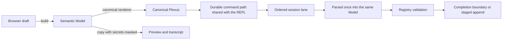
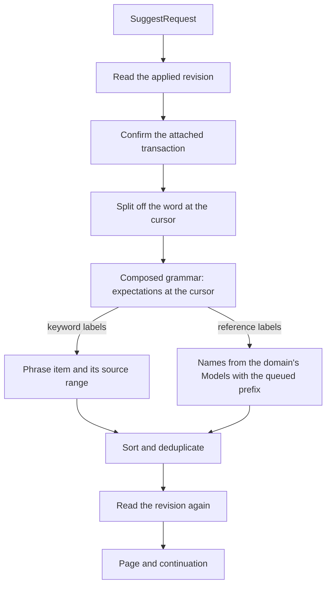
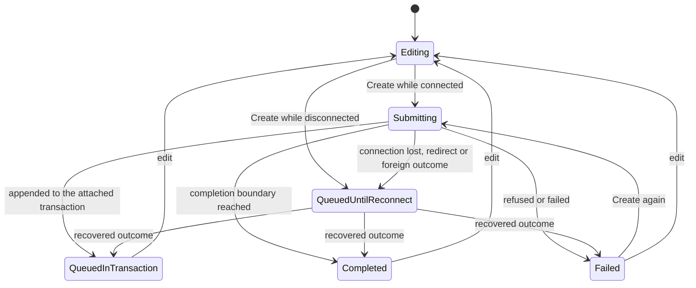

# Visual Creation And Shared Completion

*Plexus, the Nervix graph definition language.*

The web console creates every current Nervix entity from a form, and its forms, its REPL and the
command-line client all ask the session service what the configuration offers at the point being
edited. A form never assembles Plexus by hand and never sends a second representation: its completed
draft is the semantic Model the language would have parsed, rendered as canonical Plexus and
submitted through the durable command path the REPL uses. The server answers text completion from
the composed Plexus grammar and a form's typed choice lookups from typed questions. Both read the
same domain configuration with the session's queued transaction applied, and where they offer the
same thing they apply the rule registry validation applies.

This chapter explains how those parts fit together, what each one guarantees and where it stops,
how to extend them and which evidence qualifies them. It describes the system as it stands. The
following chapters own the contracts it connects:

| Contract | Owner |
| --- | --- |
| Each form's controls and optional clauses, and the creation coverage table | [Web Console](./client-tools-web-console.md#creating-entities-from-forms) |
| Suggestion and choice requests, their statuses, page cursors and transaction-aware resolution | [Sessions](./sessions.md#suggestions) and [Structured Choices](./sessions.md#structured-choices) |
| Lanes, the request window, cancellation, rejections and the console's request bounds | [Client Session Protocol](./client-session-protocol.md#two-lanes) and [Restoration And Bounded Consumers](./client-session-protocol.md#restoration-and-bounded-consumers) |
| What a client must do with choice lookups | [Client Implementation Manual](./client-implementation-manual.md#structured-choice-lookups) |
| Execution references, retained outcomes, retry and recovery | [Command Completion](./command-completion.md#lifecycle-and-ownership) |
| Transaction previews and the guarded `COMMIT` | [Transaction Quiescence](./transaction-quiescence.md#coherent-preview-and-guarded-commit) and [Inspecting a transaction](./client-tools-web-console.md#inspecting-a-transaction) |
| Statement heads, canonical rendering and adding a kind | [Architecture Overview](./architecture.md#statement-heads-and-body-properties) |
| Connector and entity declarations | [Connector Crates And The Connector Contract](./connector-contract.md#entity-declarations) |
| `LATEST` and version pinning | [Resource Versions And Bindings](./resource-versions.md#latest-resolution) |
| REPL completion keys and the CLI's local paths | [Command Line Client](./client-tools-cli.md#completion) |
| Error reports and their rendering | [Errors And Diagnostics](./errors-and-diagnostics.md) |

## Ownership By Layer

| Layer | Owner | Owns | Must not know |
| --- | --- | --- | --- |
| Vocabulary | `nervix-models` | Models and `ModelKind`; Models generic over the resource version they bind; canonical Plexus; connector and entity declarations; codec direction and the reference-admission rules; `SemanticReference`, the kind of value a completion position names | Parser labels, sessions, presentation |
| Language | `nervix-plexus` | The composed client statement grammar and the completion expectations it yields at a cursor; `parse_expression`, which reads one embedded expression; canonical rendering of session-local statements such as `CREATE SUBSCRIPTION` | Registries, sessions, browser state |
| Wire | `nervix-client-wire` | `SuggestRequest`, `SuggestOutcome`, `ChoiceLookupRequest`, `ChoiceOutcome`, the 66 `ChoiceTarget` values, `ChoiceValue`, `ChoicePresentation` and their page bounds | What a target means |
| Decisions | The registry | Folding queued statements into a domain's Models; placement-member eligibility | Sessions, transports, paging |
| Server edge | The session service | The concurrent lane that serves both requests; the text-completion resolver; the configured-choice resolver; page bases and cursors | Browser controls |
| Browser edge | `nervix-web-console` | Drafts, choice controls, previews and submission progress in its create dialog; the request window, connection generations, recovery and outcome routing in its session loop | Registry state, how the server resolves a choice |

The console depends on the vocabulary, the language and the wire crate directly. It does not use
the Rust client, whose `suggest` and `lookup_choices` reach the same requests from native code.

## From A Draft To A Command

### Drafts

The console keeps one draft for every family for the life of the page. Each of the nine processor
families keeps its own processor draft, and schemas, the three wire-schema formats and branches
share one structured draft set. Closing the dialog keeps the draft; nothing is written to browser
storage, so reloading the page starts every draft afresh.

A draft holds what the operator entered, not a half-built Model. Entered text stays text until the
draft builds: names parse through their vocabulary types, durations, counts and sizes through their
own parsers, and expressions as described below. A choice not yet made is absent. Where "none" is
itself a meaningful answer, the draft keeps an explicit unselected state beside it, so a relay is
never unbranched by omission and a route never takes a branch, inheritance, flush or error policy
it was not given. Parts that are already valid hold the vocabulary's own types: scalar types,
acknowledgement modes, placement policies, delivery behaviors, names and requested resource
versions.

A draft's `build` returns its Model, or the first missing or invalid choice in form order as the
draft's own typed error. The dialog lifts that error into its own, with the draft's report beneath
it, and shows its message inline. The form is `novalidate`, so the browser's constraint checks
never pre-empt the draft's validation, and the canonical preview stays empty until the draft builds.

A completed Model becomes a `CREATE` statement with its `IF NOT EXISTS` flag. Domains, users and
resources build their own statements, and a subscription builds the client statement
`CREATE SUBSCRIPTION`. The statement is rendered by the vocabulary's canonical renderer, and the
server parses that text once into the same Model and validates it exactly as it validates a typed
statement. The console therefore decides only whether a draft is complete and locally well-formed.
References, exact types, branches, sensitivity and graph contracts are decided by the registry when
the command runs, and their refusals return as the command's outcome.

### Expressions, Source Text And Order

Every expression field, whether a filter, a `WHERE` predicate, an assigned value, an invocation
argument, a key or ordering expression, a correlation condition or an inferencer input mapping, is
read by `parse_expression`, which lexes and parses its text exactly as a statement reads an
expression it embeds. The draft keeps the text, the Model receives the structured expression, and
canonical rendering writes it back. A picker that inserts a field reference appends that
reference's canonical spelling to the expression text, so an inserted `input.amount` or
`relay_state.prices.price` reads exactly as a typed one.

Source text that is a contract of its own stays verbatim: jaq programs in codecs and signaling
protocols, Roto source with its `test` blocks, which the form accepts up to 64 KiB, and connector
`CONFIG` values, which are passed through unchanged while their keys are trimmed. Ordered editors
keep their rows in a sequence and only swap or remove rows, so the order shown is the order the
Model holds and canonical Plexus writes: schema fields, routes and their assignments, invocations,
inputs, materialized dependencies, key and ordering expressions, handshake steps, UDF arguments,
emitter rows and placement members. Placement members keep their insertion order in an ordered map,
so a member appears once per side.

### Resource Versions And Secrets

A draft that binds a resource builds its Model at the requested version. `LATEST` remains a request
in the draft, the preview and the submitted command, and the server pins it to an exact version
when the statement applies. Version lists offer `LATEST` and completed uploads only.

Each submission carries two renderings. The query is the canonical text of the Model as built. The
presentation is the canonical text of a copy with its secrets replaced by `********`, and it is
what the preview, the REPL transcript and the form's outcome lines show. A user's password is always
masked. A client's `CONFIG` value is masked when the operator marked it secret, when its key
contains `password`, `secret`, `token`, `credential`, `private_key` or `dsn`, or when it is a URL
that carries a password. The connector declaration's inspection projection then also masks keys
the declaration marks confidential, addresses it treats as confidential, and pass-through keys it
does not declare publicly. The masked copy never reaches the session, and a form's command never
enters the REPL's command history. The query carries the actual values, as a typed statement would.

### Dispatch

Submitting hands the query, the captured domain and a new UUIDv7 execution reference to the
console's request queue as a command request tagged as a form's, so its outcome returns to the
form. It is the queue the REPL uses: the command takes the session's ordered lane behind earlier
commands, and after a redirect, a lost connection, an unknown outcome or a detached transaction it
is held whole and sent again under the same reference, as
[Command Completion](./command-completion.md#disconnects-deadlines-and-recovery) and
[Reconnecting A Session](./client-session-protocol.md#reconnecting-a-session) describe. While a
transaction is active, the request also carries the transaction's accepted-operation count as its
expected position, so a replay is an exact append check. A form never sends `COMMIT` and never
carries a preview identity; the transaction inspector supplies that basis for a typed `COMMIT`. A
subscription draft instead opens a tab through the session subscription path that a typed
`CREATE SUBSCRIPTION` uses.

## Families And Scope

### The Create Menu

`CreateKind` names what the console can create: the four statements outside the Model vocabulary,
`Domain`, `User`, `Resource` and `Subscription`, and one family for every `ModelKind`. The dialog's
dispatch over families, the drafts it builds, the references a scope change invalidates, the
controls a form asks about and the `IF NOT EXISTS` field are exhaustive matches over those types, so
a Model kind the vocabulary gains does not compile in the console until its form is decided. The
Create menu lists the 29 families in a fixed order. A unit test holds the menu to exactly the four
statements and every Model kind, each once with a distinct key, and checks that each family opens
its own titled form. Families with one shape share an editor: one structured editor serves schemas,
the three wire-schema formats and branches, and one processor form serves the nine processor
families, selecting its sections by processor family.

Contextual actions open the same forms: the **＋** beside the sidebar's schemas, wire schemas, which
first asks for the format, codecs, clients, VHOSTs and endpoints; the resource group's create
action; and the execution graph's **PLACE** and **SUBSCRIBE**. The graph actions name what the
operator wants, so they replace the family's retained draft: **PLACE** starts a corridor whose first
`FROM` member is the selected item, and **SUBSCRIBE** starts a subscription to the selected relay
under a newly generated name, `web_console_subscription_<n>`, whose number only grows. Closing the
dialog returns focus to the control that opened it.

### Captured Domains

A domain-owned family captures the console's selected domain the first time it opens and keeps that
scope for its draft. Domain and user creation are cluster scoped and capture nothing. When the
console has since selected another domain, the dialog offers **Use current domain**, which moves the
draft. A move invalidates every reference the draft selected in its old domain: each selection keeps
its name on screen, is marked as needing a new choice, and fails the draft's `build` until it is
selected again, so a name chosen in one domain never silently names an entity of another. Every
lookup a domain-owned form sends carries its captured domain as its first dependency; without a
captured domain a control asks nothing and names the missing scope.

## Text Completion

The REPL and the CLI send a `SuggestRequest`: the whole input, a cursor as a UTF-8 byte offset on a
character boundary, the selected domain, a page size from 1 through 100, and an optional
continuation. The console converts the browser's UTF-16 cursor to that offset, waits 50 milliseconds
for typing to settle, and asks for pages of 64. The session serves the request on its concurrent
lane from the session view the ordered lane last published, so a pending command never delays it.

Expectations come only from the composed client statement grammar. The server parses the input up
to the cursor with the half-typed word removed, and keeps the labels the parser expected at the
furthest point it reached, or the statement's tail when the input is complete. A keyword label
becomes a literal item. A composed keyword phrase, such as `WINDOW PROCESSOR` or
`KAFKA TOPIC INGESTOR`, is one item whose replacement range widens over phrase words already typed
on either side of the cursor. A reference label, `ref:<kind>`, becomes a reference to Models of that
kind, narrowed to the clients or endpoints that the ingestor head's declaration admits. Resource,
version, runtime-node, domain, subscription and field labels name their own references. An
expression position offers the built-in functions, the header reads or writes and the metadata
fields the selected entity declares, and the domain's `udf::` functions. A position where a new name
is typed offers nothing. A local-path position yields one local-directory item covering the quoted
path, which only the native CLI acts on; the console keeps text items only.

References resolve against the selected domain's Models as the serving node's registry holds them,
with the session's queued transaction folded in written order: a create adds a Model, a drop removes
it, and an alteration, a field rename included, applies to the Model it names and is skipped when
that Model is gone. Resources staged in the transaction are offered by name and have no versions
until an upload completes. A candidate is offered when its name starts with the word before the
cursor, compared in ASCII lower case. A reference that needs a domain gets `MissingContext`, with no
items at all, when the selected domain is absent or unknown. A session bound to a transaction of
another domain, or to a transaction it cannot confirm, gets `StaleContext`. A failed registry read
is `LookupFailed`.

Every item carries its display value, its kind and an exact text edit over the original input, which
clients apply as given: it replaces the whole word around the cursor and keeps the text after it.
Items are sorted by value and deduplicated. The server reads the applied revision before it
resolves and again before it answers, and a revision that moved answers `StaleContext` instead of
candidates. A continuation binds digests of the input, the cursor and the domain to that revision
and to the ordered candidate set, so a page never continues through a different set. The console
keeps one completion per input: a newer input replaces a waiting request, a reply is applied only
while it matches the input, cursor and domain the console recorded and that domain is still
selected, and **MORE SUGGESTIONS** appends a `Ready` continuation page.

## Typed Choices

A form never asks the grammar. Each control asks a typed question, a `ChoiceLookupRequest` carrying
one of 66 `ChoiceTarget` values, the typed selections the question depends on in a fixed order,
search text, a page size from 1 through 100 and an optional page cursor.
[Structured Choices](./sessions.md#structured-choices) is the contract for every target and its
dependencies; the targets fall into these groups:

| Group | Depends on | Targets |
| --- | --- | --- |
| Fixed variants | Nothing | Domain pace, placement policy |
| Domain catalogs | The domain | Schemas, each wire-schema format, branches, relays, codecs, VHOSTs, signaling protocols, resources, placement members |
| Entity references | The domain | One target for each of the 15 ingestor connector and entity pairs and each of the 21 emitter pairs, the Iceberg catalog, decoding codecs, encoding codecs |
| Record fields | The domain, then a relay, codec, branch or schema | Relay fields, codec output fields, branch key fields, schema fields |
| Compatible relays | The domain, and the branch or the relays already chosen where the question needs them | Ingestor relays with no branch or one branch, a processor's further inputs, output and state relays, an emitter's further inputs, state and error relays, a generator's materialized relay |
| Versions | The domain, then a resource | Completed versions and `LATEST` |

### Values And Presentation

A choice is a `ChoiceValue` and a `ChoicePresentation`. The value is what a control selects: a
domain-pace or placement-policy variant, a typed domain, resource or Model reference, a reference to
a field of the selected record, or a requested resource version as an explicit number or `LATEST`.
The presentation's label, detail and group are for display only. A relay or codec field's detail
states its exact type and its `OPTIONAL` and `SENSITIVE` flags, and a placement member's detail its
kind. The console selects by value and keys its buttons by label, and neither the console nor the
server derives behavior from a label.

### Resolution

The two fixed targets are answered from their variant lists. Every other target first passes its
dependency shape: the wrong number or kind of selections, or a domain that does not exist, is
`MissingContext`. The session's transaction binding is then confirmed as for text completion, which
answers `StaleContext` when it fails, and the domain's Models are read with the queued prefix folded
in by the same registry function, which answers `LookupFailed` when the read fails. The
configured-choice resolver then answers the typed question. It returns `MissingContext` when a
relay, codec, branch or schema the question names is no longer configured, and `LookupFailed` when
a definition the answer depends on cannot be resolved or rendered, such as a relay whose schema is
gone. As for suggestions, the applied revision is read before and after, and a revision that moved
answers `StaleContext`.

Models, placement members and resources are ordered by name, versions with `LATEST` first and then
ascending, and fields in their schema's declaration order. Search keeps the candidates whose label
contains the search text, compared in lower case; the two fixed targets also search their detail.

A page cursor binds the applied revision, where the page ended, a digest of the question (the
target, the search text and every dependency) and a digest of the candidates: their values and
presentation together with the canonical definitions of the matching Models. A change made inside
the attached transaction therefore invalidates a cursor even when names and counts stay the same.
Client definitions enter that digest in their public rendering, with secrets redacted. The digests
are BLAKE3, a non-security use that the
[classification register](./cryptography.md#classification-register) records. A cursor that no
longer matches answers `StaleContext`.

### Shared Rules

Text completion and typed choices are answered by two resolvers: one over the semantic references
the grammar's positions name, and one over the typed questions forms ask. Both start from the same
input, the domain's Models with the queued prefix folded in by one registry function, and where both
offer the same thing they apply the rule registry validation applies:

| Rule | Owner | Applied by |
| --- | --- | --- |
| Which runtime nodes a placement rule may name | The registry's placement-member rule | Validation, REPL completion, the placement-member target |
| Which clients or endpoints an ingestor entity reads through | `IngestorReferenceKind::admits`, over the entity declaration | REPL completion, the ingestor-reference targets; validation reads the same declaration |
| Which clients an emitter entity publishes through | `EmitterReferenceKind::admits_client` | The emitter-reference targets, validation |
| Whether a codec decodes or encodes | The codec format's `supports_decoding` and `supports_encoding` | The decoding- and encoding-codec targets, validation |
| Whether an entity reads or writes headers | The entity declaration's header capability | REPL expression completion, validation |

Two differences remain where the paths share no rule. The grammar names every codec reference with
one label, so REPL completion offers each codec of the domain after `DECODE USING` and
`ENCODE USING` alike, while the forms offer only codecs with the direction the clause needs.
Validation refuses a codec without that direction either way. The compatible-relay targets, which
require a further input's exact schema and branch, also have no REPL counterpart: text completion
offers every relay where the grammar expects one. In both cases the command's validation decides.

## Requests In The Console

### One Latest Request Per Control

The dialog keeps search text and a load state for each of its 72 choice controls, and the session
loop keeps the latest lookup of each control. A new lookup for a control replaces its waiting one.
A lookup already sent is superseded instead: its reply is no longer routed to the form, its text and
any partial reply are released at once, and it keeps its place in the session's request window until
its final part arrives. The console never sends `CancelRequest` for a lookup.

### Fencing Late Replies

Each lookup carries its control, the dialog's draft revision and the connection generation. The
draft revision is one counter for the whole dialog, advanced when the dialog opens or closes, by
every edit and selection, by a keystroke in any control's search and by a scope change. The
connection generation advances each time the console's WebSocket opens. A reply fills its control
only while the open form uses that control, the revision is the one the lookup was issued under and
the generation is current. A domain move is fenced by the revision it advances, and the domain is
the lookup's first dependency, so a reply about another domain cannot fill a control.

### Asking Again

One effect watches the open family, the draft revision, the connection generation and the
connection state. Whenever one of them changes, it asks every control the open form currently uses
for a fresh first page, so each list answers the draft as it now stands; while the console is
disconnected, it marks those controls waiting instead. A control whose prerequisite is missing, such
as a version list before a resource is selected, records why and sends nothing. Selecting an
upstream value invalidates what depends on it, such as a resource's version, a codec's key and
timestamp fields, a branch's relays, or a relay's state and route choices, and the edit that follows
asks again. Forms therefore need no restoration across connections: lookups waiting on a connection
end with it, and the open form asks again under the new generation once the new connection is ready.

### What A Control Shows

| State | Cause | Shown |
| --- | --- | --- |
| Waiting | The console is not connected | "Waiting for connection" |
| Loading | A first page is in flight | "Loading choices" |
| Ready | `Ready` with values | The choices, and **Load more** while the reply carried a cursor, which appends the next page |
| Empty | `Ready` with no values on a first page | "No choices" |
| Missing prerequisite | The draft lacks a dependency, or the reply was `MissingContext` | A neutral hint about what to choose first |
| Stale context | `StaleContext` | A neutral message and **Retry**, which asks for a fresh first page |
| Failed | `LookupFailed`, an unavailable session, a request the console's bounds refused, or a rejected or cancelled request | An alert |

A reply the console cannot decode or reassemble, or a reply of another kind, is not shown on a
control. It ends the session as a protocol violation, which the REPL reports, and the control waits
and asks again on the next connection.

### Bounds

Lookups share the session's 64-place request window with every other request. While the console
waits for a connection, its controls hold at most 64 requests carrying 4 MiB of text; once
connected, at most 256 outstanding requests carrying 16 MiB. Connection setup and reattachment go
first, and other waiting work keeps its issue order, so a stream of lookups cannot overtake an
earlier command. [Restoration And Bounded
Consumers](./client-session-protocol.md#restoration-and-bounded-consumers) owns these bounds. A
form's page size is fixed by its question: 2 for domain pace, 20 for a question that depends on the
domain alone and for an ingestor route's relays, and 100 for placement policies, fields and the
other dependent lists.

The dialog's event handlers and effects belong to its components and end when the dialog unmounts.
The dialog owns no timers or listeners of its own and keeps no browser callback alive past its
owner.

## Submission And Recovery

Each submission is an attempt identified by its number and the draft revision it was built from.
The form applies an outcome only to its active attempt. While that attempt is submitting or queued
until reconnect, the form's fields and its choice controls are disabled, a choice control's search,
choices, **Load more** and **Retry** included. A selection is an edit of the draft, and a search,
though it is no draft content, asks again by advancing the draft revision, so neither can run until
the attempt has its outcome. The draft therefore stays the one the attempt was built from, and the
form reports that attempt's own outcome. Once the attempt is queued in a transaction, completed or
failed, the controls are live again. An edit then returns the form to **Editing** and drops the
attempt, so a late outcome of a superseded attempt changes nothing in the form while the transcript
still reports it. Create is refused, by the disabled button and by the submit handler itself, while
the attempt is submitting, waiting for reconnection, queued in a transaction or completed. Within
the open form, only an edit or a failure allows another attempt, so a repeated click cannot submit
the same draft twice.

An outcome that admits the command into the attached transaction shows **Queued in transaction**
with its position, and a staged create is never shown as applied. **Completed** appears only for a
command that reached its completion boundary. Any other outcome shows **Failed** with the server's
message, and the draft stays as it was for correction. After a lost connection, a leader redirect,
or a reply that names another command's execution reference, the form shows **Queued until
reconnect** until the same command, sent again under its own reference, returns its outcome. A
completed domain becomes the selected domain. A completed resource selects itself and opens its
version dialog through `DESCRIBE RESOURCE`, where uploads keep their own identity and completion.

A staged create enters the session's transaction prefix, so the next form's lookups offer it at
once. A whole graph can be staged form by form and committed once the inspector has supplied the
commit basis, and the attached transaction and its staged creates survive the console following a
new leader.

## Guarantees And Limits

The system guarantees that:

- A form submits the Model the language would have parsed. The server parses the canonical text
  once and validates it as it validates a typed statement; no form-specific statement, second
  Model or whole-statement text box exists.
- What a form previews is what it sends, except that the preview and transcript mask secrets
  the command carries. Every semantically significant order a form shows is the order the Model
  keeps.
- `LATEST` stays a request until the server applies the statement.
- Controls select typed values, and no label selects behavior.
- A reply to an older draft revision, an earlier connection or a superseded lookup never fills a
  control. A page cursor never continues through a different candidate set, and a revision that
  moved during a lookup answers `StaleContext` instead of candidates.
- Suggestions and lookups are read-only: they are never admitted, never enter a transaction and
  run beside a pending command.
- A form's command keeps one execution reference through redirects, reconnects and unknown
  outcomes, and is never sent again under a new identity.
- Every page is bounded by its page size, and every console request by the session's request
  window and the console's outstanding limits.

It does not guarantee more than that:

- A suggestion or choice describes the configuration as the serving node's registry held it when
  the lookup ran. It decides nothing; the command's validation, against the configuration current
  when the command runs, decides.
- Search text and dependency lists have no bound of their own beyond the session's string,
  collection and frame limits.
- Drafts live only in the page, so a reload discards them.
- A reingestor route whose branch action preserves the incoming branch builds a route without a
  branch clause, which the route grammar refuses, so that form's command fails when the server
  parses it. An explicit `UNBRANCHED` or `BRANCHED BY` choice builds an executable route.
- REPL completion and the forms differ where they share no rule: codec references in the REPL are
  not filtered by direction, and the forms' compatible-relay targets have no REPL counterpart.
- Reopening the dialog while its attempt is pending returns the form to **Editing** and enables
  **Create**, so a retained draft can be submitted again before its first attempt answers.
- **Use current domain** stays enabled while an attempt is pending, and using it moves the draft
  and drops the attempt.
- Text completion offers only what the grammar names at the cursor, so a position that introduces a
  new name offers nothing.
- The console uses choice lookups; among the client libraries, the Rust client exposes them, while
  the host bindings expose suggestions only.

## Failure Handling

| Failure | Decided by | What the operator sees | What remains |
| --- | --- | --- | --- |
| An incomplete or invalid draft | The draft's `build` | The first missing or invalid choice, inline | The draft; nothing was sent |
| A reference chosen in another domain | The draft | The selection marked for a new choice | Its name, until it is selected again |
| A refused command: parsing, validation or policy | The server | **Failed** with the server's message, also in the transcript | The draft, for correction |
| A lost connection, redirect or unknown outcome | The console's command path | **Queued until reconnect** | The same command and execution reference, sent again |
| An expired execution reference | The server's retry fence | **Failed** with the expiry | Nothing is applied again |
| A stale page or a moved revision | The server | A neutral message and **Retry** | The draft; **Retry** asks for a fresh first page |
| A lookup that could not run | The server, or the console's bounds | An alert on the control | The draft |
| An unreadable reply, or one of another kind | The console | A protocol violation in the REPL, then reconnection | Every unanswered command, sent again under its reference |

## Extending The System

### Adding A Creation Family

1. Add the kind to the vocabulary, the grammar and the canonical renderer as
   [Adding a kind](./architecture.md#adding-a-kind) describes. The console then stops compiling at
   each exhaustive match over Model kinds and creation families.
2. Add the family to the Create menu with its label and menu entry; the creation matrix test holds
   the menu complete.
3. Write its draft. Keep entered text as text and parse it in `build` through the vocabulary's
   types, keep an unmade choice absent, and give a meaningful "none" its own unselected state. Reuse
   vocabulary types for valid parts. Return the Model, or the first missing or invalid choice as the
   draft's own typed error, which the dialog lifts with its report beneath it. Read expressions with
   `parse_expression`, keep contract source text verbatim, keep ordered editors in Model order, and
   bind resources at their requested version.
4. Hold selected references so that a change of captured domain or of an upstream selection
   invalidates them while keeping their names visible.
5. Build a masked presentation Model when the kind carries a secret.
6. Return each editor, and each large section of one, erased at its component boundary. The dialog
   renders every form in one view, and an editor that returned its concrete view would spell its
   whole nested view type into the debug names of every generic that encloses it, which the linker
   merges, and into each frame of an unoptimized render. The render stack test runs the dialog's
   render tests with three quarters of a test thread's default stack, and
   `just measure-web-console-debug-strings` reports each codegen unit's debug strings.
7. Register a Bolero property that the draft rebuilds every complete Model it can express and that
   its canonical text reads back to that Model, add public browser scenarios on one and three nodes,
   and update the manual's [Creation Coverage](./client-tools-web-console.md#creation-coverage).

### Adding A Choice Target

1. Add the target to the session schema and the wire crate. The wire contract changes, so
   regenerate the conformance corpus and advance the affected Bolero domains; the protocol keeps
   [one current form](./client-session-protocol.md#one-current-form).
2. On the server, validate the target's dependency shape and build its typed question, then answer
   it in the configured-choice resolver with the rule validation applies, never a second copy of it.
   Include every definition the answer depends on in the content digest, and answer
   `MissingContext` for a missing dependency and `LookupFailed` for a definition that cannot be
   resolved or rendered.
3. In the console, add a choice control with its form, its signals, its question and page size and
   its place in the open form's control list, and invalidate it from its upstream selections.
4. Where the same context exists in typed Plexus, give the grammar position a label that resolves
   through the same rule.
5. Update [Structured Choices](./sessions.md#structured-choices), the protocol's summary and the
   implementation manual's requirements.

### Adding A Completion Position

Completion follows the grammar, so a new position needs only the right label: `ref:<kind>` for a
reference to a Model, a name label where a new name is typed, which offers nothing, and keyword
phrases composed from the shared token definition so that completion offers each as one item. The
[statement-head contract](./architecture.md#statement-heads-and-body-properties) owns the head and
body rules, and the completion walk must stay clean.

## Evidence

### Beside The Code

- `just test-web-console` runs the console's unit tests. The creation matrix test holds the menu to
  every family. The dialog tests cover canonical queries and masked passwords, discarding replies
  for an older draft revision or connection, progress changing only for the active attempt, choice
  controls disabled while an attempt is pending, scope changes invalidating references, generated
  subscription names and an accessible render. The visual form tests cover the forms' controls,
  choices and submissions, secret masking and the graph's **PLACE** action, and the emitter and
  processor tests cover their forms and Models. The session loop's tests cover superseded lookups,
  the request window and reply kinds.
- `just test-placement-members` runs the server's tests of the placement-member rule across
  validation, REPL completion and typed choices, with the configured-choice resolver's tests.
- `just plexus-completion-walk` fails on any completion branch that accepting the parser's own
  suggestions cannot complete, and `just plexus-completion-walk-deep` searches further and reports.
  The walk drives the parser directly, not the session.

### Representations

These registered Bolero properties qualify the drafts and the wire messages. The [target
register](./property-testing-and-fuzzing.md#target-and-representation-register) records their
domains and bounds.

| Target | Property |
| --- | --- |
| `console-client-drafts` | Client drafts rebuild every complete client, and both the submitted and the masked Model render their connector head and read back |
| `console-codec-drafts` | Codec drafts rebuild every complete codec under its family head |
| `console-endpoint-drafts` | Endpoint drafts rebuild the complete Model, and its canonical text reads back |
| `console-placement-drafts` | Placement drafts rebuild every complete rule, and its canonical text reads back |
| `console-ingestor-source-drafts` | The ingestor source draft rebuilds every declared entity's configuration |
| `console-emitter-drafts` | Emitter drafts rebuild every complete entity |
| `console-processor-drafts` | Processor drafts rebuild every complete Model of the nine processor families |
| `client-requests`, `client-replies` | Suggestion and choice requests and outcomes keep their complete values through the wire codec |
| `client-processor-choice-request` | A processor's choice request keeps its target and dependencies through the wire codec |

The wire crate's tests check that the checked-in conformance corpus, which holds suggestion and
choice requests and outcomes with every `ChoiceValue` member, is exactly what its encoder writes and
reads, and the Go and Node probes reproduce the corpus report in the client conformance scenarios.

### Public Scenarios

- The fifteen `tests/features/web-console/visual_create*.feature` files hold 66 scenarios and 41
  outlines. Every outline but the schema type matrix runs on one and three nodes.
  `visual_create_graph.feature` builds a complete graph in one transaction on three nodes,
  `visual_create_initial_choices.feature` covers forms opened before the console's first domain
  publication, and `visual_create.feature` holds a create's reply back while its choice controls
  are used.
- `connector_presentation.feature` checks that visual connector choices follow the entity
  declarations, on one and three nodes.
- `plexus_repl.feature` covers REPL completion, connector completion and a full request window.
  `runtime/session_protocol.feature` pages semantic completion through every domain and covers the
  rejection of a cursor inside a character and of page sizes 0 and 101, and
  `tools/cli_session.feature` and the connector declaration features cover CLI and connector
  completion.
- `just test-visual-create`, `just test-visual-window-correlator`,
  `just test-visual-generator-inferencer-wasm` and `just test-visual-placement-graph` run their
  feature files with the server's prerequisites; the other files run through
  `just test-scenarios --input <feature>`. `just coverage-visual-create` measures the Model,
  language, wire, browser and server owners together.

### Test Policy

Public browser behavior is tested through the web-console suite's browser-facing steps, never by
bypassing the browser flow, while the console's unit tests check its owners beside the code.
Grammar completion keeps its parser and completion-context tests beside the grammar and the
completion walk, which runs in CI for a pull request labeled `extra-completion-walk`. Parser
rejections stay parser tests and browser refusals public scenarios.

Registered properties run in Bolero's randomized and corpus mode through `just test-bolero`, in CI
for a pull request labeled `bolero-random`, and in every manual run of the Bolero workflow.
Sanitizer campaigns run through `just fuzz`, and the `fuzz` label enables no CI execution under the
temporary policy that [CI labels](./developing-nervix.md#ci-labels) records. The system's Rust APIs
carry no `compile_fail` doctests today. A restriction one of them enforces at compile time is
checked by a paired `compile_fail` doctest beside the API, as
[Capability doctests](./developing-nervix.md#capability-doctests) describes, never by a separate
harness.

### What The Evidence Does Not Cover

- The conformance corpus holds 2 of the 66 choice targets, `Ready` outcomes only, and no
  local-directory suggestion.
- No property generates suggestion or choice page cursors or drives the server's paging.
- No scenario sends a choice lookup through a session outside the browser forms.
- The completion walk exercises the parser, not `SuggestRequest` or its paging.
